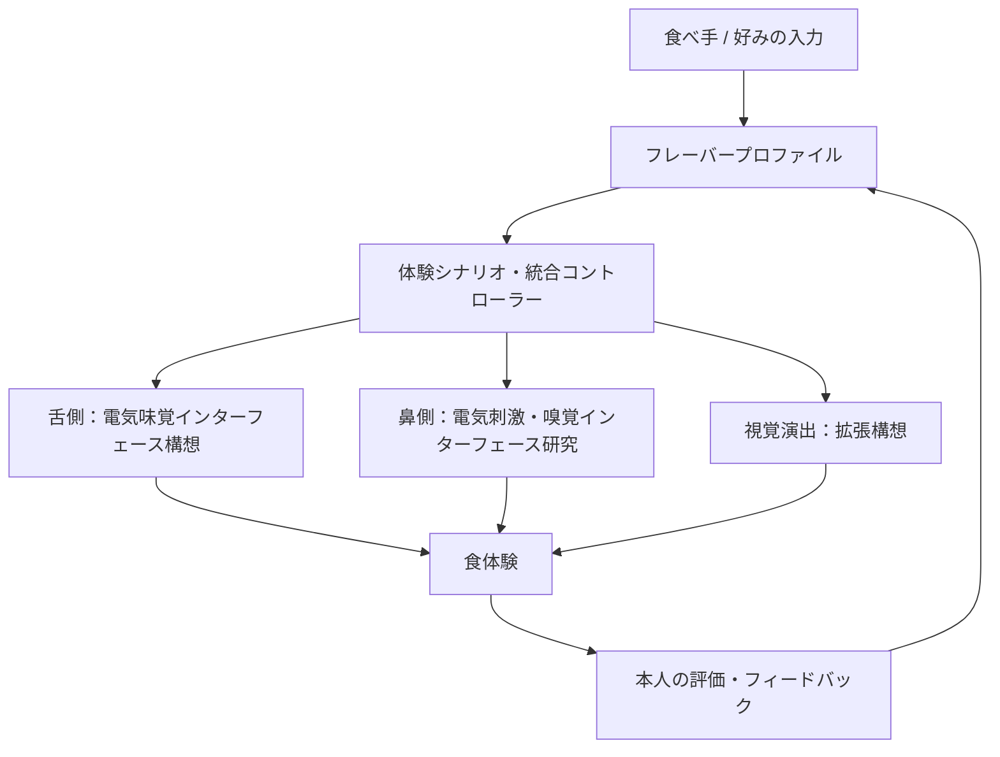

# FLAVOR SHIFT（仮称）— 食べるものはそのまま、味わいを自分に合わせる。

> **Taste × Smell × Electrical Stimulation**  
> 舌への電気味覚と、鼻への電気刺激を用いた嗅覚インターフェースを探り、**「食べ物を変える」のではなく「食べる人が感じる味わいを調整する」**ことを目指す、パーソナルな食体験のプロダクト構想。


> **ステータス：企画候補。未開発・未実証・チーム未決定。**  
> 以下に記す刺激デバイスや味わいの変化は、目指す仕組みと検証仮説を含みます。現在実現した機能ではありません。

---

## 目次

- [製品概要](#製品概要)
- [背景](#背景)
- [製品説明](#製品説明)
- [利用シーン](#利用シーン)
- [システム構成](#システム構成)
- [特長](#特長)
- [解決できること](#解決できること)
- [MVP・Hack Dayで目指すこと](#mvphack-dayで目指すこと)
- [開発技術](#開発技術)
- [既存技術との違い](#既存技術との違い)
- [今後の展望](#今後の展望)
- [参考資料](#参考資料)

---

## 製品概要

### コンセプト

**「同じ一皿でも、おいしさは一人ひとり違う。」**

苦手な味がある人と、好きな味がある人。いつもと味の感じ方が違う人。食事の好みや制限が異なる人。

同じ料理を食べても、その体験は同じとは限りません。しかし一般的には、食べる人に合わせるために料理そのものの味付けを変える必要があります。

**FLAVOR SHIFT** は、食べ物の成分だけに手を加えるのではなく、**味覚・嗅覚への働きかけを組み合わせて、食べ手が知覚する「風味」をパーソナライズする**ことを目指します。

中心となる発想は、次の2つです。

1. **舌への電気刺激**：食品の味わいの一部を変化させる「電気味覚」を、食事の感じ方の調整に応用する。
2. **鼻への電気刺激**：嗅覚に関連する感覚を電気的に扱う技術を探索し、味覚だけでは届かない「香りを含む風味」の体験へ広げる。

将来的には、視覚情報との組み合わせも検討します。

## 背景

### 1. おいしさは、舌だけでは決まらない

食事を楽しむとき、私たちは舌で感じる基本味だけでなく、鼻で感じる香り、食感、温度、見た目などを組み合わせて「風味」を知覚します。

そのため、**味覚だけを変えても、食べたいと感じる体験を十分に変えられるとは限りません。** 反対に、嗅覚だけに着目しても、塩味・うま味などの感じ方は残ります。

この2つを別々ではなく、ひとつの食体験として設計できないかと考えました。

### 2. 食べ物を変える以外の選択肢がほしい

例えば、同じ料理を囲む人同士で好みが違うと、味付けを分けたり、別の料理を選んだりすることがあります。

また、栄養面では食べたいと思っても、特定の香りや味が苦手で食が進まないこともあります。

**料理を大きく作り変えることなく、食べる人の側で感じ方を調整できたらどうなるか。**

これが本プロダクトの出発点です。

### 3. 電気味覚はすでに現実の技術になっている

電気味覚の研究・製品化例として、キリンの「エレキソルト」があります。これは食品の塩味・うま味の感じ方を増強する食器であり、「電気を使って食事の味わいに働きかける」という発想は実在します。

一方、それは**舌への電気刺激だけで好きな味を無制限に生成できる**ことを意味しません。鼻への電気刺激についても、任意の香りを自由に作れることが実証されたわけではありません。

FLAVOR SHIFTが挑戦するのは、それぞれの研究の到達点を踏まえた**味覚と嗅覚を横断する体験設計**です。

## 製品説明

> **同じ食べ物。違う味わい。自分で選べる食体験。**

想定する完成形では、食事を始める前にアプリから「どのように感じたいか」を選び、味覚・嗅覚インターフェースの動作を連携させます。

### 主要機能（構想）

| 機能 | 内容 |
|:--|:--|
| **パーソナル・フレーバープロファイル** | 自分が感じたい味わいの方向を選択・保存する |
| **電気味覚インターフェース** | 舌側の刺激技術を用いて食品の味の知覚に働きかけることを検討 |
| **電気嗅覚インターフェース** | 鼻側の電気刺激と嗅覚関連の知覚・提示技術を研究対象として統合 |
| **味覚と嗅覚の連携制御** | ひとつの体験シナリオとして、両インターフェースを同期・管理 |
| **食体験のフィードバック** | 食べ手が感じた変化や好みを記録して次の体験設計に反映 |
| **視覚的な風味演出** | 色・映像・食べ物の見え方と風味の関係を探る拡張機能 |

### 体験の流れ（目指す完成形）

```text
① 同じ料理を用意する
       ↓
② アプリで自分の「味わいの好み」を選ぶ
       ↓
③ 味覚・嗅覚インターフェースが連携する
       ↓
④ 食事中に、感じ方の変化を体験する
       ↓
⑤ 「どう感じたか」を記録して次の体験に生かす
```

※③〜④のうち、とくに鼻の電気刺激によって特定の香りを再現する部分は**未実証の研究目標**です。現時点で完成・動作を保証するものではありません。

## 利用シーン

### Scene 01：同じ料理を、違う好みの人と楽しむ

ある人はあっさりした味が好きで、別の人は濃い味が好き。

料理を二種類作る代わりに、一人ひとりが**「自分の好きな感じ方」に近づける**。一緒に食卓を囲むための、新しい選択肢を目指します。

### Scene 02：苦手な風味への向き合い方を変える

栄養のために食べたい食材でも、特定の匂いや味が苦手なことがあります。

食材自体の価値を変えるのではなく、**感じる風味の一部を調整する**ことで、食べることへの抵抗感を減らせないか検証します。

### Scene 03：「味わい」をデザインする創作体験

同じ食材から、ある人はすっきりした印象を、ある人は強いうま味を感じるような体験を構想します。

料理人や体験デザイナーが**食材に加え、知覚そのものを演出対象にする**新しい表現方法へ発展させます。

## システム構成

### コンセプトアーキテクチャ



### システムの役割

| コンポーネント | 想定する役割 | 現在の位置づけ |
|:--|:--|:--|
| **Webアプリ** | 好み・体験モードの選択、体験中の状態表示 | Hack Dayでの実装候補 |
| **フレーバープロファイル** | 個人ごとの希望・評価の記録 | Hack Dayでの実装候補 |
| **体験制御エンジン** | 味覚・嗅覚の提示シナリオを時間軸で管理 | Hack Dayでの実装候補 |
| **舌側インターフェース** | 既存の電気味覚研究を踏まえた知覚調整 | 技術検証・研究段階 |
| **鼻側インターフェース** | 電気刺激による嗅覚関連の感覚提示を探索 | 技術検証・研究段階 |
| **フィードバック画面** | 本人の主観評価を比較・記録 | Hack Dayでの実装候補 |

**実験的な刺激インターフェース**と、**体験を設計するソフトウェア**は分けて開発する想定です。初期のデモは、実際の知覚変化が未検証でもシナリオ制御とユーザー体験の流れを示せるように構成します。

## 特長

### 1. 味覚と嗅覚を、一つの「おいしさ」として扱う

電気味覚だけ、香りだけではなく、両者の関係を食体験全体の設計課題として扱います。

### 2. 「食べ物」ではなく「食べる人」に合わせる

同じ一皿でも、人によって違う体験を選べる世界を目指します。万人に同じ味を押し付けるのではなく、本人の好みを中心にします。

### 3. 味付けの自動化ではなく、食体験のパーソナライズ

既存の調味技術と競うだけではなく、食事をともにする人の違いや、その日の感じ方まで含めて設計します。

### 4. 未来のハードウェアと、いま作れる体験設計を分離する

研究段階の電気刺激デバイスを完成品として扱わず、プロファイル・シナリオ・評価というソフトウェア層を独立して構築します。

## 解決できること（価値仮説）

- 同じ料理を食べる人の好みの違いに、新しい調整手段を提案できる。
- 苦手な風味がある食品を、より前向きに楽しむ選択肢を検討できる。
- その日の感じ方に合わせて、食体験をパーソナライズする発想を試せる。
- 調理者と食べ手の「おいしい」の違いを、共有・比較するための情報を蓄積できる。

これらは**達成済みの効果ではなく、検証したい体験価値**です。

## MVP・Hack Dayで目指すこと

### 最小プロトタイプ

まずは、**複数人が同じ料理に対して異なるフレーバープロファイルを選び、仮想の味覚・嗅覚インターフェースがどう連携するかを可視化できるWebアプリ**を目指します。

- [ ] 食べる人を選ぶ・追加する
- [ ] 苦手な風味・好みの方向を登録する
- [ ] 同じ食材に対する個別の体験シナリオを生成する
- [ ] 舌側／鼻側の出力状態を画面上で切り替える
- [ ] 食体験の前後を比較できるUIを表示する
- [ ] 評価を記録し、別プロファイルと比較する

ここで表示する「知覚の変化」は**デモ用のシミュレーション**であり、鼻や舌で同じ変化が実際に生じた証拠ではありません。

### 90秒デモ構成（案）

1. **0〜15秒：課題** — 同じ料理でも、人によって好みが違う。
2. **15〜35秒：プロファイル** — 3人がそれぞれ希望する味わいを選ぶ。
3. **35〜65秒：体験** — 同じ料理に対し、舌側・鼻側の制御シナリオが変わる様子を表示する。
4. **65〜80秒：違い** — 同じ食べ物でも、設計された体験が人によって異なることを比較する。
5. **80〜90秒：未来** — 味覚と嗅覚を一体に扱うフレーバーインターフェースという構想を示す。

**注力すること**は、単なるスライダー操作で終わらず、**どんな人の、どんな食事が、どのように変わるのか**を一つのストーリーとして見せることです。

## 開発技術

### 活用予定の技術

| 分野 | 技術候補 | 用途 |
|:--|:--|:--|
| フロントエンド | React / TypeScript | 体験の操作画面 |
| UI・可視化 | SVG / Canvas / Web Animations | フレーバープロファイルと状態の表示 |
| データ | JSON / ローカル保存 | 好み・シナリオ・本人評価 |
| アプリロジック | TypeScript | 体験シナリオと状態遷移 |
| 電気味覚 | 先行研究・市販製品の公開仕様の調査 | 舌側インターフェースの仕様検討 |
| 嗅覚関連インターフェース | 鼻腔電気刺激・嗅覚代替技術の論文調査 | 鼻側インターフェースの仕様検討 |

### 独自に設計したい仕組み

1. **個人の希望を表すフレーバープロファイル** — 食材・好み・食事場面を一つの体験データにする。
2. **味覚・嗅覚を横断するシナリオ** — 二つの感覚系を、別々のデモではなく一つの体験として設計する。
3. **食べ手のフィードバックを受け取る仕組み** — 提示内容の決定を一方的に自動化せず、本人の感じ方を中心に更新する。

## 既存技術との違い

| 先行例 | 確認されていること | FLAVOR SHIFTが検討する方向 |
|:--|:--|:--|
| **キリン「エレキソルト」** | 電気の力で減塩食品の塩味・うま味の感じ方を増強する食器が製品化されている | 減塩支援という特定用途だけでなく、食べ手ごとのフレーバー設計へ |
| **電気味覚研究** | 使う食品や刺激条件に依存した味覚変化を検討する研究がある | 味覚変化を単独で示すのではなく、嗅覚と食体験の設計につなぐ |
| **鼻腔電気刺激を用いた嗅覚代替研究** | 特定の装置により匂いに関連する外界情報の検出・識別を補助した研究例がある。一方、研究は実際の香りを自由に嗅がせる技術ではない | 鼻側でどの感覚を提示できるのかを研究し、味覚との統合可能性を探る |
| **香りを提示する既存の嗅覚ディスプレイ** | 香料などを使って所定の香りを提示する方式がある | 化学的な香料提示とは異なる電気刺激の可能性を追究する |

**「鼻と舌に電気を流せば好きな味を自由に作れる」という効果は、現時点では確認できていません。** そのため、製品としての価値と実証すべき技術要素を区別して検討します。

## 今後の展望

### Phase 1 — 体験のデザイン

実際の食事の困りごとと「どう感じたいか」の希望を集め、味覚・嗅覚を統合するソフトウェアを検証します。

### Phase 2 — 感覚インターフェースの検証

電気味覚の既存技術を調査し、鼻腔への電気刺激研究についても、再現できる感覚・知覚の範囲を明確にします。

### Phase 3 — パーソナル・フレーバー体験

本人の希望と感想に応じて、料理を変えずに感じ方を変える体験を研究します。

### Phase 4 — 食卓から広がる体験

食事だけでなく、映像・ゲーム・遠隔コミュニケーションに「風味」を取り込む可能性を検討します。

## 参考資料

- [キリンホールディングス — エレキソルト スプーン／カップ（2025年）](https://www.kirinholdings.com/jp/newsroom/release/2025/0909_01.html)
- [Substitution of human olfaction by the trigeminal system — 鼻腔内電気刺激による嗅覚代替研究（2025年）](https://pmc.ncbi.nlm.nih.gov/articles/PMC12652247/)
- [Devices for the electrical stimulation of the olfactory system: A review（2025年）](https://pubmed.ncbi.nlm.nih.gov/39729754/)
- [JPHACKS2025 kz_2504 / 4DX@HOME README — 構成の参考](https://github.com/jphacks/kz_2504/blob/main/README.md)

---

<div align="center">

### **同じ一皿に、ひとりひとりの「おいしい」を。**

**FLAVOR SHIFT（仮称）**

*JPHACKS2026 企画候補 — コンセプトREADME*

</div>
