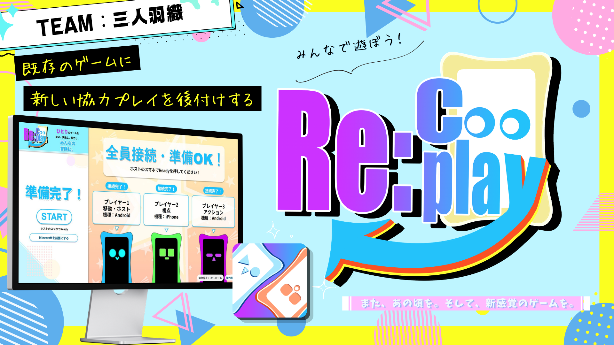
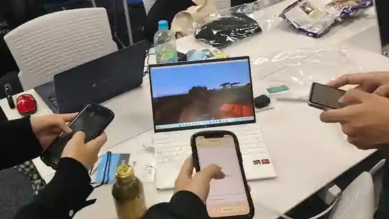
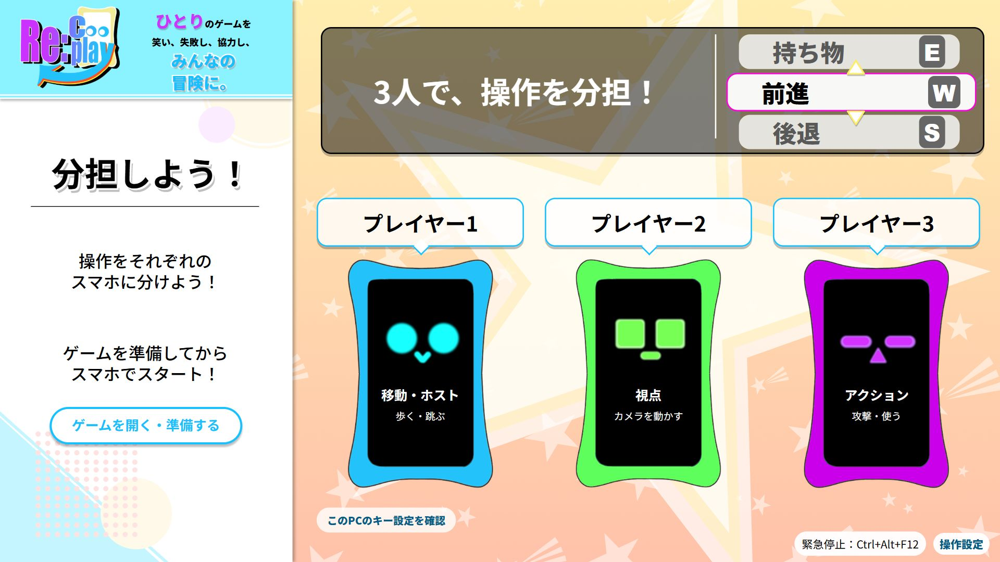
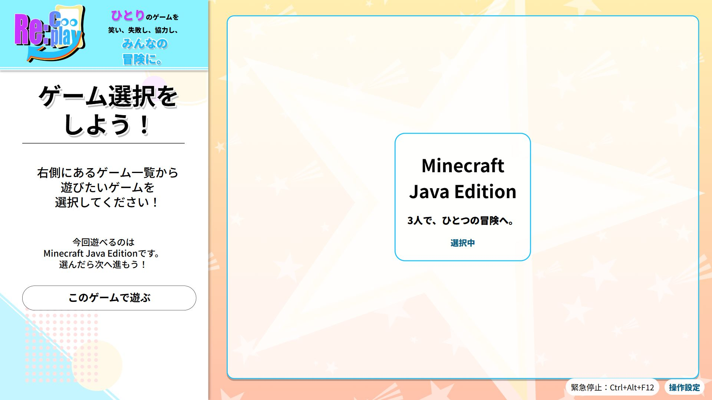
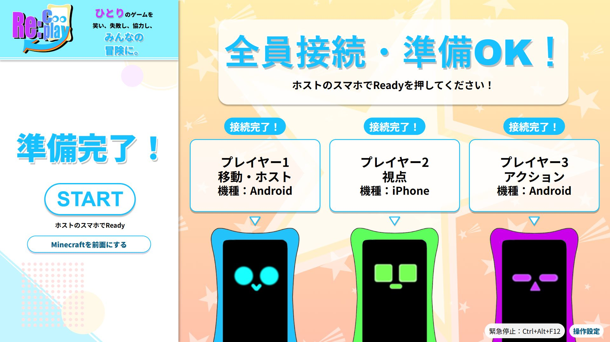
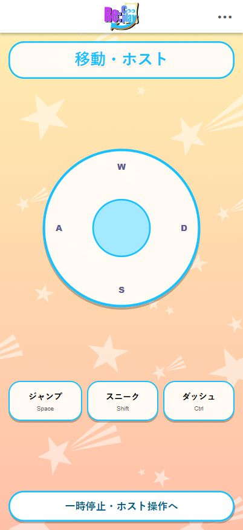
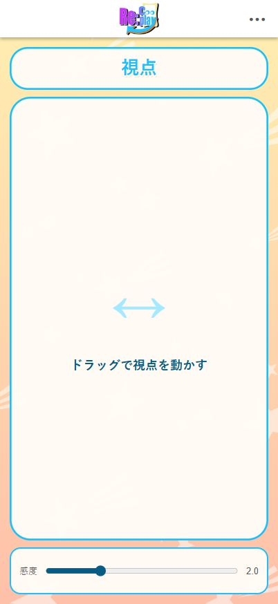
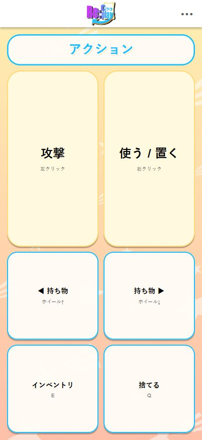
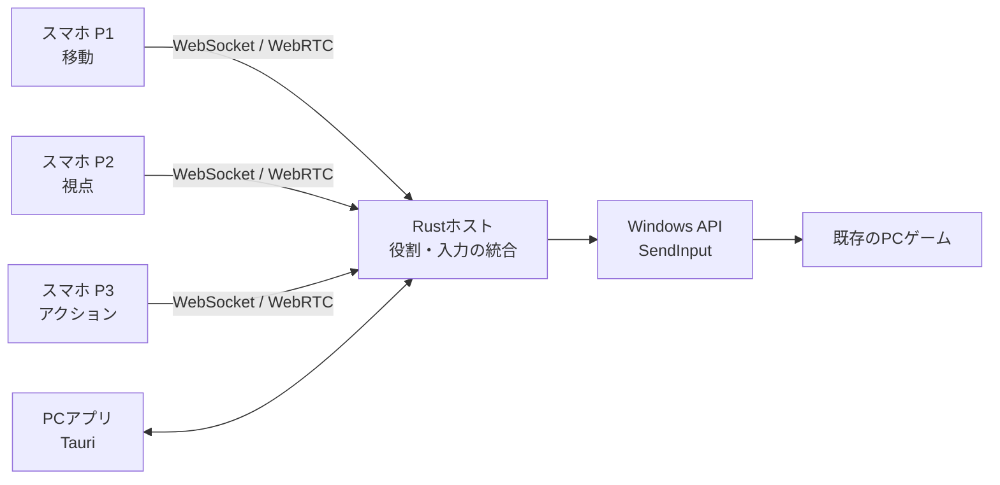

# Re:Cooplay（リコープレイ）— ゲームはそのまま。遊び方を変える。

  

  

    
  

  
🎉 <strong>JPHACKS 2026 Hack Day（金沢会場）</strong> 🎉

  
🏆 <strong>「Hack Day Audience Award」受賞</strong> 🏆

  
<strong>1人で遊んでいたゲームが、みんなで協力して遊ぶゲームに。</strong>

  
チーム「三人羽織」（kz_2613）

  
  
Hack Dayのプレイ風景：3人がスマホから1つのキャラクターを共同操作

**Re:Cooplay（リコープレイ）**は、**既存のPCゲームに、新しい協力プレイを後付けするツール**です。

**1人で動かすキャラクターを、3人で動かす。** 移動・視点・攻撃をそれぞれのスマートフォンで分担することで、いつものゲームが「声を掛け合い、息を合わせる協力ゲーム」に変わります。

ゲーム本体のMODやプラグインは不要です。複数人の入力をPC側で統合し、通常のキーボード・マウス操作としてゲームへ渡します。**特定のゲームだけの追加モードではなく、複数のPCゲームに応用できる方式**です。

**まず知ってほしい3つのこと**

- **体験：** 1キャラクターを3人で共同操作し、会話や連携そのものを楽しむ
- **手軽さ：** 1台のWindows PCと、同じWi-Fiにつないだ3台のスマートフォンで参加
- **動作：** [Hack Dayでの実際のプレイ写真](assets/images/recooplay-hackday-play.webp)・[Minecraft実機での基本操作の検証記録](docs/handoff/BUILD_LOG.md)・[実装コード](apps/host-rs/src/hub.rs)を公開

**デモ動画：現時点では閲覧可能な動画URLを掲載できていません。** 公開・提出済みの動画URLが確認でき次第、こちらへ追記します。

**資料を見る：** [📷 写真・UIギャラリー](docs/gallery.md) ｜ [🧪 動作確認・未検証事項](docs/verification.md) ｜ [📚 資料一覧](docs/README.md) ｜ [🛠️ Windowsセットアップ](docs/handoff/SETUP_WINDOWS.md)

<strong>PCアプリ・スマートフォン操作画面を見る（表示確認用画像）</strong>

開発メンバー3人で、Minecraft Java Editionの1キャラクターを共同操作しました。モンスターとの戦闘では「剣に持ち替えて！」「下がって！」と声を掛け合うなど、普段のプレイとは違う一体感が生まれました。

### PCアプリ

  

  3人の操作分担を確認する画面（2026/10/25版・表示検証用キャプチャ）

ゲーム選択・準備完了の画面を見る

  
  
ゲーム選択

  
  
ゲーム準備完了・ホストのReady待ち

### スマートフォンのコントローラー

<table>
  <tr>
    <th align="center">P1：移動</th>
    <th align="center">P2：視点</th>
    <th align="center">P3：アクション</th>
  </tr>
  <tr>
    <td></td>
    <td></td>
    <td></td>
  </tr>
</table>

画像は[最新UIの検証記録](artifacts/improved-ui/README.md)に収録された画面キャプチャです。ゲームプレイ中の写真や、Android・iPhone実機での動作を示す画像ではありません。

そのほかの画像は[写真・UIギャラリー](docs/gallery.md)で確認できます。

## 製品概要

### 背景(製品開発のきっかけ、課題等）

#### **「1人で操作するゲーム」が、みんなの協力ゲームになったら？**

友達と集まってゲームをするとき、普通のマルチプレイではそれぞれが別のキャラクターを動かします。では、**1つのキャラクターの操作を3人で分担したら、どうなるでしょうか。**

「右を向いて！」「剣に持ち替えて！」「下がって！」。1人なら無言でできる操作が、声掛けなしでは難しくなります。**その不自由さが、今までとは違う面白さと一体感を生む**と考えました。

#### **ゲームにない遊び方を、プレイヤーが選べるようにする**

既存ゲームの多くには、この共同操作ルールが用意されていません。ゲームごとに専用MODや専用の協力モードを作る方法では、別のゲームで気軽に試せません。

そこで私たちは、**ゲームの中身を改造せず、ゲームへ渡す操作の仕方を変える**ことにしました。

### 製品説明（具体的な製品の説明）

> **既存ゲーム × Tech**

**Re:Cooplay**は、**1人で遊んでいたゲームが、みんなで協力して遊ぶゲームになる**ツールです。「ワンキャラクター・マルチコントロール」という新しい遊び方を、既存のPCゲームに後付けします。

スマホから届く操作をWindows PCのRustホストが統合し、通常の**キーボード・マウス入力**として送信します。ゲーム本体の改造は不要。**Minecraft以外にも、複数のPCゲームへ応用できる仕組み**を備えています。タイトルごとの実機互換性は別途確認が必要です。

例えば現在のMinecraft向けの3人プレイでは、役割を次のように分けています。

| プレイヤー | 役割 | 担当する操作 |
|:--|:--|:--|
| **P1** | 移動 | 前後左右、ジャンプ、スニーク、ダッシュ |
| **P2** | 視点 | タッチ操作でカメラ・視点を動かす |
| **P3** | アクション | 攻撃、使用・設置、持ち物の切り替えなど |

例えば敵に襲われたとき。移動担当は逃げたくても、視点担当が敵の方向を見なければ攻撃できません。攻撃担当には武器の切り替えをお願いする必要があります。

「右！」「下がって！」「今だ！」。**1人なら無言で終わる操作が、3人の会話になる。** そのちょっとした不自由さこそが、Re:Cooplayの面白さです。

#### 遊び方

1. **PCで起動する：** Windows PCでRe:Cooplayを立ち上げ、参加用の画面を開きます。
2. **スマホで参加する：** 同じローカルネットワークにいる3人が、スマホのブラウザから参加します。
3. **ゲームを準備する：** ホストがゲームを選び、操作の担当を確認します。
4. **みんなで操作する：** ゲームが準備できたらホストがReady。3人の共同操作が始まります。

スマホに専用アプリをインストールする必要はありません。ゲーム映像は1台のPC画面を共有し、スマホはコントローラーとして使います。

### 特長

#### 1. **既存のゲームに、協力プレイを後付けできる**

Re:Cooplayの核は、特定タイトルの内部を変更するのではなく、**複数のコントローラー入力を1つにまとめて、ゲームへ渡す**仕組みです。

Minecraftに限らず、キーボード・マウスで操作するPCゲームを中心に、タイトルごとの操作定義を使って共同操作を適用できます。ホラーゲームなら、視点を動かす人と逃げる人が違うだけで、きっと大騒ぎになるはずです。

ゲームごとの入力方式・起動環境には違いがあるため、**入力を統合する汎用的な仕組みがあること**と、**すべてのゲームで動作確認が済んでいること**は別です。対応状況はゲームごとに確認します。

#### 2. **「3人で1キャラ」が生み出す、新しい一体感**

普通のマルチプレイでは、各自が自分のキャラクターを動かします。Re:Cooplayでは、**誰か1人の操作が、全員のキャラクターに影響します。**

相手の意図が分からず失敗することも、息が合って成功することも、その場にいる全員の体験になります。普通のマルチプレイの代わりではなく、**同じゲームを楽しむための、もう1つの選択肢**です。

#### 3. **手元のスマホが、そのままコントローラーに**

専用機器は必要ありません。各自のスマホをつなげば、操作担当に合わせた画面が表示されます。

PCアプリには参加状況や操作分担、ゲームの準備状況を表示。ホストは準備・開始・一時停止・再開を管理できます。接続やゲーム操作をローカルネットワークで完結させる設計です。

### 解決出来ること

**ゲームはそのまま。操作を分けるだけで、遊ぶ体験を変えられます。**

| | これまでの操作 | Re:Cooplayを使うと |
|:--|:--|:--|
| 操作者 | 1人が移動・視点・攻撃を操作 | **3人で1つのキャラクターを操作** |
| やりとり | 判断と操作が1人で完結する | **声掛けや相談がプレイに必要になる** |
| ルール | ゲーム側が用意した操作方法で遊ぶ | **ゲームの改造なしで共同操作を追加する** |

**想定するユーザーは、友達と同じPC画面を囲み、普段のゲームを新しいルールで楽しみたい人たち。** 特別な入力機器を購入したり、スマホ用アプリをインストールしたりせず、ゲームの遊び方を変えられます。

開発メンバー3人が実際にMinecraftを共同操作した際にも、モンスターとの戦闘で声掛けが自然に生まれました。また、金沢会場で**Hack Day Audience Award**を受賞しました。これは当日の発表に対する投票の結果であり、一般ユーザーへの長期的な効果検証を終えたという意味ではありません。

### 今後の展望

- **対応ゲームの実機検証：** ホラー・アクションなど複数ジャンルの操作方式や利用条件を確認し、実際の対応タイトルを増やす
- **人数・役割のカスタマイズ：** 現行3人セッションから、役割交換・キー配置・人数に応じた遊び方へ広げる
- **遠隔からの参加：** 同じ場所での共同プレイから、離れた友達同士での協力体験へ発展させる

**Hack DayでのMinecraft実プレイは3人で確認済みです。** 現在のコードにはPR #110で2〜4人のセッションと人数に応じた分担を追加しましたが、**2人・4人のスマホ・Minecraft実機での動作確認は未実施**です。操作定義の登録数は実機動作確認済みタイトル数ではなく、遠隔接続も現在の実機実証範囲には含みません。

### 注力したこと（こだわり等）

#### **操作の遅延や取りこぼしを抑える**

操作の気持ちよさを損なわないよう、WebSocketとWebRTC DataChannelを併用し、先に届いた入力を重複させずに処理します。短い連打や長押し、視点の連続操作も扱えるようにしています。

#### **複数人でも安心して遊べるようにする**

通信切断・一時停止・入力先ウィンドウの変更時には、操作を解放したり、古い入力を破棄したりする制御を実装しています。ホストの明示Readyによって、ゲームの準備中に共同操作が始まらないようにしています。

#### **ゲームごとの違いを吸収する**

ゲームのキー設定や操作の違いを扱うため、操作定義（プロファイル）を導入。Minecraftの`options.txt`などから設定を読み取る機能や、Steam・Epic Gamesのインストール済みタイトルを検出・起動する機能を実装しています。

参考用のゲーム操作定義も多数用意しています。ただし、**定義が存在することと、そのゲームで共同操作が実機確認済みであることは異なります。** 未検証・未対応の定義を区別し、安全に開始を制限しています。

#### **触るだけで楽しいUIにする**

PCとスマホで見た目を統一し、担当ごとに操作しやすい画面を用意しました。開発・診断情報は通常画面から分離し、ゲーム中に必要な情報を見やすくしています。[最新UIの比較と検証](artifacts/improved-ui/README.md)には画面ごとの制作記録があります。

#### システム構成

| 構成要素 | 技術 | 役割 |
|:--|:--|:--|
| スマホ操作画面 | HTML / CSS / JavaScript | P1〜P3それぞれのコントローラー |
| PCホスト | Rust / Tokio / axum | ローカル通信、役割と状態の管理、入力統合 |
| リアルタイム通信 | WebSocket / WebRTC DataChannel | スマホからの操作と状態の送受信 |
| ゲームへの入力 | Windows API `SendInput` | キーボード・マウス操作として送信 |
| PCアプリ | Tauri / WebView2 | 参加、ゲーム選択、分担確認、準備・開始 |

詳しくは[システム設計](docs/architecture/system-design.md)と[通信仕様](docs/architecture/protocol.md)を参照してください。

## 開発技術

### 活用した技術

#### API・データ

- **OS入力：** Windows API `SendInput`（キーボード・マウス入力）
- **通信：** WebSocket / WebRTC DataChannel（各スマホからの入力と状態の送受信）
- **ゲーム操作設定：** Minecraft `options.txt`のキー割り当て参照
- **ネットワーク：** ローカルWi-Fi（プレイ時の外部クラウドサーバーは不要）

#### フレームワーク・ライブラリ・モジュール

- **PCホスト：** Rust / Tokio / axum
- **PCアプリ：** Tauri 2 / WebView2
- **スマホ・PC画面：** HTML / CSS / JavaScript
- **検証：** Node.js参照実装、通信シミュレーション、ブラウザUIテスト、Windows入力プローブ

#### デバイス

- Windows PC（ゲーム実行・操作入力の統合）
- Androidスマートフォン / iPhone（ブラウザをコントローラーとして利用）
- ローカルWi-Fiネットワーク

### 独自技術

#### ハッカソンで開発した独自機能・技術

##### 1. **3人の操作を、1つのWindows入力に統合する**

各スマホは「前進」「攻撃」などの操作名を送信。PC側でプレイヤーの役割を確認して入力をまとめ、ゲームのキーボード・マウス操作に変換します。

[入力・セッション統合](apps/host-rs/src/hub.rs) ／ [操作の対応](apps/host-rs/src/controls.rs) ／ [Windows入力](apps/host-rs/src/input.rs)

##### 2. **通信の速さと、状態の正しさを両立する**

WebSocketとWebRTCから届く入力を順序番号で管理して重複処理を防止。視点移動の補間、連打・長押しの扱い、接続切断時の停止まで統合しています。

[WebRTC通信](apps/host-rs/src/rtc.rs) ／ [通信プロトコル](docs/architecture/protocol.md) ／ [通信回帰テスト](scripts/sim/protocol-sim.mjs)

##### 3. **既存ゲームに合わせるための操作定義**

Minecraftのキー変更を反映できるほか、インストール済みゲームの検出と、操作定義を使った担当別コントローラーの生成に取り組みました。未検証のゲームを「動作確認済み」と表示しない設計も重要な部分です。

[ゲーム検出](apps/host-rs/src/games.rs) ／ [キー設定](apps/host-rs/src/keybinds.rs) ／ [操作プロファイル](apps/host-rs/src/profiles.rs) ／ [操作定義カタログのテスト](scripts/sim/profile-catalog-test.mjs)

##### 4. **誤入力を防ぐ安全なゲーム操作**

対応するゲームが前面にあるかを確認し、切断・停止・対象ウィンドウの変更時には入力を解放します。操作用画面と診断画面を分け、診断を開いたときには通常操作を停止します。

[入力先の確認](apps/host-rs/src/focus.rs) ／ [診断と入力停止のテスト](scripts/sim/controller-diagnostics-test.mjs)

### Hack Dayでの実装差分

**Hack Day：2026年10月24〜25日。** 開始前にアイデア比較やREADMEの準備を行いましたが、**開発開始前の基準コミットには`README.md`と`LICENSE`しかありませんでした。** その状態から、2日間で共同操作システムを実装しました。

**[開発開始前の基準コミット](https://github.com/jphacks/kz_2613/tree/5acb0049e6) ／ [実装差分をGitHubで確認](https://github.com/jphacks/kz_2613/compare/5acb0049e6...main)**

| Hack Day中に実装した機能 | ソース・検証へのリンク |
|:--|:--|
| 3台のスマホ入力を統合するWindowsホスト | [セッション・入力統合](apps/host-rs/src/hub.rs)・[OS入力](apps/host-rs/src/input.rs) |
| 役割別コントローラーとPCの操作画面 | [UIソース](apps/web-static/)・[UI検証](artifacts/improved-ui/README.md) |
| WebSocket / WebRTCによる操作送信・視点処理 | [WebRTC実装](apps/host-rs/src/rtc.rs)・[通信仕様](docs/architecture/protocol.md) |
| Ready・担当権限・緊急停止・入力解放 | [Rustホスト](apps/host-rs/src/hub.rs)・[通信回帰テスト](scripts/sim/protocol-sim.mjs) |
| ゲームの検出と操作定義による複数タイトルへの展開 | [操作定義](apps/game-profiles/)・[ゲーム検出](apps/host-rs/src/games.rs) |

### 動作確認の範囲

**実機で確認したこと：** 2026年10月25日に、Windows 11 PCとスマホ3台（Android Chrome 2台、iPhone Safari 1台）でMinecraft Java Editionを操作しました。**前進・視点操作・持ち物切替などが実際のゲームに反映**され、その後、開発者から「基本操作は全て大丈夫だった。停止も問題ない」と報告されています。[試験条件と操作結果](docs/handoff/BUILD_LOG.md)。

**別途テストしたこと：** Rustホストの通信・認可・状態遷移・安全停止、画面表示や操作定義などを、自動試験・シミュレーションでも確認しました。[開発・検証ログ](docs/handoff/BUILD_LOG.md) ／ [UI検証画像](artifacts/improved-ui/README.md)。

**未確認・制約：** 新しいUIとMinecraft実機の組合せによる全ケースの再確認、Minecraft以外のタイトルでの互換性、長時間の安定性、別PC配布時の動作、2人・4人セッションや遠隔接続など。**自動試験や登録済みの操作定義を、すべてのゲームでの実機動作証明とは扱いません。** [実機検証ゲート（作成時点の記録）](docs/architecture/validation-gates.md)。

### 試してみるには

1. Windows PCでRe:Cooplayとゲームを起動します。[セットアップ手順](docs/handoff/SETUP_WINDOWS.md)を参照してください。
2. 同じネットワークにスマホ3台を接続し、PCに表示されたQRコードでブラウザから参加します。
3. ホストがゲームを準備し、3人の担当と入力先を確認してから、明示的にReadyして共同操作を始めます。

**デモ動画へのリンクは現在未掲載です。** 審査員の方が動作を確認できるよう、このREADMEでは実プレイ写真・検証ログ・実装コードを示しています。動画URLが利用可能になればREADME冒頭に追記します。

## 起動・開発手順

Windows環境でのセットアップ、PCアプリ・Rustホストの起動方法は、以下を参照してください。

- [Windowsセットアップ](docs/handoff/SETUP_WINDOWS.md)
- [PCアプリの使い方](apps/desktop/README.md)
- [Rustホストのビルドと検証](apps/host-rs/README.md)

## 権利・利用上の注意

Re:Cooplayは独立した非公式ツールです。**Minecraftの公式製品ではなく、Mojang StudiosおよびMicrosoftの承認・提携を受けたものではありません。**

**NOT AN OFFICIAL MINECRAFT PRODUCT. NOT APPROVED BY OR ASSOCIATED WITH MOJANG OR MICROSOFT.**

Minecraftのゲーム本体やゲーム素材は同梱していません。画像・動画・名称の扱いについては[確認記録](docs/decisions/2026-10-25-minecraft-usage-terms.md)を参照してください。デモ素材の使用条件と公開用の連絡先は引き続き確認事項です。

---

**ゲームはそのまま。遊び方を変える。**

**Re:Cooplay**

