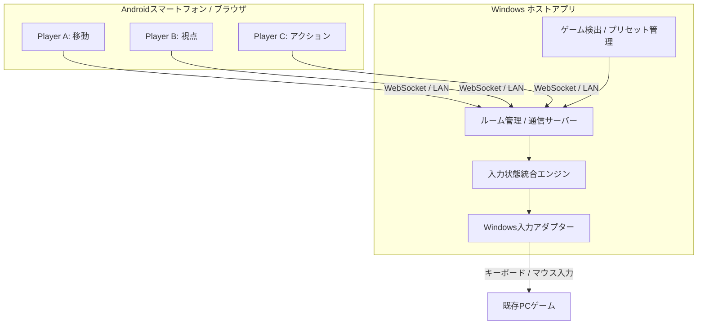

# Re:Cooplay - そのゲーム、まだ遊び尽くしていない。

**「ゲームはそのまま。遊び方は新しく。」**

**もともと1人用のPCゲームを、複数人で協力して遊べる体験へ。**

ゲームはそのまま。移動・視点・アクションを役割分担して、ひとつのキャラクターを動かす。

<!-- デモ動画が完成したら、以下にサムネイル・動画URLを追加する -->
<!--  -->

<!-- 実装済み画面のキャプチャやプロダクトロゴをここに追加 -->

> **Re:Cooplay** は、**マルチプレイを前提としていない既存の1人用PCゲーム**を、複数人でひとつのキャラクターを操作する協力プレイ体験に変えるプラットフォームです。複数のコントローラーを接続するだけでなく、ゲームの操作を役割単位で分け、参加人数に合わせた分担を提案します。
>
> **開発状況について：** 本READMEはJPHacks向けの企画・技術構想をまとめたものです。以下に記載する機能は、実装済みであることを保証するものではありません。「MVPで目指す機能」「今後の展望」を区別して記載しています。

---

## 目次

- [製品概要](#製品概要)
  - [背景と解決したい課題](#背景と解決したい課題)
  - [製品説明](#製品説明)
  - [既存の遊び方・サービスとの違い](#既存の遊び方サービスとの違い)
  - [使い方](#使い方)
  - [主な特長](#主な特長)
  - [解決できること](#解決できること)
- [デモ](#デモ)
- [システム構成](#システム構成)
- [開発技術](#開発技術)
- [独自性とこだわり](#独自性とこだわり)
- [MVP開発範囲](#mvp開発範囲)
- [今後の展望](#今後の展望)
- [対応環境と注意事項](#対応環境と注意事項)
- [参考リンク](#参考リンク)

---

## 製品概要

### 背景と解決したい課題

> **好きだったゲームなのに、気づけば遊ばなくなっていた。**

何度も遊んだゲームは、操作や攻略に慣れることで最初の驚きや緊張感が薄れてしまうことがあります。新しいゲームを買う、MODを導入するといった方法だけでなく、**今持っているゲームを違う遊び方で楽しむ方法**があってもいいはずです。

そこで私たちは、ゲーム内容ではなく「**誰が操作するか**」を変えることに着目しました。1人分の移動、視点、アクションを3人で分担すると、当たり前の行動もチームワークが必要になります。移動担当が進みたくても視点担当が違う方を見ていたり、攻撃担当とのタイミングが合わなかったり。そんな失敗も、新しい笑いや達成感になります。

また、1人用ゲームを友達と囲むと、操作している人以外は観戦に回りがちです。**遊び慣れたゲームのマンネリ化**と**見ているだけの人が生まれること**を、1つの遊び方で解決したいと考えました。

#### 解決したい3つの課題

| 課題 | Re:Cooplayのアプローチ |
|:--|:--|
| 遊び慣れたゲームの新鮮さが薄れる | 操作分担という新しいルールを加える |
| 1人用ゲームでは友達が観戦者になりやすい | 1人のキャラクターの操作に全員が参加 |
| 操作の分担や準備が面倒 | QR接続と人数別の推奨プリセット |

※遊び直す楽しさや効果は、今後のユーザーテストで検証します。

### 製品説明

> **既存PCゲーム × スマホ × 操作分担 = 遊び慣れたゲームの再発見**

**Re:Cooplay** は、Windows PCで実行する1人用ゲームを、複数のAndroidスマホから共同操作できるプラットフォームです。

PCでホストアプリを起動し、スマホのブラウザからQRコードで参加。ゲームを選ぶと、人数と操作特性に応じた**推奨操作プリセット**が提示され、担当は自由に変更できます。

複数端末の操作はPC側で統合。**もともと1人用として作られたゲームが、仲間との連携を必要とする協力プレイ体験に変わる**ことを目指しています。

ここでいう「マルチプレイ化」は、ゲームそのものに複数キャラクターや通信対戦機能を追加することではありません。**1つのゲーム・1人のキャラクターを、複数人で役割分担して操作する**という体験上の変化を指します。

| いつものシングルプレイ | Re:Cooplay |
|:--|:--|
| 1人で移動・視点・攻撃を担当 | 操作を3人で分担 |
| 慣れた動作を1人でこなす | 声を掛け合って進む |
| いつもの攻略を繰り返す | 分担次第で違う展開を楽しめる |
| 友達は画面を見ているだけ | 友達も操作に参加できる |

### 既存の遊び方・サービスとの違い

Re:Cooplayが実現したいのは、**最初から複数人用に作られたゲームを遊ぶことでも、単に複数のコントローラーをつなぐことでもありません。**

**既存のシングルプレイヤーゲームをそのまま使い、1人分の操作を役割として再構成することで、複数人で協力する新しい遊び方へ変える**ことが中心です。

| 比較対象 | 基本的な考え方 | Re:Cooplayとの違い |
|:--|:--|:--|
| **もともと複数人用の協力ゲーム** | ゲーム自体が複数プレイヤーでの操作や進行を想定している | Re:Cooplayは**1人用として作られた既存ゲーム**を対象にする |
| **一般的な複数コントローラー接続・入力共有** | 複数の入力機器をゲームにつなぎ、入力を共有する | Re:Cooplayは接続だけでなく、**移動・視点・アクションなどを役割単位で分担**し、協力プレイとして遊べる状態まで設計する |
| **Re:Cooplay** | 既存の1人用ゲームの操作を、複数人の役割に割り当てる | **ゲームは1人用のまま、プレイ体験を複数人での協力に変える** |

例えば3Dゲームなら、Player Aは「移動」、Player Bは「視点」、Player Cは「Shift・クリック・アイテム操作」を担当します。各人のスマホには担当に必要な操作UIを表示し、PC側で入力を1つに統合します。

**差別化の中心は、コントローラーの台数ではなく「遊び方の設計」です。** ゲーム別の操作特性を踏まえた推奨分担、自由なカスタマイズ、QRからの参加までを一連の体験として提供します。

> **先行技術との関係：** 複数人の入力を共有したり、1人のキャラクターを共同操作したりする製品・研究は存在します。共同操作そのものが世界初だとは主張せず、Re:Cooplayは「既存の1人用ゲームを対象に、役割分担を協力プレイとして設計し、簡単に始められるようにする」組み合わせを特徴とします。

### 使い方

| STEP | 操作 | 内容 |
|:--:|:--|:--|
| **01** | **PCでホストを起動** | ルームを作成し、QRコードを表示 |
| **02** | **スマホで参加** | Androidのブラウザから同じLAN内のルームに接続 |
| **03** | **ゲームを選択** | PCにインストールされたゲームを選ぶ |
| **04** | **操作を分担** | 推奨プリセットを確認し、担当を手動でカスタマイズ |
| **05** | **ゲームを起動** | 全員の操作をひとつに統合してプレイ |

ゲーム終了後もルーム接続を維持し、別のゲームへ切り替えられる体験を目指します。

<!-- 画面が完成したら接続・ゲーム選択・プリセット設定のスクリーンショットを挿入 -->

### 主な特長

#### 1. 1人用ゲームを、複数人で協力する体験に
もともとマルチプレイを前提としていない**既存の1人用PCゲーム**を対象に、移動・視点・アクションなどを別々の人が担当。ゲーム本体を変えずに、新しい難しさや達成感を生み出します。

#### 2. 1人のキャラクターを、みんなで操作
移動・視点・Shift・クリック・アイテム切替をそれぞれ担当する、デジタル二人羽織のような協力体験です。

#### 3. QRコードから手軽に参加
Androidスマホのブラウザから、PCと同じLANのルームに参加。専用コントローラーを用意する手間を減らします。

#### 4. ゲームと人数に応じた推奨分担
操作頻度や同時操作の関係を考慮したプリセットを提示。MVPでは事前定義したデータによるルールベースの提案を予定しています。

#### 5. 分担そのものを遊びに
推奨設定は自由にカスタマイズ可能。あえて難しい分担にしたり、友達と役割を交換したりして、同じタイトルを繰り返し楽しめます。

#### 6. 既存の対応PCゲームを活用
専用に作ったゲームではなく、手持ちのタイトルで遊べる設計。ただし入力方式によって対応できないゲームもあります。

### 解決できること

- **マンネリから再発見へ：** 遊び慣れたゲームを、新しい協力ルールで遊び直す
- **観戦から参加へ：** 友達全員が1人のキャラクターの操作に関われる
- **個人技からチームワークへ：** 移動・視点・アクションを連携させる楽しさが生まれる
- **手持ちのゲームを再活用：** 新作を用意せず、対応ゲームの遊び方を増やす
- **準備を簡単に：** QR接続と推奨プリセットで役割を決めやすくする

---

## デモ

### 3人で1人のキャラクターを操作

3Dクラフト／探索系ゲームを使用し、**3台のスマホから1つのPCゲームを操作**するデモを想定しています。

| プレイヤー | 担当 | 入力の例 |
|:--|:--|:--|
| **Player A** | 移動 | WASD、ジャンプ |
| **Player B** | 視点 | マウスの上下左右移動 |
| **Player C** | アクション | 左右クリック、Shift、アイテム切替 |

**デモシナリオ：** Aが移動、Bが視点、CがShift・採掘・設置を担当。普段なら1人でできる操作を3人で協力して達成し、**「同じゲームなのに遊び方が変わる」**ことを見せます。

> ※使用タイトルは実際に動作検証と公開利用条件の確認ができた作品から選定します。オリジナルの **Minicraft** は2D見下ろし型ゲームであり、上記の自由視点操作は3Dゲームを想定したものです。

**90秒プレゼンの想定：** 遊び慣れたゲームに新鮮さを与えるという課題とQR接続方法はスライドで紹介。デモは3台が接続済み・ゲーム起動済みの状態から始め、移動・視点・アクションの連携を実演します。

<!-- デモ映像公開後にURLを追加 -->

---

## システム構成

### アーキテクチャ

PCホストアプリとAndroidを**同一LAN内のWebSocket**で接続し、操作イベントをWindowsへ反映します。ゲーム画面そのものはスマホに配信せず、PC画面を全員で見る設計です。

### コンポーネント構成（採用予定）

| コンポーネント | 技術候補 | 役割 |
|:--|:--|:--|
| **PCデスクトップ** | Tauri v2 / React / TypeScript | ルーム、ゲーム選択、設定UI |
| **通信・制御** | Rust / Tokio / Axum | HTTP配信、WebSocket、ルーム管理 |
| **Androidコントローラー** | React / TypeScript / Pointer Events | タッチ入力、動的UI、接続・再接続 |
| **入力統合** | Rust | 複数端末の押下状態、軸・視点入力の統合 |
| **Windows入力** | Win32 `SendInput` | キーボード・マウスへの入力変換 |
| **ゲーム検出** | Steamの管理情報など | インストール済みタイトルの一覧化 |
| **設定保存** | JSON（初期） | ゲームプロファイルとカスタムプリセット |

> 24時間のMVPでは、まず**Rustホストプロセス＋Web管理画面**として実装し、デスクトップアプリへの統合は開発状況に応じて判断する予定です。

### 操作データの設計

設定は次の3層に分離します。

1. **Game Profile：** ゲーム固有の操作一覧・キー割当・推定操作負荷
2. **Role Assignment：** どのプレイヤーがどの操作を担当するか
3. **Controller Layout：** 各スマホ上のボタンやタッチパッドの表示位置・種類

これにより、同じゲームでも参加人数や好みに応じて操作分担を変更できます。

### リアルタイム入力の制御

- **同時入力：** 例としてAの前進、Bの視点移動、Cのクリックを並列に処理
- **長押し管理：** 各端末が押しているキーを個別に追跡
- **競合対策：** 同じキーを複数人が押した場合、全員が離すまで押下を維持
- **連続入力：** 視点移動データの滞留を抑え、操作の応答性を優先
- **切断時の安全性：** 切断・フォーカス喪失・緊急停止時に必要な入力を解放

> 一部の3DゲームはRaw Inputなどを利用するため、Win32 `SendInput` による視点操作が正常に認識されない場合があります。ゲーム別の実機検証が必要で、すべてのタイトルへの対応を保証するものではありません。

---

## 開発技術

### 活用予定の技術

| 分野 | 技術 | 用途 |
|:--|:--|:--|
| デスクトップ | **Tauri** | Windows向けホストUI |
| フロントエンド | **React / TypeScript / Vite** | PC管理画面・Android操作画面 |
| バックエンド | **Rust / Tokio / Axum** | 通信・入力状態管理 |
| 通信 | **WebSocket / HTTP / LAN** | ローカル双方向通信とUI配信 |
| OS連携 | **Windows API** | キーボード・マウス入力の生成 |
| データ | **JSON** | プリセット、ゲームプロファイル |

### 重視する技術課題

1. **操作の同時性：** 複数端末の入力をひとつのゲームに干渉なく届ける
2. **操作の継続性：** 長押しや視点移動を途中で途切れさせない
3. **入力の安全性：** 端末の切断時にキーが押されっぱなしにならない
4. **操作負荷の分配：** 単なるボタン数ではなく、忙しさを考慮した初期配置を作る
5. **導入の手軽さ：** QRコードから参加し、専用コントローラーを用意しなくてよい

---

## 独自性とこだわり

### 1. ゲームではなく、遊び方をアップデート
新たなステージやルールをゲーム内部に追加せず、**操作を分けることで遊び慣れたゲームに新しい挑戦を生む**ことが出発点です。

### 2. 「複数人用ゲーム」ではなく「既存の1人用ゲーム」
ゲーム内に最初から複数人の役割やキャラクターが用意されたタイトルを前提としません。これまで1人で遊んでいたPCゲームに、**外側から協力操作という新しいルールを加える**ことが出発点です。

### 3. 「別キャラクター」ではなく「みんなで1人」
通常のマルチプレイとは違い、1人のキャラクターに複数人の意思が集まります。

### 4. コントローラー共有ではなく、役割の設計
単に複数デバイスから入力できるだけでは、共同操作の楽しさは生まれません。ゲームに必要な操作を分解し、**何を誰が担当するか**を決めるところまでをプロダクトの中心に据えています。

### 5. 操作の分担そのものがコンテンツになる
誰が移動や視点を担当するかを変更するだけで、同じゲームから違う難しさやコミュニケーションが生まれます。

### 6. 操作負荷を考えた初期配置
操作頻度・継続時間・同時性を踏まえた役割分担を提案し、初めてでも参加しやすい構成を目指します。

### 7. 導入を一連の体験にする
複数入力の共有は既存の製品・研究にも存在します。Re:Cooplayでは、**QR参加・ゲーム別の分担提案・自由な編集**をひと続きの体験にすることに注力します。

## MVP開発範囲

**以下は開発目標であり、完了済み機能の一覧ではありません。**

| 項目 | 24時間MVPの目標 |
|:--|:--|
| ホスト | Windows PCでルームを起動 |
| 参加 | Android 2〜4台がQR経由で接続 |
| 通信 | 同一LAN / WebSocket |
| 操作 | 移動・視点・アクションの同時入力 |
| 設定 | 推奨プリセット表示、担当の手動変更 |
| ゲーム | 検証済みのタイトルを事前登録して選択・起動 |
| 安全性 | 切断時の入力解除・ホスト側の停止操作 |
| 検証 | 共同操作の実演と遅延・動作安定性の確認 |

**時間があれば実装：** Steamゲームの自動検出、レイアウト編集、プリセット保存、複数タイトル対応。

**MVPの対象外：** iPhone対応、遠隔インターネット対戦、映像配信、機械学習による自動最適化、すべてのPCゲームへの対応。

### デモ成功の目安

3人がそれぞれ移動・視点・アクションを担当し、**同時操作によってひとつのゲーム内目標を達成できること**。加えて、一度の設定変更がスマホの操作画面と入力割当に反映されることを目指します。

---

## 今後の展望

### 遊び直しを促すチャレンジモード
担当を一定時間ごとに交代する、ランダムに分担するなど、操作を分けること自体がゲームになる新モードを検討します。

### 対応ゲームの拡充
オープンワールド、アクション、ホラー、FPS、パズル、シミュレーターなど、さまざまな入力特性のタイトルへ広げます。

### インストール済みゲームの自動認識
SteamやEpic Gamesの管理情報からタイトルを検出し、遊べるゲームを一覧表示します。

### より賢いおすすめプリセット
ユーザーの同意を得て操作量を分析し、得意・不得意や希望難易度に合った役割分担を提案する構想です。

### スマホならではの新しい操作
傾きによる操作、振動、自由なボタン配置、仮想ゲームパッドなどを検討します。

### 遊び方を共有するコミュニティ
「このゲームにはこの分担が面白い」というプリセットを共有し、遊び慣れたタイトルを再発見する場を目指します。

## 対応環境と注意事項

- **想定OS：** Windows 11（ホスト）、Android Chrome（操作端末）
- **通信：** PC・スマホが相互通信できる同一LAN。ゲストWi-Fi等では接続できない場合があります。
- **入力互換性：** ゲーム側のRaw Input、権限、アンチチート等によっては動作しない可能性があります。
- **セキュリティ：** ゲーム起動はホストが認可したタイトルに限定し、QR参加には一時トークンを使う方針です。
- **権利関係：** ゲームの著作権・商標は各権利者に帰属します。本プロジェクトは各ゲーム会社の公式製品・提携製品ではありません。
- **公開デモ：** 実演するゲームの利用規約・映像利用条件を個別に確認します。
- **ライセンス：** 本プロジェクト自身のソースコードの公開ライセンスは、リポジトリの `LICENSE` にて別途定めます。

---

## 参考リンク

- [JPHacks 2025 参考README：4DX@HOME](https://github.com/jphacks/kz_2504)
- [Tauri](https://tauri.app/)
- [Microsoft Learn：SendInput](https://learn.microsoft.com/en-us/windows/win32/api/winuser/nf-winuser-sendinput)
- [MDN：WebSocket API](https://developer.mozilla.org/en-US/docs/Web/API/WebSocket)
- [MDN：Pointer Events](https://developer.mozilla.org/en-US/docs/Web/API/Pointer_events)

---

### **そのゲーム、まだ遊び尽くしていない。**

**Re:Cooplay**

