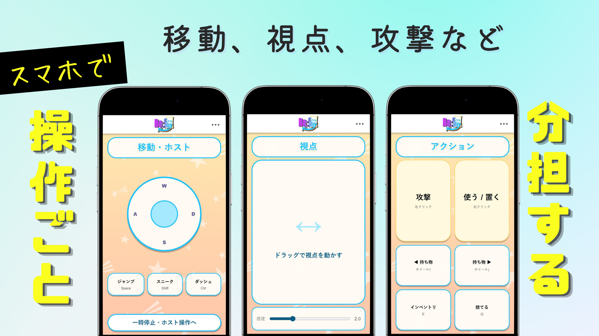
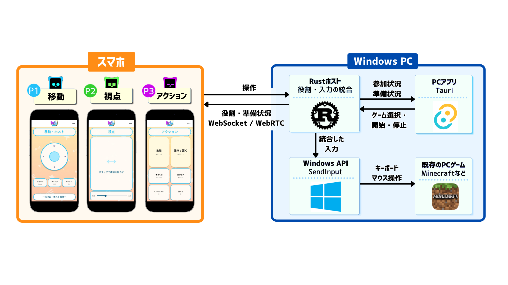

# Re:Cooplay（リコープレイ）— ゲームはそのまま。操作はみんなで。

   

  

  ---

  
🎮 <strong>プレイ風景</strong>

  
移動・視点・攻撃を3人で分担し、声を掛け合いながら1つのキャラクターを操作する様子をご覧ください。

https://github.com/user-attachments/assets/60d577f4-e287-45bc-bc6a-09455dd017c3

  
Hack Dayの開発中に撮影した実プレイ風景：3人がスマートフォンから1つのキャラクターを共同操作

  ---

  
  
  

  ---

  

  
🏆 <strong>JPHACKS 2026 金沢会場 Hack Day Audience Award 受賞</strong>

---

Re:Cooplay（リコープレイ）は、**既存のPCゲームに、新しい協力プレイを後付けするツール**です。

普段は1人で操作するゲームのキャラクターを、2〜4人で分担して動かします。

移動する人、視点を動かす人、攻撃する人。**全員が操作の当事者になることで、いつものゲームに新しい協力体験が生まれます。**

ゲーム本体を改造することなく、手元のスマートフォンから新しい遊び方を楽しめます。

---

## 製品概要

### 背景(製品開発のきっかけ、課題等）

1人で遊ぶなら1人で操作する。複数人で遊ぶなら、それぞれが自分のキャラクターを操作するマルチプレイを選ぶ。それが一般的なゲームの楽しみ方です。

でも、**1つのキャラクターを動かすことそのものを、みんなで分担しても面白いのではないか。**

移動する人と視点を動かす人が違えば、思った方向へ進むにも声を掛け合う必要があります。失敗して笑うことも、息が合って成功することも、同じキャラクターを動かす全員の体験になります。

**ゲームの内容を変えずに、操作する人と協力の仕方を変える。**

Re:Cooplayは、既存のゲームにそんな新しい遊び方を加えたい、という発想から生まれました。

---

### 製品説明（具体的な製品の説明）

> **ゲーム体験 × Tech：1つのキャラクターを、みんなで動かす**

Re:Cooplay（リコープレイ）は、既存のPCゲームに新しい協力プレイを後付けするツールです。

参加者はそれぞれのスマートフォンをコントローラーとして使い、1つのキャラクターの操作を分担します。移動や視点、攻撃など、それぞれの操作を組み合わせることで、みんなで1つのキャラクターを動かします。

例えば、**3人でMinecraftを遊ぶ場合**、次のように担当します。

| プレイヤー | 担当する操作 |
|---|---|
| P1 | 移動・ジャンプ |
| P2 | 視点・カメラ操作 |
| P3 | 攻撃・アイテムの使用 |

  
  
左からP1・P2・P3の操作画面を並べた説明用画像。画像を開くと拡大できます。

敵が現れたら、移動担当が距離を取り、視点担当が敵を捉え、攻撃担当がタイミングを合わせて攻撃します。

それぞれが別の操作を担当するからこそ、自然と会話や協力が生まれます。

 

参加から共同操作までの流れは、次のとおりです。

1. **デスクトップアプリを起動する**  
   PCでRe:Cooplayを起動すると、参加用のQRコードが表示されます。

2. **スマホで参加する**  
   スマートフォンでQRコードを読み取り、Webアプリで参加します。最初に参加した人がホストとなり、スマホをPC画面のリモコンとして使えるようになります。

3. **遊びたいゲームを選ぶ**  
   ホストがスマホをリモコンとして操作し、PC画面に表示されたゲーム一覧から遊びたいゲームを選択します。

4. **操作を分担する**  
   PC画面で参加メンバーそれぞれの担当を確認し、操作分担を決定します。必要に応じて担当を入れ替えることもできます。

5. **ゲームを起動・準備する**  
   ゲームを起動し、プレイしたいステージやワールドなどを準備します。

6. **みんなで協力プレイ！**  
   準備ができたら、ホストがスマホから「Ready」を押します。各自のスマホが担当する操作画面に切り替わり、みんなで1つのキャラクターを操作できるようになります。

スマートフォンへの専用アプリのインストールは不要。1つのPCゲーム画面を共有しながら、複数人で協力プレイを楽しめます。PC側のセットアップについては[Windows構築・起動手順](docs/handoff/SETUP_WINDOWS.md)をご覧ください。

---

### 特長

#### 1. **1つのキャラクターを、みんなで操作する**

Re:Cooplayでは、**2〜4人で1つのキャラクターを共同操作**できます。参加人数に応じて操作を自動で分担し、ゲーム開始前や一時停止中には担当を入れ替えることもできます。

同じゲームでも、誰が移動や視点を担当するかによって、声の掛け合い方や連携の仕方が変わります。

**キャラクターを動かすだけでなく、仲間と息を合わせること自体がゲームの楽しさになります。**

 

#### 2. **いつものPCゲームに、新しい遊び方を後付け**

Re:Cooplayは、**ゲーム本体を改造することなく、新しい協力プレイを追加**できます。

ゲームごとの操作方法に合わせて共同操作を実現する仕組みを備えており、Minecraftでの共同操作に加え、さまざまなPCゲームへの展開を目指しています。

**遊ぶゲームを変えるのではなく、遊び方を変える。** 遊び慣れたゲームにも、新しい楽しさが生まれます。

 

#### 3. **スマホが、そのままコントローラーに**

PC画面に表示されたQRコードをスマートフォンで読み取れば、Webアプリから参加できます。**専用のスマホアプリや、新しいコントローラーを用意する必要はありません。**

ゲームの準備中は、ホストのスマホをPC画面のリモコンとして使用できます。共同操作を開始すると、参加者それぞれのスマホが**担当する役割に合わせたコントローラー**に切り替わります。

普段使っているスマートフォンだけで、参加から協力プレイまで楽しめます。

---

### 解決出来ること

Re:Cooplayは、ゲームの内容を変えることなく、これまでとは違う協力の楽しさを生み出します。

- **Minecraft：キャラクターを動かすこと自体がチームプレイに**  
  通常のマルチプレイでは、それぞれが自分のキャラクターを操作します。Re:Cooplayでは、1つのキャラクターの移動・視点・攻撃を3人で分担。モンスターとの戦闘では、声を掛け合い、息を合わせることが攻略の鍵になります。うまく動けないハプニングも、協力して敵を倒す達成感も、3人で共有する楽しさに変わります。

- **ホラーゲーム：見守るだけでなく、一緒に恐怖へ立ち向かう体験に**  
  1人用のホラーゲームを友達と楽しむとき、通常は1人が操作し、ほかの人はその様子を見守ります。Re:Cooplayなら、2人とも操作に参加し、怖い場面を一緒に乗り越えることができます。チームメンバーによる試遊でも、1人では心細い場面に2人で挑み、恐怖やゲームの展開を共有する楽しさがありました。

もちろん、Minecraftやホラーゲーム以外でも、操作を分担することで、そのゲームならではの掛け合いや協力の楽しさが生まれる可能性があります。**ゲームそのものは変わらなくても、誰とどう操作するかによって、楽しみ方は大きく変わります。**

---

### 今後の展望

Re:Cooplayは、**ゲームや参加人数に合わせて、もっと自然に共同操作を楽しめること**を目指しています。

- **操作しやすいボタン配置に：** スマホの操作画面でボタンの配置を編集し、自分の手や担当する操作に合わせたコントローラーを作れるようにする。
- **操作の負担を考えた、自動的な役割分担に：** ボタンの数だけで分けるのではなく、操作の頻度や量、同時に操作する場面などから負担を推定し、参加人数に応じた、より適切な分担を提案できるようにする。
- **より多くのゲームのキー設定を読み取れるように：** ゲームごとに異なるキー設定の保存方法に対応し、自動でキーバインドを取得できるタイトルを増やす。読み取りが難しいゲームでも操作を設定しやすい方法を整える。
- **離れた友達とも一緒に：** 同じ場所に集まらなくても、1つのキャラクターを協力して操作できるようにする。

---

### 注力したこと（こだわり等）

* **無線入力の低遅延化**

  スマートフォンからの操作を素早くPCゲームに反映し、ストレスなく共同操作できることを追求しました。
  - **技術選定：** ゲームと並行して動作する際の処理負荷とタイミングの安定性を重視してRustを採用。通信にはWebRTC DataChannelを活用。
  - **実測・最適化：** 通信試作品では、WebRTCの導入によって不安定な端末の視点操作の途切れを42%から1.7%に改善。視点入力の30Hz送信と4ms周期の補間処理も実装。

* **スマートフォンでの快適な操作感**

  普段使っているスマートフォンを、ゲームのコントローラーとして自然に扱えることを重視しました。
  - **直感的な操作：** 移動には仮想スティック、視点操作にはスワイプを採用し、視点の感度調整にも対応。
  - **入力の安定性：** 連打や長押しが正しく反映されるよう、ボタンの押下・解放処理や視点の滑らかさを調整。

* **手軽に参加できるUX**

  初めて使う人でも、複雑な設定をせずに協力プレイを始められることにこだわりました。
  - **簡単な参加：** 専用アプリのインストールが不要なWebアプリを採用。PC画面のQRコードからすぐに参加可能。
  - **スムーズな準備：** ホストのスマホからPC画面を操作し、ゲーム選択やプレイ開始まで進められる導線を設計。

* **パーティ感のあるポップなUIデザイン**

  みんなでゲームを遊ぶ楽しさが伝わる、明るく親しみやすいデザインを目指しました。
  - **統一された世界観：** 星柄、鮮やかな配色、丸みのある形状を取り入れ、PCとスマホの画面デザインを統一。
  - **役割の分かりやすさ：** プレイヤーごとの色分けとP1〜P4の表示により、自分が何Pで、どの操作を担当するのかを直感的に把握できるよう工夫。

---

## 開発技術

### 活用した技術

#### API・データ

| 技術 | 用途 |
|:--|:--|
|  | 既存のPCゲームへキーボード・マウス入力を送る |
|   | スマホの操作入力や参加・プレイ状態をリアルタイムに送受信 |
|  | ゲームごとに異なるボタン・操作分担・入力の対応関係を管理 |
|  | Minecraftのキー設定を読み取り、操作定義に反映 |

#### フレームワーク・ライブラリ・モジュール

| カテゴリ | 技術スタック |
|:--|:--|
| **PCホスト** |    Rust、Tokio、axum |
| **PCアプリ** |   Tauri 2、WebView2 |
| **スマホ・PC画面** |    HTML、CSS、JavaScript |
| **開発・検証** |  Node.jsによる通信シミュレーション・UI検証、Rustのテスト |

#### デバイス

| デバイス | 説明 |
|:--|:--|
|  | PCゲームの実行、複数人の操作入力の統合 |
|   | 2〜4人が各自のスマホからブラウザで参加・操作 |
|  | PCとスマホを同じネットワークに接続。通常の共同操作に外部クラウドサーバーは不要 |

### 独自技術

#### ハッカソンで開発した独自機能・技術

Hack Day（2026年10月24〜25日）に、複数人で1つのキャラクターを動かす仕組みを開発しました。技術ごとの実装・検証記録は以下から確認できます。

| 技術 | 概要 | 実装・記録 |
|:--|:--|:--|
| **複数人の入力統合と役割分担** | スマホから受け取った操作を担当者ごとに判定し、1つのゲーム入力へ統合。2〜4人の操作分担や役割交換に対応 | [入力統合](apps/host-rs/src/hub.rs)、[入力変換](apps/host-rs/src/controls.rs)、[OS入力](apps/host-rs/src/input.rs) |
| **リアルタイム通信と入力の整合性** | WebSocketとWebRTC DataChannelを併用し、重複・古い入力を排除。視点操作、長押しや連打も処理 | [通信実装](apps/host-rs/src/rtc.rs)、[通信仕様](docs/architecture/protocol.md)、[通信検証](scripts/sim/protocol-sim.mjs) |
| **ゲーム別の操作定義・役割別UI** | ゲームのキー設定や操作種類に合わせて入力を変換し、担当に適したスマホ画面を生成。インストール済みゲームの検出にも対応 | [操作定義](docs/architecture/game-profiles.md)、[ゲーム検出](apps/host-rs/src/games.rs)、[操作画面](apps/web-static/scripts/generated-controls.js) |
| **安全な開始・停止と入力先の制御** | ホストのReadyによる開始、対象ゲームのウィンドウ確認、切断・一時停止・緊急停止時の入力解放 | [入力先の確認](apps/host-rs/src/focus.rs)、[セッション管理](apps/host-rs/src/hub.rs)、[開始手順](docs/decisions/2026-10-25-launch-after-roles.md) |
| **参加からプレイまでの画面** | QRコード参加、ゲーム選択、操作分担の確認、スマホをリモコンから役割別コントローラーへ切り替えるUI | [PC・スマホUI](apps/web-static/)、[表示検証](artifacts/improved-ui/README.md) |

操作入力は次の構成でPCゲームに伝わります。

  
  
3人構成を例にした概略図。参加・状態管理はWebSocket、入力の速達にはWebRTC DataChannelも併用します。画像を開くと拡大できます。

[開発開始前のコミット](https://github.com/jphacks/kz_2613/tree/5acb0049e6) ／ [GitHub上の変更差分](https://github.com/jphacks/kz_2613/compare/5acb0049e6...main) ／ [Hack Day開発ログ](docs/handoff/BUILD_LOG.md) ／ [システム設計](docs/architecture/system-design.md)

比較リンクにはREADMEの編集も含まれます。実装内容はコミット履歴と開発ログを参照してください。ゲームの検出・操作定義の登録は、すべてのゲームでの動作を保証するものではありません。

---

Re:Cooplayは独立した非公式ツールであり、Minecraftのゲーム本体・素材を同梱していません。Minecraftの公式製品ではなく、Mojang Studios・Microsoftの承認・提携を受けていません。NOT AN OFFICIAL MINECRAFT PRODUCT. NOT APPROVED BY OR ASSOCIATED WITH MOJANG OR MICROSOFT. [Minecraftの利用条件に関する確認記録](docs/decisions/2026-10-25-minecraft-usage-terms.md)
