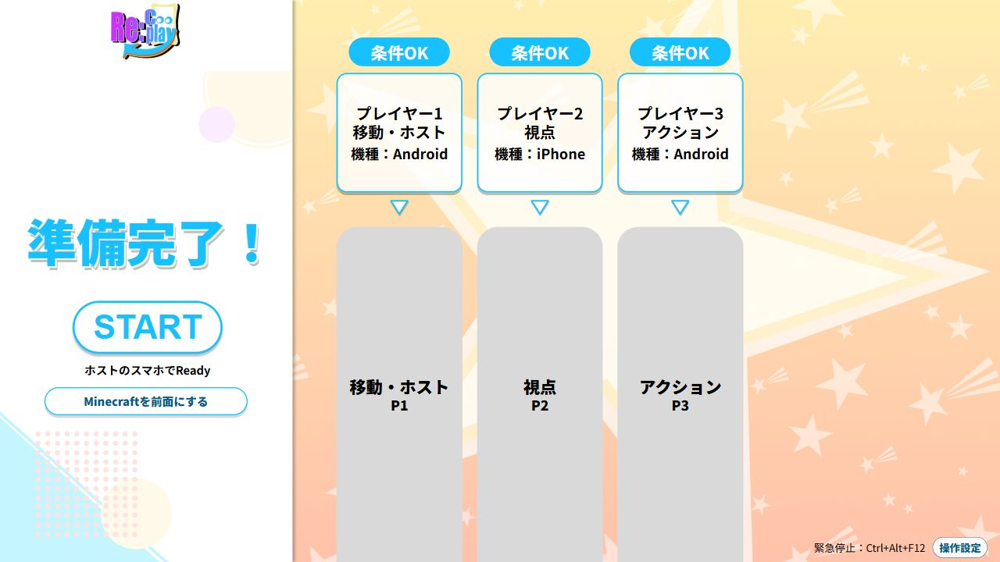
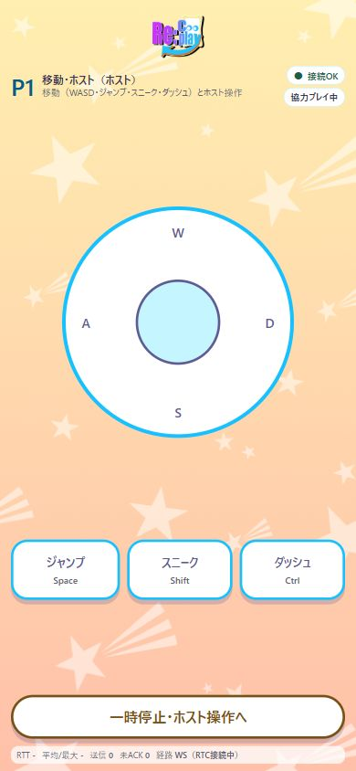
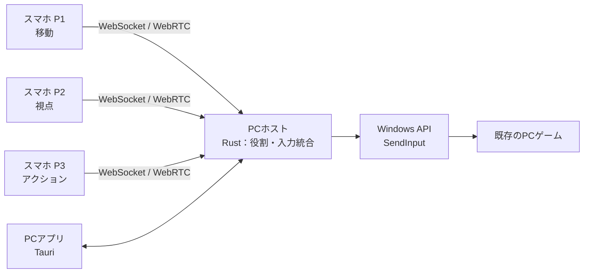

# Re:Cooplay（リコープレイ）— ゲームはそのまま。遊び方を変える。

  

  
<strong>いつものゲームを、みんなで再発見する。</strong>

**Re:Cooplay** は、既存のPCゲームに「**ワンキャラクター・マルチコントロール**」という新しい遊び方を後付けするツールです。

1つのキャラクターの「移動」「視点」「アクション」を、友達それぞれのスマートフォンで分担。普段は1人で当たり前にできる操作が、声を掛け合い、息を合わせる協力プレイへと変わります。

> **目指すのは、どんなゲームでも、新しい協力プレイを楽しめること。**  
> 現在はMinecraft Java Editionを題材に、3人で1キャラクターを操作する体験を開発・検証しています。すべてのゲームでの動作を保証するものではありません。

## デモ・画面イメージ

開発メンバー3人が、それぞれのスマホから1台のPC画面上のMinecraftを共同操作しました。モンスターとの戦闘では「剣に持ち替えて！」「引いて、下がって！」と声を掛け合う場面が生まれました。

紹介動画は準備中です。以下はアプリの画面例です（ゲームプレイの映像ではありません）。

  
  
PC側の画面例

  
  
スマートフォン側の操作画面例（P1）

## 製品概要

### 背景（製品開発のきっかけ・課題）

私たちは、**既存のものに新しい機能や体験を「後付け」することで、今までになかった価値を生み出せないか**と考えてきました。

ゲームの面白さは、ゲームそのものの内容だけで決まるわけではありません。**同じゲームでも、遊び方が変われば体験も変わる**はずです。

例えば、友達と集まってゲームをするとき。普通のマルチプレイでは、それぞれが自分のキャラクターを操作します。それも楽しい一方で、「**1つのキャラクターを、みんなで一緒に動かしたら？**」という遊び方もできるのではないでしょうか。

ところが、ゲームが最初から用意していない操作ルールを、既存のゲームへ後から追加するのは簡単ではありません。タイトルごとに専用の仕組みを作るのでは、気軽に別のゲームでも試せません。

そこで私たちは、**ゲームの中身を変えるのではなく、ゲームの外側から操作の仕方を変える**「Re:Cooplay」を開発しました。

### 製品説明（具体的な製品の説明）

Re:Cooplayは、**友達3人が同じPC画面を囲み、各自のスマホをコントローラーとして使って、1つのキャラクターを動かす**システムです。

現在のMinecraft向けの役割は、次の3つです。

| プレイヤー | 役割 | 主な操作 |
|:--|:--|:--|
| **P1** | 移動 | 前後左右、ジャンプ、スニーク、ダッシュ |
| **P2** | 視点 | スワイプによるカメラ・視点操作 |
| **P3** | アクション | 攻撃、ブロックの設置・使用、持ち物の切り替えなど |

モンスターが現れたら、1人が逃げる方向を決めても、視点担当が敵を見失えばうまく戦えません。「剣に持ち替えて！」「下がって！」と声を掛け合って、3人で1つの行動を成立させます。

**失敗して笑う。連携できて盛り上がる。** 操作を分けることで生まれる不自由さ自体が、新しいゲーム体験になります。

#### 使い方

1. Windows PCでRe:Cooplayを起動し、スマホを同じローカルネットワークへ接続します。
2. 3人がスマホのブラウザから参加し、それぞれの役割を受け取ります。
3. ホストがPCゲームを準備し、準備完了後に共同操作を開始します。
4. 全員で同じPC画面を見ながら、声を掛け合って遊びます。

スマホ側はブラウザで操作するため、専用のスマホアプリをインストールする必要はありません。ゲーム映像をスマホへ配信する方式ではなく、画面はPCで共有し、スマホは操作専用に使います。

### 特長

#### 1. **どんなゲームにも、新しい協力プレイを**

Re:Cooplayが目指すのは、特定のゲームだけの追加モードではありません。**今あるゲームを、別の遊び方でもう一度楽しめるようにすること**です。

今回はMinecraftを題材にしていますが、例えばホラーゲームなら「逃げたい人」と「怖くて視点を動かせない人」が1つのキャラクターを動かす、普段とは違う恐怖と笑いが生まれるかもしれません。

ゲームを変えるたびに、同じ「共同操作」でも違う面白さに出会える。その広がりがRe:Cooplayの目標です。なお、対応状況は各ゲームの入力方式などによるため、現在すべてのタイトルで検証済みという意味ではありません。

#### 2. **1キャラだからこそ生まれる、一体感**

通常のマルチプレイでは、各自が別の場所で別の行動を取れます。

Re:Cooplayでは、**全員の操作が1つのキャラクターに直接影響**します。誰かが視点を変えれば、別の人の移動や攻撃にも関わってきます。

各自のペースでのんびり遊ぶ日は普通のマルチプレイ。みんなでわいわい盛り上がりたい日はRe:Cooplay。**既存のマルチプレイを置き換えるのではなく、遊び方の選択肢を増やします。**

#### 3. **ゲーム本体を改造せずに「後付け」**

3台のスマホから送られた操作をPC側で1つに統合し、Windowsの**キーボード・マウス入力**としてゲームへ渡します。

ゲームごとに専用の協力プレイ機能を実装するのではなく、ゲームの外側から操作を変えるアプローチです。Minecraft向けのMVPでは、MODやプラグインに依存しない構成を採っています。

### 解決できること・生み出す価値

**「今あるゲームを、今までとは違う体験で遊びたい」**という思いに対し、ゲーム自体を作り替えることなく、新しい共同操作のルールを持ち込めるようにします。

- **既存のゲームを再発見する：** 慣れた操作に、連携の難しさや新しい緊張感が加わる
- **1つの目標にみんなで挑戦する：** 他のプレイヤーの判断や操作が自分にも直接伝わる
- **タイトルを超えて遊び方を広げる：** ゲームごとの対応を進め、「次はあのゲームでも試したい」を実現する

実際の試作品では、開発メンバー3人がMinecraftを共同操作し、特にモンスターとの戦闘で、声を掛け合う楽しさと一体感を感じました。これは開発メンバーによる体験であり、第三者への効果検証を終えたという意味ではありません。

### システム構成

- **スマホ：** HTML / CSS / JavaScriptで操作画面を提供し、ローカル通信で操作を送信
- **PCホスト：** Rustで接続・役割・進行状態を管理し、複数人の入力を統合
- **Windows入力：** `SendInput`を通して、既存ゲームにキーボード・マウスの操作を届ける
- **PCアプリ：** Tauriで参加・ゲーム選択・役割確認・ゲーム準備を案内

詳細は[システム設計](docs/architecture/system-design.md)と[通信仕様](docs/architecture/protocol.md)をご覧ください。

### 注力したこと（こだわり）

- **操作が「ゲームらしく」反応する通信：** WebSocketに加えてWebRTC DataChannelを併用。先着した入力を重複処理せず、視点操作が途切れにくいようにしました。Node.js試作品では、通信状態の悪い端末で視点の途切れが42%から1.7%へ改善しました（特定の検証条件での観測値）。
- **連打や長押しの取りこぼし対策：** ネットワーク上で短い押下・解放がまとめて届いてもゲームが認識できるよう、押下・解放の時間と入力キューを管理しています。
- **安全な停止と復帰：** 切断・一時停止・入力対象ウィンドウの切り替えに対応し、押しっぱなしの操作や古い入力が残らない設計を進めています。
- **実際のキー設定に合わせる：** Minecraftの`options.txt`を読み取り、変更された操作キーを反映する機能を実装しています。
- **使いたくなる見た目と操作感：** PC側・スマホ側の画面を統一したデザインにし、1人1台のコントローラーとして使う体験を重視しました。

### 今後の展望

- **対応ゲームの拡大：** Minecraft以外のアクションゲームやホラーゲームなど、異なるジャンルでの検証を進める
- **ゲームごとの操作プリセット：** タイトルに合わせて操作の分担を選べるようにする
- **役割交換・操作カスタマイズ：** プレイヤー同士の担当の入れ替えや、ボタン・キー配置の自由な編集
- **参加人数の拡張：** 3人固定から、ゲームに合わせた柔軟な人数・役割分担へ
- **離れた場所からの共同操作：** 同じ部屋だけでなく、遠隔の友人同士や配信での体験へ

これらは将来の構想・開発課題であり、現行のMinecraft向け3人MVPの実装済み機能とは区別しています。

## 開発技術

### 活用した技術

| 領域 | 技術 | 用途 |
|:--|:--|:--|
| PCホスト | **Rust / Tokio / axum** | ローカルサーバー、接続管理、入力統合 |
| デスクトップ | **Tauri 2 / WebView2** | Windowsアプリ、ゲームの準備・管理画面 |
| スマホ・PC画面 | **HTML / CSS / JavaScript** | インストール不要のブラウザ操作画面 |
| 通信 | **WebSocket / WebRTC DataChannel** | 参加・状態管理、低遅延の操作入力 |
| OS入力 | **Windows API `SendInput`** | キーボード、マウス、ホイールの入力 |
| 検証 | **Node.js参照実装、通信シミュレーション、疑似ゲーム画面** | 通信仕様、入力、安全停止の照合 |

**デバイス：** Windows PC、Androidスマートフォン、iPhone、ローカルWi-Fiネットワーク。ゲーム操作のための外部クラウドサーバーは必要としません。

### 独自技術・Hack Dayで開発した機能

#### 1. 複数端末からの入力を、1つのゲーム操作に統合

スマホからはキーコードではなく「前進」「攻撃」などの操作名を送り、PC側で役割ごとの権限を確認してWindows入力へ変換します。

- [セッション・入力統合：`apps/host-rs/src/hub.rs`](apps/host-rs/src/hub.rs)
- [操作とキーの対応：`apps/host-rs/src/controls.rs`](apps/host-rs/src/controls.rs)
- [Windows入力：`apps/host-rs/src/input.rs`](apps/host-rs/src/input.rs)

#### 2. WebSocketとWebRTCを組み合わせたリアルタイム操作

確実な接続・制御と、視点のような連続操作に必要な応答性を両立するため、複数の通信経路を組み合わせています。

- [WebRTC通信：`apps/host-rs/src/rtc.rs`](apps/host-rs/src/rtc.rs)
- [プロトコルと状態管理：`docs/architecture/protocol.md`](docs/architecture/protocol.md)

#### 3. 安全に止め、同じメンバーで再開するための制御

切断・一時停止時には入力を解放し、接続し直した参加者が元の役割へ戻れるようにしています。前面の対象ゲーム以外へ誤入力しないための制御や緊急停止も実装・検証を進めています。

- [入力対象の判定：`apps/host-rs/src/focus.rs`](apps/host-rs/src/focus.rs)
- [状態と通信の回帰テスト：`scripts/sim/protocol-sim.mjs`](scripts/sim/protocol-sim.mjs)

#### 4. 既存ゲームへ広げるための土台

Minecraftのキー設定への追従や、PCにインストールされたSteam・Epic Gamesのゲームの検出・起動支援を実装しています。ただし、**一覧への表示や起動と、そのゲームで共同操作が動くことは別**であり、対応確認はタイトルごとに必要です。

- [Minecraftキー設定：`apps/host-rs/src/keybinds.rs`](apps/host-rs/src/keybinds.rs)
- [インストール済みゲームの検出：`apps/host-rs/src/games.rs`](apps/host-rs/src/games.rs)

### 開発・検証の記録

2026年10月24〜25日のHack Day中に、試作品の検証、Rust/Tauriへの実装、通信・入力・安全制御、UI整備などを進めました。

- [Hack Day試作品の検証記録](docs/decisions/2026-10-24-prototype-validated.md)
- [開発・実機検証ログ（BUILD_LOG）](docs/handoff/BUILD_LOG.md)
- [実機検証ゲートと未確認項目](docs/architecture/validation-gates.md)
- [PC画面デザインの実装・監査（PR #96）](https://github.com/jphacks/kz_2613/pull/96)
- [Minecraftのキー設定への追従（PR #102）](https://github.com/jphacks/kz_2613/pull/102)
- [コミット履歴](https://github.com/jphacks/kz_2613/commits/main/)

**検証状況について：** 通信シミュレーションや疑似ゲーム画面の試験は、ゲーム実機の動作保証とは分けて記録しています。Minecraftでの共同操作は開発メンバーが体験しており、実機の詳細条件・長時間の安定性・他タイトルでの対応範囲などは継続的な検証対象です。

## 起動・開発について

Windows上の開発環境でのビルド手順や、デスクトップアプリ・ホストの起動方法は以下にまとめています。

- [Windowsセットアップ手順](docs/handoff/SETUP_WINDOWS.md)
- [デスクトップアプリの起動方法](apps/desktop/README.md)
- [Rustホストのビルド・起動・検証方法](apps/host-rs/README.md)

## 権利・利用上の注意

Re:Cooplayは独立した非公式ツールです。**Minecraftの公式製品ではなく、Mojang StudiosおよびMicrosoftの承認・提携を受けたものではありません。**

**NOT AN OFFICIAL MINECRAFT PRODUCT. NOT APPROVED BY OR ASSOCIATED WITH MOJANG OR MICROSOFT.**

本リポジトリにはMinecraftのゲーム本体・ゲーム素材を同梱していません。対応ゲームの権利・利用条件およびデモ素材の扱いについては、[確認記録](docs/decisions/2026-10-25-minecraft-usage-terms.md)に記載しています。公開用の連絡先や発表素材については、必要な確認を進めています。

---

**Re:Cooplay — ゲームはそのまま。遊び方を変える。**
