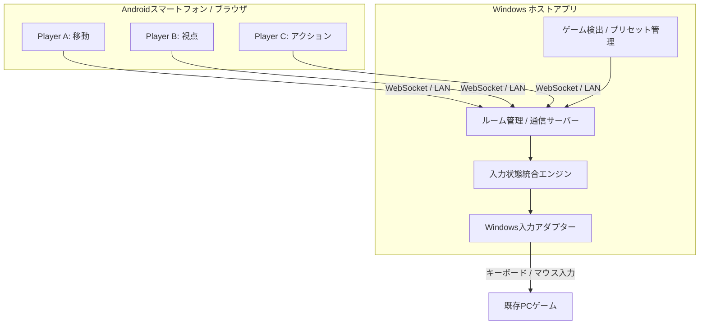

# Re:Cooplay - ひとりプレイを、みんなのプレイに。

**「操作は分ける。プレイはひとつ。」**

既存のPCゲームを、複数のスマートフォンから1人のキャラクターを操作する協力ゲームへ。

<!-- デモ動画が完成したら、以下にサムネイル・動画URLを追加する -->
<!--  -->

<!-- 実装済み画面のキャプチャやプロダクトロゴをここに追加 -->

> **Re:Cooplay** は、既存のシングルプレイヤーゲームを、操作を分担してみんなで遊ぶ協力体験に変えるプロダクトです。
>
> **開発状況について：** 本READMEはJPHacks向けの企画・技術構想をまとめたものです。以下に記載する機能は、実装済みであることを保証するものではありません。「MVPで目指す機能」「今後の展望」を区別して記載しています。

---

## 目次

- [製品概要](#製品概要)
  - [背景と解決したい課題](#背景と解決したい課題)
  - [製品説明](#製品説明)
  - [使い方](#使い方)
  - [主な特長](#主な特長)
  - [解決できること](#解決できること)
- [デモ](#デモ)
- [システム構成](#システム構成)
- [開発技術](#開発技術)
- [独自性とこだわり](#独自性とこだわり)
- [MVP開発範囲](#mvp開発範囲)
- [今後の展望](#今後の展望)
- [対応環境と注意事項](#対応環境と注意事項)
- [参考リンク](#参考リンク)

---

## 製品概要

### 背景と解決したい課題

「このゲーム、一緒にやりたい。でも、操作できるのはひとりだけ。」

友達が集まってシングルプレイヤーゲームを遊ぶと、コントローラーを持つ人がプレイし、ほかの人は画面を見るだけになりがちです。もちろん観戦も楽しいものですが、**その場にいる全員がゲームに直接参加する**選択肢は多くありません。

既存のローカルマルチプレイゲームを探したり、ゲーム専用のMODや特別なデバイスを準備したりするのも、気軽な遊び方とは言えません。

さらに、1人分の操作を複数人に分ける場合には、もうひとつの課題があります。**「誰がどの操作を担当すれば楽しいのか」が、ゲームごとに異なる**ことです。

例えば3Dゲームなら、移動・視点・攻撃を別々に担当できます。しかし、ボタン数を均等に割り振っても、各プレイヤーの忙しさが均等になるとは限りません。

私たちは、この「見るだけの人が生まれること」と「共同操作を始めるまでの複雑さ」を、ひとつの仕組みで解決したいと考えました。

### 製品説明

> **既存PCゲーム × スマホ × 操作分担 = デジタル二人羽織**

**Re:Cooplay** は、Windows PCで実行するゲームに対して、複数のAndroidスマートフォンから届いた操作を統合する共同操作プラットフォームです。

PCのホストアプリがルームを作り、参加者はQRコードを読み取ってブラウザから参加。ゲームを選択すると、人数とゲームの操作特性に応じた**推奨操作プリセット**が提示されます。ユーザーは担当操作を自由に変更できます。

プレイ中は、各スマホから送られた入力をPCで統合し、**1人のキャラクターを全員で操作**します。目指しているのは、単に操作デバイスを増やすことではありません。ふだん1人なら当たり前にできる行動が、声を掛け合う協力体験に変わることです。

### 使い方

| STEP | 操作 | 内容 |
|:--:|:--|:--|
| **01** | **PCでホストを起動** | ルームを作成し、QRコードを表示 |
| **02** | **スマホで参加** | Androidのブラウザから同じLAN内のルームに接続 |
| **03** | **ゲームを選択** | PCにインストールされたゲームを選ぶ |
| **04** | **操作を分担** | 推奨プリセットを確認し、担当を手動でカスタマイズ |
| **05** | **ゲームを起動** | 全員の操作をひとつに統合してプレイ |

ゲーム終了後もルーム接続を維持し、別のゲームへ切り替えられる体験を目指します。

<!-- 画面が完成したら接続・ゲーム選択・プリセット設定のスクリーンショットを挿入 -->

### 主な特長

#### 1. ひとり用ゲームに、みんなの出番を

ゲーム内の**移動・視点・クリック・アイテム操作**などを、それぞれ別の人が担当します。ゲーム側に専用のマルチプレイモードがなくても、外部入力を受け付けるタイトルなら共同操作を実現できる可能性があります。

#### 2. QRコードで、スマホがすぐにコントローラーに

参加者のAndroidには、基本的に専用ネイティブアプリをインストールする必要がありません。PCと同じLANに接続してブラウザで参加する方式を採用予定です。ゲーム画面はPC側で共有し、スマホは操作だけを担当します。

#### 3. 操作負荷を考えたおすすめ分担

操作頻度、継続時間、同時操作のしやすさなどから、ゲームごとの**推奨プリセット**を提示します。初期段階ではゲーム別に用意した操作プロファイルとルールベースの分担を使用し、実測データを前提とした自動推定は将来の拡張とします。

#### 4. 推奨はスタート地点。分担は自由

「視点が得意な人」「攻撃を担当したい人」など、参加者に合わせて操作の担当を編集できます。担当に応じてスマホのコントローラーUIを変化させる設計です。

#### 5. ゲームを変えても、接続し直さない

PCでゲームを切り替えても参加者のルームを維持し、次のゲームに合わせたプリセットへ移る、一連のパーティー体験を目指します。

### 解決できること

- **観戦から参加へ：** 1人用ゲームでも、その場にいる複数人が直接操作に関われる
- **専用タイトルへの依存を減らす：** 既存ゲームに新しい遊び方を後付けする
- **操作分担のハードルを下げる：** 人数別の推奨プリセットで、最初の設定に迷わない
- **手持ちのデバイスを活用：** Androidスマホを共同プレイ用コントローラーとして使う
- **コミュニケーションを生む：** 移動、視点、アクションの協調によって声掛けが必要になる

---

## デモ

### 3人で1人のキャラクターを操作

3Dクラフト／探索系ゲームを使用し、**3台のスマホから1つのPCゲームを操作**するデモを想定しています。

| プレイヤー | 担当 | 入力の例 |
|:--|:--|:--|
| **Player A** | 移動 | WASD、ジャンプ |
| **Player B** | 視点 | マウスの上下左右移動 |
| **Player C** | アクション | 左右クリック、Shift、アイテム切替 |

**デモシナリオ：** Aが移動し、Bが視点を合わせ、Cがしゃがみ・採掘・設置を担当。3人が会話しながら協力してひとつの目標を達成します。

> ※使用タイトルは実際に動作検証と公開利用条件の確認ができた作品から選定します。オリジナルの **Minicraft** は2D見下ろし型ゲームであり、上記の自由視点操作は3Dゲームを想定したものです。

**90秒プレゼンの想定：** 課題と接続方法をスライドで簡潔に紹介し、デモはあらかじめ3台が接続済み・ゲーム起動済みの状態から開始します。

<!-- デモ映像公開後にURLを追加 -->

---

## システム構成

### アーキテクチャ

PCホストアプリとAndroidを**同一LAN内のWebSocket**で接続し、操作イベントをWindowsへ反映します。ゲーム画面そのものはスマホに配信せず、PC画面を全員で見る設計です。

### コンポーネント構成（採用予定）

| コンポーネント | 技術候補 | 役割 |
|:--|:--|:--|
| **PCデスクトップ** | Tauri v2 / React / TypeScript | ルーム、ゲーム選択、設定UI |
| **通信・制御** | Rust / Tokio / Axum | HTTP配信、WebSocket、ルーム管理 |
| **Androidコントローラー** | React / TypeScript / Pointer Events | タッチ入力、動的UI、接続・再接続 |
| **入力統合** | Rust | 複数端末の押下状態、軸・視点入力の統合 |
| **Windows入力** | Win32 `SendInput` | キーボード・マウスへの入力変換 |
| **ゲーム検出** | Steamの管理情報など | インストール済みタイトルの一覧化 |
| **設定保存** | JSON（初期） | ゲームプロファイルとカスタムプリセット |

> 24時間のMVPでは、まず**Rustホストプロセス＋Web管理画面**として実装し、デスクトップアプリへの統合は開発状況に応じて判断する予定です。

### 操作データの設計

設定は次の3層に分離します。

1. **Game Profile：** ゲーム固有の操作一覧・キー割当・推定操作負荷
2. **Role Assignment：** どのプレイヤーがどの操作を担当するか
3. **Controller Layout：** 各スマホ上のボタンやタッチパッドの表示位置・種類

これにより、同じゲームでも参加人数や好みに応じて操作分担を変更できます。

### リアルタイム入力の制御

- **同時入力：** 例としてAの前進、Bの視点移動、Cのクリックを並列に処理
- **長押し管理：** 各端末が押しているキーを個別に追跡
- **競合対策：** 同じキーを複数人が押した場合、全員が離すまで押下を維持
- **連続入力：** 視点移動データの滞留を抑え、操作の応答性を優先
- **切断時の安全性：** 切断・フォーカス喪失・緊急停止時に必要な入力を解放

> 一部の3DゲームはRaw Inputなどを利用するため、Win32 `SendInput` による視点操作が正常に認識されない場合があります。ゲーム別の実機検証が必要で、すべてのタイトルへの対応を保証するものではありません。

---

## 開発技術

### 活用予定の技術

| 分野 | 技術 | 用途 |
|:--|:--|:--|
| デスクトップ | **Tauri** | Windows向けホストUI |
| フロントエンド | **React / TypeScript / Vite** | PC管理画面・Android操作画面 |
| バックエンド | **Rust / Tokio / Axum** | 通信・入力状態管理 |
| 通信 | **WebSocket / HTTP / LAN** | ローカル双方向通信とUI配信 |
| OS連携 | **Windows API** | キーボード・マウス入力の生成 |
| データ | **JSON** | プリセット、ゲームプロファイル |

### 重視する技術課題

1. **操作の同時性：** 複数端末の入力をひとつのゲームに干渉なく届ける
2. **操作の継続性：** 長押しや視点移動を途中で途切れさせない
3. **入力の安全性：** 端末の切断時にキーが押されっぱなしにならない
4. **操作負荷の分配：** 単なるボタン数ではなく、忙しさを考慮した初期配置を作る
5. **導入の手軽さ：** QRコードから参加し、専用コントローラーを用意しなくてよい

---

## 独自性とこだわり

### 1. 「別々のプレイヤー」ではなく「みんなでひとり」

複数台のスマホをゲームパッドとして接続するだけではありません。**1キャラクターの操作権限を複数人に分割する**ことを体験の中心に置いています。

### 2. 操作量を考えて、分担をおすすめ

ゲームの操作種類・頻度・継続時間・同時性から、人数ごとの役割分担を提案します。単純なキー割当ツールではなく、**誰が何を担当すると遊びやすいか**を考えられる点が特徴です。

### 3. プレイヤーが自由に調整できる

推奨設定は固定ではありません。参加者の得意・不得意や、わざと難しくして遊びたいという希望にも合わせて編集できるようにします。

### 4. 既存のゲームを使う

ゲーム本体を作り直さず、PCへの外部入力を統合する設計を基本とします。ただし対応可否は各ゲームの入力方式、実行環境、利用規約に依存します。

### 5. 誰でも参加しやすい

スマホをコントローラーとして再利用するため、専用機材の準備を減らせます。ゲームを知らない友達も、ひとつの操作だけを担当する形で参加できます。

---

## MVP開発範囲

**以下は開発目標であり、完了済み機能の一覧ではありません。**

| 項目 | 24時間MVPの目標 |
|:--|:--|
| ホスト | Windows PCでルームを起動 |
| 参加 | Android 2〜4台がQR経由で接続 |
| 通信 | 同一LAN / WebSocket |
| 操作 | 移動・視点・アクションの同時入力 |
| 設定 | 推奨プリセット表示、担当の手動変更 |
| ゲーム | 検証済みのタイトルを事前登録して選択・起動 |
| 安全性 | 切断時の入力解除・ホスト側の停止操作 |
| 検証 | 共同操作の実演と遅延・動作安定性の確認 |

**時間があれば実装：** Steamゲームの自動検出、レイアウト編集、プリセット保存、複数タイトル対応。

**MVPの対象外：** iPhone対応、遠隔インターネット対戦、映像配信、機械学習による自動最適化、すべてのPCゲームへの対応。

### デモ成功の目安

3人がそれぞれ移動・視点・アクションを担当し、**同時操作によってひとつのゲーム内目標を達成できること**。加えて、一度の設定変更がスマホの操作画面と入力割当に反映されることを目指します。

---

## 今後の展望

### 対応ゲームの拡充

オープンワールド、シミュレーター、2D・3Dアクション、ホラー、FPS、パズルなど、異なる入力特性を持つゲームへ広げます。

### ゲームライブラリの自動認識

SteamやEpic Gamesなどのインストール管理情報を読み取り、ユーザーのPCにあるゲームを自動で一覧表示します。PC全体の無差別なファイル走査は行いません。

### より賢いプリセット

プレイ中の操作履歴を、ユーザーの同意のもとで分析し、実際の操作負荷に基づいたおすすめ分担を提案します。

### 新しい操作方法

スマホの傾きによるハンドル、振動フィードバック、ボタン配置の自由編集、ゲームパッド出力などへの拡張を検討します。

### 分担そのものが遊びになる仕掛け

一定時間ごとの担当交代や、人数によって分担の細かさが変わるモードなど、操作分担をゲーム体験の一部へ発展させます。

---

## 対応環境と注意事項

- **想定OS：** Windows 11（ホスト）、Android Chrome（操作端末）
- **通信：** PC・スマホが相互通信できる同一LAN。ゲストWi-Fi等では接続できない場合があります。
- **入力互換性：** ゲーム側のRaw Input、権限、アンチチート等によっては動作しない可能性があります。
- **セキュリティ：** ゲーム起動はホストが認可したタイトルに限定し、QR参加には一時トークンを使う方針です。
- **権利関係：** ゲームの著作権・商標は各権利者に帰属します。本プロジェクトは各ゲーム会社の公式製品・提携製品ではありません。
- **公開デモ：** 実演するゲームの利用規約・映像利用条件を個別に確認します。
- **ライセンス：** 本プロジェクト自身のソースコードの公開ライセンスは、リポジトリの `LICENSE` にて別途定めます。

---

## 参考リンク

- [JPHacks 2025 参考README：4DX@HOME](https://github.com/jphacks/kz_2504)
- [Tauri](https://tauri.app/)
- [Microsoft Learn：SendInput](https://learn.microsoft.com/en-us/windows/win32/api/winuser/nf-winuser-sendinput)
- [MDN：WebSocket API](https://developer.mozilla.org/en-US/docs/Web/API/WebSocket)
- [MDN：Pointer Events](https://developer.mozilla.org/en-US/docs/Web/API/Pointer_events)

---

### **ひとりプレイを、みんなのプレイに。**

**Re:Cooplay**

