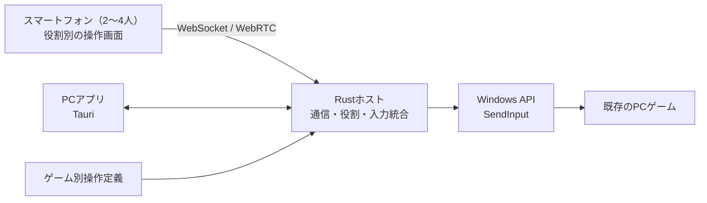

# Re:Cooplay（リコープレイ）— ゲームはそのまま。操作はみんなで。

Hack Dayでの実プレイ写真：3人で1つのキャラクターを共同操作

### 🎮 実際のプレイ風景

**3人で1つのキャラクターを操作する。** Hack Dayで披露したMinecraftの共同プレイをご覧ください。

https://github.com/user-attachments/assets/60d577f4-e287-45bc-bc6a-09455dd017c3

Hack Day中に撮影したMinecraftの実プレイ映像。移動・視点・攻撃などを3人で分担しています。

**JPHACKS 2026 金沢会場 Hack Day Audience Award 受賞**

[ギャラリー](docs/gallery.md) ・ [動作確認](docs/verification.md) ・ [資料一覧](docs/README.md)

---

Re:Cooplay（リコープレイ）は、**既存のPCゲームに新しい協力プレイを後付けするツール**です。

普段は1人が操作するキャラクターを、2〜4人で分担して動かします。移動する人、視点を動かす人、攻撃する人。**みんなが操作の当事者になることで、いつものゲームに新しい体験が生まれます。**

ゲーム本体の改造は不要。参加者はそれぞれのスマートフォンを使い、1つの画面を共有しながら遊べます。

---

## 目次

- [製品概要](#製品概要)
  - [背景](#背景製品開発のきっかけ課題等)
  - [製品説明](#製品説明具体的な製品の説明)
  - [特長](#特長)
  - [解決出来ること](#解決出来ること)
  - [今後の展望](#今後の展望)
  - [注力したこと](#注力したことこだわり等)
- [開発技術](#開発技術)
  - [活用した技術](#活用した技術)
  - [独自技術](#独自技術)
- [Hack Dayでの実装差分](#hack-dayでの実装差分)
- [動作確認の範囲](#動作確認の範囲)
- [試してみるには](#試してみるには)
- [権利・利用上の注意](#権利利用上の注意)

---

## 製品概要

### 背景(製品開発のきっかけ、課題等）

1人で遊ぶなら1人で操作する。複数人で遊ぶなら、それぞれが自分のキャラクターを操作するマルチプレイを選ぶ。それが一般的なゲームの楽しみ方です。

でも、**1つのキャラクターを動かすことそのものを、みんなで分担しても面白いのではないか。**

移動する人と視点を動かす人が違えば、思った方向へ進むにも声を掛け合う必要があります。失敗して笑うことも、息が合って成功することも、同じキャラクターを動かす全員の体験になります。

**ゲームの内容を変えずに、操作する人と協力の仕方を変える。**

Re:Cooplayは、既存のゲームにそんな新しい遊び方を加えたい、という発想から生まれました。

---

### 製品説明（具体的な製品の説明）

> **ゲーム体験 × Tech：1つのキャラクターを、みんなで動かす。**

Re:Cooplayは、**複数人がそれぞれのスマートフォンから、1つのPCゲームのキャラクターを共同操作する**ツールです。参加人数に応じて操作を分担し、全員の入力を組み合わせて1つのキャラクターを動かします。

#### 例えば、3人でMinecraftを遊ぶ場合

| プレイヤー | 担当する操作 |
|:--|:--|
| P1 | 移動・ジャンプ |
| P2 | 視点・カメラ操作 |
| P3 | 攻撃・アイテムの使用 |

敵が現れたとき、移動担当だけでは敵を狙えず、視点担当だけでは攻撃できません。互いの操作に合わせることで、初めて思いどおりにキャラクターを動かせます。

 

#### 遊び方

1. **PCでRe:Cooplayを起動する。** 参加用のQRコードを表示します。
2. **各自のスマホで参加する。** QRコードからWebアプリを開きます。最初の参加者がホストになります。
3. **ゲームを選ぶ。** ホストのスマホをリモコンとして使い、PC画面からゲームを選択します。
4. **担当を確認・決定する。** 参加人数に合わせた操作分担を確認し、必要なら担当を入れ替えます。
5. **ゲームを起動・準備する。** 遊びたいワールドやステージを開きます。
6. **みんなでプレイする。** ホストが「Ready」を押すと、各スマホが担当に応じた操作画面に切り替わります。

スマホへの専用アプリのインストールは不要です。1つのゲーム画面を見ながら、全員がプレイヤーとして参加できます。

---

### 特長

#### 1. **1つのキャラクターを、みんなで操作する**

Re:Cooplayでは、**2〜4人で1つのキャラクターを共同操作**できます。参加人数に応じて操作を自動で分担し、ゲーム開始前や一時停止中には担当を入れ替えることもできます。

同じゲームでも、誰が移動や視点を担当するかによって、声の掛け合い方や連携の仕方が変わります。

**キャラクターを動かすだけでなく、仲間と息を合わせること自体がゲームの楽しさになります。**

 

 

#### 2. **いつものPCゲームに、新しい遊び方を後付け**

Re:Cooplayは、**ゲーム本体を改造することなく、新しい協力プレイを追加**できます。

ゲームごとの操作方法に合わせて共同操作を実現する仕組みを備えており、Minecraftでの共同操作に加え、さまざまなPCゲームへの展開を目指しています。

**遊ぶゲームを変えるのではなく、遊び方を変える。** 遊び慣れたゲームにも、新しい楽しさが生まれます。

 

 

#### 3. **スマホが、そのままコントローラーに**

PC画面に表示されたQRコードをスマートフォンで読み取れば、Webアプリから参加できます。**専用のスマホアプリや、新しいコントローラーを用意する必要はありません。**

ゲームの準備中は、ホストのスマホをPC画面のリモコンとして使用できます。共同操作を開始すると、参加者それぞれのスマホが**担当する役割に合わせたコントローラー**に切り替わります。

普段使っているスマートフォンだけで、参加から協力プレイまで楽しめます。

---

### 解決出来ること

**Re:Cooplayは、ゲームの操作そのものを、みんなで協力する新しい遊び方に変えます。**

| | これまでの遊び方 | Re:Cooplayで加わる遊び方 |
|:--|:--|:--|
| **キャラクターの操作** | 通常は1人が1つのキャラクターを操作する | 複数人が分担し、同じキャラクターを動かす |
| **協力の仕方** | 一般的なマルチプレイでは、各自のキャラクターを操作して協力する | 移動や視点など、1つひとつの操作から協力が始まる |
| **ゲームとの関わり方** | 1人が操作するゲームでは、その人が操作の中心になる | 共同操作する全員が、1つのゲーム体験の当事者になる |

想定しているのは、**仲間との掛け合いや協力、思いがけないハプニングを楽しむ人たち**。そして、**1人ではためらうゲームにも、誰かと一緒に挑戦してみたい人たち**です。

共同操作が生む楽しさは、ゲームによって異なります。

- **Minecraftでは、連携すること自体が遊びになる。** 3人で移動・視点・攻撃を分担し、敵との戦闘などで声を掛け合いながら攻略する楽しさが生まれました。Hack Dayのライブデモでは、その様子を見ていた会場が盛り上がり、懇親会で実際にMinecraftを体験してもらった際にも楽しんでもらえました。
- **ホラーゲームでは、怖さを一緒に引き受けられる。** チームメンバー2人で共同操作を試した際には、多少操作しづらい場面はあっても、1人で遊ぶときの心細さが和らぎ、2人とも操作に関わるプレイヤーとして楽しめると感じました。

**ゲームはそのままなのに、まるで別ゲー。**

同じゲームでも、誰とどう操作するかによって、まったく違う協力体験が生まれます。

---

### 今後の展望

Re:Cooplayが目指すのは、**既存ゲームの数だけ、みんなで遊ぶ新しい可能性を広げること**です。

- **より多くのゲーム・ジャンルへ：** Minecraftやホラーゲームで得られた楽しさを、アクションや探索ゲームなどにも広げ、タイトルごとの操作や遊び方に合わせた共同操作を楽しめるようにする。
- **自分たちらしい共同操作へ：** 操作の割り当てやボタン配置をさらに自由にカスタマイズし、同じゲームでも自分たちだけのルールで遊べるようにする。
- **離れていても一緒に：** 同じネットワーク・同じ画面で楽しむ共同操作を、離れた友達とも共有できるようにする。

---

### 注力したこと（こだわり等）

#### **協力する過程が、自然と面白くなること**

共同操作では、1人で操作するときより思いどおりに動かせないことがあります。でも、その違いこそが会話や笑いにつながります。**操作を複雑にすることではなく、みんなで動かす過程を楽しめること**を大切にしました。

 

 

#### **操作の難しさと、操作の不具合を混同しないこと**

担当を分けたことで起こる連携の難しさは遊びの一部です。一方、入力の遅れや取りこぼしは、意図しないストレスにつながります。移動・視点・長押し・連打などができるだけ自然に伝わるよう工夫しました。

 

 

#### **初めて触る人も、迷わず参加できること**

PC画面で参加状況や担当を確認でき、スマホには役割に合った操作画面を表示します。準備中はリモコン、プレイ中はコントローラーへと切り替え、参加から開始までのわかりやすさを重視しました。

 

 

#### **みんなで操作するからこそ、安全に止められること**

ホストが明示的にプレイを始める仕組みにし、切断・一時停止・緊急停止などの際には、意図しない入力が残らないよう配慮しました。安心して試し、繰り返し遊べることも大切にしています。

実現方法は[独自技術](#独自技術)で説明します。

---

## 開発技術

### 活用した技術

#### API・データ

- **Windows API `SendInput`：** 既存ゲームへキーボード・マウス入力を渡す
- **WebSocket / WebRTC DataChannel：** スマホとPC間で操作・状態を送受信する
- **ゲームごとの操作定義：** 操作の種類・分担・キー設定を管理する（Minecraftの`options.txt`などを参照）
- **ローカルネットワーク：** 通常の共同操作に外部クラウドサーバーを必要としない構成

#### フレームワーク・ライブラリ・モジュール

- **PCホスト：** Rust / Tokio / axum
- **PCアプリ：** Tauri 2 / WebView2
- **PC・スマホ画面：** HTML / CSS / JavaScript
- **試験・検証：** Rustの自動テスト、Node.jsによる通信シミュレーション・画面テスト

#### デバイス

- Windows PC（ゲーム実行・複数人の操作の統合）
- Androidスマートフォン / iPhone（ブラウザ上のコントローラー）
- 同じローカルネットワークに接続できる通信環境

---

### 独自技術

#### システム構成

| 構成要素 | 役割 |
|:--|:--|
| スマホのWebアプリ | QR参加、ホスト用リモコン、担当ごとの操作画面 |
| TauriのPCアプリ | ゲーム選択、参加者・担当の確認、プレイ準備 |
| Rustホスト | 入力の受信、役割の管理、複数人の入力の統合と出力 |
| ゲーム別の操作定義 | タイトルごとに異なる操作やキー割り当てを扱う |
| Windows API | 既存ゲームへ通常の入力として操作を渡す |

[システム設計](docs/architecture/system-design.md) ／ [通信仕様](docs/architecture/protocol.md)

 

 

#### 1. **複数人の入力を1つの操作に統合する**

参加者それぞれから届く入力を、担当する役割に応じて受け付け、1つのWindows入力としてゲームに伝えます。人数に応じた自動分担と、プレイ開始前・一時停止中の役割交換にも対応しています。

[入力統合](apps/host-rs/src/hub.rs) ／ [入力変換](apps/host-rs/src/controls.rs) ／ [OS入力](apps/host-rs/src/input.rs) ／ [人数別の分担](docs/decisions/2026-10-25-variable-players.md)

 

 

#### 2. **リアルタイム通信と入力の整合性を両立する**

WebSocketとWebRTC DataChannelから届く入力の重複や古い状態の入力を防ぎ、視点の連続操作・押下・解放などを扱います。接続状態やプレイの進行状態もPCとスマホで共有します。

[通信実装](apps/host-rs/src/rtc.rs) ／ [通信仕様](docs/architecture/protocol.md) ／ [通信回帰試験](scripts/sim/protocol-sim.mjs)

 

 

#### 3. **ゲームごとの入力方法に合わせる**

操作の種類、初期キー、分担案をゲーム別に定義し、設定の読み取りや操作画面の生成へつなげます。Steam・Epicのインストール済みタイトルの検出なども備えています。**一覧に表示されることと、そのゲームで共同操作できることは別**として扱います。

[操作定義](docs/architecture/game-profiles.md) ／ [ゲーム検出](apps/host-rs/src/games.rs) ／ [キー設定](apps/host-rs/src/keybinds.rs) ／ [操作画面の生成](apps/web-static/scripts/generated-controls.js)

 

 

#### 4. **意図しない入力を残さない**

ゲーム・参加者・分担の決定後に、ホストが明示的に開始します。入力先のゲーム画面を確認し、一時停止・切断・緊急停止の際には入力を解放して、以前の操作が残らないようにしています。

[対象ウィンドウの判定](apps/host-rs/src/focus.rs) ／ [役割交換の設計](docs/decisions/2026-10-25-role-swap.md) ／ [開始手順の設計](docs/decisions/2026-10-25-launch-after-roles.md)

---

## Hack Dayでの実装差分

Hack Dayは**2026年10月24〜25日**。開発開始前の基準コミットには`README.md`と`LICENSE`があり、そこから共同操作を成立させるシステムを開発しました。

**[開始前の基準コミット](https://github.com/jphacks/kz_2613/tree/5acb0049e6) ／ [GitHubの実装差分](https://github.com/jphacks/kz_2613/compare/5acb0049e6...main)**

| Hack Day中に開発したもの | コード・証拠 |
|:--|:--|
| 複数台のスマホから操作を受け取るPCホスト | [Rustホスト・入力統合](apps/host-rs/src/hub.rs)・[OS入力](apps/host-rs/src/input.rs) |
| PC・スマホの参加画面と役割別コントローラー | [Web UI](apps/web-static/)・[UIの検証結果](artifacts/improved-ui/README.md) |
| WebRTC / WebSocketでの通信と操作変換 | [通信実装](apps/host-rs/src/rtc.rs)・[操作定義](apps/host-rs/src/profiles.rs) |
| 分担、明示的な開始、停止と誤入力対策 | [ホスト実装](apps/host-rs/src/hub.rs)・[開発ログ](docs/handoff/BUILD_LOG.md) |
| ゲーム別の操作定義とゲーム検出 | [操作定義](apps/game-profiles/)・[検出処理](apps/host-rs/src/games.rs) |

**Hack Dayの成果を示す中心的な動作は、Minecraftでの3人共同操作です。** 開発経緯は[Hack Day開発・検証ログ](docs/handoff/BUILD_LOG.md)に記録しています。

なお、比較リンクにはREADMEの編集なども含まれます。Hack Day中の実装内容は、コミット履歴と開発ログで確認できます。

---

## 動作確認の範囲

| 確認の種類 | 内容 |
|:--|:--|
| **実際のゲームでのプレイ** | **Minecraft：** Hack Dayのライブデモと懇親会で、Windows PCとスマホ3台（Android 2台、iPhone 1台）を使って共同操作。**ホラーゲーム：** チームメンバー2人で短時間の共同操作を試遊。 |
| **機能・自動試験** | 2〜4人の人数に応じた操作分担と役割交換に対応。Rustホストの状態遷移、通信、認可、安全停止などを、自動テストやシミュレーションでも確認しています。 |
| **引き続き確認が必要な範囲** | ほかのタイトルへの幅広い互換性、長時間の安定性、異なるPC環境への配布・再現性、遠隔接続など。操作定義を登録しただけのタイトルで動作を保証するものではありません。 |

[検証記録の詳細](docs/verification.md) ／ [Hack Day開発ログ](docs/handoff/BUILD_LOG.md) ／ [ギャラリー](docs/gallery.md)

---

## 試してみるには

Re:Cooplayは、Windows PCでゲームを実行し、同じローカルネットワークに接続したスマートフォンをコントローラーとして使います。

1. **環境を用意する。** Windows PCと、利用するPCゲーム、参加人数分（2〜4台）のスマートフォンを用意します。
2. **Re:Cooplayを起動する。** [Windowsセットアップ](docs/handoff/SETUP_WINDOWS.md)に従ってPCホスト・PCアプリを準備します。
3. **スマホから参加する。** PC画面のQRコードを読み取り、同じネットワークからWebアプリにアクセスします。
4. **ゲームと担当を決める。** ゲームを選択し、人数に応じた分担を確認して、ゲームを起動・準備します。
5. **プレイを始める。** ホストが「Ready」を押し、共同操作を始めます。

### 起動・開発手順

開発環境や起動コマンドの詳細は、以下の資料を参照してください。

- [Windowsセットアップ](docs/handoff/SETUP_WINDOWS.md)
- [PCアプリの起動・使い方](apps/desktop/README.md)
- [Rustホストのビルド・検証](apps/host-rs/README.md)

---

## 権利・利用上の注意

Re:Cooplayは、ゲーム開発元とは独立した非公式ツールです。ゲーム本体や、各ゲームのプログラム・素材は同梱していません。利用するゲームごとの規約や、配信・映像公開に関する条件に従ってください。

**Minecraftの公式製品ではなく、Mojang StudiosおよびMicrosoftの承認・提携を受けたものではありません。**

**NOT AN OFFICIAL MINECRAFT PRODUCT. NOT APPROVED BY OR ASSOCIATED WITH MOJANG OR MICROSOFT.**

Minecraftの名称・画面・デモ素材の扱いについては[利用条件の確認記録](docs/decisions/2026-10-25-minecraft-usage-terms.md)を参照してください。公開用の連絡先や素材の利用条件については、引き続き確認が必要です。

---

**ゲームはそのまま。操作はみんなで。**

**Re:Cooplay**

