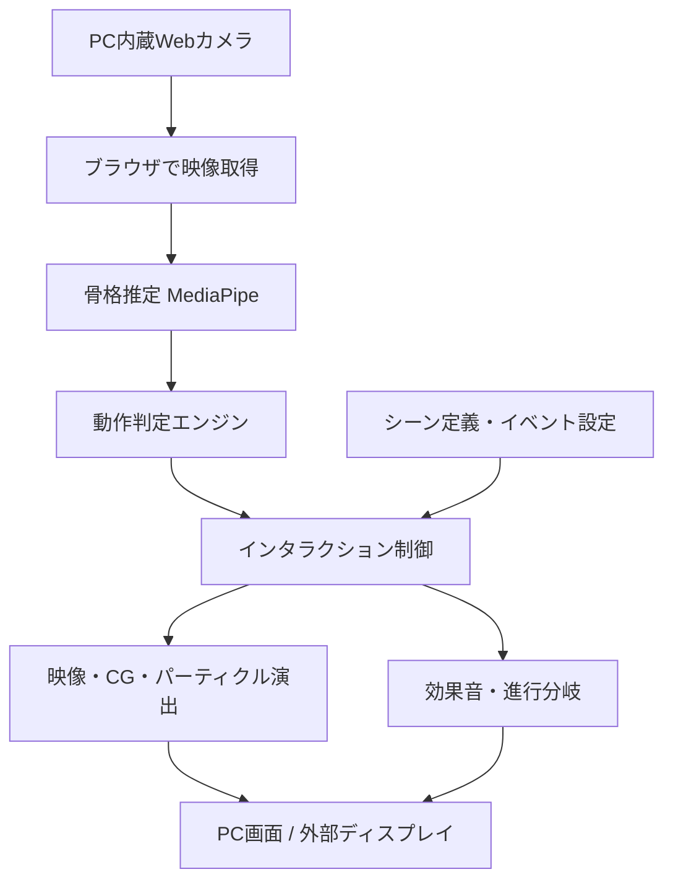

# WARMVERSE（仮称） - 映像は、あなたが動かす。

> **観るウォームアップから、世界に干渉するウォームアップへ。**  
> PCの内蔵カメラが身体の動きを読み取り、あなたの一歩・一振りで映像世界が変化する、没入型インタラクティブ運動体験。


<!-- プロダクト名・ロゴ・デモ映像・公開URLは開発進行に合わせて更新してください。 -->

<div align="center">

### **あなたのパンチで壁が壊れる。しゃがめば障害物を避けられる。ジャンプすれば景色が変わる。**

**動画を真似するだけだった運動が、映像を進めるためのアクションになる。**

<!-- デモ動画完成後に以下を置き換えて掲載
[](https://example.com/demo)
-->

**デモ動画・Webアプリ：準備中**

</div>

---

## 目次

- [Live Demo](#live-demo)
- [製品概要](#製品概要)
  - [背景（製品開発のきっかけ・課題など）](#背景製品開発のきっかけ課題など)
  - [製品説明（具体的な製品の説明）](#製品説明具体的な製品の説明)
  - [体験の流れ](#体験の流れ)
  - [システム構成](#システム構成)
  - [特長](#特長)
  - [解決できること](#解決できること)
  - [今後の展望](#今後の展望)
  - [注力すること（こだわり等）](#注力することこだわり等)
- [開発技術](#開発技術)
  - [活用予定の技術](#活用予定の技術)
  - [独自に設計する仕組み](#独自に設計する仕組み)
- [MVPと評価計画](#mvpと評価計画)
- [既存サービスとの違い](#既存サービスとの違い)
- [利用環境・注意事項](#利用環境注意事項)
- [参考資料](#参考資料)

---

## Live Demo

現在は**企画・設計段階**です。公開URL・デモ映像は実装後に掲載します。

**最初のデモで見せたいこと：**
1. Webブラウザでカメラを許可する。
2. 画面上のガイドに合わせて立ち位置・検出状態を確認する。
3. パンチ、しゃがむ、ジャンプの3種類の動作をする。
4. 動作に合わせて映像世界がリアルタイムに破壊・回避・変化する。

## 製品概要

### 背景（製品開発のきっかけ・課題など）

#### 1. 「見て真似する」だけでは、映像の世界に参加できない

SNSや動画サイトでは、画面に合わせてパンチしたり、しゃがんだり、身体を動かしたりする **Immersive Interactive Warm Up** 風のコンテンツが見られます。映像の演出によって、ただの準備運動がゲームのように感じられる一方、一般的な動画は**視聴者が動いたかどうかを認識しません**。

パンチを出しても出さなくても壁は壊れる。しゃがまなくても障害物は通り過ぎる。視聴者は「参加しているように感じる」ことはできても、映像の展開そのものは変えられません。

#### 2. 身体を動かすきっかけが、日常の中で不足している

デスクワークや長時間のPC利用では、こまめに身体を動かすことが後回しになりがちです。一方で、運動のためにウェアラブル機器を購入したり、特別なゲーム機を用意したりするのは、気軽な開始を妨げる要因になります。

**「PCを開いている、その場ですぐに遊べる運動」** があれば、短い休憩時間をもっと楽しく使えるのではないかと考えました。

#### 3. 体感ゲームはある。それでも「没入する映像作品」とは少し違う

身体を使う既存のゲームやモーション認識サービスはあります。しかし本プロジェクトが目指す中心体験は、スコアを稼ぐことだけではありません。

**身体を動かした結果、目の前の世界が自分の行動によって変化し、映像の物語が続いていく。** その感覚を、特別な機材なしで実現することを目指します。

### 製品説明（具体的な製品の説明）

> **Immersive Video × Body Tracking × Real-time Interaction**

**WARMVERSE** は、PC内蔵カメラで身体の動きを認識し、映像世界にリアルタイムで干渉できる **Webベースの没入型ウォームアップ体験** です。

ブラウザでコンテンツを開き、画面の前で身体を動かすだけ。カメラ映像から推定した骨格情報をもとに、パンチ・しゃがむ・ジャンプなどを判定します。その結果によって、壁が砕ける、障害物を避ける、景色が切り替わるなど、**映像そのものに反応が起きます**。

映像は決まったタイミングで勝手に成功演出へ進むのではなく、**プレイヤーの行動によって変わる**ことを重視します。

#### 主な機能（実装予定）

| 機能 | 内容 |
|:--|:--|
| **カメラだけで身体を認識** | PC内蔵Webカメラの映像から姿勢・関節位置を推定 |
| **ジェスチャー判定** | パンチ、左右回避、しゃがむ、ジャンプなどを検出 |
| **映像世界へのリアルタイム干渉** | 動作に応じてオブジェクトの破壊、パーティクル、障害物の通過判定などを発生 |
| **インタラクティブな場面進行** | 成功・失敗や動作の種類によって次の演出・場面を変化 |
| **運動ガイド** | 画面内の演出や音で、次に必要な動きを直感的に提示 |
| **体格・環境への調整** | カメラに映る範囲や関節可動域に応じた初期キャリブレーション |
| **短時間で遊べるモード** | 30〜60秒程度のミニ体験から始められる構成 |

### 体験の流れ

#### Scene 01：BREAK — パンチで壁を壊せ

画面の奥から迫ってくる壁。指示された方向へパンチすると、拳の動きに対応した場所にヒビが入り、破片が飛び散る。必要な回数のアクションが成功すると壁が崩れ、次の世界が現れます。

- **検知**：手首・肘・肩の位置変化、動作方向、移動速度
- **フィードバック**：ヒビ、破片、衝撃音、カメラシェイク
- **運動要素**：上半身・腕の動作

#### Scene 02：DODGE — 身体で障害物をかわそう

トンネルの中を進む映像。上から障害物が現れたらしゃがみ、左右から迫る障害物には身体を傾けて対応。回避の成否によって画面の揺れや進行が変わります。

- **検知**：肩・腰の高さ、身体中心の左右移動、姿勢変化
- **フィードバック**：障害物の通過、衝突演出、成功時の速度感
- **運動要素**：屈伸・体幹移動

#### Scene 03：LEAP — ジャンプで世界を切り拓け

目の前に現れる崖や段差。タイミングよくジャンプすると、映像視点が上昇し、足元の地形が変化。着地すると次の景色へつながります。

- **検知**：腰・肩などの上下移動と時間変化（全身が映る環境を推奨）
- **フィードバック**：視点移動、空中演出、着地時の環境変化
- **運動要素**：下半身・全身運動
- **代替操作**：画角が足りない場合は、背伸びなどの低負荷動作への切り替えを検討

**重要なのは、動作に点数をつけるだけではなく、動作が映像内の出来事の「原因」になることです。**

### システム構成

#### システムアーキテクチャ（構想）



#### データの流れ

1. ブラウザの `getUserMedia()` でカメラ映像を取得。
2. `MediaPipe Pose Landmarker` などで身体ランドマークを推定。
3. 座標を正規化し、平滑化・個人差調整したうえで動作を判定。
4. 判定結果を `punch` / `duck` / `jump` などのイベントとして発行。
5. 映像再生位置・ゲーム状態に応じて、演出・当たり判定・場面遷移を更新。
6. 画面エフェクトと効果音を同じアクションに対して再生。

※まずは**事前に制作したシーンとリアルタイムエフェクトの組み合わせ**で実装を目指します。任意の動画を自動でインタラクティブ化する機能は、初期スコープには含めません。

### 特長

#### 1. **「見る運動」から「映像に作用する運動」へ**

従来のウォームアップ動画では、ユーザーが実際に動いているかどうかに関係なく映像が進みます。本プロダクトでは、身体の動きが**物体の破壊・衝突・回避・場面進行**に直結します。自分が世界を変えたという手応えを演出します。

#### 2. **PCと内蔵カメラだけで開始できる**

専用センサー、コントローラー、ウェアラブル端末を前提としません。Webブラウザ上での動作を目指し、普段使っているPCを身体操作型の体験装置に変えます。

#### 3. **短い映像作品として楽しめる**

独立したミニゲームを並べるだけではなく、「壁を壊して進む → 障害物をかわす → 崖を飛び越える」のように、**場面がつながる演出**を重視します。運動の結果が次の世界への入口になります。

#### 4. **動作を強制しない設計**

カメラの画角や身体の可動域は人によって異なります。上半身だけで遊べるコンテンツから始め、低負荷の代替操作や難易度調整を検討します。安全に動けることを優先します。

### 解決できること

- **受動的な運動体験**：視聴者の行動に反応しない映像を、入力とフィードバックのある体験に変える。
- **運動開始の心理的ハードル**：短時間のゲーム感覚で、PC作業の合間に身体を動かすきっかけをつくる。
- **専用機器が必要な体感型エンタメへのハードル**：既存のPCカメラで試せる構成を目指す。
- **継続しにくい単調な動作**：シーンごとに異なる世界や反応を用意し、次の動きを楽しみにできるようにする。

※運動習慣の改善や身体機能の向上といった効果は、今後のユーザーテストで検証する仮説です。

### 今後の展望

#### もっと多彩な世界へ
- 敵とのバトル、落ちてくる物体のキャッチ、空を飛ぶ、波をかき分けるなどのシーンを追加。
- ジャンルごとに異なる映像演出を備えたショートコンテンツを配信。
- 友人や家族が交代で挑戦できるモードを検討。

#### もっとパーソナルに
- 可動範囲や動作の速さに合わせて難易度・判定閾値を自動調整。
- 上半身だけで成立するモード、座ったままできるモードを検討。
- 継続時間や好みに合わせたコンテンツ推薦を検討。

#### 「映像を遊べる作品」にする制作環境へ
- 動画・背景・演出・ジェスチャーの対応づけを編集できるシーンエディター。
- クリエイターがインタラクティブなウォームアップ映像を制作・公開できる仕組み。
- 許諾済み素材を対象とした、AIによるイベント候補生成や編集支援を検討。

### 注力すること（こだわり等）

- **反応の気持ちよさ**：手が動いた瞬間に破片が飛ぶ、身体が沈んだ瞬間に障害物をかわせるなど、映像と動作の因果関係が伝わるタイミングを重視。
- **誤検知の抑制**：単一フレームの位置だけでなく、速度・方向・姿勢の変化を用いてジェスチャーを判定。平滑化、クールダウン、判定状態の管理を行う。
- **世界の一貫性**：単なる成功メッセージではなく、ヒビ・破片・カメラ移動・背景遷移などで「世界が変わった」ことを表現。
- **導入の手軽さ**：インストール不要・ブラウザ起動を基本とし、初回のカメラ位置調整をわかりやすくする。
- **カメラ画像の扱い**：初期構想では端末内で推論を完結させ、カメラ映像をサーバーへ送信しない設計を優先。

## 開発技術

### 活用予定の技術

| 分野 | 技術候補 | 役割 |
|:--|:--|:--|
| フロントエンド | React / TypeScript / Vite | ゲーム画面、状態管理、UI |
| カメラ取得 | Web API `getUserMedia()` | PC内蔵カメラへのアクセス |
| 骨格推定 | MediaPipe Pose Landmarker (Web) | 身体ランドマークの推定 |
| 動作判定 | TypeScript / 独自ロジック | ジェスチャー認識、姿勢・速度の評価 |
| 映像演出 | Three.js または PixiJS / Canvas | 背景、2D・3D演出、破壊・粒子エフェクト |
| オーディオ | Web Audio API | 衝突音、成功音、BGMなど |
| コンテンツ定義 | JSON | 動作と映像イベント・分岐の対応づけ |
| デプロイ | 静的Webホスティング | インストール不要での公開 |

※いずれも**実装予定・検討中の技術**です。採用技術やバージョンは開発時に確定します。

### 独自に設計する仕組み

#### 1. ジェスチャーを「映像の原因」に変換するエンジン

骨格推定そのものは既存技術を利用し、独自性は**身体動作と映像内イベントの結びつけ方**に置きます。

例えば、`右パンチ` なら映像上の右側の壁にヒビを入れる、`しゃがむ` なら天井の障害物を通過させる、というように、シーンごとに異なる反応を割り当てます。

```json
{
  "scene": "break-wall",
  "trigger": "right_punch",
  "condition": { "direction": "forward", "confidenceMin": 0.7 },
  "effects": ["crack", "debris", "impact_sound"],
  "onSuccess": "increase_wall_damage"
}
```

上記は**シーン定義のイメージ**です。実際の仕様は今後設計します。

#### 2. 映像の進行と動作認識をつなぐ状態管理

映像側が要求している動きとユーザーの動作を照合し、成功・未達成・再挑戦の状態を管理します。一定時間内の成功で次のシーンを再生するなど、**動画の時間軸とユーザー入力**を結びつけます。

#### 3. 大がかりな機材を使わない没入演出

身体の姿そのものを画面に常時映すのではなく、**一人称視点の映像が動作によって変わる演出**を基本とします。PCのカメラで身体を認識しつつ、ユーザーには「映像世界の主人公になった」ように感じてもらう設計です。

## MVPと評価計画

### Hack Dayで目指す最小構成

- [ ] ブラウザでPCカメラ映像を取得できる
- [ ] 骨格推定と画面内の検出確認UIを実装する
- [ ] パンチ・しゃがむ・ジャンプの3動作を認識する
- [ ] 動作に同期した3種類の映像エフェクトを実装する
- [ ] シーンの成功判定・分岐を実装する
- [ ] 30〜60秒の連続体験を完成させる
- [ ] カメラ画角不足や誤検知の際の案内を用意する

### 確かめたいこと

| 評価観点 | 検証方法 |
|:--|:--|
| 動作認識の安定性 | 複数人・異なる照明やカメラ位置で正答率と誤検知を測る |
| 映像との同期感 | 動作から画面反応までの遅延を計測し、違和感をヒアリング |
| 没入感 | 「自分が世界を変えたと感じたか」を体験後に質問 |
| 手軽さ | 初回アクセスから体験開始までの時間・失敗箇所を記録 |
| 楽しさ・再体験意向 | 同じ映像を見るだけの場合との比較テストを検討 |

数値目標や結果は、実機計測・ユーザーテスト後に追記します。

## 既存サービスとの違い

| 比較対象 | 主な特徴 | 本プロジェクトが重視する違い |
|:--|:--|:--|
| 一般的な Immersive Warm Up 動画 | 映像を見ながら身体を動かす | 実際の動作を検知して映像の展開を変える |
| Active Arcade などのカメラ体感ゲーム | 身体を入力としてゲームを遊ぶ | ミニゲーム単位だけでなく、**連続した没入型映像作品**の構成を重視 |
| モーション採点型フィットネス | フォームや達成度を計測 | 採点だけでなく、**映像世界の破壊・変形・分岐**を中心に置く |
| 大型インタラクティブ展示 | センサーや投影設備を使った没入体験 | 手元のPCとブラウザだけで体験することを目指す |

※「先行サービスが存在しない」「世界初」などは主張しません。差別化の中心は、**身体動作・連続映像・即時フィードバックを統合した体験設計**です。

## 利用環境・注意事項

- **想定環境**：PC（内蔵または接続Webカメラ）と、カメラを利用できるWebブラウザ。外部ディスプレイへの出力は任意。
- **設置条件**：身体が認識できる画角、十分な照明、周囲の安全な運動スペースが必要。内蔵カメラでは全身が映らない場合があります。
- **安全への配慮**：無理なジャンプや急な動作を要求しない設計とし、体調や環境に応じて運動を中止・変更できるようにします。
- **プライバシー**：初期構想ではカメラ映像をブラウザ内で処理し、保存・送信を前提としません。実装後に実際のデータ取扱いを明記します。
- **コンテンツの権利**：参考にした動画や他者の映像素材を無断で組み込まず、オリジナルまたは使用許諾のある素材で制作します。

## 参考資料

- [JPHACKS 2025 / 4DX@HOME README](https://github.com/jphacks/kz_2504) — READMEの構成・伝え方の参考
- [MediaPipe Pose Landmarker for Web](https://ai.google.dev/edge/mediapipe/solutions/vision/pose_landmarker/web_js) — ブラウザ向け姿勢推定
- [MDN: MediaDevices.getUserMedia()](https://developer.mozilla.org/en-US/docs/Web/API/MediaDevices/getUserMedia) — Webカメラ取得API
- [Three.js](https://threejs.org/) — Webベースの3D表現
- [Immersive Warmup Japan (YouTube)](https://www.youtube.com/@ImmersiveWarmupJapan) — 映像に合わせて身体を動かす体験の着想元

---

<div align="center">

### **観るだけで終わらない。動いた分だけ、世界が変わる。**

**WARMVERSE（仮称）**

*本READMEは企画段階のコンセプトドキュメントです。記載した機能・技術・体験内容は実装前の計画を含みます。*

</div>
