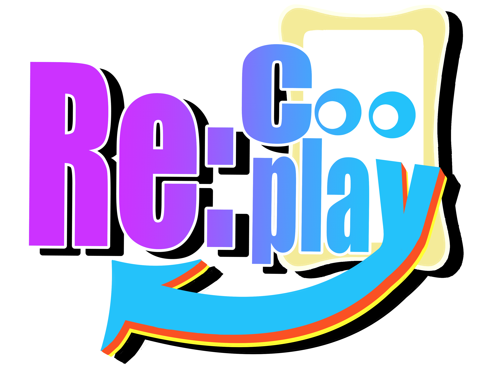
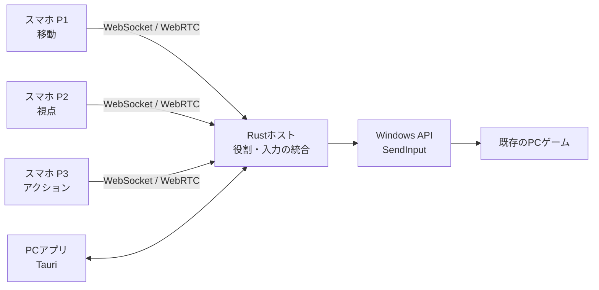

# Re:Cooplay（リコープレイ）— ゲームはそのまま。遊び方を変える。

  

  

    
  

  
🎉 <strong>JPHACKS 2026 Hack Day（金沢会場）</strong> 🎉

  
🏆 <strong>「Hack Day Audience Award」受賞</strong> 🏆

  
<strong>1人で遊んでいたゲームが、みんなで協力して遊ぶゲームに。</strong>

  
チーム「三人羽織」（kz_2613）

  
  
Hack Dayのプレイ風景：3人がスマホから1つのキャラクターを共同操作

**Re:Cooplay**は、**既存のPCゲームに、新しい協力プレイを後付けするツール**です。

1つのキャラクターの操作を複数人で分担し、それぞれのスマートフォンから動かします。ゲーム本体を改造する必要はありません。いつもは1人で完結する移動や攻撃が、仲間と声を掛け合い、息を合わせる遊びに変わります。

**特定のゲームだけの追加モードではなく、さまざまな既存PCゲームに共同操作を適用できる仕組み**を開発しました。

<strong>デモ・PCアプリ・スマートフォン操作画面を見る</strong>

開発メンバー3人で、Minecraft Java Editionの1キャラクターを共同操作しました。モンスターとの戦闘では「剣に持ち替えて！」「下がって！」と声を掛け合うなど、普段のプレイとは違う一体感が生まれました。

**紹介・デモ動画：** 公開リンク準備中

### PCアプリ

  

  3人の操作分担を確認する画面（2026/10/25版・表示検証用キャプチャ）

ゲーム選択・準備完了の画面を見る

  
  
ゲーム選択

  
  
ゲーム準備完了・ホストのReady待ち

### スマートフォンのコントローラー

<table>
  <tr>
    <th align="center">P1：移動</th>
    <th align="center">P2：視点</th>
    <th align="center">P3：アクション</th>
  </tr>
  <tr>
    <td></td>
    <td></td>
    <td></td>
  </tr>
</table>

画像は[最新UIの検証記録](artifacts/improved-ui/README.md)に収録された画面キャプチャです。ゲームプレイ中の写真や、Android・iPhone実機での動作を示す画像ではありません。

## 製品概要

### 背景(製品開発のきっかけ、課題等）

#### **ゲームを変えずに、遊び方を変えたい**

友達と遊び慣れたゲームをするとき、「いつもと違うルールで楽しめたら面白いのに」と思うことがあります。

例えば、1つのキャラクターを、友達みんなで動かしてみる。移動する人、周囲を見る人、攻撃する人が別々なら、ただ敵を倒すだけでも声を掛け合う必要があります。**同じゲームが、まったく違う協力体験になる**はずです。

#### **ゲームにない遊び方を、後から追加する難しさ**

通常のマルチプレイは、それぞれが自分のキャラクターを操作します。一方、**複数人で1つのキャラクターの操作を分担する遊び方**は、ゲーム側に用意されているとは限りません。

個々のゲームに専用のMODや新機能を実装する方法では、別のゲームでも同じ遊び方を試すには手間がかかります。

そこで私たちは、**ゲームの中身ではなく、ゲームに送る「操作」の側を変える**ことにしました。

### 製品説明（具体的な製品の説明）

> **既存ゲーム × Tech**

**Re:Cooplay**は、スマートフォンを使って**1キャラクターを複数人で共同操作**できる、既存PCゲーム向けの「遊び方を後付けする」ツールです。

各自のスマホから送られる入力をPCで統合し、通常の**キーボード・マウス操作**としてゲームへ渡します。ゲーム本体の改造は不要。**Minecraftだけでなく、複数のPCゲームにこの仕組みを適用できます。**

例えば現在のMinecraft向けの3人プレイでは、役割を次のように分けています。

| プレイヤー | 役割 | 担当する操作 |
|:--|:--|:--|
| **P1** | 移動 | 前後左右、ジャンプ、スニーク、ダッシュ |
| **P2** | 視点 | タッチ操作でカメラ・視点を動かす |
| **P3** | アクション | 攻撃、使用・設置、持ち物の切り替えなど |

例えば敵に襲われたとき。移動担当は逃げたくても、視点担当が敵の方向を見なければ攻撃できません。攻撃担当には武器の切り替えをお願いする必要があります。

「右！」「下がって！」「今だ！」。**1人なら無言で終わる操作が、3人の会話になる。** そのちょっとした不自由さこそが、Re:Cooplayの面白さです。

#### 遊び方

1. **PCで起動する：** Windows PCでRe:Cooplayを立ち上げ、参加用の画面を開きます。
2. **スマホで参加する：** 同じローカルネットワークにいる3人が、スマホのブラウザから参加します。
3. **ゲームを準備する：** ホストがゲームを選び、操作の担当を確認します。
4. **みんなで操作する：** ゲームが準備できたらホストがReady。3人の共同操作が始まります。

スマホに専用アプリをインストールする必要はありません。ゲーム映像は1台のPC画面を共有し、スマホはコントローラーとして使います。

### 特長

#### 1. **既存のゲームに、協力プレイを後付けできる**

Re:Cooplayの核は、特定タイトルの内部を変更するのではなく、**複数のコントローラー入力を1つにまとめて、ゲームへ渡す**仕組みです。

Minecraftに限らず、キーボード・マウスで操作するPCゲームを中心に、タイトルごとの操作定義を使って共同操作を適用できます。ホラーゲームなら、視点を動かす人と逃げる人が違うだけで、きっと大騒ぎになるはずです。

ゲームごとの入力方式・起動環境には違いがあるため、**入力を統合する汎用的な仕組みがあること**と、**すべてのゲームで動作確認が済んでいること**は別です。対応状況はゲームごとに確認します。

#### 2. **「3人で1キャラ」が生み出す、新しい一体感**

普通のマルチプレイでは、各自が自分のキャラクターを動かします。Re:Cooplayでは、**誰か1人の操作が、全員のキャラクターに影響します。**

相手の意図が分からず失敗することも、息が合って成功することも、その場にいる全員の体験になります。普通のマルチプレイの代わりではなく、**同じゲームを楽しむための、もう1つの選択肢**です。

#### 3. **手元のスマホが、そのままコントローラーに**

専用機器は必要ありません。各自のスマホをつなげば、操作担当に合わせた画面が表示されます。

PCアプリには参加状況や操作分担、ゲームの準備状況を表示。ホストは準備・開始・一時停止・再開を管理できます。接続やゲーム操作をローカルネットワークで完結させる設計です。

### 解決出来ること

**ゲームを作り替えることなく、今あるゲームに「みんなで1つのキャラクターを操作する」という新しい協力体験を加えられます。**

- **遊び慣れたゲームを再発見：** いつもの場面が、声掛けや連携の必要な挑戦に変わる
- **一緒に遊ぶ楽しさを増やす：** 1キャラを全員で動かすため、成功も失敗も共有できる
- **ゲームをまたいで遊び方を持ち込む：** タイトルごとにゲームを改造することなく、共同操作を適用できる

私たち自身が3人でMinecraftをプレイしたときも、戦闘中に自然と声が飛び交い、普段とは違う面白さを感じました。ここで述べている体験は開発メンバーによるもので、一般ユーザーへの大規模な評価を意味するものではありません。

### 今後の展望

- **さまざまなジャンルでの実機検証：** ホラー、アクションなどのタイトルごとに入力方式を確認し、対応範囲を明確にする
- **操作分担のカスタマイズ：** 役割の組み替え、配置変更、人数に応じたプレイ方法を充実させる
- **離れた友達との共同操作：** 同じ場所でのプレイから、遠隔参加・配信での利用へ広げる

ゲームごとに遊び方を持ち込める仕組みは実装していますが、操作の完全な自由編集、2人・4人での実セッション、遠隔共同操作は今後の開発対象です。

### 注力したこと（こだわり等）

#### **操作の遅延や取りこぼしを抑える**

操作の気持ちよさを損なわないよう、WebSocketとWebRTC DataChannelを併用し、先に届いた入力を重複させずに処理します。短い連打や長押し、視点の連続操作も扱えるようにしています。

#### **複数人でも安心して遊べるようにする**

通信切断・一時停止・入力先ウィンドウの変更時には、操作を解放したり、古い入力を破棄したりする制御を実装しています。ホストの明示Readyによって、ゲームの準備中に共同操作が始まらないようにしています。

#### **ゲームごとの違いを吸収する**

ゲームのキー設定や操作の違いを扱うため、操作定義（プロファイル）を導入。Minecraftの`options.txt`などから設定を読み取る機能や、Steam・Epic Gamesのインストール済みタイトルを検出・起動する機能を実装しています。

参考用のゲーム操作定義も多数用意しています。ただし、**定義が存在することと、そのゲームで共同操作が実機確認済みであることは異なります。** 未検証・未対応の定義を区別し、安全に開始を制限しています。

#### **触るだけで楽しいUIにする**

PCとスマホで見た目を統一し、担当ごとに操作しやすい画面を用意しました。開発・診断情報は通常画面から分離し、ゲーム中に必要な情報を見やすくしています。[最新UIの比較と検証](artifacts/improved-ui/README.md)には画面ごとの制作記録があります。

#### システム構成

| 構成要素 | 技術 | 役割 |
|:--|:--|:--|
| スマホ操作画面 | HTML / CSS / JavaScript | P1〜P3それぞれのコントローラー |
| PCホスト | Rust / Tokio / axum | ローカル通信、役割と状態の管理、入力統合 |
| リアルタイム通信 | WebSocket / WebRTC DataChannel | スマホからの操作と状態の送受信 |
| ゲームへの入力 | Windows API `SendInput` | キーボード・マウス操作として送信 |
| PCアプリ | Tauri / WebView2 | 参加、ゲーム選択、分担確認、準備・開始 |

詳しくは[システム設計](docs/architecture/system-design.md)と[通信仕様](docs/architecture/protocol.md)を参照してください。

## 開発技術

### 活用した技術

#### API・データ

- **OS入力：** Windows API `SendInput`（キーボード・マウス入力）
- **通信：** WebSocket / WebRTC DataChannel（各スマホからの入力と状態の送受信）
- **ゲーム操作設定：** Minecraft `options.txt`のキー割り当て参照
- **ネットワーク：** ローカルWi-Fi（プレイ時の外部クラウドサーバーは不要）

#### フレームワーク・ライブラリ・モジュール

- **PCホスト：** Rust / Tokio / axum
- **PCアプリ：** Tauri 2 / WebView2
- **スマホ・PC画面：** HTML / CSS / JavaScript
- **検証：** Node.js参照実装、通信シミュレーション、ブラウザUIテスト、Windows入力プローブ

#### デバイス

- Windows PC（ゲーム実行・操作入力の統合）
- Androidスマートフォン / iPhone（ブラウザをコントローラーとして利用）
- ローカルWi-Fiネットワーク

### 独自技術

#### ハッカソンで開発した独自機能・技術

#### 1. **3人の操作を、1つのWindows入力に統合する**

各スマホは「前進」「攻撃」などの操作名を送信。PC側でプレイヤーの役割を確認して入力をまとめ、ゲームのキーボード・マウス操作に変換します。

[入力・セッション統合](apps/host-rs/src/hub.rs) ／ [操作の対応](apps/host-rs/src/controls.rs) ／ [Windows入力](apps/host-rs/src/input.rs)

#### 2. **通信の速さと、状態の正しさを両立する**

WebSocketとWebRTCから届く入力を順序番号で管理して重複処理を防止。視点移動の補間、連打・長押しの扱い、接続切断時の停止まで統合しています。

[WebRTC通信](apps/host-rs/src/rtc.rs) ／ [通信プロトコル](docs/architecture/protocol.md) ／ [通信回帰テスト](scripts/sim/protocol-sim.mjs)

#### 3. **既存ゲームに合わせるための操作定義**

Minecraftのキー変更を反映できるほか、インストール済みゲームの検出と、操作定義を使った担当別コントローラーの生成に取り組みました。未検証のゲームを「動作確認済み」と表示しない設計も重要な部分です。

[ゲーム検出](apps/host-rs/src/games.rs) ／ [キー設定](apps/host-rs/src/keybinds.rs) ／ [操作プロファイル](apps/host-rs/src/profiles.rs) ／ [操作定義カタログのテスト](scripts/sim/profile-catalog-test.mjs)

#### 4. **誤入力を防ぐ安全なゲーム操作**

対応するゲームが前面にあるかを確認し、切断・停止・対象ウィンドウの変更時には入力を解放します。操作用画面と診断画面を分け、診断を開いたときには通常操作を停止します。

[入力先の確認](apps/host-rs/src/focus.rs) ／ [診断と入力停止のテスト](scripts/sim/controller-diagnostics-test.mjs)

### Hack Dayでの開発・検証

2026年10月24〜25日のHack Dayでは、試作品を実ゲームで試しながら、Rust/TauriによるPCアプリ、複数端末のリアルタイム入力、画面の整備、ゲーム別の操作定義、安全停止機構などを開発しました。

- [試作品の実機確認](docs/decisions/2026-10-24-prototype-validated.md)
- [開発・検証ログ](docs/handoff/BUILD_LOG.md)
- [画面デザインと検証画像](artifacts/improved-ui/README.md)
- [実機検証項目](docs/architecture/validation-gates.md)
- [Hack Dayのコミット履歴](https://github.com/jphacks/kz_2613/commits/main/)

**検証範囲について：** 開発メンバーによるMinecraftの共同操作体験、Rustホストの通信・入力シミュレーション、UIのブラウザ表示確認は、それぞれ異なる検証です。最新UIとすべてのゲームを組み合わせた実機動作、各タイトルの互換性、長時間の安定性については継続して確認します。

## 起動・開発手順

Windows環境でのセットアップ、PCアプリ・Rustホストの起動方法は、以下を参照してください。

- [Windowsセットアップ](docs/handoff/SETUP_WINDOWS.md)
- [PCアプリの使い方](apps/desktop/README.md)
- [Rustホストのビルドと検証](apps/host-rs/README.md)

## 権利・利用上の注意

Re:Cooplayは独立した非公式ツールです。**Minecraftの公式製品ではなく、Mojang StudiosおよびMicrosoftの承認・提携を受けたものではありません。**

**NOT AN OFFICIAL MINECRAFT PRODUCT. NOT APPROVED BY OR ASSOCIATED WITH MOJANG OR MICROSOFT.**

Minecraftのゲーム本体やゲーム素材は同梱していません。画像・動画・名称の扱いについては[確認記録](docs/decisions/2026-10-25-minecraft-usage-terms.md)を参照してください。デモ素材の使用条件と公開用の連絡先は引き続き確認事項です。

---

**ゲームはそのまま。遊び方を変える。**

**Re:Cooplay**

