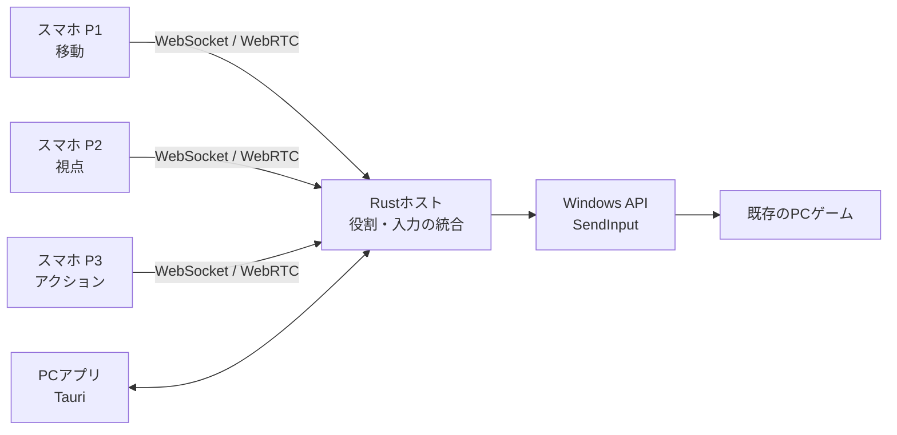

# Re:Cooplay（リコープレイ）— ゲームはそのまま。遊び方を変える。

   

  

  ---

  ### 🎥 デモ・プレイ風景

  

  
Hack Dayの開発中に撮影した実プレイ風景：3人がスマートフォンから1つのキャラクターを共同操作

  
デモ動画の公開URLは現在未掲載です。実際のプレイ風景は上の写真とギャラリーでご覧いただけます。

  ---

  ### クイックリンク

  
  
  

  ---

  

  ## 🎉 JPHACKS 2026 受賞結果 🎉

  ### 🏆 Hack Day（金沢会場）

  **Hack Day Audience Award**

  
チーム「三人羽織」（kz_2613）

---

**Re:Cooplay（リコープレイ）**は、既存のPCゲームに、新しい協力プレイを後付けするツールです。

普段は1人で操作するゲームのキャラクターを、複数人で分担して動かします。

移動する人、視点を動かす人、攻撃する人。1人なら簡単な操作も、みんなで声を掛け合い、息を合わせる協力プレイに変わります。

ゲーム本体を改造することなく、手元のスマートフォンから新しい遊び方を楽しめます。

---

## 目次

- [製品概要](#製品概要)
  - [背景](#背景製品開発のきっかけ課題等)
  - [製品説明](#製品説明具体的な製品の説明)
  - [特長](#特長)
  - [解決出来ること](#解決出来ること)
  - [今後の展望](#今後の展望)
  - [注力したこと](#注力したことこだわり等)
- [開発技術](#開発技術)
  - [活用した技術](#活用した技術)
  - [独自技術](#独自技術)
- [Hack Dayでの実装差分](#hack-dayでの実装差分)
- [動作確認の範囲](#動作確認の範囲)
- [試してみるには](#試してみるには)
- [起動・開発手順](#起動開発手順)
- [権利・利用上の注意](#権利利用上の注意)

---

## 製品概要

### 背景(製品開発のきっかけ、課題等）

1人で遊ぶなら1人用ゲームを、複数人で遊ぶならマルチプレイに対応したゲームを選ぶ。それが一般的なゲームの楽しみ方です。

しかし、**1人で操作することを前提としたゲームを、複数人で操作する遊び方があってもいいのではないでしょうか。**

例えば、1つのキャラクターの「移動」「視点」「攻撃」を、それぞれ別の人が担当する。

1人なら当たり前にできる操作も、複数人で分担すれば声掛けや連携が必要になります。思いどおりに動かせない失敗も、息が合って成功した瞬間も、みんなで共有する楽しさに変わります。

**ゲームの内容を変えなくても、操作する方法を変えるだけで、新しい協力プレイが生まれる。**

遊ぶ人数に合わせてゲームを選ぶのではなく、今あるゲームの遊び方を変える。

Re:Cooplayは、そんな新しい協力体験を、さまざまな既存ゲームで楽しめるようにすることを目指しています。

### 製品説明（具体的な製品の説明）

> **ゲーム体験 × Tech：1つのキャラクターを、みんなで動かす**

**Re:Cooplay（リコープレイ）**は、既存のPCゲームに新しい協力プレイを後付けするツールです。

参加者はそれぞれのスマートフォンをコントローラーとして使い、1つのキャラクターの操作を分担します。移動や視点、攻撃など、それぞれの操作を組み合わせることで、みんなで1つのキャラクターを動かします。

#### 例えば、3人でMinecraftを遊ぶ場合

| プレイヤー | 担当する操作 |
|---|---|
| P1 | 移動・ジャンプ |
| P2 | 視点・カメラ操作 |
| P3 | 攻撃・アイテムの使用 |

敵が現れたら、移動担当が距離を取り、視点担当が敵を捉え、攻撃担当がタイミングを合わせて攻撃します。

それぞれが別の操作を担当するからこそ、自然と会話や協力が生まれます。

#### 遊び方

1. **デスクトップアプリを起動する**  
   PCでRe:Cooplayを起動すると、参加用のQRコードが表示されます。

2. **スマホで参加する**  
   スマートフォンでQRコードを読み取り、Webアプリで参加します。最初に参加した人がホストとなり、スマホをPC画面のリモコンとして使えるようになります。

3. **遊びたいゲームを選ぶ**  
   ホストがスマホをリモコンとして操作し、PC画面に表示されたゲーム一覧から遊びたいゲームを選択します。

4. **操作を分担する**  
   PC画面で参加メンバーそれぞれの担当を確認し、操作分担を決定します。必要に応じて担当を入れ替えることもできます。

5. **ゲームを起動・準備する**  
   ゲームを起動し、プレイしたいステージやワールドなどを準備します。

6. **みんなで協力プレイ！**  
   準備ができたら、ホストがスマホから「Ready」を押します。各自のスマホが担当する操作画面に切り替わり、みんなで1つのキャラクターを操作できるようになります。

スマートフォンへの専用アプリのインストールは不要。1つのPCゲーム画面を共有しながら、複数人で協力プレイを楽しめます。

### 特長

#### 1. **既存のゲームに、協力プレイを後付けできる**

Re:Cooplayの核は、特定タイトルの内部を変更するのではなく、**複数のコントローラー入力を1つにまとめて、ゲームへ渡す**仕組みです。

Minecraftに限らず、キーボード・マウスで操作するPCゲームを中心に、タイトルごとの操作定義を使って共同操作を適用できます。ホラーゲームなら、視点を動かす人と逃げる人が違うだけで、きっと大騒ぎになるはずです。

ゲームごとの入力方式・起動環境には違いがあるため、**入力を統合する汎用的な仕組みがあること**と、**すべてのゲームで動作確認が済んでいること**は別です。対応状況はゲームごとに確認します。

#### 2. **「3人で1キャラ」が生み出す、新しい一体感**

普通のマルチプレイでは、各自が自分のキャラクターを動かします。Re:Cooplayでは、**誰か1人の操作が、全員のキャラクターに影響します。**

相手の意図が分からず失敗することも、息が合って成功することも、その場にいる全員の体験になります。普通のマルチプレイの代わりではなく、**同じゲームを楽しむための、もう1つの選択肢**です。

#### 3. **手元のスマホが、そのままコントローラーに**

専用機器は必要ありません。各自のスマホをつなげば、操作担当に合わせた画面が表示されます。

PCアプリには参加状況や操作分担、ゲームの準備状況を表示。ホストは準備・開始・一時停止・再開を管理できます。接続やゲーム操作をローカルネットワークで完結させる設計です。

### 解決出来ること

**ゲームはそのまま。操作を分けるだけで、遊ぶ体験を変えられます。**

| | これまでの操作 | Re:Cooplayを使うと |
|:--|:--|:--|
| 操作者 | 1人が移動・視点・攻撃を操作 | **3人で1つのキャラクターを操作** |
| やりとり | 判断と操作が1人で完結する | **声掛けや相談がプレイに必要になる** |
| ルール | ゲーム側が用意した操作方法で遊ぶ | **ゲームの改造なしで共同操作を追加する** |

**想定するユーザーは、友達と同じPC画面を囲み、普段のゲームを新しいルールで楽しみたい人たち。** 特別な入力機器を購入したり、スマホ用アプリをインストールしたりせず、ゲームの遊び方を変えられます。

開発メンバー3人が実際にMinecraftを共同操作した際にも、モンスターとの戦闘で声掛けが自然に生まれました。また、金沢会場で**Hack Day Audience Award**を受賞しました。これは当日の発表に対する投票の結果であり、一般ユーザーへの長期的な効果検証を終えたという意味ではありません。

### 今後の展望

- **対応ゲームの実機検証：** ホラー・アクションなど複数ジャンルの操作方式や利用条件を確認し、実際の対応タイトルを増やす
- **人数・役割のカスタマイズ：** 現行3人セッションから、役割交換・キー配置・人数に応じた遊び方へ広げる
- **遠隔からの参加：** 同じ場所での共同プレイから、離れた友達同士での協力体験へ発展させる

**Hack DayでのMinecraft実プレイは3人で確認済みです。** 現在のコードにはPR #110で2〜4人のセッションと人数に応じた分担を追加しましたが、**2人・4人のスマホ・Minecraft実機での動作確認は未実施**です。操作定義の登録数は実機動作確認済みタイトル数ではなく、遠隔接続も現在の実機実証範囲には含みません。

### 注力したこと（こだわり等）

#### **操作の遅延や取りこぼしを抑える**

操作の気持ちよさを損なわないよう、WebSocketとWebRTC DataChannelを併用し、先に届いた入力を重複させずに処理します。短い連打や長押し、視点の連続操作も扱えるようにしています。

#### **複数人でも安心して遊べるようにする**

通信切断・一時停止・入力先ウィンドウの変更時には、操作を解放したり、古い入力を破棄したりする制御を実装しています。ホストの明示Readyによって、ゲームの準備中に共同操作が始まらないようにしています。

#### **ゲームごとの違いを吸収する**

ゲームのキー設定や操作の違いを扱うため、操作定義（プロファイル）を導入。Minecraftの`options.txt`などから設定を読み取る機能や、Steam・Epic Gamesのインストール済みタイトルを検出・起動する機能を実装しています。

参考用のゲーム操作定義も多数用意しています。ただし、**定義が存在することと、そのゲームで共同操作が実機確認済みであることは異なります。** 未検証・未対応の定義を区別し、安全に開始を制限しています。

#### **触るだけで楽しいUIにする**

PCとスマホで見た目を統一し、担当ごとに操作しやすい画面を用意しました。開発・診断情報は通常画面から分離し、ゲーム中に必要な情報を見やすくしています。[最新UIの比較と検証](artifacts/improved-ui/README.md)には画面ごとの制作記録があります。

#### システム構成

| 構成要素 | 技術 | 役割 |
|:--|:--|:--|
| スマホ操作画面 | HTML / CSS / JavaScript | P1〜P3それぞれのコントローラー |
| PCホスト | Rust / Tokio / axum | ローカル通信、役割と状態の管理、入力統合 |
| リアルタイム通信 | WebSocket / WebRTC DataChannel | スマホからの操作と状態の送受信 |
| ゲームへの入力 | Windows API `SendInput` | キーボード・マウス操作として送信 |
| PCアプリ | Tauri / WebView2 | 参加、ゲーム選択、分担確認、準備・開始 |

詳しくは[システム設計](docs/architecture/system-design.md)と[通信仕様](docs/architecture/protocol.md)を参照してください。

## 開発技術

### 活用した技術

#### API・データ

- **OS入力：** Windows API `SendInput`（キーボード・マウス入力）
- **通信：** WebSocket / WebRTC DataChannel（各スマホからの入力と状態の送受信）
- **ゲーム操作設定：** Minecraft `options.txt`のキー割り当て参照
- **ネットワーク：** ローカルWi-Fi（プレイ時の外部クラウドサーバーは不要）

#### フレームワーク・ライブラリ・モジュール

- **PCホスト：** Rust / Tokio / axum
- **PCアプリ：** Tauri 2 / WebView2
- **スマホ・PC画面：** HTML / CSS / JavaScript
- **検証：** Node.js参照実装、通信シミュレーション、ブラウザUIテスト、Windows入力プローブ

#### デバイス

- Windows PC（ゲーム実行・操作入力の統合）
- Androidスマートフォン / iPhone（ブラウザをコントローラーとして利用）
- ローカルWi-Fiネットワーク

### 独自技術

#### ハッカソンで開発した独自機能・技術

##### 1. **3人の操作を、1つのWindows入力に統合する**

各スマホは「前進」「攻撃」などの操作名を送信。PC側でプレイヤーの役割を確認して入力をまとめ、ゲームのキーボード・マウス操作に変換します。

[入力・セッション統合](apps/host-rs/src/hub.rs) ／ [操作の対応](apps/host-rs/src/controls.rs) ／ [Windows入力](apps/host-rs/src/input.rs)

##### 2. **通信の速さと、状態の正しさを両立する**

WebSocketとWebRTCから届く入力を順序番号で管理して重複処理を防止。視点移動の補間、連打・長押しの扱い、接続切断時の停止まで統合しています。

[WebRTC通信](apps/host-rs/src/rtc.rs) ／ [通信プロトコル](docs/architecture/protocol.md) ／ [通信回帰テスト](scripts/sim/protocol-sim.mjs)

##### 3. **既存ゲームに合わせるための操作定義**

Minecraftのキー変更を反映できるほか、インストール済みゲームの検出と、操作定義を使った担当別コントローラーの生成に取り組みました。未検証のゲームを「動作確認済み」と表示しない設計も重要な部分です。

[ゲーム検出](apps/host-rs/src/games.rs) ／ [キー設定](apps/host-rs/src/keybinds.rs) ／ [操作プロファイル](apps/host-rs/src/profiles.rs) ／ [操作定義カタログのテスト](scripts/sim/profile-catalog-test.mjs)

##### 4. **誤入力を防ぐ安全なゲーム操作**

対応するゲームが前面にあるかを確認し、切断・停止・対象ウィンドウの変更時には入力を解放します。操作用画面と診断画面を分け、診断を開いたときには通常操作を停止します。

[入力先の確認](apps/host-rs/src/focus.rs) ／ [診断と入力停止のテスト](scripts/sim/controller-diagnostics-test.mjs)

### Hack Dayでの実装差分

**Hack Day：2026年10月24〜25日。** 開始前にアイデア比較やREADMEの準備を行いましたが、**開発開始前の基準コミットには`README.md`と`LICENSE`しかありませんでした。** その状態から、2日間で共同操作システムを実装しました。

**[開発開始前の基準コミット](https://github.com/jphacks/kz_2613/tree/5acb0049e6) ／ [実装差分をGitHubで確認](https://github.com/jphacks/kz_2613/compare/5acb0049e6...main)**

| Hack Day中に実装した機能 | ソース・検証へのリンク |
|:--|:--|
| 3台のスマホ入力を統合するWindowsホスト | [セッション・入力統合](apps/host-rs/src/hub.rs)・[OS入力](apps/host-rs/src/input.rs) |
| 役割別コントローラーとPCの操作画面 | [UIソース](apps/web-static/)・[UI検証](artifacts/improved-ui/README.md) |
| WebSocket / WebRTCによる操作送信・視点処理 | [WebRTC実装](apps/host-rs/src/rtc.rs)・[通信仕様](docs/architecture/protocol.md) |
| Ready・担当権限・緊急停止・入力解放 | [Rustホスト](apps/host-rs/src/hub.rs)・[通信回帰テスト](scripts/sim/protocol-sim.mjs) |
| ゲームの検出と操作定義による複数タイトルへの展開 | [操作定義](apps/game-profiles/)・[ゲーム検出](apps/host-rs/src/games.rs) |

### 動作確認の範囲

**実機で確認したこと：** 2026年10月25日に、Windows 11 PCとスマホ3台（Android Chrome 2台、iPhone Safari 1台）でMinecraft Java Editionを操作しました。**前進・視点操作・持ち物切替などが実際のゲームに反映**され、その後、開発者から「基本操作は全て大丈夫だった。停止も問題ない」と報告されています。[試験条件と操作結果](docs/handoff/BUILD_LOG.md)。

**別途テストしたこと：** Rustホストの通信・認可・状態遷移・安全停止、画面表示や操作定義などを、自動試験・シミュレーションでも確認しました。[開発・検証ログ](docs/handoff/BUILD_LOG.md) ／ [UI検証画像](artifacts/improved-ui/README.md)。

**未確認・制約：** 新しいUIとMinecraft実機の組合せによる全ケースの再確認、Minecraft以外のタイトルでの互換性、長時間の安定性、別PC配布時の動作、2人・4人セッションや遠隔接続など。**自動試験や登録済みの操作定義を、すべてのゲームでの実機動作証明とは扱いません。** [実機検証ゲート（作成時点の記録）](docs/architecture/validation-gates.md)。

### 試してみるには

1. Windows PCでRe:Cooplayとゲームを起動します。[セットアップ手順](docs/handoff/SETUP_WINDOWS.md)を参照してください。
2. 同じネットワークにスマホ3台を接続し、PCに表示されたQRコードでブラウザから参加します。
3. ホストがゲームを準備し、3人の担当と入力先を確認してから、明示的にReadyして共同操作を始めます。

**デモ動画へのリンクは現在未掲載です。** 審査員の方が動作を確認できるよう、このREADMEでは実プレイ写真・検証ログ・実装コードを示しています。動画URLが利用可能になればREADME冒頭に追記します。

## 起動・開発手順

Windows環境でのセットアップ、PCアプリ・Rustホストの起動方法は、以下を参照してください。

- [Windowsセットアップ](docs/handoff/SETUP_WINDOWS.md)
- [PCアプリの使い方](apps/desktop/README.md)
- [Rustホストのビルドと検証](apps/host-rs/README.md)

## 権利・利用上の注意

Re:Cooplayは独立した非公式ツールです。**Minecraftの公式製品ではなく、Mojang StudiosおよびMicrosoftの承認・提携を受けたものではありません。**

**NOT AN OFFICIAL MINECRAFT PRODUCT. NOT APPROVED BY OR ASSOCIATED WITH MOJANG OR MICROSOFT.**

Minecraftのゲーム本体やゲーム素材は同梱していません。画像・動画・名称の扱いについては[確認記録](docs/decisions/2026-10-25-minecraft-usage-terms.md)を参照してください。デモ素材の使用条件と公開用の連絡先は引き続き確認事項です。

---

**ゲームはそのまま。遊び方を変える。**

**Re:Cooplay**

