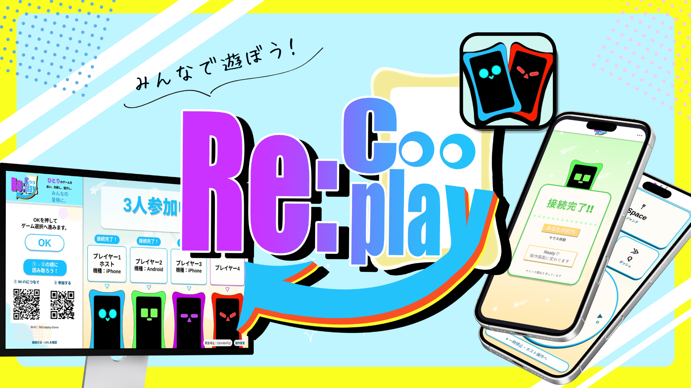
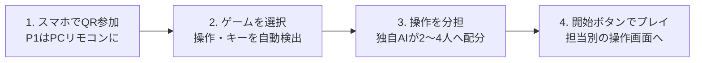
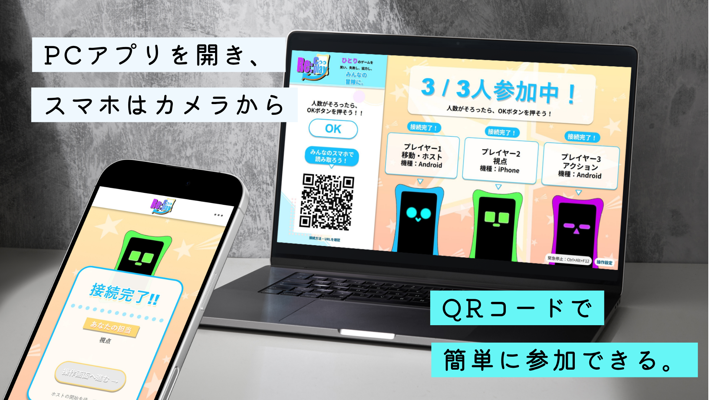
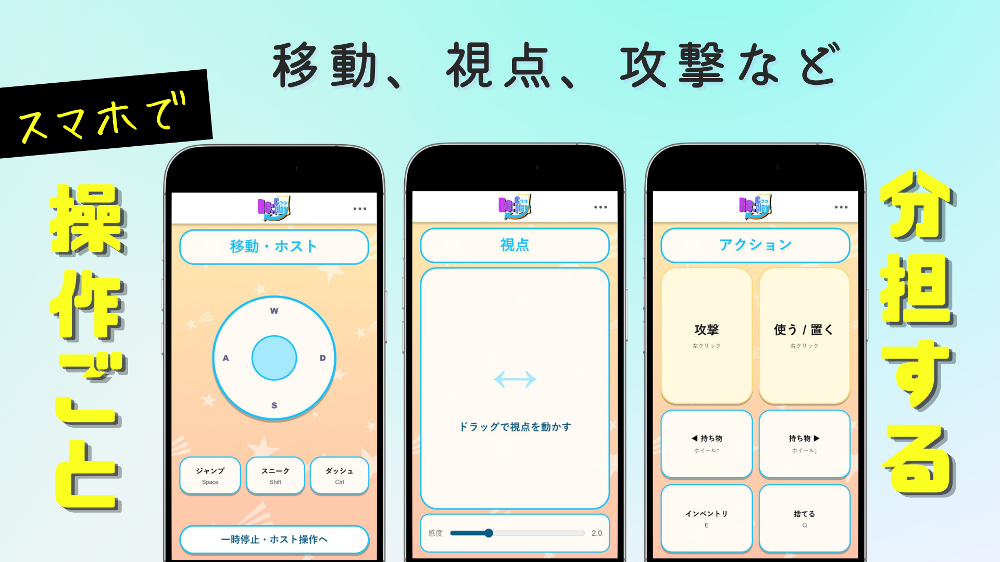
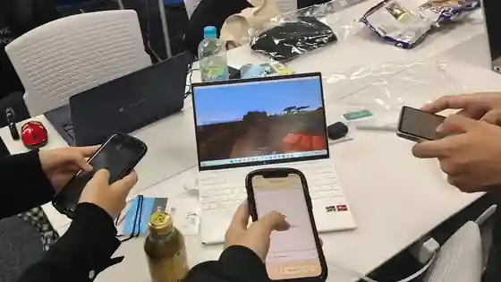
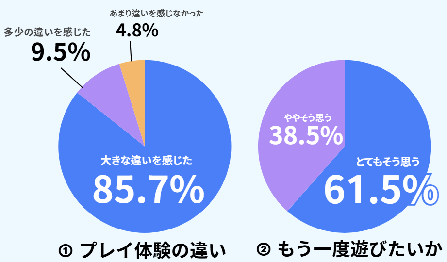
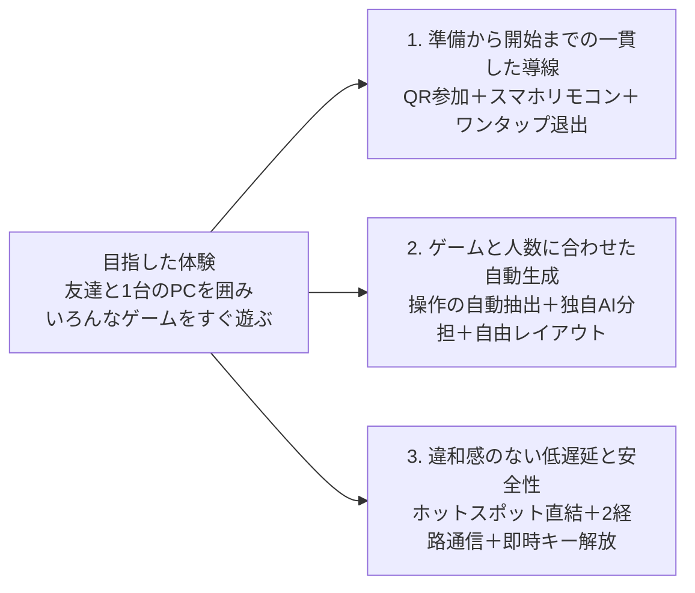
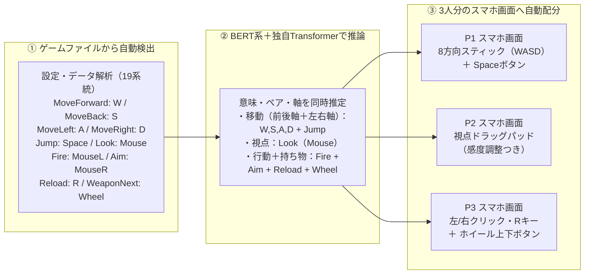

# Re:Cooplay（リコープレイ）— ゲームはそのまま。1キャラをみんなで操作。

   

  

  
🎬 <strong>画像をクリックしてプロダクト紹介動画を再生</strong>

  

    
  

  ---

  

    
🎮 <strong>プレイ風景を見る</strong>（クリックで開く）

  
移動・視点・攻撃を3人で分担し、1つのキャラクターを共同操作したHack Day中の実プレイ風景です。

https://github.com/user-attachments/assets/60d577f4-e287-45bc-bc6a-09455dd017c3

  

  ---

  
  

  
  

  ## 🎉 JPHACKS 2026 受賞結果 🎉
  ### **🏆 Hack Day (金沢会場)**
  **🥇 Hack Day Audience Award**  
  **🎯 Award Day Finalist**

  ---
  ### **🏆 Award Day**
  **🏅 審査委員特別賞**    **💡 Innovator認定** 
  **🎁 企業賞受賞**  
  合同会社DMM.com賞

---

**ゲームはそのまま。遊び方を変える。**

Re:Cooplayは、**既存のPCゲームに新しい協力プレイを後付けするシステム**です。

友達と1台のPC画面を囲み、普段は1人で操作するキャラクターを**2〜4人で役割分担して共同操作**します。**みんなが普段持っているスマートフォンの画面がそのままコントローラーになる**ため、人数分のコントローラー機器を用意したり、専用のスマホアプリをインストールしたりする必要はありません。

さらに、ゲームごとの**操作名・キー割り当ての自動検出**と**独自AIによる自動振り分け**により、どんなPCゲームでも、そのタイトルと参加人数（2〜4人）に合わせた役割分担とスマホコントローラーを自動生成します。

---

## 製品概要

### 背景(製品開発のきっかけ、課題等）

誰のPCにも、クリアしてしまったり、1人で遊び尽くして眠っていたりするゲームがあるはずです。そんな**遊び慣れた既存のゲームに、「新しい遊び方」を後付けできないか**——それがRe:Cooplayの出発点でした。

友達と集まったときに1人用のPCゲームで遊ぼうとしても、操作できるのは1人だけで、周りの人は画面を眺める「観客」になってしまいます。その場にいる全員がプレイヤーとして参加できる方法を探る中で、キャラクターを増やすのではなく、**1人分の操作そのものをみんなで分け合う**という発想に行き着きました。

**「1人分の操作をあえて複数人で分担する不自由さ」そのものが、ゲームでは新しい面白さになる。**

実際に操作を分けてみると、移動する人と視点を動かす人が違うだけで、思った方向へ進むにも自然と声を掛け合うようになります。息が合わずに起こるハプニングや笑いも、連携がピタリと決まったときの達成感も、みんなで分かち合う特別な体験へと変わりました。

**ゲーム自体を変えずに、操作する人と協力の仕方を変える。** いつも遊んでいたPCゲームや眠っていた名作を、友達と集まったその場で新しい協力ゲームへと生まれ変わらせます。

### 製品説明（具体的な製品の説明）

> **既存ゲーム × Tech：1つのキャラクターを、みんなで動かす**

1台のPC画面を友達と囲み、各自のスマートフォンをコントローラーにして遊びます。QRコードでの参加からゲーム選択・役割分担・プレイ開始まで、**スマートフォンの操作だけで一貫して進められる**設計です。

1. **スマホで参加：** PCアプリのQRコードをスマホのブラウザで読み取って参加します。最初の参加者（P1・ホスト）のスマホはタッチパッド付きのリモコンになり、手元からPC画面やランチャーを操作できます。
2. **ゲームを選択：** PC内のインストール済みゲームを自動検出して一覧表示します。遊ぶゲームを選ぶと、そのゲームの操作名とキー設定を自動で読み取ります。
3. **操作を分担：** 選択したゲームの操作と参加人数（2〜4人）に合わせて、独自AIが役割分担を自動生成します。担当を確認し、そのままゲームを起動します。
4. **開始ボタンでプレイ：** ホストのスマホで「分担操作開始」を押すと対象ゲームが前面に切り替わり、各スマホが自分の担当操作だけが並んだ専用コントローラーに変わります。

  
  
QRコード読み取りからゲーム選択・開始まで、すべてスマートフォンの手元操作で進められます。

**3人で『Minecraft』を遊ぶ場合の分担例**

| プレイヤー | 担当する操作 | スマホに表示されるUI |
|---|---|---|
| **P1（ホスト）** | 移動・ジャンプ・スニーク・ダッシュ | 8方向スティック＋アクションボタン |
| **P2** | 視点・カメラ操作 | 感度調整つきドラッグパッド |
| **P3** | 攻撃・ブロック設置・持ち物切替・インベントリ | 左右クリック・ホイール・キーボタン |

  
  
3人分の操作画面イメージ。担当別の画面はゲームと参加人数に合わせて自動生成されます。

実際の画面遷移は[PC・スマホの画面一覧](docs/screenshots.md)で確認できます。

### 特長

- **1つのキャラクターを2〜4人で分担し、各自のスマホが専用コントローラーになる**  
  移動・視点・アクションなどの役割を分け合い、各スマホには自分の担当操作だけが使いやすい配置で自動生成されます。自分の持ち方に合わせたボタンの位置・大きさの調整や、60秒ごとに担当が入れ替わる時間交代ルールにも対応しています。

- **どんなPCゲームでも、選ぶだけでそのまま協力ゲームになる**  
  PCに入っている好きなゲームを選ぶだけで、そのゲームの操作に合った自然な役割分担と専用コントローラーがその場で用意されます。特定のタイトルに限らず、手元の幅広いPCゲームで共同操作を楽しめます。

- **専用機器もアプリ導入も不要。PCのキーボード・マウスを触ることなく、その場ですぐ遊べる**  
  Android・iPhoneの標準ブラウザでQRコードを読み取るだけで参加できます。ホストのスマホがPC画面のリモコンになるため、PCのキーボード・マウスを触ることなく、ゲーム選びから起動・プレイ開始まで手元で完結します。

### 解決出来ること

Re:Cooplayは、**「1人用ゲームをみんなで囲むと1人しか操作できず、周りが観客になってしまう」「遊び慣れたゲームがPCに眠ってしまう」という課題を解決し、手元のPCゲームを全員が主役になれる協力ゲームへと変えます。**

#### 1. ジャンルごとにまったく違う協力体験が生まれる

- **3D空間を自由に動くゲーム（『Minecraft』など）**  
  「移動・ジャンプ」「視点・カメラ」「攻撃・アイテム使用」を分担。狙った場所へ進むだけでも声掛けが必要になり、見慣れたワールドでの冒険や建築が、ハプニングと達成感に満ちた共同作業に変わります。
- **ホラー・サバイバルホラー（『Outlast（アウトラスト）』『バイオハザード』など）**  
  移動する人、視点や照準を動かす人、ライトや攻撃を担当する人を分担。1人では足がすくむ場面でも**2〜3人で声を掛け合いながら進む心強さ**が生まれ、迫る危機に焦るスリルや驚いた瞬間の悲鳴・笑いまで全員で共有できます。
- **パズル・落ち物ゲーム（『テトリス』など）**  
  「左右移動」「回転」「落下」を分担。一瞬の判断が求められる中で「右！」「今、回して！」と息を合わせる、ハイテンポなパーティーゲームへと変わります。
- **車を運転するゲーム（レース・ドライブシミュレーターなど）**  
  「ハンドル操作」「アクセル・ブレーキ」「視点・ライトやギア」を分担。まっすぐ走るだけでも阿吽の呼吸が試される協力ドライブ体験になります。
- **その他のあらゆるジャンルでも**  
  アクションRPG、2Dアクション、シミュレーションなど、ここに挙げた以外のジャンルでも、1人分の操作を分け合うことで1人プレイとはまったく違う新しい面白さが生まれます。

#### 2. 「見ているだけ」だった人も、1つの役割から同じ目線で盛り上がれる

すべての操作を1人で同時にこなす代わりに、「移動だけ」「ジャンプと攻撃だけ」といったシンプルな役割から参加できます。普段PCゲームに慣れている人と初めて触る人が一緒になっても、同じ1つのキャラクターを動かしてクリアする喜びを対等に共有できます。

---

🎮 **実プレイ映像：** [『Outlast』2人で操作を分担する様子（約3分18秒）](https://drive.google.com/file/d/1ZdPi9M9zD87YS8cdn4fIGKjNNi-r7Ewt/view) ／ [驚いた場面の切り抜き（約11秒）](https://drive.google.com/file/d/1HzBcDEd4Hm6iXMjvd6CHqWi29Rwi6NfX/view)（紹介動画では『Terraria』での共同操作も実演しています）

  
  
1台のPC画面を囲み、各自のスマートフォンから1キャラクターを共同操作している様子

#### 3. 試遊アンケートによる体験価値の実証（回答者26名）

- **楽しさ・再遊意欲：** **100%（26名全員）** が「楽しかった」「またこの遊び方をしてみたい」と回答
- **体験の変化：** そのゲームの経験者21名中 **95.2%（20名）** が「1人で遊んだときと違うプレイ体験だった」と回答
- **操作の快適さ：** **84.6%（22名）** が「自分の担当操作を思い通りに動かせた」と回答

自分のスマホ操作は快適に動く一方で、複数人で息を合わせる連携そのものが新しいゲーム体験を生むことが実証されました。

  
  
試遊者アンケートの結果（①プレイ体験の違い：経験者21名、②もう一度遊びたいか：回答者26名）

**試遊者の声（自由記述より抜粋）**
- *「一人で遊ぶ時は最初流れ作業になってしまうが、役割分担することで最初から楽しむことができた。ゲーム内容は同じだけど、操作性が大きく変わることで、新たな楽しみ方を実際に行うことができた」*（Minecraft・4人プレイ）
- *「普段はなんてことない作業でも一つのイベントのように苦戦し、いつも以上に印象に残りました」*（Minecraft・4人プレイ）
- *「1人プレイでも他の人と一緒にプレイしてる感覚になった」「1人で完結できないため仲良くなるには適していた」*（Minecraft・3人プレイ）
- *「FPSゲーム（Outlast）を複数人で遊ぶのが非常に面白かった」*（Outlast・2人プレイ・初プレイ）

### 今後の展望

まずは、初めてこのアプリを開く人でも迷わず導入・参加できる形へと磨き上げ、**誰もが手元のPCで実際に遊べるサービスとして世に出すこと**を目指しています。

そのうえで将来的には、さらに多様なゲームや設定形式への対応、PCゲーム以外のプラットフォームへの展開、そして離れた場所にいる友達とも同じ1キャラクターを共同操作できるオンライン対応へと広げていきます。

### 注力したこと（こだわり等）

「友達と集まったその場で、いつものPCゲームをすぐにみんなで遊べること」を実現するため、体験の質を左右する3つのポイントに注力しました。

1. **準備からプレイ開始まで、スマホだけで完結する導線**  
   P1のスマホをタッチパッド付きPCリモコンにすることで、ゲーム選択・ランチャー操作・起動・開始まで手元で進められます。また、試遊時のフィードバックを反映し、参加者のワンタップ退出や全員リセット時の一時Wi-Fi自動切り替えも実装しました。
2. **意味のまとまりを踏まえた役割分担と、持ち方に合わせるUI編集**  
   単純にキーを等分するのではなく、「移動」「視点」「照準と攻撃」のように意味のつながりと負担バランスを独自AIが判断して配分します。さらに「持ち方に合わせてボタン配置を変えたい」という試遊者の声を取り入れ、スマホ上での位置・縦横サイズの自由な調整機能を実現しました。
3. **ゲームの面白さを支える、極限までの低遅延化**  
   操作の違和感をなくすため、WindowsモバイルホットスポットによるPC・スマホ間の直接通信と、WebSocket＋WebRTC DataChannelの2経路通信を採用しました。実機測定で**Wi-Fi通信の往復遅延中央値 9.0ms**、**スマホの操作からPCでの入力実行までの推定遅延中央値 26.0ms** を達成し、電波が混線しやすい展示会場でも「ラグなく動かせる」「感度が変えられて快適」と高い評価を得ました。

---

## 技術仕様書

- [総合仕様書](docs/README.md) — システム構成・動作環境と詳細仕様への入口
- [技術選定の理由](docs/technology-selection.md) — 低遅延・操作の確実性を重視した採用理由と代替案の比較
- [ゲーム操作定義仕様書](docs/game-profile-specification.md) — ゲーム別の操作自動検出・キー設定読取り・人数別分担
- [分担AI仕様書](docs/preset-model-specification.md) — 独自AIによる分担の構成・学習・推論と評価
- [Re:Cooplay Preset Model v2（Hugging Face）](https://huggingface.co/YOSHI0209/recooplay-preset-model-v2#recooplay-preset-model-v2) — 操作の意味と関係から分担を生成する独自モデル
- [画面一覧](docs/screenshots.md) — PC・スマホの画面と使用の流れ
- 詳細：[フロントエンド](docs/frontend-specification.md) ／ [ホスト](docs/host-specification.md) ／ [通信](docs/protocol-specification.md) ／ [動作確認の範囲](docs/verification.md)

---

## 開発技術

### システム構成

各スマートフォンのブラウザからの操作をローカルWi-Fi経由でPC上のRustホストが受け取り、参加者ごとの担当・入力順序・対象ウィンドウを確認して1つの入力へ統合。Windows標準の`SendInput` APIでPCゲームへ送ります。

  
  
3人で共同操作する場合のシステム構成例

### 活用した技術

#### API・データ

Windows API（`SendInput`・ウィンドウ前面制御・モバイルホットスポット制御）、WebSocket、WebRTC DataChannel、JSONによるゲーム操作定義、各ゲームエンジンの設定・パッケージデータ解析

#### フレームワーク・ライブラリ・モジュール

- **PCホスト・デスクトップアプリ：** Rust（Tokio・axum・`windows`・`datachannel`・`tokenizers`）、Tauri 2／WebView2
- **フロントエンド・UI：** React・TypeScript strict（Vite）、Pointer Events API
- **独自AI（操作分担生成）：** [Re:Cooplay Preset Model v2](https://huggingface.co/YOSHI0209/recooplay-preset-model-v2#recooplay-preset-model-v2) — 事前学習済み多言語エンコーダ（`sentence-transformers/paraphrase-multilingual-MiniLM-L12-v2` を語彙43,691語へ削減・行ごと8bit量子化、約40MB）＋ 分担判断用2層Transformerエンコーダ（104,136パラメータ、約410KB、教師あり＋自己教師あり学習、Rustネイティブ推論）
- **検証・シミュレーション：** Node.js（通信境界・画面・入力プローブの自動検証）

#### デバイス

Windows 11 PC（ホスト・ゲーム実行）＋ Android／iPhone（標準ブラウザから参加）。ローカルWi-Fi（PCのモバイルホットスポットを含む）だけで完結し、インターネット環境がない場所でもその場で2〜4人の共同操作が可能です。

### 独自技術

#### ① 19系統のゲームエンジン・設定形式から操作名とキー割り当てを抽出する自動検出エンジン
- Steam・Epic Games・GOG・Xboxなど7系統のランチャーからインストール済みゲームを自動検出します。
- Unity（Input System / 旧Input Manager）、Unreal Engine 4・5、Godot 3・4、RPGツクール2000〜MZ、WOLF RPGエディター、Source 1・2など**計19系統のゲームファイル・ユーザー設定**を直接解析し、ユーザーのキー変更も含めて操作定義を自動抽出します。  
  🔗 [読み取りの対応表](docs/game-profile-specification.md#定義のないゲームのファイルからの読み取り) ／ [操作抽出の入口](apps/host-rs/src/game_actions.rs) ／ [エンジン別パーサー群](apps/host-rs/src/engines/) ／ [キー設定の取得](apps/host-rs/src/keybinds.rs)

#### ② 事前学習済みBERT系モデル×独自学習Transformerによる操作分担AI（[Re:Cooplay Preset Model v2](https://huggingface.co/YOSHI0209/recooplay-preset-model-v2#recooplay-preset-model-v2)）
- **操作名の読み取り（約40MB）：** 多言語モデル `paraphrase-multilingual-MiniLM-L12-v2` の語彙を約4.4万語に絞り8ビット量子化。日本語名とゲーム内の英語識別子（`IA_Jump`・`+attack`・`MoveForward` 等）の両方を384次元の意味ベクトルに変換します。
- **分担の判断（約410KB）：** 教師あり＋自己教師あり（伏せたキーを当てる）で独自学習させた2層Transformerエンコーダが、**①操作カテゴリ（6種）、②同じ人が持つべきかの確率、③同じまとまり内の方向軸（縦・横）**を同時推定します。
- **高速なオフライン推論：** Rustホストが直接推論し、**14操作のゲームで約80ミリ秒**で2〜4人の分担を生成・保存します。

| 評価に使ったゲーム（学習に未使用、ゲームごとの平均） | カテゴリの正解率 | 同じ人の判定 | 同じまとまりの再現率 | 同じ軸の判定 |
|:--|--:|--:|--:|--:|
| GitHub の Unity・Godot の操作定義 57本（生の名前、4組に分けた評価） | **88.1%** | **94.5%** | **91.8%** | **94.6%** |
| ゲームのファイルから読んだ操作 6本（生の名前、1本ずつ外した評価） | **76.0%** | **89.3%** | **75.9%** | **91.5%** |

※人が正解を確かめた30本（246操作）でのカテゴリの正解率は **87.4%** です。  
🔗 [分担AI仕様書](docs/preset-model-specification.md) ／ [Hugging Faceモデルカード](https://huggingface.co/YOSHI0209/recooplay-preset-model-v2#recooplay-preset-model-v2) ／ [推論・クラスタリング](apps/host-rs/src/preset_model.rs) ／ [MiniLMトークナイザー・埋め込み](apps/host-rs/src/text_encoder.rs)

#### ③ WebSocket×WebRTCの2経路通信と、Rust＋SendInputによる低遅延・安全な入力統合
- **2経路の使い分けと視点補間：** 確実な状態共有はWebSocket、視点移動や連打の速達はWebRTC DataChannel（最新入力を優先するUDP高速通信）で送信し、Rustホストの単一hubスレッドで重複排除と4ms周期の滑らかな視点補間を行ってWin32 `SendInput` へ統合します。
- **多重の安全設計：** 対象ゲームが前面にあるときのみ入力を送り、一時停止・切断・緊急停止（`Ctrl+Alt+F12`）・終了時には合成中の全キーとマウスボタンを即時解放して安全に停止します。  
  🔗 [通信処理](apps/host-rs/src/rtc.rs) ／ [入力統合・順序制御](apps/host-rs/src/hub.rs) ／ [入力先の制御](apps/host-rs/src/focus.rs) ／ [Windows入力](apps/host-rs/src/input.rs)

#### ④ 担当と持ち方に合わせて自動生成・自由編集できるスマホUIとPCリモコン機構
- **描画と入力エンジンの分離：** React＋TypeScript strictの画面描画からPointer Events入力・通信エンジンを独立させ、スマホブラウザ上での低遅延な操作レスポンスを維持しています。
- **個人レイアウト編集とリモコン操作：** 各スマホ上でのボタン移動・リサイズ・複製・横持ち変換に加え、ロビーではP1スマホがPC画面とOSカーソルを操作するリモコンとして機能します。  
  🔗 [コントローラー生成](apps/web/src/shared/controller-layout.ts) ／ [個人レイアウト設計](apps/web/src/shared/model/layout.ts) ／ [コントローラー編集UI](apps/web/src/phone/LayoutController.tsx) ／ [動作確認の範囲](docs/verification.md)

---

Re:Cooplayは独立した非公式システムであり、Minecraftのゲーム本体・素材を同梱していません。Minecraftの公式製品ではなく、Mojang Studios・Microsoftの承認・提携を受けていません。NOT AN OFFICIAL MINECRAFT PRODUCT. NOT APPROVED BY OR ASSOCIATED WITH MOJANG OR MICROSOFT. [Minecraftの利用条件に関する確認記録](docs/develop/decisions/2026-10-25-minecraft-usage-terms.md)
