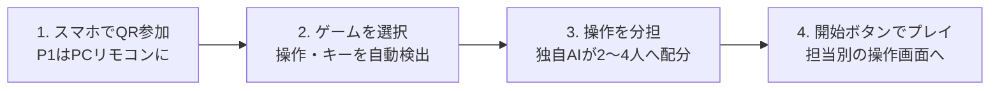
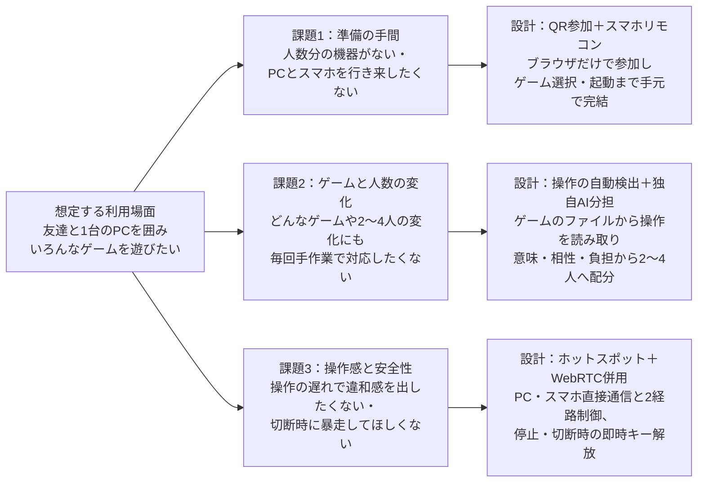
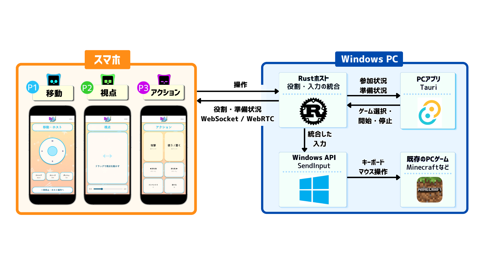
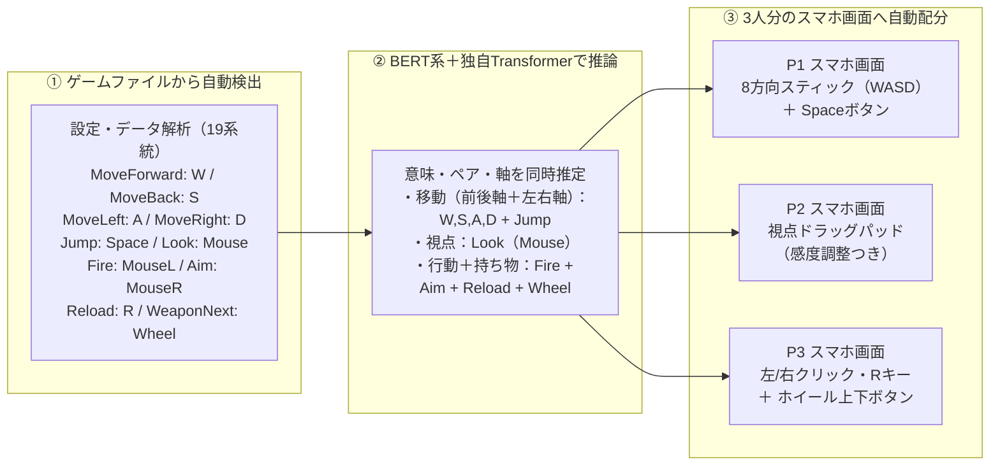

# Re:Cooplay（リコープレイ）— ゲームはそのまま。1キャラをみんなで操作。

   

  

  
🎬 <strong>画像をクリックしてプロダクト紹介動画を再生</strong>

  

    
  

  ---

  

    
🎮 <strong>プレイ風景を見る</strong>（クリックで開く）

  
移動・視点・攻撃を3人で分担し、1つのキャラクターを共同操作したHack Day中の実プレイ風景です。

https://github.com/user-attachments/assets/60d577f4-e287-45bc-bc6a-09455dd017c3

  

  ---

  
  

  
  

  ## 🎉 JPHACKS 2026 受賞結果 🎉
  ### **🏆 Hack Day (金沢会場)**
  **🥇 Hack Day Audience Award**  
  **🎯 Award Day Finalist**

  ---
  ### **🏆 Award Day**
  **🏅 審査委員特別賞**    **💡 Innovator認定** 
  **🎁 企業賞受賞**  
  合同会社DMM.com賞

---

**ゲームはそのまま。遊び方を変える。**

Re:Cooplayは、**既存のPCゲームを改造することなく、新しい協力プレイを後付けするシステム**です。

友達と1台のPC画面を囲み、普段は1人で操作するキャラクターを**2〜4人で役割分担して共同操作**します。**みんなが普段持っているスマートフォンの画面がそのままコントローラーになる**ため、人数分のコントローラー機器を用意したり、専用のスマホアプリをインストールしたりする必要はありません。

**ゲームも人数も、固定しない。** ゲームごとの**操作名・キー割り当ての自動検出**と、**独自AIによる2〜4人への自動振り分け**により、どんなPCゲームでも、そのタイトルと参加人数に合わせた役割分担とスマホコントローラーを自動生成します。

---

## 製品概要

### 背景(製品開発のきっかけ、課題等）

誰のPCにも、クリアしてしまったり、1人で遊び尽くして眠っていたりするゲームがあるはずです。そんな**遊び慣れた既存のゲームに、「新しい遊び方」を後付けできないか**——それがRe:Cooplayの出発点でした。

友達と集まったときに1人用のPCゲームで遊ぼうとしても、操作できるのは1人だけで、周りの人は画面を眺める「観客」になってしまいます。ゲーム本体を作り変えることなく、その場にいる全員がプレイヤーとして参加できる方法はないかと考えたとき、1つの発想に行き着きました。キャラクターを増やすのではなく、**1人分の操作そのものをみんなで分け合う**という方法です。

**「1人分の操作をあえて複数人で分担する不自由さ」そのものが、ゲームでは新しい面白さになる。**

実際に操作を分けてみると、移動する人と視点を動かす人が違うだけで、思った方向へ進むにも自然と声を掛け合うようになります。息が合わずに起こるハプニングや笑いも、連携がピタリと決まったときの達成感も、1人で遊んでいたときには生まれなかった全員の体験へと変わりました。

**ゲーム自体を変えずに、操作する人と協力の仕方を変える。** いつも遊んでいたPCゲームや眠っていた名作を、友達と集まったその場で新しい協力ゲームへと生まれ変わらせます。

### 製品説明（具体的な製品の説明）

> **既存ゲーム × Tech：1つのキャラクターを、みんなで動かす**

Re:Cooplayでは、1台のPC画面を友達と囲み、各自のスマートフォンをコントローラーにして遊びます。このとき、ゲームの選択や起動のたびに誰かがPCのキーボードやマウスへ持ち替えるのは手間になります。そこで、**QRコードでの参加からゲーム選択・役割分担・プレイ開始まで、PCのキーボード・マウスを触ることなくスマートフォンの操作だけで一貫して進められる**ようにしました。

1. **スマホで参加：** PCアプリのQRコードを読み取り、スマホのブラウザから参加します。最初の参加者（ホスト・P1）のスマホはタッチパッド付きのリモコンに変身し、手元からPC画面やランチャーをそのまま操作できます。
2. **ゲームを選択：** Steam・Epic Games・GOG・Xboxなどのインストール済みゲームを自動検出して一覧に表示（手動登録にも対応）。ゲームを選ぶと、そのゲームの操作名やキー設定を自動で読み取ります。
3. **操作を分担：** 選択したゲームの操作と参加人数（2〜4人）に合わせて、独自AI（または定型ルール）が役割分担を自動生成します。担当を確認し、そのままゲームを起動します。
4. **開始ボタンで開始：** ホストのスマホの「分担操作開始」ボタン1つで対象ゲームが前面に切り替わり、共同プレイが始まります。各スマホは自分の担当操作だけが並んだ専用コントローラーに変わります。

  
  
PCアプリのQRコードからスマホのブラウザだけで参加し、ホストのリモコン操作でゲーム選択・開始まで進められます。

**3人でMinecraftを遊ぶ場合の分担例**

| プレイヤー | 担当する操作 | スマホに表示されるUI |
|---|---|---|
| P1（ホスト） | 移動・ジャンプ・スニーク・ダッシュ | 8方向スティック＋アクションボタン |
| P2 | 視点・カメラ操作 | 感度調整つきドラッグパッド |
| P3 | 攻撃・ブロック設置・持ち物切替・インベントリ | 左右クリック・ホイール・キーボタン |

  
  
3人分の操作画面イメージ。担当別の画面はゲームごとの操作と参加人数に合わせて自動生成され、手元で配置や大きさも調整できます。

参加からゲーム選択、分担確認、共同操作、一時停止までの実際の画面は[PC・スマホの画面一覧](docs/screenshots.md)で確認できます。

### 特長

- **1つのキャラクターを2〜4人で分担し、各自のスマホが専用コントローラーになる：** 移動・視点・アクションなどの役割を2〜4人で分け合い、それぞれのスマホ画面には自分の担当操作だけが使いやすい配置で自動生成されます。自分の持ち方に合わせてボタンの位置や大きさを調整でき、途中で担当を交換したり、60秒ごとに担当が自動で入れ替わるルールで遊んだりすることもできます。
- **どんなPCゲームでも、選ぶだけでそのまま協力ゲームになる：** ゲーム本体の改造や、ゲームごとの面倒な初期設定は必要ありません。PCに入っている好きなゲームを選ぶだけで、そのゲームの操作に合った自然な役割分担が自動で用意されるため、特定のタイトルに限らず幅広いPCゲームで共同操作を楽しめます。
- **専用機器もアプリ導入も不要。PCのキーボード・マウスに触れず、その場ですぐ遊べる：** Android・iPhoneのブラウザでQRコードを読み取るだけで参加でき、人数分のコントローラーを用意する必要はありません。最初の参加者のスマホがPC画面のリモコンになるため、PCのキーボード・マウスを触ることなく、ゲーム選びから起動・プレイ開始まで手元で完結します。

### 解決出来ること

Re:Cooplayは、**「1人用ゲームをみんなで囲むと1人しか操作できず、周りが観客になってしまう」「遊び慣れたゲームが新しい刺激のないままPCに眠ってしまう」という課題を解決し、手元にある既存のPCゲームを、その場にいる全員が主役になれる協力ゲームへと生まれ変わらせます。**

- **ジャンルごとにまったく違う協力体験が生まれる**
  - **3D空間を自由に動くゲーム（『Minecraft』など）：** 「移動・ジャンプ」「視点・カメラ」「攻撃・アイテム使用」を分担。狙った場所へ進むだけでも声掛けが必要になり、見慣れたワールドでの冒険や建築が、ハプニングと達成感に満ちた共同作業に変わります。
  - **ホラー・サバイバルホラー（『Outlast（アウトラスト）』『バイオハザード』など）：** 移動する人、視点や照準を動かす人、ライトや攻撃・アクションを担当する人を分担。1人では怖くて足が止まってしまう場面でも、**2〜3人で声を掛け合いながら進む心強さ**が生まれ、迫る危機に焦って操作が噛み合わないスリルや驚いた瞬間の悲鳴・笑いまで、その場にいる全員で共有できます。
  - **パズル・落ち物ゲーム（『テトリス』など）：** 「左右への移動」「回転」「落下」を分担。一瞬の判断が求められる中で「右！」「今、回して！」と息を合わせる、ハイテンポなパーティーゲームのような体験になります。
  - **車を運転するゲーム（レース・ドライブシミュレーターなど）：** 「ハンドル操作」「アクセル・ブレーキ」「視点・ライトやギア」を分担。まっすぐ走るだけでも阿吽の呼吸が試される、息の合った協力ドライブ体験に変わります。
  - ここに挙げた以外のジャンル（アクションRPG、2Dアクション、シミュレーションなど）でも、1人分の操作を分担するだけで、1人で遊んでいたときとはまったく違う新しい面白さが生まれます。
- **「見ているだけ」だった人も、1つの役割から同じ目線で一緒に盛り上がれる**
  - 複雑な同時操作を2〜4人で分け合うため、1人で移動・視点・攻撃のすべてをこなす必要がありません。「移動だけ」「ジャンプと攻撃だけ」といったシンプルな役割から参加できるため、普段PCゲームに慣れている人と初めて触る人が一緒になっても、同じ1つのキャラクターを動かしてクリアする喜びを対等に共有できます。

🎮 **『Outlast（アウトラスト）』の実プレイ動画：** [2人で操作を分担する様子（約3分18秒）](https://drive.google.com/file/d/1ZdPi9M9zD87YS8cdn4fIGKjNNi-r7Ewt/view) ／ [驚いた場面の切り抜き（約11秒）](https://drive.google.com/file/d/1HzBcDEd4Hm6iXMjvd6CHqWi29Rwi6NfX/view)

その他実演として、**プロダクト紹介動画では『Terraria（テラリア）』での共同操作**も紹介しています。

  
  
1台のPC画面を囲み、各自のスマートフォンから1キャラクターを共同操作している様子

**試遊アンケートによる体験価値の実証**

2〜4人での共同操作を体験した26名へのアンケートでは、**全員（100%）が「楽しかった」**（とても楽しかった **88.5%** ／ やや楽しかった **11.5%**）・**「またこの遊び方をしてみたい」**（とてもそう思う **61.5%** ／ ややそう思う **38.5%**）と回答しました。また、そのゲームを以前に遊んだことがある経験者21名中20名（**95.2%**）が「**以前とは違うプレイ体験だった**（大きな違いを感じた **85.7%** ／ 多少の違いを感じた **9.5%**）」、**84.6%**（26名中22名）が「**自分の担当操作を思い通りに動かせた**」と回答しています。自分のスマホ操作自体は快適に動く一方で、複数人で息を合わせる連携のもどかしさが新しいゲーム体験を生むことが実証されました。

  
  
試遊者アンケートの結果（①プレイ体験の違い：経験者21名、②もう一度遊びたいか：回答者26名全員が肯定回答）

**試遊者の声（自由記述より抜粋）**
- *「一人で遊ぶ時は最初流れ作業になってしまうが、役割分担することで最初から楽しむことができた。ゲーム内容は同じだけど、操作性が大きく変わることで、新たな楽しみ方を実際に行うことができた」*（Minecraft・4人プレイ）
- *「普段はなんてことない作業でも一つのイベントのように苦戦し、いつも以上に印象に残りました」*（Minecraft・4人プレイ）
- *「1人プレイでも他の人と一緒にプレイしてる感覚になった」「1人で完結できないため仲良くなるには適していた」*（Minecraft・3人プレイ）
- *「FPSゲーム（Outlast）を複数人で遊ぶのが非常に面白かった」*（Outlast・2人プレイ・初プレイ）

### 今後の展望

まずは、初めてこのアプリを開く人でも迷わず導入・参加できる形へと磨き上げ、**誰もが手元のPCで実際に遊べるサービスとして世に出すこと**を目指しています。

そのうえで将来的には、さらに多様なゲームや設定形式への対応、PCゲーム以外のプラットフォームへの展開、そして離れた場所にいる友達とも同じ1キャラクターを共同操作できるオンライン対応へと広げていきたいと考えています。

### 注力したこと（こだわり等）

「友達と集まったその場で、いつものPCゲームをすぐにみんなで遊べること」を実現するため、実際の利用場面で生じる課題から逆算して設計・実装にこだわりました。

| 利用場面・課題 | こだわった設計・実装 |
|---|---|
| **その場で気軽に始めたい・PCとスマホを行き来したくない** | 専用アプリ不要のQR参加に加え、P1のスマホをタッチパッド付きPCリモコンにすることで、PCのキーボード・マウスに触れることなく、ゲーム選択・ランチャー操作・起動・開始までスマホから一貫して進められる導線を設計しました。さらに試遊アンケートでの「前の参加者の接続を簡単に切り替えたい」という声を受け、ワンタップでの退出や全員リセット時の一時Wi-Fi自動切り替えも実装しました。 |
| **どんなPCゲームでも、面倒な事前設定なしで遊びたい** | 事前定義のないゲームでも対応できるよう、19種類のゲームエンジン・設定形式から**操作名とキー割り当てを自動検出**する仕組みを実装しました。ユーザーのキー変更も反映し、送れないキーを誤った入力で代用しない設計を徹底しています。 |
| **単純なキーの等分ではなく、人数が変わっても楽しく分担したい** | **独自AIが操作の意味や関連性を推定**し、「移動」「視点」「攻撃と照準」など実際のプレイに即したまとまりと負担バランスで2〜4人に振り分けます。試遊者からの「ボタンの位置や縦横比を自分の持ち方に合わせて自由に変えたい」という要望も取り入れ、スマホ上での自由なレイアウト編集や時間交代にも対応しました。 |
| **ゲームを遊ぶときの違和感を出さず、どんな環境でも快適に操作したい** | 操作の遅れがゲームの面白さを損なわないよう、極限まで遅延を抑えました。WindowsのモバイルホットスポットでPCとスマホを直接通信させ、状態管理のWebSocketと高速入力のWebRTC DataChannelを併用することで、**Wi-Fi通信の往復遅延中央値 9.0ms**、**スマホ操作からPC入力実行までの推定遅延中央値 26.0ms** を達成しています。電波が混線しやすいJPHACKSの展示会場でも安定して動作し、試遊アンケートでも84.6%が「担当操作を思い通りに動かせた」と回答、「あまりラグなくできる」「感度が変えられるのが良かった」と評価されました。 |

---

## 技術仕様書

- [総合仕様書](docs/README.md) — システム構成・動作環境と詳細仕様への入口
- [技術選定の理由](docs/technology-selection.md) — 低遅延・操作の確実性を重視した採用理由と代替案の比較
- [ゲーム操作定義仕様書](docs/game-profile-specification.md) — ゲーム別の操作自動検出・キー設定読取り・人数別分担
- [分担AI仕様書](docs/preset-model-specification.md) — 独自AIによる分担の構成・学習・推論と評価
- [Re:Cooplay Preset Model v2（Hugging Face）](https://huggingface.co/YOSHI0209/recooplay-preset-model-v2#recooplay-preset-model-v2) — 操作の意味と関係から分担を生成する独自モデル
- [画面一覧](docs/screenshots.md) — PC・スマホの画面と使用の流れ
- 詳細：[フロントエンド](docs/frontend-specification.md) ／ [ホスト](docs/host-specification.md) ／ [通信](docs/protocol-specification.md) ／ [動作確認の範囲](docs/verification.md)

---

## 開発技術

**システム構成**

各スマートフォンのブラウザからの操作をローカルWi-Fi経由でPC上のRustホストが受け取り、参加者ごとの担当・入力順序・対象ウィンドウを確認して1つの入力へ統合。Windows標準の`SendInput` APIで既存のPCゲームへ送ります。確実な状態共有にはWebSocket、視点移動やボタン入力の速達にはWebRTC DataChannelを併用しています。

  
  
3人で共同操作する場合のシステム構成例

### 活用した技術

#### API・データ

Windows API（`SendInput`・ウィンドウ前面制御・モバイルホットスポット制御）、WebSocket、WebRTC DataChannel、JSONによるゲーム操作定義、各ゲームエンジンの設定・パッケージデータ解析

#### フレームワーク・ライブラリ・モジュール

- **PCホスト・デスクトップアプリ：** Rust（Tokio・axum・`windows`・`datachannel`・`tokenizers`）、Tauri 2／WebView2
- **フロントエンド・UI：** React・TypeScript strict（Vite）、Pointer Events API
- **独自AI（操作分担生成）：** [Re:Cooplay Preset Model v2](https://huggingface.co/YOSHI0209/recooplay-preset-model-v2#recooplay-preset-model-v2) — 事前学習済み多言語エンコーダ（`sentence-transformers/paraphrase-multilingual-MiniLM-L12-v2` を語彙43,691語へ削減・行ごと8bit量子化、約40MB）＋ 分担判断用2層Transformerエンコーダ（104,136パラメータ、約410KB、教師あり＋自己教師あり学習、Python不要のRustネイティブ推論）
- **検証・シミュレーション：** Node.js（通信境界・画面・入力プローブの自動検証）

#### デバイス

Windows 11 PC（ホスト・ゲーム実行）＋ Android／iPhone（標準ブラウザから参加）。外部クラウドやインターネット中継を使わず、ローカルWi-Fi（PCのモバイルホットスポットを含む）上で2〜4人の共同操作に対応しています。

### 独自技術

Re:Cooplayでは、「事前登録のないPCゲームでも、集まった人数に合わせて、遅延や暴走なくすぐ遊べること」を実現するため、以下の4つの独自技術を構築しました。

- **① 事前定義のないPCゲームから操作名・キー割り当てを抽出する自動検出エンジン：**  
  Steam・Epic Games・GOG・Ubisoft Connect・EA app・Battle.net・Xboxのインストール済みゲーム検出に加え、各ゲームのインストール先ファイルやユーザー設定（Unity Input System / 旧Input Manager、Unreal Engine 4・5、Godot 3・4、RPGツクール2000〜MZ、WOLF RPGエディター、Source 1・2、Creation Engine、REDengine、CryEngine、Factorio、Project Zomboidなど計19系統）を直接解析します。ゲーム本体を起動・改造せず、設定変更済みのキーも含めて操作定義を自動抽出します。  
  [読み取りの対応表](docs/game-profile-specification.md#定義のないゲームのファイルからの読み取り) ／ [操作抽出の入口](apps/host-rs/src/game_actions.rs) ／ [エンジン別パーサー群](apps/host-rs/src/engines/) ／ [キー設定の取得](apps/host-rs/src/keybinds.rs)

- **② 事前学習済みBERT系モデル×独自学習Transformerによる、2〜4人への操作分担AI（[Re:Cooplay Preset Model v2](https://huggingface.co/YOSHI0209/recooplay-preset-model-v2#recooplay-preset-model-v2)）：**  
  抽出した「操作名・キー・種類」から、事前学習済みの多言語BERT系モデル（`paraphrase-multilingual-MiniLM-L12-v2` の語彙を約4.4万語に絞り8ビット量子化したエンコーダ、約40MB）で、`IA_Jump`・`+attack`・`MoveForward` のような説明のない英語識別子や日本語名を384次元の意味ベクトルに変換します。そのベクトルと初期キー・入力種類を入力として、教師あり＋自己教師あり（伏せたキーを当てる）で独自学習させた2層Transformerエンコーダ（約410KB、104,136パラメータ）が「操作カテゴリ（6種）」「同じ人が持つべき操作の組」「同じまとまり内の方向軸（縦・横）」を同時推定します。Pythonや外部通信に依存せずRustホスト内で直接推論（14操作で約80ms）し、未知のゲームでも2〜4人への自然な役割分担を自動生成します。

  **未知のゲームに対する評価（学習に未使用のゲームでの測定、ゲームごとの平均）**

  | 評価に使ったゲーム | カテゴリの正解率 | 同じ人の判定 | 同じまとまりの再現率 | 同じ軸の判定 |
  |:--|--:|--:|--:|--:|
  | GitHub の Unity・Godot の操作定義 57本（生の名前、4組に分けた評価） | **88.1%** | **94.5%** | **91.8%** | **94.6%** |
  | ゲームのファイルから読んだ操作 6本（生の名前、1本ずつ外した評価） | **76.0%** | **89.3%** | **75.9%** | **91.5%** |

  また、人が正解を確かめた30本（246操作）でのカテゴリの正解率は **87.4%** です。

  [分担AI仕様書](docs/preset-model-specification.md) ／ [Re:Cooplay Preset Model v2（Hugging Face）](https://huggingface.co/YOSHI0209/recooplay-preset-model-v2#recooplay-preset-model-v2) ／ [推論・クラスタリング](apps/host-rs/src/preset_model.rs) ／ [MiniLMトークナイザー・埋め込み](apps/host-rs/src/text_encoder.rs) ／ [定型ルールとの切替・管理](apps/host-rs/src/profiles.rs)

- **③ WebSocket×WebRTCの2経路通信と、Rust＋SendInputによる低遅延・安全な入力統合：**  
  参加・役割・停止などの確実性が必要な制御はWebSocket、視点移動や連打など低遅延が求められる操作はWebRTC DataChannel（順序保証・再送なし）で送信し、Rustホストの単一hubスレッドで入力番号による重複排除と4ms周期の視点補間を行ってWin32 `SendInput` へ統合します。実機測定で**Wi-Fi往復遅延中央値 9.0ms**、**スマホ操作からPC入力実行までの推定遅延中央値 26.0ms** を実現しました。また、対象ゲームが前面のときだけ入力を許可し、一時停止・切断・緊急停止（`Ctrl+Alt+F12`）・ホスト異常終了時には合成中の全キー・マウスボタンを即時解放して暴走を防ぎます。  
  [通信処理](apps/host-rs/src/rtc.rs) ／ [入力統合・順序制御](apps/host-rs/src/hub.rs) ／ [入力先の制御](apps/host-rs/src/focus.rs) ／ [Windows入力](apps/host-rs/src/input.rs)

- **④ 役割・持ち方に合わせて自動生成・自由編集できるスマホUIと、PC操作を完結させるリモコン機構：**  
  React＋TypeScript strictによる画面描画からPointer Events入力・通信エンジンを分離して低遅延を保ちつつ、担当操作と実キー名に応じたスマホ別コントローラーを自動生成します。各スマホ上でボタンの移動・リサイズ・複製や横持ち時のスティック方向変更が可能で、非プレイ時はP1スマホがPC画面・ランチャー・OSカーソルを動かすリモコンとなり、QR参加（一時Wi-Fi自動構成）からゲーム起動・開始・60秒ごとの役割ローテーションまで手元で完結します。  
  [コントローラー生成](apps/web/src/shared/controller-layout.ts) ／ [個人レイアウト設計](apps/web/src/shared/model/layout.ts) ／ [コントローラー編集UI](apps/web/src/phone/LayoutController.tsx) ／ [動作確認の範囲](docs/verification.md)

---

Re:Cooplayは独立した非公式システムであり、Minecraftのゲーム本体・素材を同梱していません。Minecraftの公式製品ではなく、Mojang Studios・Microsoftの承認・提携を受けていません。NOT AN OFFICIAL MINECRAFT PRODUCT. NOT APPROVED BY OR ASSOCIATED WITH MOJANG OR MICROSOFT. [Minecraftの利用条件に関する確認記録](docs/develop/decisions/2026-10-25-minecraft-usage-terms.md)
