# 受賞結果のカード：比較用の案（第7回）

第5回の案を、指摘をもとに直しました。

## 第7回で直したこと

- **発表を発表らしく**：スポットライトの当たる演台で、青がマイクに向かって話します。大きな画面のスライドが3枚切り替わり（題名 → スマホで分担 → 棒グラフ）、緑と紫が画面を指します。最後に3体でおじぎをすると、観客が拍手します。
- **展示を展示らしく**：「Re:Cooplay」ののぼりを掲げたブースに観客が集まり、緑が来場者にスマホを手渡します。来場者が遊ぶとモニターの主人公が跳ね、「!」が上がります。
- スマホ版の場面は、東京駅の上の空き（Hack Day の行と「東京」の間）に移しました（文字に重ならないようにするため）。1周は約39秒です。

## 第6回で直したこと

- **新幹線を降りたら、画面はふつうの顔に戻ります。** 画面の表示は、王冠 → 切符 →（降車後は顔）→ それぞれの賞、の順です。
- **プレゼンと展示は、Award Day の Innovator認定の右の空いた所で行います**（スマホ版は Innovator認定の文字の上に並び、その右で行う）。
- **展示のあと、発表直前のドキドキを入れました。** 3体がそれぞれの賞の横で小刻みに震えて冷や汗をかき、3つの賞のタイルが発表の順に2周点滅します。そのあと1つずつ発表されます（約1.3秒。1周は約37秒）。

## 第5回で足したこと

- **東京で降りたあと、Award Day のプレゼンと展示をする場面（約3.3秒）を入れました。** プレゼンでは画面が立ち上がり、青が画面を指して説明します。スライドが棒グラフに変わると、緑と紫がうなずきます。展示では画面がブースに変わり、緑と紫が遊んで見せます（モニターの中の主人公が跳ねる）。見に来た人の「!」が上がります。そのあと、それぞれの賞へ向かいます。
- 長くなりすぎないよう、新幹線の移動と走り去る動きを少し短くしました。1周は約36秒です（前回は約32秒）。

## 第4回の変更

- **赤はキャラクターにせず、点のまま見出しに残します。** チームの3体（青・緑・紫）だけが出てきます。Hack Day の2つ（勝者・切符）はチームのものなのでグラデーション、Award Day の3つの賞は受け取るキャラクターの色にしました。
- **PC版も新幹線にしました。** スマホ版と同じ小さな新幹線が、路線の上を走ります。3体が乗り込むと、窓がそれぞれの色で光ります。
- **路線は、PC版もスマホ版も東京駅の先へ続けました。** 路線がカードの端まで通ることで受賞の欄の枠組みにもなり、3体を降ろした新幹線は路線の先へ走り去ります。
- **画面の表示が重ならないようにしました。** 3体の画面は、手にしたものを順に映します：王冠（Hack Day の勝者）→ 切符 → それぞれの賞。
- **最後に点へ戻る動きに余裕を持たせました。** 見出しへ1体ずつ戻って並び、そろって跳ねてから、1体ずつ点に戻ります（戻り始めてから全員が点になるまで約5秒）。

## 路線図と新幹線

カードを金沢と東京を結ぶ路線図にする。青・緑・紫の3体がチーム（赤は点のまま見出しに残る）。3体が観客賞の文字に乗ると王冠が光り、画面に王冠が映る（Hack Day の勝者）。決勝進出では、3人分の切符が1枚ずつ飛んできて画面の王冠が切符に変わり、灰色だった路線が金沢から東京まで光って開通する。3体は小さな新幹線に乗り込み（窓がそれぞれの色で光る）、路線を走って東京駅へ。それぞれの賞を受け取ると、画面の切符がその賞に変わる。最後は見出しへ戻って並び、そろって跳ねてから、1体ずつ点に戻る。

### PC版

<picture><source media="(prefers-color-scheme: dark)" srcset="awards-2-dark.svg"></picture>

### スマホ版

<picture><source media="(prefers-color-scheme: dark)" srcset="awards-2-narrow-dark.svg"></picture>

### 前後とのつり合い（閲覧している画面の幅に合わせて切り替わる）

<picture><source media="(max-width: 700px) and (prefers-color-scheme: dark)" srcset="../video-cta-narrow-dark.svg"><source media="(max-width: 700px)" srcset="../video-cta-narrow-light.svg"><source media="(prefers-color-scheme: dark)" srcset="../video-cta-dark.svg"></picture>

 

<picture><source media="(max-width: 700px) and (prefers-color-scheme: dark)" srcset="awards-2-narrow-dark.svg"><source media="(max-width: 700px)" srcset="awards-2-narrow-light.svg"><source media="(prefers-color-scheme: dark)" srcset="awards-2-dark.svg"></picture>

 

<picture><source media="(max-width: 700px) and (prefers-color-scheme: dark)" srcset="../heads/toc-title-narrow-dark.svg"><source media="(max-width: 700px)" srcset="../heads/toc-title-narrow-light.svg"><source media="(prefers-color-scheme: dark)" srcset="../heads/toc-title-dark.svg"></picture>

## 作り方

`python scripts/readme/awards_play.py` で、この比較用の画像（4枚）を `assets/readme/awards-options/` に書き出します。決まったら README の `awards-*.svg` を差し替えます。
