# 受賞結果のカード：比較用の案（第2回）

前回のA案（Award Day への道）を基準に、実際の流れに沿って物語を組み直しました。前後とのつり合いが分かるよう、各案の上に**動画への誘導**、下に**目次の見出し**を並べています。PCとスマホ、ライトとダークで、それぞれの画像に切り替わります。

## 物語の筋（3案に共通）

1. 約3.5秒たつと、見出しの右端の4色の点がキャラクターに変わって飛び出す（止まっているあいだは、目次の見出しと同じ形）。
2. **Hack Day（金沢）の勝者**：観客賞の文字の上に乗り、王冠のタイルが光るなか、みんなで跳ねて喜ぶ。
3. **Award Day への切符**：青が決勝進出の行へ跳び、画面に切符を映して掲げる。
4. **金沢から東京へ**（ここが案ごとに違う）。おっちょこちょいの赤が出遅れる（作品名の見出しで「。」を蹴った赤と同じ役）。
5. **Award Day（東京）で受賞**：それぞれ自分の色の賞の横へ行き、受け取ると画面に賞のアイコンが映る。みんなで喜び、見出しへ戻って点になる。

## 前回からの変更（3案に共通）

- セリフ（吹き出し）をなくし、「!」「♪」「z」の記号だけにしました。
- 観客賞のアイコンを王冠（Hack Day の勝者）に、決勝進出のアイコンを切符にしました。
- 会場名は「金沢」「東京」にしました。

## 案1　新幹線で東京へ

Hack Day（金沢）の勝者＝観客賞の王冠の上でみんなで喜び、青が決勝進出＝Award Day への切符を受け取る。線路に新幹線が入ってきて、3体は窓から顔を出す。喜び疲れて眠っていた赤は、発車に気づいて走り出した新幹線に飛び乗る。東京に着いたら、それぞれ Award Day の自分の賞へ。最後は見出しへ戻り、元の点になる。

<picture><source media="(max-width: 700px) and (prefers-color-scheme: dark)" srcset="../video-cta-narrow-dark.svg"><source media="(max-width: 700px)" srcset="../video-cta-narrow-light.svg"><source media="(prefers-color-scheme: dark)" srcset="../video-cta-dark.svg"></picture>

 

<picture><source media="(max-width: 700px) and (prefers-color-scheme: dark)" srcset="awards-1-narrow-dark.svg"><source media="(max-width: 700px)" srcset="awards-1-narrow-light.svg"><source media="(prefers-color-scheme: dark)" srcset="awards-1-dark.svg"></picture>

 

<picture><source media="(max-width: 700px) and (prefers-color-scheme: dark)" srcset="../heads/toc-title-narrow-dark.svg"><source media="(max-width: 700px)" srcset="../heads/toc-title-narrow-light.svg"><source media="(prefers-color-scheme: dark)" srcset="../heads/toc-title-dark.svg"></picture>

## 案2　路線図

カードを路線図にする。金沢と東京の駅を線でつなぎ、駅の下にそれぞれの日の賞を並べる。Hack Day の勝者として喜んだあと、青が切符を受け取り、4体は連なって列車になる。眠っていた赤は置いていかれ、走って追いかけて最後尾に連結する。東京の駅で降りて、Award Day の賞へ。

<picture><source media="(max-width: 700px) and (prefers-color-scheme: dark)" srcset="../video-cta-narrow-dark.svg"><source media="(max-width: 700px)" srcset="../video-cta-narrow-light.svg"><source media="(prefers-color-scheme: dark)" srcset="../video-cta-dark.svg"></picture>

 

<picture><source media="(max-width: 700px) and (prefers-color-scheme: dark)" srcset="awards-2-narrow-dark.svg"><source media="(max-width: 700px)" srcset="awards-2-narrow-light.svg"><source media="(prefers-color-scheme: dark)" srcset="awards-2-dark.svg"></picture>

 

<picture><source media="(max-width: 700px) and (prefers-color-scheme: dark)" srcset="../heads/toc-title-narrow-dark.svg"><source media="(max-width: 700px)" srcset="../heads/toc-title-narrow-light.svg"><source media="(prefers-color-scheme: dark)" srcset="../heads/toc-title-dark.svg"></picture>

## 案3　切符と改札

カード全体を、金沢から東京への切符の形にする（切り取り線と半円の切り欠き）。Hack Day の勝者として喜んだあと、青が切符を受け取る。切り取り線のところの自動改札に青がタッチして3体が通るが、遅れてきた赤は閉まった扉にぶつかる。青が戻ってもう一度タッチし、赤を通してあげる。そして Award Day の賞へ。

<picture><source media="(max-width: 700px) and (prefers-color-scheme: dark)" srcset="../video-cta-narrow-dark.svg"><source media="(max-width: 700px)" srcset="../video-cta-narrow-light.svg"><source media="(prefers-color-scheme: dark)" srcset="../video-cta-dark.svg"></picture>

 

<picture><source media="(max-width: 700px) and (prefers-color-scheme: dark)" srcset="awards-3-narrow-dark.svg"><source media="(max-width: 700px)" srcset="awards-3-narrow-light.svg"><source media="(prefers-color-scheme: dark)" srcset="awards-3-dark.svg"></picture>

 

<picture><source media="(max-width: 700px) and (prefers-color-scheme: dark)" srcset="../heads/toc-title-narrow-dark.svg"><source media="(max-width: 700px)" srcset="../heads/toc-title-narrow-light.svg"><source media="(prefers-color-scheme: dark)" srcset="../heads/toc-title-dark.svg"></picture>

## 作り方

`python scripts/readme/awards_play.py` で、この比較用の画像（案ごとに4枚）を `assets/readme/awards-options/` に書き出します。決まった案は、選んでもらった後で README の `awards-*.svg` に差し替えます。
