# 受賞結果のカード：比較用の案

READMEの冒頭で、紹介動画への誘導と目次の間に置く受賞結果の案です。前後とのつり合いが分かるよう、各案の上に**動画への誘導**、下に**目次の見出し**を並べています。PCとスマホ、ライトとダークで、それぞれの画像に切り替わります。

## 3案に共通すること

- **見出しは目次とまったく同じ形にしました。** 見出し、英字ラベル、細い線、右端の4色の点までそろえています。止まっているあいだは目次の見出しと見分けがつきません。
- **約3.5秒たつと、4色の点がキャラクターに変わって飛び出します。** カードの中の文字や線の上で劇を演じ、最後は見出しへ戻って元の点になります。作品名の見出しと同じく、「ふつうに見えて、後から動く」作りです。
- **動画への誘導と目次は変えていません。** 見出しを目次と同じ形にし、見出しの点がキャラクターになる演出で、受賞結果と目次をつないでいます。
- **受賞の印は、メダルをやめてタイルにしました。** 遊ぶまでの流れの図と同じ、角丸の正方形に白い線のアイコンです。色は役割の4色とブランドのグラデーションだけを使います。観客賞は「みんなの賞」としてグラデーション、決勝進出は青、審査委員特別賞は緑、Innovator認定は紫、DMM.com賞は赤です。**各キャラクターが、自分の色の賞を受け取ります。**
- 賞を受け取ったキャラクターは、スマホの画面に賞のアイコンを映します（項目の見出しの「画面が切り替わる」演技と同じ）。
- OSで「視差効果を減らす」を選んでいる閲覧者には動きを止め、キャラクターも出しません。

## 今の受賞結果（比較用）

<picture><source media="(max-width: 700px) and (prefers-color-scheme: dark)" srcset="../video-cta-narrow-dark.svg"><source media="(max-width: 700px)" srcset="../video-cta-narrow-light.svg"><source media="(prefers-color-scheme: dark)" srcset="../video-cta-dark.svg"></picture>

 

<picture><source media="(max-width: 700px) and (prefers-color-scheme: dark)" srcset="../awards-narrow-dark.svg"><source media="(max-width: 700px)" srcset="../awards-narrow-light.svg"><source media="(prefers-color-scheme: dark)" srcset="../awards-dark.svg"></picture>

 

<picture><source media="(max-width: 700px) and (prefers-color-scheme: dark)" srcset="../heads/toc-title-narrow-dark.svg"><source media="(max-width: 700px)" srcset="../heads/toc-title-narrow-light.svg"><source media="(prefers-color-scheme: dark)" srcset="../heads/toc-title-dark.svg"></picture>

## 案A　Award Day への道

4色の点がキャラクターになって見出しの線の上を駆け、Hack Day へ。みんなで観客賞の文字に乗って喜び、青が決勝進出の旗を受け取って先導する。寝坊した赤が慌てて追いつき、Award Day ではそれぞれが自分の賞を受け取って画面に映す。最後は見出しへ戻り、元の点になる。

<picture><source media="(max-width: 700px) and (prefers-color-scheme: dark)" srcset="../video-cta-narrow-dark.svg"><source media="(max-width: 700px)" srcset="../video-cta-narrow-light.svg"><source media="(prefers-color-scheme: dark)" srcset="../video-cta-dark.svg"></picture>

 

<picture><source media="(max-width: 700px) and (prefers-color-scheme: dark)" srcset="awards-a-narrow-dark.svg"><source media="(max-width: 700px)" srcset="awards-a-narrow-light.svg"><source media="(prefers-color-scheme: dark)" srcset="awards-a-dark.svg"></picture>

 

<picture><source media="(max-width: 700px) and (prefers-color-scheme: dark)" srcset="../heads/toc-title-narrow-dark.svg"><source media="(max-width: 700px)" srcset="../heads/toc-title-narrow-light.svg"><source media="(prefers-color-scheme: dark)" srcset="../heads/toc-title-dark.svg"></picture>

## 案B　わっしょい！5

受賞の数「5」を大きな数字で見せる。点から出てきた4体はカードの枠の上を駆けて「5」の下にもぐり、みんなで担いでわっしょい。赤が足を滑らせて「5」が傾き、みんなで踏んばって立て直す。最後は「5」を放り上げ、落ちてきた「5」が元の場所に収まると、5つの賞が1つずつ光る。帰りは賞の文字を階段にして見出しへ戻る。

<picture><source media="(max-width: 700px) and (prefers-color-scheme: dark)" srcset="../video-cta-narrow-dark.svg"><source media="(max-width: 700px)" srcset="../video-cta-narrow-light.svg"><source media="(prefers-color-scheme: dark)" srcset="../video-cta-dark.svg"></picture>

 

<picture><source media="(max-width: 700px) and (prefers-color-scheme: dark)" srcset="awards-b-narrow-dark.svg"><source media="(max-width: 700px)" srcset="awards-b-narrow-light.svg"><source media="(prefers-color-scheme: dark)" srcset="awards-b-dark.svg"></picture>

 

<picture><source media="(max-width: 700px) and (prefers-color-scheme: dark)" srcset="../heads/toc-title-narrow-dark.svg"><source media="(max-width: 700px)" srcset="../heads/toc-title-narrow-light.svg"><source media="(prefers-color-scheme: dark)" srcset="../heads/toc-title-dark.svg"></picture>

## 案C　取り違え

賞を、特長の図と同じ形の5枚のカードにする。点から出てきた4体は、それぞれ自分の賞のカードの上に乗り、画面に賞を映す。ところが赤は緑の賞に乗ってしまい、画面に緑の星が映る。緑に見つめられて赤は気づき、謝って自分の賞へ。最後は「みんなの賞」の観客賞に4体でぎゅうぎゅうに乗り、カードがたわむ。

<picture><source media="(max-width: 700px) and (prefers-color-scheme: dark)" srcset="../video-cta-narrow-dark.svg"><source media="(max-width: 700px)" srcset="../video-cta-narrow-light.svg"><source media="(prefers-color-scheme: dark)" srcset="../video-cta-dark.svg"></picture>

 

<picture><source media="(max-width: 700px) and (prefers-color-scheme: dark)" srcset="awards-c-narrow-dark.svg"><source media="(max-width: 700px)" srcset="awards-c-narrow-light.svg"><source media="(prefers-color-scheme: dark)" srcset="awards-c-dark.svg"></picture>

 

<picture><source media="(max-width: 700px) and (prefers-color-scheme: dark)" srcset="../heads/toc-title-narrow-dark.svg"><source media="(max-width: 700px)" srcset="../heads/toc-title-narrow-light.svg"><source media="(prefers-color-scheme: dark)" srcset="../heads/toc-title-dark.svg"></picture>

## 作り方

`python scripts/readme/awards_play.py` で、この比較用の画像（案ごとに4枚）を `assets/readme/awards-options/` に書き出します。決まった案を README の `awards-*.svg` に差し替えるのは、選んでもらった後に行います。
