# キャラクターのアニメーション

製品READMEの各項目の終わりに区切りの帯として1つずつ置いている、4色のキャラクターが遊ぶ小さなアニメーションです。帯の色は半透明で、ライト・ダークのどちらの背景にもなじみます。幅700px以下の画面では `-narrow` の版を使います。OSで視差効果を減らす設定にしている閲覧者には、動きが止まります。

生成：`python scripts/readme/scenes.py`

## 1. だるまさんがころんだ

鬼が数えるあいだに3人が忍び足。振り向いたら固まるけれど、紫がこらえきれずに転んで見つかる。（8秒で1周）

<picture>
  <source media="(max-width: 700px)" srcset="scene-01-daruma-narrow.svg">
  
</picture>

## 2. おいかけっこ

逃げる緑がつまずいて転び、勢いのついた青も宙返りして転ぶ。起き上がったら、またおいかけっこ。（6秒で1周）

<picture>
  <source media="(max-width: 700px)" srcset="scene-02-chase-narrow.svg">
  
</picture>

## 3. 電車ごっこ

4人が縄の輪に入って、ぴょこぴょこ跳ねながら横切っていく。（9秒で1周）

<picture>
  <source media="(max-width: 700px)" srcset="scene-03-train-narrow.svg">
  
</picture>

## 4. なわとび

緑と紫が回す縄を、青と赤が息を合わせて跳ぶ。（1.5秒で1周）

<picture>
  <source media="(max-width: 700px)" srcset="scene-04-rope-narrow.svg">
  
</picture>

## 5. ドミノ倒し

転がってきたボールに当たり、順番にパタパタ倒れる。最後は「せーの」でいっせいに起き上がる。（7秒で1周）

<picture>
  <source media="(max-width: 700px)" srcset="scene-05-domino-narrow.svg">
  
</picture>

## 6. かくれんぼ

鬼が数えるあいだに茂みへ。順番にそっと顔を出し、最後の紫が見つかって飛び上がる。（9秒で1周）

<picture>
  <source media="(max-width: 700px)" srcset="scene-06-hide-narrow.svg">
  
</picture>

## 7. ボールのパス

青と赤がジャンプしてボールを打ち合い、緑と紫が跳びはねて応援する。（2.6秒で1周）

<picture>
  <source media="(max-width: 700px)" srcset="scene-07-volley-narrow.svg">
  
</picture>

## 8. シーソー

青と赤がギッタンバッコン。下がった側でぽんと跳ね、まわりで緑と紫がはしゃぐ。（3.2秒で1周）

<picture>
  <source media="(max-width: 700px)" srcset="scene-08-seesaw-narrow.svg">
  
</picture>

## 9. 綱引き

踏んばって引っぱり合い、勢いあまって全員そろってひっくり返る。（7秒で1周）

<picture>
  <source media="(max-width: 700px)" srcset="scene-09-tug-narrow.svg">
  
</picture>

## 10. おひるね

眠る紫に青が忍び足で近づいてつつくと、紫が飛び起きて青は大あわてで逃げる。紫はあくびをして、また眠る。（9秒で1周）

<picture>
  <source media="(max-width: 700px)" srcset="scene-10-nap-narrow.svg">
  
</picture>
