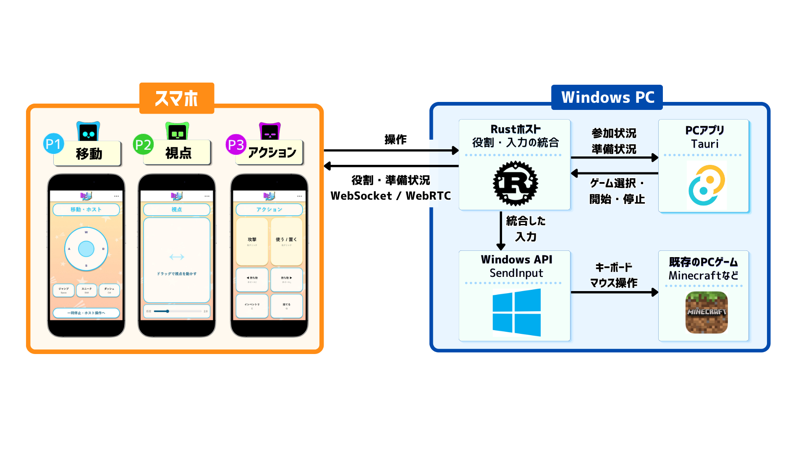
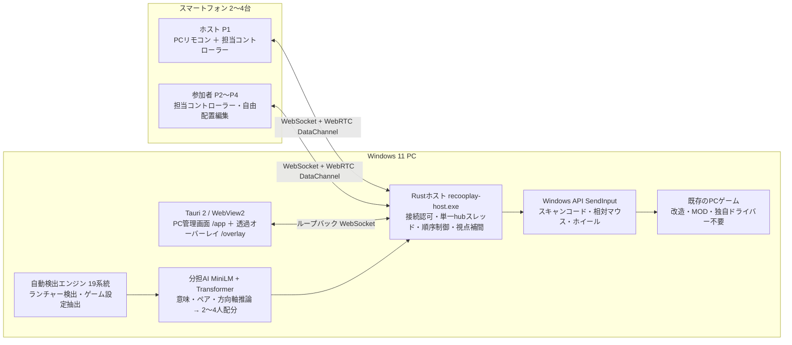
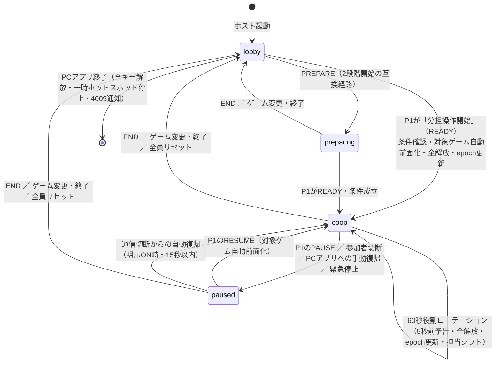

# Re:Cooplay システム仕様書

**バージョン**: 0.2.0　**更新日**: 2026-11-18

[製品紹介](../README.md) ／ [利用手順](usage.md) ／ [動作確認](verification.md)

---

製品のスマホ接続と性能受入はローカルWi-Fi（PCのモバイルホットスポットを含む）を前提とします。USBは開発・原因切り分け用の任意の補助であり、通常利用や推奨接続として扱いません（[2026-11-09のユーザー判断](develop/decisions/2026-11-09-wifi-product-baseline.md)）。

## 📑 目次

1. [概要](#概要)
2. [システム概要](#システム概要)
3. [仕様書構成](#仕様書構成)
4. [技術的特徴](#技術的特徴)
5. [開発・配布](#開発配布)
6. [API一覧](#api一覧)
7. [パフォーマンス指標](#パフォーマンス指標)
8. [トラブルシューティング](#トラブルシューティング)
9. [関連ドキュメント](#関連ドキュメント)
10. [動作条件・制約](#動作条件制約)

---

## 概要

Re:Cooplayは、既存のPCゲームを改造することなく、**2〜4人で1つのキャラクターを役割分担して共同操作する遊び方を後付けするシステム**です。参加者は各自のスマートフォンのブラウザからQRコードで参加し、担当する操作をPCへ送ります。

事前定義のあるゲームだけでなく、**19系統のゲームエンジン・設定ファイルから操作名とキー割り当てを自動検出**し、**事前学習済みBERT系モデル（多言語MiniLM）と独自学習Transformer encoderを組み合わせた分担AI**によって、どんなPCゲームでも参加人数（2〜4人）に合わせた自然な役割分担とスマホ専用コントローラーを自動生成します。

<div align="center">
  <a href="../assets/images/recooplay-system-architecture.webp"></a>
  <p><sub>スマートフォンの操作をRustホストで統合し、Windows API（SendInput）で既存PCゲームへ送る全体構成</sub></p>
</div>

---

## システム概要



PCアプリ（`recooplay-desktop.exe`）はRustホスト（`recooplay-host.exe`）を子プロセスとして起動・監視し、ホストが配信する画面を表示します。ゲーム映像はスマートフォンへ配信せず、全員が同じPC画面を囲んで操作します。ゲーム本体のMOD、独自カーネルドライバー、外部クラウド中継、STUN/TURNサーバーは一切使用しません。

| 構成要素 | 責務 | 技術スタック |
|:--|:--|:--|
| **スマホ画面**（`/`） | QR参加、ホストのPCリモコン、担当コントローラー描画、個人レイアウト編集・保存 | React 19 / TypeScript strict（Vite）、Pointer Events API、`localStorage` |
| **PC画面**（`/app`） | 一時Wi-Fi・参加QR案内、ゲーム選択・手動登録、分担確認・AI/定型切替、キー設定・診断 | React 19 / TypeScript strict（Vite） |
| **補助画面**（`/overlay`, `/host`, `/game`） | 配信・観客向け最前面透過表示、通信・注入リアルタイム診断、OS入力照合用疑似ゲーム | React 19 / TypeScript strict（Vite） |
| **PCデスクトップ枠** | ホストの起動・異常終了時の自動再起動（最大3回）、終了時の安全停止連携、透過オーバーレイ窓 | Tauri 2 / WebView2（Rust） |
| **PCホスト** | 接続・役割認可、セッション状態機械、重複排除、出力キュー、視点補間、前面確認、緊急停止 | Rust / Tokio / axum / 単一 `hub` スレッド |
| **ゲーム・操作自動検出** | 7系統ランチャーからのゲーム検出、19系統のエンジン・設定ファイルからの操作名・実キー抽出 | Rust（`games.rs`, `launchers.rs`, `game_actions.rs`, `engines/`） |
| **操作分担AI** | 操作名・キー・種類からのカテゴリ・同一担当ペア・方向軸の推論と2〜4人クラスタリング | 多言語MiniLM（8bit量子化）＋ 独自2層Transformer encoder（Rust推論） |
| **高速通信経路** | 状態・制御の確実な到達と、視点・ボタン入力の低遅延速達（未ACK入力のバンドル再送つき） | WebSocket（JSON）＋ WebRTC DataChannel（`libdatachannel`） |
| **Windows入力・ネットワーク** | キー・マウス合成入力、対象ウィンドウ前面化・終了要求、一時モバイルホットスポット制御 | Win32 `SendInput`, `SetForegroundWindow`, WinRT Tethering API |

### セッションの状態機械

最初に参加した端末がホスト兼P1となり、サーバーがP1〜P4の枠を割り当てます。端末側からホスト権や枠番号を自己申告することはできません。ロビーではホストが他の接続中メンバーへホスト権を移譲（`transfer_host`）でき、ホスト以外の参加者は自主退出（`leave`）で15秒の保持を待たずに枠を空けられます。また、ロビーでホストが切断して15秒戻らない場合は、サーバーが接続中で最も若い枠へ自動的にホストを移します。



- **ワンステップ開始と自動前面化**：PC画面で分担を決定（`confirm_lineup`）してゲームを起動した後は、ロビーからP1スマホの「分担操作開始」（`READY`）を押すだけで、サーバーが対象ゲームのウィンドウを前面化し、全出力解放と `epoch` 更新を行って `coop` へ直接進みます。
- **時間制の役割ローテーション**：PCの操作設定で「60秒ごと」を有効にすると、`coop` を一時停止することなく、交代の5秒前に全スマホへ次の担当を予告（`rotationSoon`）し、60秒経過時点で全キー解放・`epoch` 更新とともに参加者の担当を1つずつシフトします。
- **フォーカス喪失と安全停止**：`coop` 中に対象ゲームが前面から外れた場合は、即座に全出力を解放して新規押下を遮断し、再度前面に戻った時点で新しい `epoch` として再開します。PCアプリ（`recooplay-desktop.exe`）自体を前面に戻した場合は `paused` へ遷移します。

---

## 仕様書構成

| 仕様書 | 内容 | 主な対象コード |
|:--|:--|:--|
| **[フロントエンド仕様書](frontend-specification.md)** | 5画面構成、React描画と入力エンジンの分離、個人レイアウト編集UI、ホストリモコン | `apps/web/src/` |
| **[ホスト仕様書](host-specification.md)** | Rustホストのモジュール構造、単一hubスレッド、入力キュー・視点補間、前面制御、安全停止、配布・インストーラー | `apps/host-rs/src/`, `apps/desktop/src/`, `scripts/windows/` |
| **[通信仕様書](protocol-specification.md)** | `protocolVersion = 6` のHTTP・WebSocket・WebRTC DataChannel契約、認可規則、未ACK再送、遅延破棄 | `apps/host-rs/src/protocol.rs`, `apps/web/src/shared/transport/` |
| **[ゲーム操作定義仕様書](game-profile-specification.md)** | 7系統ランチャー検出、19系統エンジンからの操作自動抽出、JSONスキーマ、キー設定読取り、人数別割当 | `apps/host-rs/src/profiles.rs`, `keybinds.rs`, `game_actions.rs`, `engines/` |
| **[分担AI仕様書](preset-model-specification.md)** | 多言語MiniLM＋2層Transformer encoderの構成、自己教師あり＋教師あり学習、Rust推論、未知ゲーム汎化性能 | `apps/host-rs/src/preset_model.rs`, `text_encoder.rs`, `scripts/preset-model/` |
| **[技術選定の理由](technology-selection.md)** | 低遅延・安全性・参加容易性を実現するための採用技術と代替案の比較、実機計測・試作品検証結果 | 全体アーキテクチャ |

---

## 技術的特徴

### 1. 事前定義のないPCゲームにも対応する自動検出エンジン

Steam・Epic Games・GOG・Ubisoft Connect・EA app・Battle.net・Xbox（PC Game Pass）・Steam非Steamショートカットからインストール済みゲームを自動検出し、一覧にないゲームもPCのファイル選択から手動登録できます。

固有の操作定義（`apps/game-profiles/*.json`）がないゲームでは、インストール先のファイルやユーザー設定から**19系統のエンジン別パーサー**（Unity Input System / 旧Input Manager、Unreal Engine 4・5、Godot 3・4、RPGツクール2000〜MZ、WOLF RPGエディター、Source 1・2、Creation Engine、REDengine、CryEngine、Factorio、Project Zomboid等）で操作名とキー割り当てを自動抽出します。送れないキーや未設定の操作を別のキーで代用せず、「送らない」として明確に区別します。

### 2. BERT系モデル×独自Transformerによる2〜4人分担と専用画面生成

抽出した操作一覧（操作名・キー・種類）から、事前学習済み多言語BERT系モデル（語彙約4.4万語・8bit量子化MiniLM）と独自学習2層Transformer encoder（[Re:Cooplay Preset Model v2](https://huggingface.co/YOSHI0209/recooplay-preset-model-v2#recooplay-preset-model-v2)）が「操作カテゴリ」「同じ人が持つべきか」「方向軸」を推論し、2〜4人へ自動配分します（定型ルールとの切り替え・再生成も可能）。学習に未使用のUnity・Godot操作定義57本で**カテゴリ 88.1%・同じ人の判定 94.5%**、ゲームのファイルから読んだ操作6本で**カテゴリ 76.0%・同じ人の判定 89.3%**、人が正解を確かめた30本（246操作）で**カテゴリ 87.4%** の精度を確認しています。

生成された各スマホのコントローラーは、スマホ上でボタンやスティックの位置・縦横サイズ・複製・非表示をドラッグ操作で自由にカスタマイズして端末ごとに保存できます。

### 3. WebSocket＋WebRTCの2経路通信と4ms周期の視点補間

参加・状態・管理命令と確実性が必要な入力はWebSocket、視点移動や連打の速達にはWebRTC DataChannel（`ordered:false`, `maxRetransmits:0`、直近500msの未ACK入力のバンドル送信つき）を併用します。二重到着は端末ごとの連番（`nextIseq`）で先着1回のみを採用し、30Hzの累積視点移動はホスト側で4ms周期・可変時定数（30〜120ms）で滑らかに補間します。

### 4. 多重の安全停止境界とセッション単位の一時Wi-Fi管理

- **入力先の厳格な制限**：`injectMode: "on"` でも、選択した対象ゲームのウィンドウが前面にあることを100ms周期で確認し、前面から外れた瞬間や通信遅延（500ms以上遅れた押下）では入力を遮断・解放します。
- **全キー即時解放と異常終了からの自動復旧**：PAUSE、参加者切断（4秒無受信）、緊急停止ホットキー（`Ctrl+Alt+F12`）、ゲーム終了、アプリ終了、さらには `hub` スレッドの万一のパニック時にも `catch_unwind` で全合成キー・マウスボタンを解放します。ホストが異常終了した場合はTauriアプリが最大3回まで自動再起動し、スマホを自動再接続させます。
- **一時モバイルホットスポット管理**：PC画面からホットスポットを起動すると、セッション固有のSSID（`ReCooplay-<12桁hex>`）とパスフレーズを自動生成してQRコードで案内し、全員リセット時のWi-Fiローテーションやアプリ終了時のホットスポット自動停止まで一貫して管理します。

---

## 開発・配布

### システム要件

- **PC**: Windows 11 x64、Microsoft Edge WebView2 ランタイム、Microsoft Visual C++ v14 Redistributable（x64）
- **スマートフォン**: 同じローカルWi-Fi（またはPCのモバイルホットスポット）上の標準ブラウザ（Android Chrome / iPhone Safari）、2〜4台
- **開発環境**: Rust（MSVC）、Visual Studio C++ Build Tools、CMake、Perl、LLVM/libclang、Node.js 22以上、Python 3.10以上（インストーラー作成時は NSIS 3）

### ビルドと配布パッケージ

Web画面（5エントリ）をViteでビルドし、RustホストとTauriデスクトップアプリを `--release --locked` でビルドしたうえで、配布用zipおよびNSISインストーラー（`setup.exe`）を生成します。分担AIの版2モデル（`preset-model-v2`、約57MB）は `scripts/windows/preset-model-v2.json` に固定したSHA-256で検証して同梱します。

```powershell
cd apps/web
npm ci
npm run build
cd ../..
cargo build --release --locked --manifest-path apps/host-rs/Cargo.toml
cargo build --release --locked --manifest-path apps/desktop/Cargo.toml
powershell -ExecutionPolicy Bypass -File scripts/windows/package.ps1
powershell -ExecutionPolicy Bypass -File scripts/windows/build-installer.ps1
```

[Windows構築手順](develop/handoff/SETUP_WINDOWS.md) ／ [配布・インストーラー手順](../apps/desktop/README.md) ／ [導入・接続案内](getting-started.md)

---

## API一覧

| 経路 | エンドポイント / チャネル | 用途 | 公開範囲 |
|:--|:--|:--|:--|
| **HTTP** | `GET /` | スマホ操作画面（`phone/index.html`） | LAN |
| **HTTP** | `GET /app`, `/overlay`, `/host`, `/game` | PC管理画面、観客用透過オーバーレイ、診断画面、疑似ゲーム画面 | PCループバックのみ（LANからは403） |
| **HTTP** | `GET /api/info` | 参加URL・QR（ループバックのみWi-Fi接続QR・ホットスポット状態・ビルド版を含む） | LAN / ループバック |
| **HTTP** | `POST /api/hotspot` | Windowsモバイルホットスポットの起動（一時SSID・パスフレーズ生成） | PCループバック＋同一Originのみ |
| **HTTP** | `GET /api/game-image?id=...` | 検出ゲーム・Minecraftランチャーのタイル画像取得 | PCループバックのみ |
| **WebSocket** | `GET /ws` | 参加・再接続認可、セッション状態同期、管理命令、リモコン、操作入力、WebRTCシグナリング | 参加者はLAN、管理接続（`monitor`）はループバックのみ |
| **WebRTC** | DataChannel `fast` | 操作入力（未ACKバンドル含む）、累積視点移動（30Hz）、50ms周期の生存確認（`ka`/`kpong`） | 認可済み参加者枠（P1〜P4） |

メッセージ形式と全フィールドの詳細は [通信仕様書](protocol-specification.md) を参照してください。

---

## パフォーマンス指標

### 1. 入力・通信制御の設定定数（実測に基づく確定値）

| 処理項目 | 設定値・方式 | 設計上の根拠 |
|:--|:--|:--|
| **視点送信周期** | 30Hz、累積座標（`cx`, `cy`） | 毎フレーム送信による無線キュー詰まりを防ぎ、パケット欠落時も次回差分で移動量を保持 |
| **ホスト視点補間** | 4ms周期（`timeBeginPeriod(1)`）、時定数 30〜120ms | 直近2秒の最大到着間隔×0.5で時定数を自動調整し、安定時の低遅延と途切れ時の滑らかさを両立 |
| **最低押下・最低解放時間** | 押下 60ms・解放 50ms（連打キュー最大8件） | 通信のバースト到着で1〜5msに潰れたタップをゲーム側のポーリング（50ms周期）に取りこぼさせない（安全停止時は待たずに即時解放） |
| **遅延押下の破棄閾値** | 基準から 500ms 以上の遅延で `stale: true` | 無線の一時的な詰まり後に古い押下がまとめて実行されるのを防止（解放 `up` は常に適用） |
| **生存確認・切断判定** | WS `ping` 1秒・RTC `ka` 50ms ／ スマホ再接続3秒・ホスト切断4秒 | スマホ無線の省電力スリープを防ぎ、切断時は4秒以内に全参加者の合成入力を安全解放 |

### 2. 実機測定およびAI推論の性能実績

| 測定項目 | 実測値 | 測定条件・備考 |
|:--|:--|:--|
| **Wi-Fi通信の往復遅延（RTT）** | **中央値 9.0ms** | PCモバイルホットスポット直接接続時の実機測定 |
| **スマホ操作 → PC入力実行（SendInput）推定遅延** | **中央値 26.0ms** | タッチ検知から通信（片道＝RTT/2）・ホスト処理・`SendInput` 実行までの合計（計測ビルド `latency-measure`） |
| **分担AIの推論時間（Rustネイティブ）** | **約 80ms**（14操作） | バックグラウンドスレッドで実行し、入力・通信ループを一切ブロックしない |
| **不安定端末での視点途切れ率（通信試作品）** | **42% → 1.7% に改善** | WebSocketのみ（最大RTT 2,015ms）とWebRTC併用（最大RTT 221ms）の比較記録 |

詳細な検証条件と確認範囲は [動作確認の範囲](verification.md) を参照してください。

---

## トラブルシューティング

接続できない場合は同一ネットワーク（ホットスポット）とファイアウォール許可、入力が届かない場合は対象ゲームの前面状態・入力モード・実キー割当を確認します。

[症状別の確認と対処（困ったとき）](troubleshooting.md)

---

## 関連ドキュメント

- [PC・スマホの画面一覧](screenshots.md)：参加からゲーム選択、分担確認、共同操作、一時停止、緊急停止までの画面
- [動画・ギャラリー](gallery.md)：製品紹介動画、説明画像、Hack Day実プレイ記録
- [導入・接続](getting-started.md)：必要環境、入手・展開、起動、QR参加
- [使い方](usage.md)：ゲーム選択、分担確認、開始・一時停止・役割交換・終了
- [困ったとき](troubleshooting.md)：起動・接続・通信・入力のトラブル対処
- [動作確認の範囲](verification.md)：実機確認済みタイトル・人数、自動試験、未確認条件の区別
- [開発資料](develop/README.md)：Web構成設計、要件定義、意思決定記録、BUILD_LOG、CI検証範囲

---

## 動作条件・制約

ゲームの自動検出や操作定義の自動抽出は、すべてのPCゲームへ `SendInput` の合成入力がそのまま通ることを保証するものではありません。ゲーム固有の入力方式（Raw InputやDirectInputの実装差）、管理者権限（UIPI）、アンチチート機構、ウィンドウフォーカス状態によって挙動が異なります。Windows 11 x64以外のPCホスト、インターネット越しの遠隔プレイ、スマホへのゲーム映像配信は現在の対象外です。

実装：[ホスト受付](../apps/host-rs/src/main.rs) ／ [状態・入力統合](../apps/host-rs/src/hub.rs) ／ [PCデスクトップアプリ](../apps/desktop/src/main.rs) ／ [Web構成設計](develop/architecture/web-structure.md)
