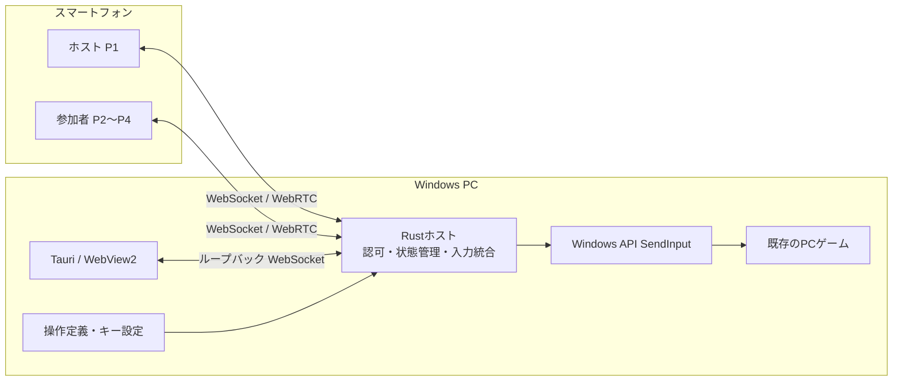
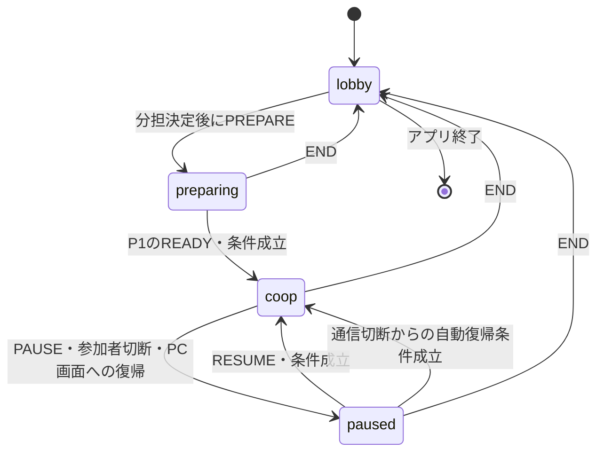

# Re:Cooplay システム仕様書

**バージョン**: 0.1.0　**更新日**: 2026-10-26

[製品紹介](../README.md) ／ [利用手順](usage.md) ／ [動作確認](verification.md)

---

## 📑 目次

1. [概要](#概要)
2. [システム概要](#システム概要)
3. [仕様書構成](#仕様書構成)
4. [技術的特徴](#技術的特徴)
5. [開発・配布](#開発配布)
6. [API一覧](#api一覧)
7. [パフォーマンス指標](#パフォーマンス指標)
8. [トラブルシューティング](#トラブルシューティング)
9. [関連ドキュメント](#関連ドキュメント)
10. [動作条件・制約](#動作条件制約)

---

## 概要

Re:Cooplayは、複数のスマートフォンから届く操作をWindows PCで統合し、既存のPCゲームへキーボード・マウス入力として送るシステムです。

---

## システム概要

PCアプリはRustホストを子プロセスとして起動し、ホストが配信する画面を表示します。ゲーム映像はスマートフォンへ配信せず、全員がPCのゲーム画面を見ながら操作します。ゲーム本体のMOD、外部クラウド中継、STUN/TURNは使用しません。

| 構成要素 | 責務 | 技術 |
|:--|:--|:--|
| スマホ画面 | 参加、ホストのリモコン、担当操作の入力 | HTML / CSS / JavaScript、Pointer Events |
| PC画面 | 接続、ゲーム選択、分担、準備、診断 | 静的HTML / JavaScript |
| PCアプリ | ホストの起動・終了と画面表示 | Tauri 2 / WebView2 |
| PCホスト | 接続認可、セッション、役割、入力統合 | Rust / Tokio / axum |
| 高速入力経路 | 視点・入力の速達 | WebRTC DataChannel / libdatachannel |
| Windows入力 | キー・ボタン・相対移動・ホイール | Win32 SendInput |

### セッションの状態

最初に参加した端末がホスト兼P1です。サーバーがP1〜P4の枠を割り当て、端末自身はホスト権や枠を指定できません。役割を交換してもP1の管理権は移りません。

ゲームの準備と共同操作の開始は別です。Ready時点の参加者と分担を固定し、人数を変更する場合は一度終了して組み直します。対象ゲームのフォーカス喪失は入力を止めますが、進行状態が常にpausedへ変わるわけではありません。

---

## 仕様書構成

| 仕様書 | 内容 |
|:--|:--|
| [PC・スマホ画面](frontend-specification.md) | 画面遷移、操作可否、分担と入力表示 |
| [Rustホスト・Windows入力](host-specification.md) | プロセス、hub、入力処理、停止、配布 |
| [通信](protocol-specification.md) | HTTP、WebSocket、DataChannel、認可、順序制御 |
| [ゲーム操作定義](game-profile-specification.md) | ゲーム検出、設定読取り、割当、操作画面生成 |

---

## 技術的特徴

### リアルタイム入力

WebSocketを本経路とし、WebRTC DataChannelを速達に使います。二重到着は入力番号で排除し、視点は累積値と補間で処理します。

### 人数別の分担

2〜4人へ操作定義のグループを割り当て、各端末に担当の入力画面を生成します。

### 安全・信頼性

接続・役割・進行をサーバーで認可し、入力先の確認、緊急停止、旧入力の破棄を組み合わせます。

---

## 開発・配布

### システム要件

- **PC**: Windows 11 x64、WebView2、Visual C++ v14 Redistributable（x64）
- **スマホ**: 同じローカルネットワーク上のブラウザ、参加2〜4台
- **開発**: Rust MSVC、C++ビルドツール、CMake、Perl、libclang。試験はNode.js 22以上・Python 3.10以上

### ビルドと配布

PCホストとTauriアプリをRustでビルドし、静的画面・操作定義をWindows x64用zipへまとめます。

[Windows構築](develop/handoff/SETUP_WINDOWS.md) ／ [配布手順](../apps/desktop/README.md) ／ [導入・配布状況](getting-started.md)

---

## API一覧

| 経路 | 用途 |
|:--|:--|
| HTTP | 画面、参加情報・QR、ゲーム画像、PCのホットスポット要求 |
| WebSocket | 参加・認可、管理命令、状態、操作入力、RTCシグナリング |
| DataChannel fast | 操作入力、視点、生存確認 |

[エンドポイント・メッセージ形式](protocol-specification.md)を参照してください。

---

## パフォーマンス指標

| 処理 | 設定値・方式 |
|:--|:--|
| 視点送信 | 30Hz、累積値 |
| ホスト補間 | 4ms周期、時定数30〜120ms |
| 最低押下・解放 | 60ms・50ms。安全停止では即時解放 |
| 無受信時の切断判定 | ホスト4秒 |

これらは処理の設定値です。エンドツーエンドの実測遅延とは異なります。実機での確認条件と試作品の測定は[動作確認](verification.md)を参照してください。

---

## トラブルシューティング

接続できない場合はネットワークと参加URL、入力が届かない場合は前面のゲーム・入力モード・実キーを確認します。

[症状別の確認と対処](troubleshooting.md)

---

## 関連ドキュメント

- [導入・接続](getting-started.md)：必要環境、入手、起動、QR参加
- [使い方](usage.md)：ゲーム選択、分担、準備、開始・停止・終了
- [困ったとき](troubleshooting.md)：起動・接続・通信・入力の対処
- [動作確認の範囲](verification.md)：実機記録、自動試験、未確認条件
- [開発資料](develop/README.md)：ソース構成、構築、要件、意思決定、開発履歴

---

## 動作条件・制約

操作定義やゲームの検出は、実際にそのゲームへ入力が届くことを保証しません。ゲームのキー設定、実行権限、前面ウィンドウ、入力方式によって挙動が異なります。Windows以外のPCホスト、遠隔プレイ、ゲーム映像の配信は対象外です。

実装：[ホスト](../apps/host-rs/src/main.rs) ／ [入力統合](../apps/host-rs/src/hub.rs) ／ [PCアプリ](../apps/desktop/src/main.rs)
