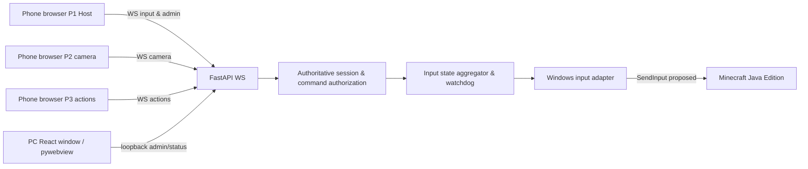

# System design: Re:Cooplay MVP (proposed)

This is an engineering design proposal, **not** a claim of implementation or hardware verification. Product requirements are in `../requirements/requirements-v0.2.md`.

## Boundaries
1. `web` handles Pointer Events and displays the server-confirmed role/session mode. It never emits raw Windows keycodes as trusted authority.
2. WebSocket validates a session token and connection identity, translates semantic actions to server commands, and rate/size-limits messages.
3. Session domain alone owns roles, host authorization, mode, `epoch`, and participant connectivity; don't mutate from pywebview UI thread.
4. Input engine stores pressed keys and mouse buttons **per owner** (and maintains reference counts/owner set where keys overlap in future). Translates virtual stick/D-pad and directional-look into game-specific mappings.
5. Windows adapter is behind an interface and implements key scan-code events, mouse left/right DOWN/UP, relative mouse dx/dy. Fail closed when no trusted game window focus.
6. WebView/PC administration never directly injects arbitrary OS input from unauthenticated LAN clients.

## Session modes (proposal)
| State | Host remote injection | P1 move | P2 look | P3 act | Control transition |
|---|---:|---:|---:|---:|---|
| WAITING | only when host present | no | no | no | first join -> HOST_REMOTE |
| HOST_REMOTE | yes | no | no | no | 3 connected + target ready -> Start |
| COOP_PLAY | no (management Pause only) | yes | yes | yes | Pause -> PAUSED_REMOTE; disconnect -> WAITING_RECONNECT/HOST_LOST |
| PAUSED_REMOTE | yes | no | no | no | 3 connected + host Resume -> COOP_PLAY |
| WAITING_RECONNECT | host may navigate (subject to target focus) | no | no | no | original token returns; explicit Resume |
| HOST_LOST | no | no | no | no | host's original token returns; explicit Resume |

**P0 invariants**
- Every mode transition increments `epoch`, invalidates stale messages and immediately releases ALL previously synthesized key/mouse states.
- Zero or invalid participants -> cannot Start/Resume. Only designated host may Start/Pause/Resume.
- A disconnect or watchdog timeout always closes the input gate; reconnect does not automatically restart gameplay.
- On focus loss / unexpected target process / exceptions, input stops, all states are released, and the host is notified. `SendInput` return count alone is **not** confirmation that Minecraft accepted an event.
- Unimplemented input driver returns an explicit failure, never a success-shaped no-op.

## Relative look (highest risk)
- P2 directional buttons create bounded recurring `(dx,dy)` **relative** mouse events while pressed, with a fixed tick/cap; swipes later send coalesced deltas.
- Do not use Screact's `MOUSEEVENTF_ABSOLUTE` pointer path for in-game Minecraft look.
- Verify that Minecraft Java's **installed version** accepts injected relative mouse events before implementing full UI.
- Remote PC menus may need *absolute* pointer + clicks, which is a separate mode/driver method (P1). Arrow/Enter/Esc alone are minimum.

## WebSocket contract idea, unimplemented
All WS messages should include `protocolVersion`, `sessionId`, `seq`, `epoch`, `type` (plus role-scoped `action` and `down` or bounded deltas); server resolves authenticated `participantId` from connection, **not client claims**.

- `hello` join/resume using per-device token (first host/P1; then P2; then P3).
- `welcome` server-confirmed role and mode.
- `control` input DOWN/UP (e.g. `move.forward`), or `look` delta.
- `manage` host-only Start/Pause/Resume.
- `state` authoritative participants/mode, all clients.
- `error` clear reason, never echo credentials.
- heartbeat/pong with watchdog, background lifecycle `release` hint (server still owns safety).

Avoid relying only on release hints because browsers cannot guarantee network delivery when backgrounded or disconnected. `seq` should prevent stale/out-of-order updates; `epoch` rejects controls from before Pause/Resume; input states should be snapshot-reconciled or timeout-cleared so a dropped `up` never leaves a key stuck.

## Focus + host PC GUI
- Two different dimensions: **what the PC displays** (Re:Cooplay or Minecraft), and **who has permission to inject** (host remote / split roles). They are not one state variable.
- When game window owns focus, target-check and SendInput; when Re:Cooplay has focus, prefer direct React focus/key handling for PC UI.
- Windows doesn't guarantee `SetForegroundWindow` success; allow manual game focus fallback at MVP.
- Minecraft "pause" is not equal to Re:Cooplay input pause; changing app state doesn't freeze the world.

## Packaging lifecycle
- Python runtime/WS + React dist on same PC; LAN clients open HTTP path via QR.
- Start Uvicorn background thread; pywebview window on main thread; no dual worker state.
- pywebview unavailable -> `http://127.0.0.1:<port>/?view=desktop` in normal browser.
- No external font/CDN/resources. Docker not required for Windows SendInput validation.
- Window loss/crash/service stop invokes best-effort release; Windows host can retain a local emergency stop hotkey independent of phone connection (implementation to be specified).
