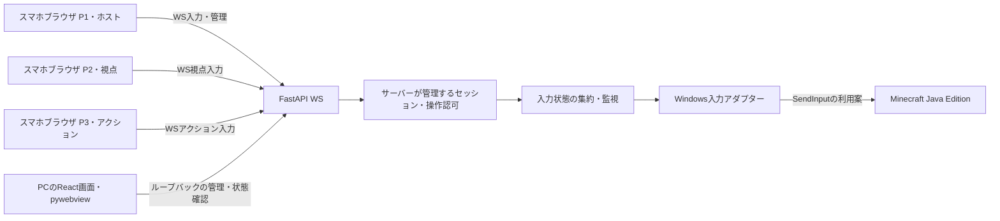

# Re:Cooplay MVPのシステム設計（提案）

この文書は実装設計の提案であり、実装済み・実機検証済みという意味ではない。製品要件は `../requirements/requirements-v0.2.md` を参照する。

## モジュール境界

1. Web画面はPointer Eventsを扱い、サーバーが確定した役割・モードを表示する。生のWindowsキーコードを権限の根拠として送らない。
2. WebSocket層はセッショントークンと接続者を検証し、意味的なアクションをサーバーの操作へ変換する。送信頻度・サイズを制限する。
3. セッション層だけが役割・ホスト権・モード・`epoch`・接続状態を管理する。pywebviewのUIスレッドから直接変更しない。
4. 入力エンジンはキー・マウスボタンの押下状態を**所有者ごと**に保持する。将来の重複キーには参照数や所有者集合で対応する。仮想スティック・十字キー・視点ボタンをゲーム固有の入力へ変換する。
5. Windowsアダプターをインターフェースの背後に分離し、スキャンコード、左右ボタンの押下・解放、相対マウスdx/dyを実装する。信頼したゲームのフォーカスが確認できない場合は入力を許可しない。
6. WebViewやPC管理画面から、未認証のLANクライアントによる任意OS入力を直接実行しない。

## セッションモード（提案）

| 状態 | ホストリモコン入力 | P1移動 | P2視点 | P3アクション | 遷移条件 |
|---|---|---|---|---|---|
| WAITING | ホストがいる場合のみ | 不可 | 不可 | 不可 | 最初の参加でHOST_REMOTEへ |
| HOST_REMOTE | 可 | 不可 | 不可 | 不可 | 3人接続・対象準備完了でStart |
| COOP_PLAY | 不可、管理のPauseのみ | 可 | 可 | 可 | PauseでPAUSED_REMOTE、切断でWAITING_RECONNECT/HOST_LOST |
| PAUSED_REMOTE | 可 | 不可 | 不可 | 不可 | 3人接続・ホストのResumeでCOOP_PLAY |
| WAITING_RECONNECT | 対象フォーカス条件を満たせばホスト操作可 | 不可 | 不可 | 不可 | 元のトークンで復帰後、明示的にResume |
| HOST_LOST | 不可 | 不可 | 不可 | 不可 | 元のホストトークンで復帰後、明示的にResume |

### P0で常に守る条件

- 全モード遷移で `epoch` を増やし、古いメッセージを無効化し、既存の合成キー・ボタンを直ちに全解放する。
- 参加者がいない・参加条件が不正な場合はStart/Resume不可。管理操作は指定ホストだけに許可する。
- 切断や監視タイムアウトでは必ず入力ゲートを閉じる。再接続のみで自動再開しない。
- フォーカス喪失・想定外の対象プロセス・例外では停止し、全解放してホストへ通知する。`SendInput` の返却件数だけではMinecraftが受理した証拠にならない。
- 未実装ドライバーは明確に失敗を返す。何もしない処理を成功扱いしない。

## 相対視点操作（最大の技術リスク）

- P2の方向ボタン押下中は、固定周期・上限付きの `(dx,dy)` 相対マウス入力を繰り返す。将来のスワイプでは差分をまとめて送る。
- Minecraftの視点操作にScreactの `MOUSEEVENTF_ABSOLUTE` による座標指定処理を流用しない。
- 完成UIを作る前に、**実際にインストールされているMinecraft Javaの版**で合成相対マウスが受理されるか検証する。
- PCメニュー用には絶対座標とクリックが必要な場合がある。これは別モード・別メソッドで扱う優先度P1の機能。最低限は方向キー・Enter・Esc。

## WebSocket契約案（未実装）

全メッセージに `protocolVersion`、`sessionId`、`seq`、`epoch`、`type` を含める。操作に応じて役割内の `action`、`down`、上限付き差分を付ける。認証済み `participantId` はクライアントの申告ではなく接続から解決する。

- `hello`：端末ごとのトークンで参加・復帰。最初がホスト兼P1、次がP2、次がP3。
- `welcome`：サーバーで確定した役割・モード。
- `control`：押下・解放（例：`move.forward`）、または `look` の差分。
- `manage`：ホスト専用のStart/Pause/Resume。
- `state`：サーバーが管理する参加者・モードを全端末へ送信。
- `error`：理由を明示し、認証情報は返さない。
- 心拍・応答を監視し、ページ非表示時等の `release` 通知も利用する。ただし安全性の責任はサーバーが持つ。

ブラウザは非表示・切断時の通信成功を保証できないため、解放通知だけに依存しない。`seq` で古い・順序逆転した入力を防ぎ、`epoch` でPause/Resume前の入力を拒否する。状態全体の照合やタイムアウト解放により、`up` 欠落で押しっぱなしにならないようにする。

## フォーカスとPC画面

- **PCが何を表示しているか**（Re:Cooplay/Minecraft）と、**誰が入力権を持つか**（ホスト/役割分担）は別の状態として管理する。
- ゲームが前面なら対象確認後にSendInputを使う。Re:Cooplayが前面なら、PC画面はReactのフォーカス・キー処理で直接操作する方法を優先する。
- Windowsは `SetForegroundWindow` の成功を保証しない。MVPでは手動フォーカスを代替として許容する。
- Re:Cooplayの入力PauseはMinecraftの時間停止とは異なる。アプリ状態の変更だけでワールドは止まらない。

## 配布・起動・終了

- Python実行環境・WebSocketとReactのdistを同じPCへ配置し、LAN端末はQRからHTTPで参加する。
- Uvicornはバックグラウンドスレッド、pywebviewはメインスレッドで起動する。複数ワーカーへ状態を分けない。
- pywebviewが利用できない場合は通常ブラウザで `http://127.0.0.1:<port>/?view=desktop` を開く。
- 外部フォント・CDN・資産を必須にしない。WindowsのSendInput検証にDockerは不要。
- ウィンドウ消失・異常終了・サービス停止でも可能な限り全解放する。スマホ回線に依存しないPCの緊急停止キーも用意する案とし、詳細は後で定める。
