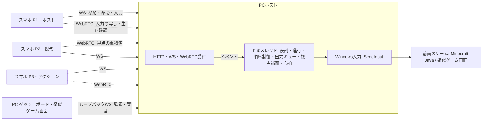

# Re:Cooplay MVPのシステム設計

**状況：**
- 2026-10-24に実機で検証した試作品（Node.js参照実装）の観測を比較対象として設計を整理する（[判断記録](../decisions/2026-10-24-prototype-validated.md)）。
- PCホストはRustで実装する。Rust版は同じ設計の移植で、PC上のシミュレーションのみ実施済み。実入力とスマホ3台での実機試験は未検証。
- 製品要件は `../requirements/requirements-v0.3.md`、通信の詳細は [protocol.md](protocol.md) を参照する。
- Minecraftでの動作は未検証。

## 1. モジュール境界

| モジュール | 責務 | 参照実装 | Rust版 |
|---|---|---|---|
| 受付 | 静的ページ配信、`/api/info`（QR）、WebSocketの受け渡し、WebRTCのコールバック | `server.js` のHTTP・WS部分、`rtc.js` | `main.rs`、`rtc.rs` |
| hub | 役割、進行、認可、入力の先着1回処理、出力キュー、視点補間、心拍、ログ。**状態を変更するのはここだけ** | `server.js` の中心部 | `hub.rs`（専用スレッドとタイマーヒープ） |
| 対応表 | 操作名 → 出力（キー・マウス）の変換。役割・状態ごとに許可する | `controls.js` | `controls.rs` |
| Windows入力 | スキャンコードのキー、左右ボタン、相対移動、ホイール。`timeBeginPeriod(1)` | `input.js`（koffi） | `input.rs`（`windows` crate） |
| 画面 | スマホのコントローラー、ダッシュボード、疑似ゲーム画面 | `public/*.html`（Node版・Rust版で共通） | 同じファイルを配信する |

規則：
- スマホは「操作名」だけを送る。Windowsのキーコードは送らない。
- 役割・ホスト権・状態の認可はhubが行う。
- モニター（PC画面）の接続と、`/host`・`/game` はループバックからだけ受け付ける。

## 2. 進行の状態

| 状態 | ホストのリモコン（矢印・Enter・Esc） | P1移動 | P2視点 | P3アクション | 遷移 |
|---|---|---|---|---|---|
| `lobby` | 可 | 不可 | 不可 | 不可 | P1が `START`（`canStart` が真）で `coop` |
| `coop` | 不可（`PAUSE` のみ） | 可 | 可 | 可 | `PAUSE` で `paused`（`host pause`）、誰かが切断すると `paused`（`Px disconnected`） |
| `paused` | 可 | 不可 | 不可 | 不可 | `RESUME`（`canStart`）で `coop`、`END` で `lobby`。試作品では切断理由・ON設定で15秒以内の自動復帰を観測。実ゲームの初期値・使用条件は未決定。ホストPAUSE・OFF・期限外は明示RESUME |

- `canStart` は、P1が接続していて、接続人数が `required`（初期値3）以上であること。
- 状態が変わるたびに、全出力を解放し、視点の未処理分を捨てる。
- ホストの自動交代はしない。再接続した端末は、同じ `clientId` で元の枠へ戻る。
- 進行が変わるたびに `epoch` を増やし、`game` で通知する。スマホは `input`・`look` に押した時点の `epoch` を付け、hubは現在と違うものを処理しない（要件SM-05、Rust版で実装・PC上のシミュレーションで確認。Node参照実装は未対応）。状態変更時の全解放・接続ごとの `nextIseq` と併用する。

### 停止と復帰の採用条件

協力プレイから一時停止へ移るときは、切断者だけでなく全参加者の合成キー・マウスボタンを直ちに解放する。最低押下時間・連打キューより安全停止を優先し、待機中の入力キュー・視点の未処理分を破棄する。再開時は旧押下を復元せず、新しい押下から始める。

試作品では自動復帰ONで、通信切断後15秒以内に全員が戻ると復帰する挙動を3回確認した。これは観測事実であり、Minecraft実運用での採用判断ではない。実運用の自動復帰の初期値・許可条件は未決定で、安全確認後にユーザーが判断する。ホストの明示PAUSEは設定のON/OFFによらず自動復帰しない。 全参加者の解放、対象ウィンドウ確認（FR-034）、緊急停止（FR-035）、旧入力破棄の確認は未完了の安全要件として残す。

## 3. 入力の流れ

### 3.1 ボタン（押下・解放）

1. スマホは `iseq` を付けて、WebRTCとWebSocketの両方へ送る。
2. hubは番号順に、先に届いたほうで1回だけ処理する。番号が飛んだら、WebSocketで届くのを待つ。
3. 対応表で出力に変換する。出力がなければ（担当外・状態外）無視する。
4. 出力キューに積む。参照数（押している人の集合）を見て、最低押下60ms・最低解放50msを守りながら `SendInput` する。
5. 押下は注入可能なときだけ受け付け、解放は常に受け付ける。

### 3.2 視点

1. スマホは同じepoch内のドラッグ量×感度を累積し、30Hzで `cx`・`cy` を送る。epoch変更時にスマホとホストは累積値・視点の順序番号を0へ戻し、未送信移動量を捨てる。別epochのパケットは累積値の基準にも反映しない。
2. hubは前回値との差を未処理分に積む。
3. 4ms周期で、未処理分の `1-exp(-dt/τ)` だけを相対移動として送る。端数は次回へ持ち越す。
4. τは、直近2秒の到着の最長の途切れ×0.5を、30〜120msに収めた値。

### 3.3 生存確認と切断

- スマホ：WebSocketで1秒ごとに `ping`。協力プレイ中はWebRTCで50msごとに `ka`。3秒応答がなければ接続し直す。
- hub：4秒受信がなければ切断扱いにする。協力プレイ中なら一時停止に移り、全参加者の合成キー・マウスボタンと待機入力を解放・破棄する。切断者のみの解放では不足。

## 4. 注入モードとフォーカス

| モード | 注入する条件 | 用途 |
|---|---|---|
| `off` | 注入しない（初期値） | 安全 |
| `test` | 疑似ゲーム画面がフォーカスを持つときだけ | 実入力の照合試験 |
| `on` | 常に、前面のウィンドウへ | 実ゲーム |

**課題：** `on` のときに前面がMinecraftであることを確かめる処理（例：前面のプロセスが `javaw.exe` か）は未実装（FR-034・G1-D）。実装するまでは、ホストがMinecraftを前面にしてから `on` にする運用とする。

## 5. 疑似ゲーム画面（検証用の道具）

`/game` は、OSが受け取ったキー・マウス入力だけで動くテスト用の画面。
- メニュー操作、WASDでの移動、マウスでの視点、ジャンプ、採掘・設置、ホットバー、インベントリ、捨てる、Escメニューがある。
- キーボード・マウスの図に、誰の操作で押されたかを色で表示する。
- 注入の通知と実際の受信を照合し、受信できたか・届かなかったか・遅延・最短の押下時間を記録する（ログの `observe`）。
- Minecraftの代わりではなく、入力の経路が切れていないかを切り分けるための道具として残す。

## 6. 起動・終了・配布

- PCホストは、`public/` のある場所から起動する。`config.json` は任意。
- Rust版はCtrl+Cで終了するとき、全出力を解放してからログを書き出して終了する。
- PCアプリの枠はTauri（WebView2）を予定している。使えない場合は通常のブラウザで `http://localhost:8080/host` と `/game` を開く。
- 外部CDN・フォント・クラウドは使わない。
