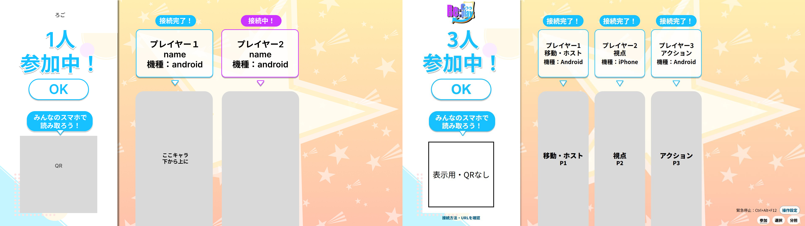
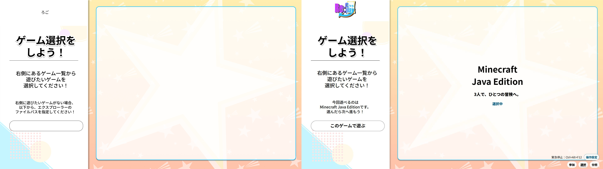
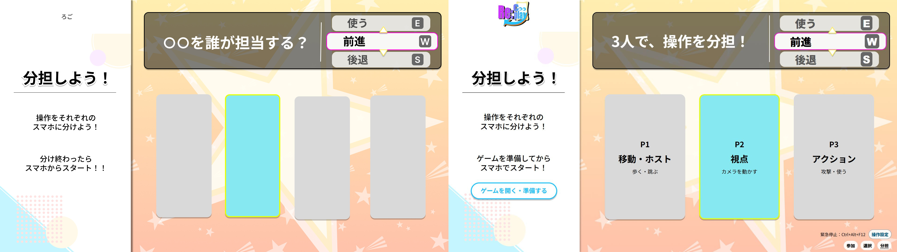
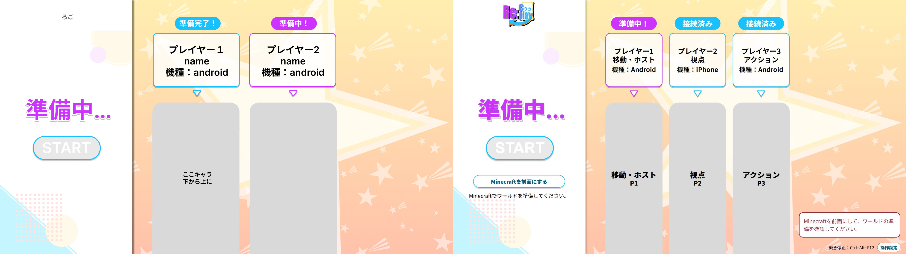
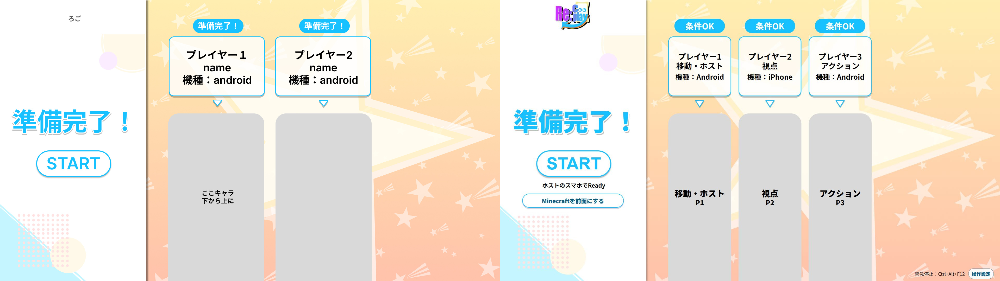

# 原案5画面との最終比較

これは表示専用の模擬状態による新規撮影。Minecraft・スマホ・Tauri実機の動作証明ではない。左に提供PNG、右に製品HTMLの1920×1080描画を、縮小・切り取り・マスクなしで並べた。画像を開くと原寸3840×1080で確認できる。

[比較ギャラリー](index.html) ／ [要素ごとの計測・差分](../pc-fidelity-element-matrix.md) ／ [監査履歴](../pc-fidelity-progress.md) ／ [2回の撮影来歴](audit-manifest.json)

| 画面 | 構造25 | 位置25 | 文字20 | 形・色15 | 密度15 | 合計 |
| --- | ---: | ---: | ---: | ---: | ---: | ---: |
| 参加 | 25 | 24 | 19 | 14 | 14 | 96 |
| ゲーム選択 | 25 | 25 | 19 | 14 | 14 | 97 |
| 分担 | 25 | 25 | 19 | 14 | 13 | 96 |
| 準備中 | 25 | 25 | 18 | 14 | 14 | 96 |
| 準備可能 | 25 | 25 | 19 | 14 | 14 | 97 |

ルーブリックによる自己監査。点数は画素一致率・第三者評価ではない。正式フォント情報がないため完全一致は保証しない。各観点80%以上・全画面95点以上。提供ロゴ反映後の製品コード 5cefdf9 で独立した2回の新規撮影を行い、その間に製品コードを変更していない。ロゴは追加の明示的ユーザー指定に従う差替で、原案の仮ロゴを再現対象にはしない。

## 参加

[実装1920×1080](join-1920.jpg) ／ [実装1280×720](join-1280.jpg) ／ [無加工差分](join-difference.png)

## ゲーム選択

[実装1920×1080](game-1920.jpg) ／ [実装1280×720](game-1280.jpg) ／ [無加工差分](game-difference.png)

## 分担

[実装1920×1080](roles-1920.jpg) ／ [実装1280×720](roles-1280.jpg) ／ [無加工差分](roles-difference.png)

## 準備中

[実装1920×1080](preparing-1920.jpg) ／ [実装1280×720](preparing-1280.jpg) ／ [無加工差分](preparing-difference.png)

## 準備可能

[実装1920×1080](ready-1920.jpg) ／ [実装1280×720](ready-1280.jpg) ／ [無加工差分](ready-difference.png)
