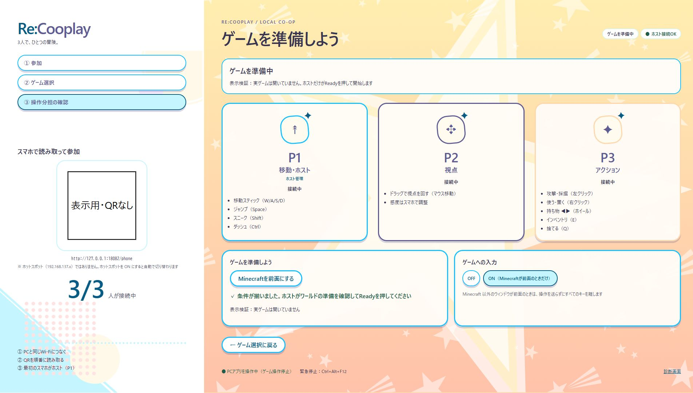

# PC・スマホUIの検証結果

対象は2026-10-25の工程0〜4。起点mainは `0b35dd198033f229708e711eac95ed7377a20346`。既存の未コミット実機記録を保持し、専用作業ツリーとStacked PRで実装した。新UIのスマホ実機・Minecraft受入は行っていない。

## 実装した画面と構造

- PC：QR参加、3人の接続、Minecraft選択、固定分担、ゲーム準備、ホストReady待ち、協力中、一時停止、入力先・停止状態。
- スマホ：接続・担当待ち、P1タッチパッドと管理、P1移動、P2視点・感度、P3アクション、満員・参加情報不一致・版不一致、再接続、横向き停止案内。
- 配色は `styles/colors.css`、寸法等は `styles/tokens.css`、共通部品は `styles/shared.css`。提供背景5枚をローカル配信する。採色・画像対応は `color-palette.md` と `ui-reference-map.md`。
- WebSocketと接続状態は `scripts/controller.js`、WebRTCは `transport.js`、協力ポインターと30Hz視点は `cooperative-input.js`、ホスト操作は `touchpad.js`、スマホ描画は `phone-view.js`、PC描画は `desktop.js` に分離した。操作のたびに画面全体を描画しない。統計更新は最大10Hz、低頻度の表示更新は1秒ごと。
- 新しい本番依存、React移行、自由な操作配置編集、外部CDN、STUN/TURNは導入していない。

## ブラウザの確認

Windows上の内蔵Chromiumを使用した。Rustのdry-runホストに異なるOriginの3つのブラウザ画面を接続し、WebRTC接続、準備→P1の明示Ready→3担当への移行、Pause、再接続を確認した。OSには入力を送っていない。

レスポンシブと障害表示は、製品ソースを配信する表示専用の `node scripts/sim/ui-preview.mjs` でも確認した。ここではWSの状態を模擬する。製品側の認可やOS入力を迂回する機構ではなく、Rustの安全性・実機合格の証拠には使わない。

| 対象 | 条件 | 観測 |
| --- | --- | --- |
| 縦画面 | 320×568、360×640、360×780、390×844、402×874、430×932 | 横にはみ出さない |
| P1/P2/P3協力画面 | 3担当×6サイズ | P1/P3の操作ボタンは全て画面内で高さ44px以上。P2の視点領域と感度調整を表示 |
| ホスト準備・一時停止 | 2状態×6サイズ | Ready・再開・前面化・終了ボタンが画面内。最小タッチパッド高64px |
| 障害 | 満員・トークン不一致・版不一致 | 固有の説明を表示。版不一致とトークン不一致は無限再接続しない |
| 横向き | 874×402 | 操作を解放し、縦向き案内を表示 |
| PC | 1920×1080、1280×720 | 3カードを保持し、横はみ出しなし。小解像度は説明の下部に縦スクロールが必要。入力ON・ゲーム前面化ボタンは画面内 |

表示モジュールの分離後にもReady→協力画面→Pauseを再確認し、当該プレビューページのJavaScriptエラーは0件だった。libdatachannelの応答をArrayBufferとして受けた際のJSONエラーを修正し、文字列・ArrayBuffer・Blob・壊れた応答・旧接続を試験した。

[1280×720の表示](evidence/pc-1280-preparing.jpg)／[402×874のホスト画面](evidence/mobile-402-host.jpg)。画像内のQRは表示確認用の代替で、実環境のIPや参加トークンは含めていない。実際のRustホストではAPIが生成したQRを表示する。

## 送信遅延の観測

実際のRust dry-runホストに接続したChromiumで測定した。単位ms。開始点はPointerEventのtimeStamp、終了点はブラウザからのsend呼出し後。物理タッチ、ネットワーク、OS入力、Minecraft描画までの遅延ではない。数値保証を新設しない。

| 測定 | 件数 | 中央値 | p95 | 最大 |
| --- | --- | --- | --- | --- |
| ジャンプpointerdown→送信 | 20 | 0.5 | 1.0 | 1.0 |
| 視点pointermove→送信 | 28 | 32.0 | 40.7 | 41.7 |
| 視点の送信間隔 | 27 | 33.4 | 66.0 | 66.9 |

視点はドラッグ8回の集計で、ドラッグ間の短い空白も含む。変更前の同条件でのブラウザ測定はないため、改善率や無劣化は断定しない。最低押下60ms・最低解放50ms・視点30Hz・補間4ms・切断4秒の値は変更していない。低頻度の検証用集計は端末内だけに保持し、外部へ送信しない。

## React移行を検証する価値

**将来の検証価値はあるが、今回のMVPを移行する必要はない。** 今回困った点は、約500行のインラインコードに通信・入力・描画が混在し、状態遷移とポインターの寿命を追いにくかったこと、PCとスマホで開始案内が重複していたことだった。まず既存依存のままモジュールを分離して解決した。

今後、画面・設定・再利用する部品が増える場合や、将来の操作編集を扱う段階では、Reactで状態と部品を管理する小さな検証を行う価値がある。その場合も通信・epoch・入力エンジンは描画から独立させ、同一端末で押下・ドラッグのp95、30Hz間隔、pointercancel・回転・非表示・再接続を比較してから判断する。今回の静的UIの実機受入を先に行う。

## 未実機検証・切り戻し

- 新しい二段階開始・既存ゲームの前面化・P1タッチパッドの実PC／Minecraftでの挙動。
- Android Chrome・iPhone Safariの実タッチ、safe area、アドレスバー伸縮、端末回転、複数指、画面非表示、長押し中のAlt+Tab・切断・実ホットキー。
- Raw Input・感度別のMinecraft視点、3台での長時間操作と混雑したWi-Fi、オフライン配布ZIPの別PCでの起動。

マージ前はmainの旧画面・入力を維持する。レビューは開始機能→ホスト操作→PC・スマホ同時UIの順。取り込んだ後に問題があれば依存の逆順にrevertし、旧画面だけをv4ホストへ混在させない。工程5の実機受入を満たすまで関連Issueは閉じない。
