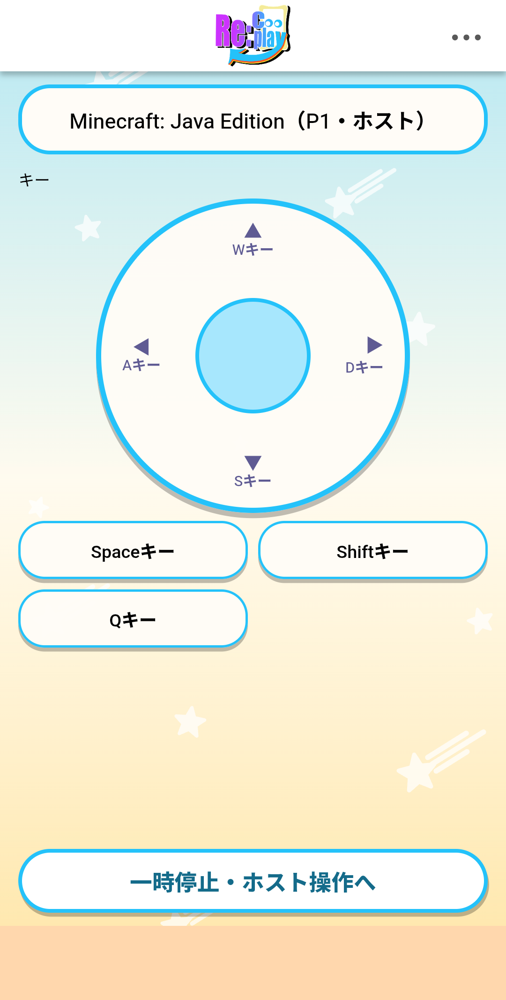
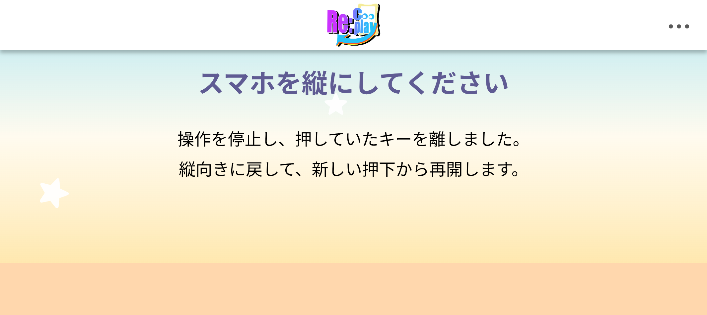
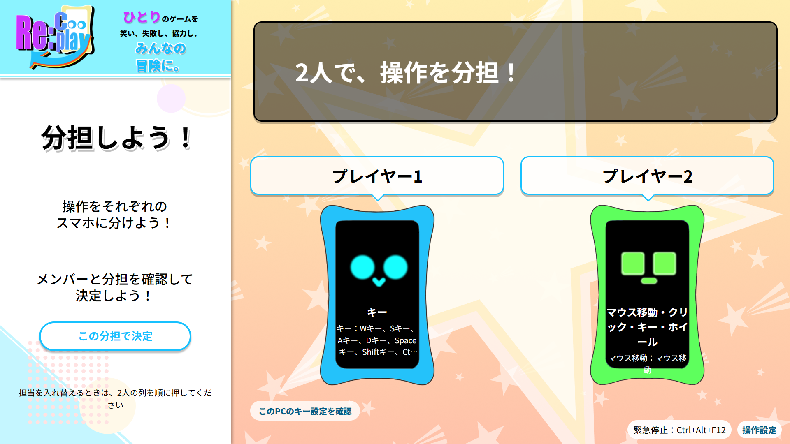
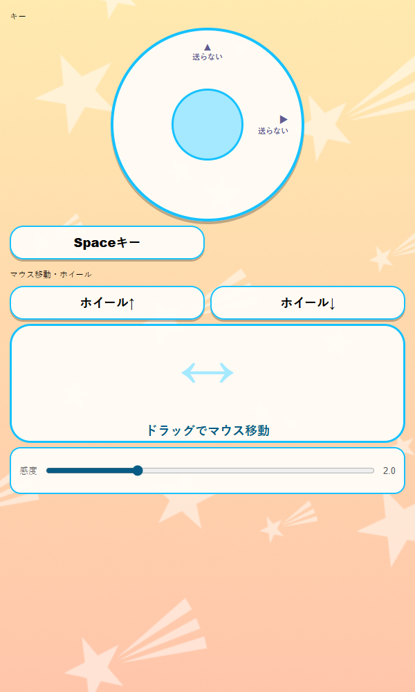

# React + TypeScript移行基盤の検証記録（#235）

## 範囲と結論

2026-11-08〜09、専用ブランチでスマホ・PCの主要画面をReact + TypeScript strictへ移した。IslandsとPortalの入口を廃止し、React版は型付き描画アダプターを使う。入力エンジン、サーバーの認可、protocolVersion=4、入力定数は維持した。

自動試験とAndroid 1台のUSB/CDP試験、Tauri実窓の表示・終了を確認した。**iPhone Safari、実指、3実端末の同時操作、Wi-Fi断、Minecraftへの実入力は未検証**。既定URLとmainへの採用は完了扱いにしない。

## Android実機

| 項目 | 実施条件 |
|:--|:--|
| 端末 | Android 16 / SDK 36、1080×2392、density 450 |
| ブラウザ | Chrome/156.0.8078.79 |
| 経路 | 認可済みADB reverse、Chromeリモートデバッグ。P2/P3はPC上の模擬参加者 |
| ホスト | Rust release、dry-run、no-config、fake target。OS入力なし |
| 操作 | CDP touch、ADBによる実回転・HOME非表示・Chrome復帰 |
| 復元 | 試験タブ、ADB forward/reverseを解除し、回転モードを元のfreeへ復元 |

従来版・React版とも同じAndroidで14項目すべて合格。詳細は [React版](evidence/react-235/android-summary.json) と [従来版](evidence/react-235/android-legacy-summary.json) に記録した。実IP・端末serial・参加tokenは含めない。sourceCommitは変更の基点、sourceDirtyは未コミット状態を示し、Reactの試験資産はuiAssetsのSHA-256で照合できる。

| 計測 | 従来版 | React版 |
|:--|:--|:--|
| pointerdown→送信（3標本）p50 / p95 | 24.0 / 26.5ms | 19.9 / 20.4ms |
| 診断RTT 平均 / 最大 | 19 / 106ms | 19 / 106ms |
| 約1.5秒のlook送信数 | 43 | 42 |
| look間隔 中央値 / p95 | 33.1 / 66.0ms | 33.0 / 66.1ms |

少標本のUSB/CDP計測であり、改善や実指・LANの性能保証は主張しない。

- P1参加、横あふれなし、WebRTC+WS成立
- 生成ボタンのdown/up、同じボタンの2接点保持、最後の接点でのみup
- スティック右方向と解放、44px以上のボタン領域、端末内入力時間の集計
- 診断の開閉、保持中のホストPauseと全解放
- 再開、実回転による停止、縦復帰後の旧押下なし
- Chromeの実非表示と復帰、旧押下なし
- 保持中に試験タブの実WebSocketを閉じ、全解放・paused・同じP1への再接続・旧押下なしを確認（Wi-Fi断ではない）
- 再読み込み後のP1・管理権とpaused状態の復元
- P1/P2の担当交換、両者の確認、視点パッド、送信周期、Pause後の視点送信停止
- JavaScript例外・console errorなし、ホスト正常終了

タッチ生成は実機のブラウザで行ったが、実指の操作感やLAN品質を検証したとは扱わない。端末内のevent-to-sendはゲームへの到達時間ではない。





## 自動試験

| 試験 | 結果 |
|:--|:--|
| `npm ci --prefix apps/web`、`npm run build --prefix apps/web` | lockから復元、strict型チェックとViteビルド成功。追加は開発依存のみ |
| `cargo build --release --locked` / `cargo test --release --locked`（host） | 成功。135件合格・2件ignored、input-probe 4件合格。既存のdead_codeとOpenSSL PDB警告あり |
| desktopのreleaseビルド・`cargo test --release --locked --offline --manifest-path apps/desktop/Cargo.toml` | 通常権限で成功、既存テスト3/3合格。React確認用の明示的な環境変数を追加 |
| `react-phone-parity.mjs --samples 20` | DOM・配置・待機・リモコン・生成操作・順序・スティック・WebRTC・Pause・再接続・反復再マウント・エラー比較に合格 |
| 同試験のタップからdry-run注入まで | p95：追加検証時は従来14.8ms→React10.1ms。許容悪化10ms以内。実端末・Minecraftの遅延とは別 |
| 同試験のlook送信数 | 追加検証時は両版28回/秒。kaを除外。PC同条件の模擬タッチによる計測 |
| `react-pc-parity.mjs` | DOM・参加・分担・主要画面の文言/ボタン状態・設定変更/復元・演出14回・エラー比較に合格 |
| `protocol-sim.mjs` | 60/60合格、dry-run |
| `phone-lifecycle-test.mjs` | 16/16合格 |
| `phone-session-test.mjs` / `input-owners-test.mjs` / `protocol-boundary-test.mjs` | 7/7・4/4・7/7合格 |
| `ui-input-test.mjs` | 12/12合格 |
| 共通レイアウト、`controller-preview-test.mjs`、phone-view、診断、skin、view-transition、app-view | 合格。実TSXをReactで描き、プレビューの視点表示と入力属性/重複IDなしを確認 |
| `check-static-pages.mjs` / `static-assets-sim.mjs` | 構文・参照、57資産のHTTP/MIME/no-store/ローカル参照確認に合格 |
| `package.ps1` / `package-smoke.mjs` | zip作成、全同梱物とハッシュ、改変/欠落の拒否、リポジトリ外での配信・正常終了に合格 |
| `verify_overlay.py` / `check-public-docs.py` / `git diff --check` | 合格 |

Rustは既存のユーザー領域キャッシュを再利用した。ビルドコマンドのmanifestとbinは下記の再実行例を参照する。試験を省略したための成功や、何もしない入力ドライバーの成功扱いは行っていない。

## Tauri / WebView2

通常権限でビルドしたEXEを、専用ポート、dry-run、no-config、`RECOOPLAY_REACT_UI=1` で直接起動した。Computer Useで実窓のアクセシビリティ上のURLが `/app-react.html` であること、参加画面・ゲーム選択・操作設定の表示を確認した。終了後のログに `shutdown`、`releaseConfirmed:true`、`unconfirmed:[]` があり、プロセスも終了した。

初回の再ビルドは、ビルド完了前に旧EXEを起動したためEXEの削除がアクセス拒否になった。旧窓を終了し、ビルドの成功を待ってから新EXEで確認し直した。UAC昇格やツール再導入では対処していない。



PC写真はheadless Chromeの比較試験によるもの。実WebView2の確認と区別する。2人分担時の長い操作名の折返し・省略は従来版と同じで、デザイン変更は本移行へ混在させていない。

## 環境上の失敗と解決

- サンドボックス内のADBサーバー起動とnpmのDNS/キャッシュアクセスに失敗。通常環境の承認付き実行で解決した。Androidは認可済みだった。
- PowerShell 5.1はBOMなしの日本語スクリプトを誤読したため、`dev.ps1` をUTF-8 BOM付きにした。
- zip試験はArchiveモジュールの自動読込制限で失敗したため、.NETの展開APIへ変更した。システムの実行ポリシーは変更していない。
- バックグラウンド中のCDP touchEndはタイムアウトしたため、Chrome復帰後に終了イベントを送るよう補助スクリプトを修正した。回転・転送設定も後始末する。
- 比較試験は演出途中を比較していたため両版の演出完了を待ち、DOMノードを真偽値で判定するよう修正した。比較項目は削除せず、反復再マウントと設定変更を追加した。


## 共通コントローラーのプレビュー

入力bindingsがない場合も、プレイ用の同じ部品からボタン・スティック・ホイール・視点パッド・感度を描く。パッドの見た目は共通CSSを使い、実入力用IDやdata-ctlは出さず、全体をinertにする。Play側の既存ノード移動と入力エンジンは維持する。これは編集UIや保存スキーマの完了ではない。

`controller-preview-test.mjs` が実際のTSXを既存Viteで変換し、Reactによる描画と入力境界を確認する。600px幅のheadless Chromeで表示も確認した。



## 再実行

```powershell
npm ci --prefix apps/web
npm run build --prefix apps/web
node scripts/sim/react-phone-parity.mjs --bin <ホストEXE> --samples 20
node scripts/sim/react-pc-parity.mjs --bin <ホストEXE>
node scripts/device/android-dry-run.mjs --bin <ホストEXE> --sha256 <EXEのSHA256> --adb <adb.exe> --react
```

通常権限の構築手順は [WINDOWS_NORMAL_USER_DEV.md](../handoff/WINDOWS_NORMAL_USER_DEV.md)。判断は [React + TypeScript製品UI基盤](../decisions/2026-11-08-react-typescript-foundation.md)。

## 残件と採用ゲート

1. iPhone Safariと実指・複数実端末・Wi-Fi切断の受入を行う。2026-11-09、ユーザーが「用意できないため実機受入は保留」と回答したため、iPhone受入は保留する。PCの接続機器一覧でもiPhone/iPadは見つからなかった。
2. 受入結果とユーザー判断を受けて、既定URLを切り替え、比較用の従来描画を削除する。今回mainへマージしない。
3. #271のバージョン付き座標/サイズ/保存、#50の編集体験と履歴、#272のRust共通契約・型生成を実装する。今回の共通モデル・部品・APIを再利用する。
4. Minecraft実入力・LAN性能・配布先PCは既存の安全ゲートで確認する。USB/CDPの成功では代替しない。
