# READMEのデザインの考え方

[デザイン資料の案内](README.md) ／ [README用の図版](../../../assets/readme/README.md) ／ [製品README](../../../README.md)

製品READMEのデザインで何を狙い、どう判断したかの記録です。図の作り方や配信の仕組みは [README用の図版](../../../assets/readme/README.md) に、各回の作業と確認結果は [BUILD_LOG](../handoff/BUILD_LOG.md) にあります。ここでは、ほかの作品のREADMEにも持ち出せるように、**判断の理由**を中心に残します。

特定の部分のデザインを説明する所には、READMEで使っている画像の実物を置いています。画像はすべて「画像1」のような番号の見出しと、ファイルの場所を書いた枠の中に入れています。**枠の中は画像、枠の外はこの資料の本文です。** とくに見出しの画像は本物の見出しと見分けがつかないように作っているため、枠の外に置くとこの資料の見出しと区別できなくなります。

## 1. いちばんの狙い：「ぱっと見ふつう」から「えええ」へ

このREADMEは最初から圧倒するのではなく、**驚きを段階的に大きくする**ように作っています。

1. 開いた瞬間は、ありきたりな製品紹介のREADMEに見えます。作品名の見出しも概要文もGitHubでいつも見る見た目です。
2. 概要文を読んでいると、見出しがいきなり動き出します。いつも見ているものだと思っていたら、いつもではありえないことが始まります。ここで最初の驚きを届けます。
3. 下へ読み進めると、ふつうのREADMEではまず見ない要素が続きます。見出しの横で演じるキャラクター、実機の操作の録画、ライト・ダークとスマホに合わせた図。最後は「圧巻」と感じてもらうことを狙っています。

最初から派手にすると、読み手は「凝ったページだ」と身構え、驚きは小さくなります。**期待を一度ふつうまで下げてから裏切る**ことで、同じ演出でも印象が大きく変わります。

## 2. 作品名の見出し（h1）：ふつうの見出しに錯覚させる

作品名の見出しは、GitHubのふつうの見出しと見分けがつかないことを最優先にしています。動きの物語は、その錯覚が成立してから始まります。

### 2.1 錯覚を成立させる工夫

| 工夫 | 理由 |
|---|---|
| 文字はGitHub本体と同じフォント指定・大きさ・太さ（作品名はh1の32px、キャッチコピーはh2と同じ24px、太さ600）で描く | 画像だと気づかれないようにする |
| 1文字ずつの位置は、GitHubの見出しをChromeで実測した幅で置く | OSの書体の差で文字の並びが不自然にならないようにする |
| `<h1>` の中に `align="absbottom"` で画像を入れる | 見出しの下線までの間隔を、ふつうの見出しと同じにする |
| 一番上に「※JPHACKS 2026 Award Dayでの内容です」を、GitHubの引用と同じ見た目で描く | 下の2つを参照 |

<table><tr><th align="left">画像1　作品名の見出し（約5秒後に動き出す） READMEで使っている画像の実物：<code>assets/readme/title-*.svg</code></th></tr><tr><td><picture><source media="(prefers-color-scheme: dark)" srcset="../../../assets/readme/title-dark.svg"></picture></td></tr></table>

一番上の「※」の注釈には、2つの役割があります。

- 蹴られた「。」の放物線が見える場所になります。注釈の行と見出しの間の余白を、ボールが飛ぶ空間として使います。
- 不自然な余白を作りません。放物線のための余白を何もない空白として取ると、見出しの上が妙に空いて、画像だと気づかれます。引用の行で埋めると、READMEの先頭に注釈と見出しを並べたときと同じ位置になり、違和感がなくなります。

### 2.2 動き出す時刻

- 表示してから約5秒はまったく動きません（止まった時間3.5秒と、赤が歩き出すまでの約1.5秒）。1周は20.5秒です。
- 見出しのすぐ下に概要文を置いています。読み手が概要文を読み始めたころに、視界の端で見出しが動き出す配置です。
- 5秒より短いと、読み手が見出しを「ふつう」と思い込む前に動いてしまいます。長すぎると、見出しの下を読み終えてスクロールした後に動き、見てもらえません。

### 2.3 物語

赤のキャラクターがためてから文末の「。」を蹴ります。「。」は行をまたいで「Re:Cooplay」の「:」に当たり、「:」は2つの点に割れて落ちます。やってしまった赤は「。」を拾ってみんなに謝り、青と緑が点を1つずつ元へ戻します。みんなで喜んだ後、3体は去り、赤は「。」を文末へ戻して去ります。

- 製品のテーマを演じています。1人の失敗をみんなで直す流れは、1つのキャラクターをみんなで動かす協力プレイそのものです。
- 見出しの文字を素材にします。句読点の「。」と「:」という、ふつうは誰も気にしない記号が動くので、「見出しだと思っていたもの」が動いた驚きが強くなります。
- 終わったら元の見出しに戻ります。最後は完全に元の見た目に戻り、また止まります。何度見ても、ふつうの見出しから始まります。
- キャラクターは下から生えてくるのではなく、歩いて来て歩いて去ります。文字に乗れる高さを計算し、点を戻すときだけ文字の段を上ります。

この形は、4つの案（ウェーブ、1キャラを操作、句点のボール、わっしょい）と、そこから広げた6つの案を、比較用のブランチで見比べて選びました。

## 3. 下へ進むほど増える「見たことのない要素」

1の狙いに沿って、ページの下に行くほど、ふつうのREADMEにはない要素を重ねています。

| 位置 | 要素 | 驚きの種類 |
|---|---|---|
| 冒頭 | 作品名の見出しのアニメーション | ふつうの見出しが動く |
| 冒頭 | 紹介動画・受賞結果・目次を、カードの図にそろえる | 見出しの画像まで含めて、1つのデザインで統一されている |
| 各項目の見出し | 見出しの横で、スマホの形をしたキャラクターが項目の内容を演じる | 見出しごとに違う小さな劇がある |
| 製品説明・注力したこと | 図の中のスマホ画面で、実機の操作の録画が動く | 図だと思ったら本物の画面が動いている |
| 全体 | ライト・ダークのテーマと、スマホの画面幅に合わせて、図が描き直される | どの環境で開いても崩れない |
| 末尾 | 締めの「さあ、みんなで遊ぼう！」 | 製品の世界観で終わる |

<table><tr><th align="left">画像2　項目の見出しと、横で内容を演じるキャラクター READMEで使っている画像の実物：<code>assets/readme/heads/play-03-*.svg</code></th></tr><tr><td><picture><source media="(prefers-color-scheme: dark)" srcset="../../../assets/readme/heads/play-03-dark.svg"></picture></td></tr></table>

## 4. 色

- ブランドのグラデーションは、紫 `#C03BFF` → 青 `#6F86FF` → 水色 `#22C4FA` です。使う場所を、大きな数字・細い線・矢印・札の縁に限ります。面を塗ることはほとんどなく、塗るときも不透明度を14%に抑えます。派手にせず、要所だけを目立たせるためです。
- キャラクターの4色は、P1青 `#24C2FA`・P2緑 `#5EFF5D`・P3紫 `#CB00EA`・P4赤 `#FF1D00` です。アプリの `colors.css` と同じ色です。図の中で「誰の担当か」を示すときは、必ずこの4色を使います。**色に役割の意味を持たせ、最後まで同じ意味で使う**ので、読み手は色だけで担当を追えます。
- ライトとダークのテーマで、背景・文字・線の色を個別に決めています。色を反転させるのではなく、テーマごとに描き直します。文字の黒は純粋な黒ではなく、ブランドの色になじむ青紫寄りの黒（ライトで `#2E2B48`）です。
- 色の上に載せる文字は色ごとに濃い色か白かを選びます。目次の項目名はGitHubのリンク色（ライト `#0969DA`・ダーク `#4493F8`）で描き、画像でも押せるリンクに見えるようにします。

<table><tr><th align="left">画像3　ブランドのグラデーションを数字と棒に使う READMEで使っている画像の実物：<code>assets/readme/stats-*.svg</code></th></tr><tr><td><picture><source media="(prefers-color-scheme: dark)" srcset="../../../assets/readme/stats-dark.svg">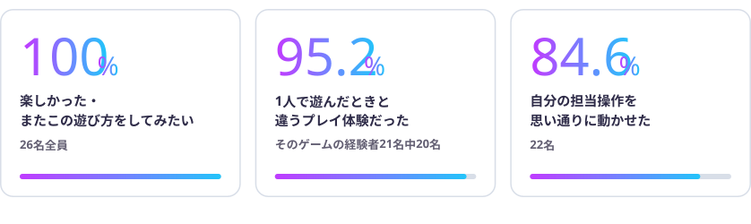</picture></td></tr></table>

<table><tr><th align="left">画像4　役割の4色で担当を示す札 READMEで使っている画像の実物：<code>assets/readme/genres-*.svg</code></th></tr><tr><td><picture><source media="(prefers-color-scheme: dark)" srcset="../../../assets/readme/genres-dark.svg">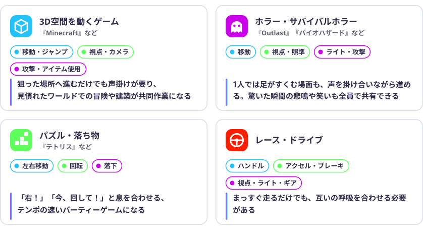</picture></td></tr></table>

## 5. 文字

| 種類 | 書体 | 使う場所 |
|---|---|---|
| 本文・見出し | GitHub本体と同じフォント指定 | ほぼすべての文字 |
| 数字 | 縦長の表示用書体＋ブランドのグラデーション | 項目の番号、アンケートの割合、遅延のミリ秒、PARTの番号 |
| 英字ラベル | 13px・太さ600・補助の色・字間を広げる | 「FEATURES」「PRODUCT」「NOW / NEXT」など |
| 埋め込みフォント | M PLUS Rounded 1c・Yusei Magic（使う字だけに絞る） | 締めの一言と吹き出しだけ |

- 基本はGitHubと同じ書体にして、本文から浮かないようにします。個性を出すのは、数字と締めの一言だけです。
- 「日本語の見出し＋小さな英字ラベル」の2段の組み方を、見出し・カード・展望でくり返します。
- 日本語の折り返しは、行頭の禁則（「、」「。」「）」「ー」など）、句読点の後での改行、行の長さの釣り合いを、生成スクリプトで処理します。行頭の「（」は字下げに見えるので、半文字ぶん左へ寄せます。

<table><tr><th align="left">画像5　埋め込みフォントを使う締めのカード READMEで使っている画像の実物：<code>assets/readme/footer-*.svg</code></th></tr><tr><td><picture><source media="(prefers-color-scheme: dark)" srcset="../../../assets/readme/footer-dark.svg">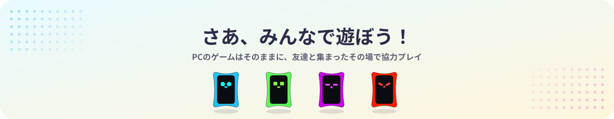</picture></td></tr></table>

## 6. 形と部品

部品の種類を絞り、すべての図で使い回しています。10枚以上の図が1つの体系に見えるのは、このためです。

- カードは線の太さ1.5px・角丸14px・塗りなしです。背景を塗らないので、ライト・ダークのどちらの背景にもなじみます。
- 札は、色で塗った丸い札（「P1」「STEP 1」など）と、枠線だけの丸い札に役割の色の点を付けたもの（分担の中身）の2種類です。
- アイコンのタイルは、角丸の正方形を役割の色で塗り、白い線のアイコンを載せます。
- 説明の左の縦線、進み具合の棒、手順をつなぐ「›」を、ブランドのグラデーションで描きます。
- 飾りとして、大見出しと締めのカードの角に、薄い色の点を並べます。節の見出しの右端に、キャラクターの4色の点を並べます。

<table><tr><th align="left">画像6　枠線だけのカード・アイコンのタイル・グラデーションの番号 READMEで使っている画像の実物：<code>assets/readme/features-*.svg</code></th></tr><tr><td><picture><source media="(prefers-color-scheme: dark)" srcset="../../../assets/readme/features-dark.svg">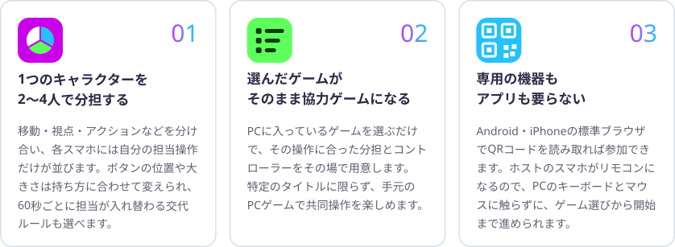</picture></td></tr></table>

<table><tr><th align="left">画像7　色で塗った札と、手順をつなぐ「›」 READMEで使っている画像の実物：<code>assets/readme/flow-*.svg</code></th></tr><tr><td><picture><source media="(prefers-color-scheme: dark)" srcset="../../../assets/readme/flow-dark.svg">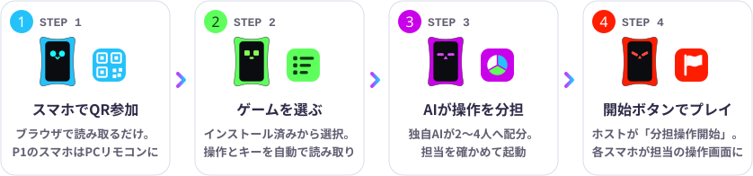</picture></td></tr></table>

<table><tr><th align="left">画像8　グラデーションの点線でまとめる枠 READMEで使っている画像の実物：<code>assets/readme/architecture-*.svg</code></th></tr><tr><td><picture><source media="(prefers-color-scheme: dark)" srcset="../../../assets/readme/architecture-dark.svg">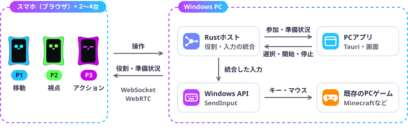</picture></td></tr></table>

## 7. 見出しの階層

| 段 | 見た目 |
|---|---|
| 作品名（h1） | GitHubの見出しと同じ見た目。2で説明 |
| 大見出し（PART 1・2） | 薄いグラデーションの背景の帯、左端のグラデーションの縦線、大きな番号、右に「SECTIONS 01 – 07」 |
| 項目の見出し（01〜11） | グラデーションの番号＋英字ラベル＋見出し。右側でキャラクターが内容を演じる |
| 節の見出し（目次・受賞結果） | 番号なし。見出し＋英字ラベル＋細い線＋4色の点 |
| 目次 | 「PART 1」「PART 2」の2列。番号＋リンク色の項目名＋下線 |

- 背景の帯を使うのは大見出しだけにして、格の違いを背景の有無で示します。
- 目次は表を使わず、本文欄の幅の49%ずつの画像を並べます。表は幅いっぱいに広がらず、中央に浮いてしまうためです。
- 見出しを画像にしても、`<a id>` を置いて目次のリンクが効くようにします。

<table><tr><th align="left">画像9　大見出し（PART） READMEで使っている画像の実物：<code>assets/readme/heads/part-1-*.svg</code></th></tr><tr><td><picture><source media="(prefers-color-scheme: dark)" srcset="../../../assets/readme/heads/part-1-dark.svg">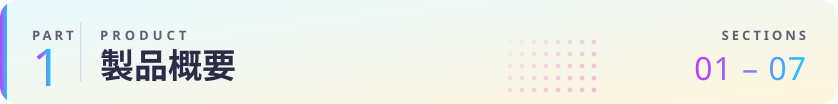</picture></td></tr></table>

<table><tr><th align="left">画像10　節の見出しと目次 READMEで使っている画像の実物：<code>assets/readme/heads/toc-*.svg</code></th></tr><tr><td><picture><source media="(prefers-color-scheme: dark)" srcset="../../../assets/readme/heads/toc-title-dark.svg"></picture> <picture><source media="(prefers-color-scheme: dark)" srcset="../../../assets/readme/heads/toc-part-1-dark.svg">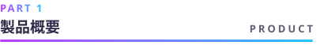</picture> <picture><source media="(prefers-color-scheme: dark)" srcset="../../../assets/readme/heads/toc-part-2-dark.svg"></picture> <picture><source media="(prefers-color-scheme: dark)" srcset="../../../assets/readme/heads/toc-01-dark.svg"></picture> <picture><source media="(prefers-color-scheme: dark)" srcset="../../../assets/readme/heads/toc-08-dark.svg"></picture></td></tr></table>

## 8. キャラクター

- 製品のコントローラーそのものがキャラクターです。4体ともスマホの形（四辺が少しくびれた縦長の枠に黒い画面）です。顔だけで性格を分けます（青は丸い目、緑は四角い目、紫は細い目、赤は吊り目）。
- キャラクターは、作品名の見出し、項目の見出しの横、区切りの帯、締めのカードだけに使います。**文章と表には使いません**。読む場所は読むことに集中してもらうためです。
- 遊びと事実を見た目で分けます。実際の画面を見せる図ではキャラクターの形を使わず、ふつうのスマホの枠に入れます。演出と証拠が混ざらないようにするためです。
- 項目の見出しの横では、画面が顔から操作画面に切り替わる、カメラで読み取る、横に寝かせて横持ちになる、といった、スマホらしい動きで各項目を表します。

## 9. 動き

- アニメーションの原則として、着地でつぶれ、跳ぶと伸びる動きと、動く前のため（予備動作）を入れます。動きは位置・姿勢・影の3層に分けます。
- ふだんの動きは、上下にゆっくり揺れる、まばたきする、くらいの控えめなものにとどめ、キャラクターごとに動きの始まりをずらします。読む邪魔をしないためです。
- 最初は止めておきます。作品名の見出しと同じく、にぎやかさは後から来るようにします。
- OSで「視差効果を減らす」を選んだ閲覧者には、すべての動きを止めます。

<table><tr><th align="left">画像11　区切りの帯でキャラクターが遊ぶ場面 READMEで使っている画像の実物：<code>assets/readme/scenes/scene-07-volley.svg</code></th></tr><tr><td><picture></picture></td></tr></table>

## 10. 実際の画面と録画

- 図の中のスマホ画面は作ったモックではなく、**実機で撮った画面と、実際の指の操作の録画**です。主張に証拠を添えるためです。
- 録画は黒いふちとカメラ穴のあるふつうのスマホの枠に入れます。指の位置は円で、PCのカーソルは輪で重ねます。加工はそれと、読み込み中の早送りだけにします。
- 最初のコマは静止画の図と同じ見た目にし、最後に少し止めてから最初に戻ります。

<table><tr><th align="left">画像12　実機の操作の録画を焼き込んだ図（アニメーションWebP） READMEで使っている画像の実物：<code>assets/readme/controllers-*.webp</code></th></tr><tr><td><picture><source media="(prefers-color-scheme: dark)" srcset="../../../assets/readme/controllers-dark.webp">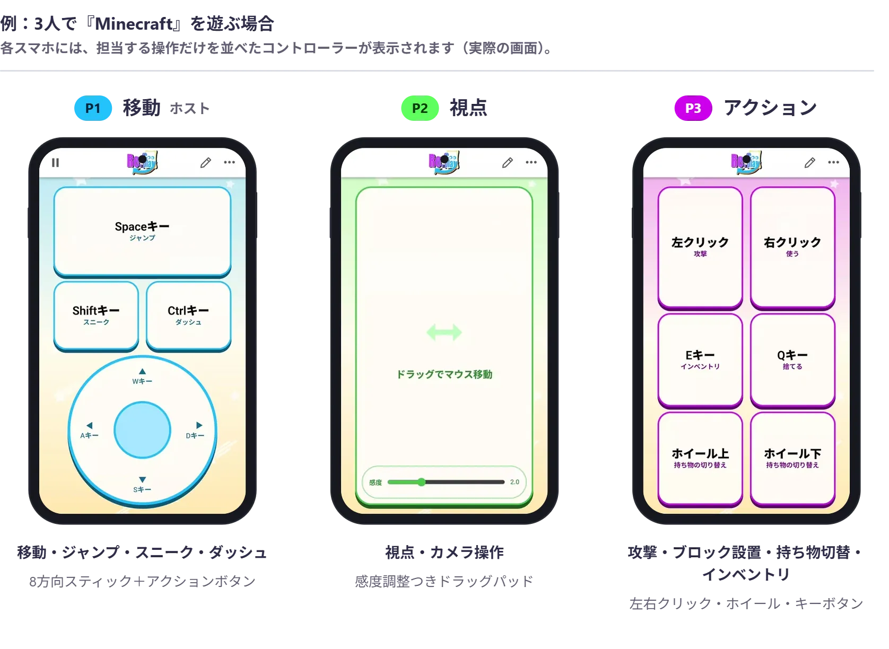</picture></td></tr></table>

## 11. 画面の幅とテーマへの合わせ方

| 決まり | 理由 |
|---|---|
| 図はGitHubの本文欄と同じ幅（PC 838px、スマホ 324px）で描き、幅を指定せず原寸で表示する | 縮小や拡大でぼやけず、図の文字の大きさがそのまま画面上の大きさになる |
| ライト／ダーク × PC／スマホの4つの版を作り、`<picture>` で切り替える | どの環境でも、その環境のために描いた図を見せる |
| スマホ版は縮めずに組み替える（横並びを縦1列にする） | PCの図を縮めただけにしない |
| 図の文字は13px以上（`check_text_size.py` で確認） | 本文16pxとの比を、PCとスマホでそろえる |
| 作品名の見出しだけは、画面の幅1100px以下でスマホ版にする | GitHubは幅768px以上で横に欄を出し、本文欄が狭くなるため |

<table><tr><th align="left">画像13　スマホ版の図（画像6を縦1列に組み替えたもの） READMEで使っている画像の実物：<code>assets/readme/features-narrow-*.svg</code></th></tr><tr><td><picture><source media="(prefers-color-scheme: dark)" srcset="../../../assets/readme/features-narrow-dark.svg">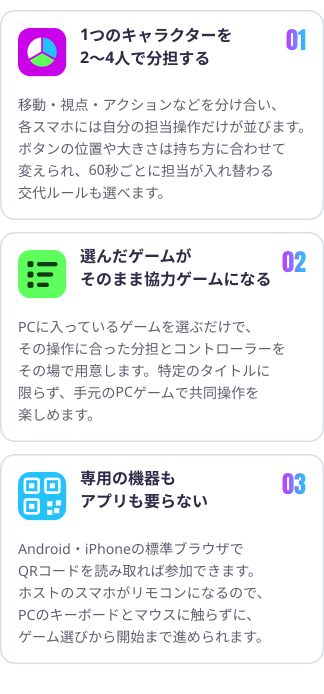</picture></td></tr></table>

## 12. SVGとWebPの使い分け

READMEの図は**SVGを基本**にし、**実機の録画を含む図だけをアニメーションWebP**にしています。

| 形式 | 使う図 | 選んだ理由 |
|---|---|---|
| SVG | 見出し・目次・受賞結果・特長・アンケート・構成図など、ほとんどの図（画像1〜11・13） | 下の「SVGを基本にする理由」を参照 |
| アニメーションWebP | 製品説明の分担の図（`controllers`）と、注力したことの図（`focus`）の2つ（画像12） | 下の「録画を含む図だけWebPにする理由」を参照 |
| JPEG（SVGに埋め込む） | SVGの図の中に置く、実機で撮った静止画 | 写真はベクターで描けないため。縮めてからBase64でSVGに入れる |
| PNG | 紹介動画のサムネイル（`assets/images/recooplay-thumbnail.png`） | YouTubeへのリンクの画像として置く |

### 12.1 SVGを基本にする理由

- 文字を文字のまま描ける。図の文字は閲覧者の端末のフォントで、GitHub本体と同じ指定のまま表示されます。画像の中の文字が本文と同じ書体になるので、図が本文から浮きません。画像1の見出しの錯覚も文字を文字として描けるから成り立ちます。
- 拡大してもぼやけない。高解像度の画面でも線と文字がくっきり表示されます。
- CSSで動かせる。キャラクターのまばたきや見出しの物語は、SVGの中のCSSアニメーションで動かしています。動きを足してもファイルはほとんど大きくならず、「視差効果を減らす」の設定で止めることもできます。
- テーマと幅の描き分けが安い。ライト・ダークとPC・スマホの4つの版は、同じ生成スクリプトで色と配置を変えて書き出すだけです。
- 検査できる。文字がデータとして残るので、`check_text_size.py` で表示時の文字の大きさを計算できます。代替テキストと `README-text.md` も図と同じデータから作れます。
- 軽い。SVGはgzipで配信されるので、録画を含まない43枚を合わせても転送量は約150KBです。

SVGには制約もあります。READMEの画像は `raw.githubusercontent.com` から `Content-Security-Policy: default-src 'none'` 付きで配信され、`` で表示したSVGは外部の画像もフォントも読めません。そのため、写真はJPEGに縮めてBase64で、締めのフォントは使う字だけに絞ってSVGに埋め込んでいます。Base64で増えた分は、gzipでほぼ打ち消せることを実測で確かめています（JPEGを3枚埋め込んだ `controllers-light.svg` は、94KBのファイルが転送量59KB。JPEGとSVGを別のファイルに分けると計68KBで、2回の通信が要る）。

### 12.2 録画を含む図だけWebPにする理由

- SVGの中で録画を動かすと重い。SVGの中に動く画像を入れると、ブラウザは画像が1コマ進むたびにSVG全体を描き直します。録画が複数ある図では、重くなって止まって見えました。
- 図ごと1本のアニメーションにする。`bake.py` が、SVGの図をChromeで2倍の解像度・透明の背景で撮り、スマホ画面の位置に録画のコマを重ねて、アニメーションWebPにします。変わった所（スマホの画面）だけを描き直すので、動きが滑らかになります。
- 画質と大きさを比べて決めた。Pillow（libwebp）の品質80で書き出すと、以前のffmpegの品質90より元の画像に近く（PSNRで0.5〜1.4dB上）、ファイルは21〜24%小さくなりました（2026-11-21の比較）。
- 重さのほとんどはこの2本にある。閲覧1回の転送量の9割以上はこの2本です（PC版は計約1.9MB、スマホ版は計約1.1MB）。GitHubは `` の `loading` 属性を取り除くため、遅延読み込みでは軽くできません。

WebPにした図も、元のSVG（`controllers-*.svg`・`focus-*.svg`）は残しています。文字の大きさの確認は同じ名前のSVGで行います。WebPはSVGから焼き込むので、図の中身はSVGの生成スクリプトで直します。

## 13. 画像が読み込めないときの、文字だけのREADME

リポジトリの直下に、画像を使わず文字だけで読める `README-text.md` を置いています（2026-11-20 の利用者の指示）。READMEのほとんどが画像なので、画像が読み込めないときにも同じ内容を読めるようにするためです。

- `scripts/readme/text_readme.py` が `README.md` から作ります。直接は編集しません。
- 文章は `README.md` のまま使い、画像（`<picture>`）だけを、同じ内容の見出し・表・箇条書きに置き換えます。
- 図の中身は `showcase.py`・`build_art.py` と同じデータから書くので、図と文字の内容がずれません。画像が残ると生成を止めます。
- 目次のリンクは `README.md` と同じ `<a id>` を使います。先頭には図の入った通常版の `README.md` への案内を置いています。

あわせて、`README.md` の画像には図の内容をすべて書いた代替テキスト（`alt`）を付けています。数値や受賞名を変えるときは、本文・代替テキスト・`README-text.md` をそろえて直します。

## 14. 作り方の判断

- 図は生成スクリプトから書き出します。SVGは手で直さず、`scripts/readme/` のスクリプトを直してから書き出します。4つの版、文字だけの版（`README-text.md`）、画像の代替テキストを、同じデータから作るためです。
- 案は並べて選びます。作品名の見出しや項目の見出しは、比較用のブランチで複数の案を作り、GitHub上で見比べてから決めました。
- GitHub上で確かめます。手元のブラウザだけでなく、GitHubに表示したREADMEを、PCとスマホ、ライトとダークで撮って確かめます。
- READMEの変更は、利用者が確認してからmainへ入れます。

## 15. ほかのREADMEに持ち出すときのチェックリスト

1. 最初は「ふつう」に見せる。驚きは読み手が油断してから届ける。
2. 下へ読み進めるほど、見たことのない要素を増やす。
3. 図は本文欄の幅で描き、原寸で表示する。文字は13px以上にする。
4. ライト・ダーク・PC・スマホの4つの版を作る。スマホ版は縮めずに組み替える。
5. 背景を塗らず、枠線だけのカードで組む。
6. ブランドの色は数字・線・矢印に絞る。
7. 色に意味を持たせ、最後まで同じ意味で使う。
8. 文字はGitHubと同じ書体にし、個性は数字と一言だけで出す。
9. 部品の種類を絞り、すべての図で使い回す。
10. 遊びの絵と事実の画面を、見た目で分ける。
11. 動きは控えめにし、「視差効果を減らす」の設定を尊重する。
12. 図はSVGを基本にし、録画を含む図だけをアニメーションWebPに焼き込む。
13. 画像が読み込めないときのために、同じデータから文字だけのREADMEを作る。
