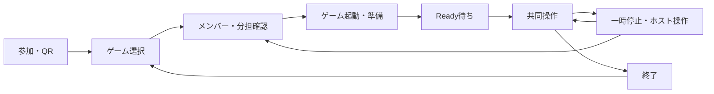
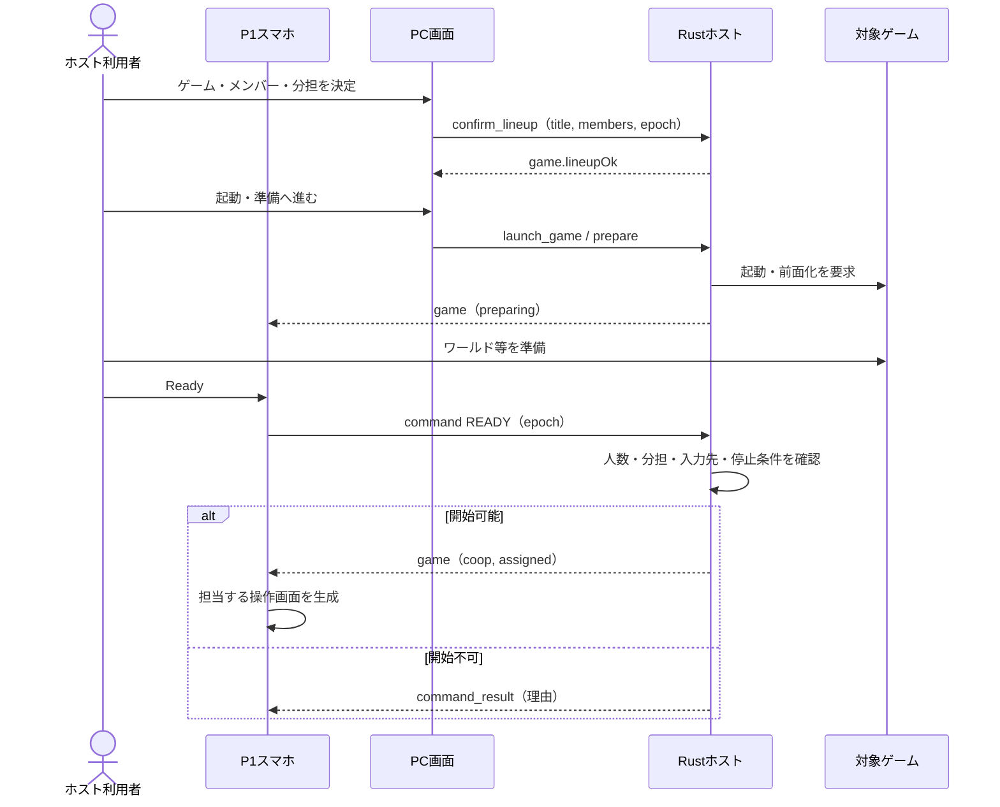

# Re:Cooplay フロントエンド仕様書

**バージョン**: 0.1.0　**更新日**: 2026-10-26

[総合仕様](README.md) ／ [利用手順](usage.md) ／ [動作確認](verification.md)

---

## 📑 目次

1. [概要](#概要)
2. [技術スタック](#技術スタック)
3. [配信情報](#配信情報)
4. [画面構成](#画面構成)
5. [準備・開始フロー](#準備開始フロー)
6. [役割別コントローラー](#役割別コントローラー)
7. [ホストのリモコン](#ホストのリモコン)
8. [WebSocket通信プロトコル](#websocket通信プロトコル)
9. [エラーハンドリング](#エラーハンドリング)
10. [パフォーマンス最適化](#パフォーマンス最適化)
11. [ビルド・起動](#ビルド起動)
12. [デバッグ・テスト](#デバッグテスト)
13. [トラブルシューティング](#トラブルシューティング)
14. [関連ドキュメント](#関連ドキュメント)
15. [実装例集](#実装例集)

---

## 概要

PC画面でゲームと分担を決め、スマートフォンをリモコンから担当別コントローラーへ切り替えます。

### システム構成

| 画面 | 対象 | 機能 |
|:--|:--|:--|
| `/app` | PC本体 | QR参加、ゲーム選択、分担、準備、操作設定 |
| `/` | スマホ | 接続、担当確認、リモコン、共同操作 |
| `/host` | PC本体 | 通信・入力診断、入力モード、ログ |
| `/game` | PC本体 | OS入力を受け取る疑似ゲーム画面 |

Tauriは`/app`をWebView2に表示します。PC専用画面はループバックからのみ利用できます。HTML / CSS / JavaScriptはビルド不要で、外部CDNは使用しません。

---

## 技術スタック

### コア技術

| 技術 | 用途 |
|:--|:--|
| HTML / CSS / JavaScript | PCとスマホの静的画面 |
| Pointer Events | タッチ・マウス、押下保持、キャンセル |
| Tauri 2 / WebView2 | Windows上のPC画面 |

### HTTP・リアルタイム通信

- **Fetch API**：参加URL・QR・ゲーム画像等の取得
- **WebSocket API**：参加・状態・管理命令・入力の本経路
- **RTCPeerConnection / RTCDataChannel**：入力・視点の速達経路

---

## 配信情報

### ローカル配信

PCホストが`apps/web-static/`を配信します。PCアプリはループバックの`/app`、スマホはPCのLANアドレスの`/`を開きます。フロントエンド専用のビルドやクラウドへのデプロイはありません。

参加カードはWi-Fi参加とアプリ参加のQRを表示します。Wi-Fi情報はPC本体にだけ返し、スマホは同じネットワークへの接続後に参加URLを開きます。

一覧はMinecraft、検出したSteam・Epic Gamesのタイトル、手動登録したゲームを扱います。画像または代替表示、名前、検証状態を表示し、選択しただけでは共同操作を開始しません。

---

## 画面構成

### 画面遷移フロー



画面上の導線とサーバーの`lobby / preparing / coop / paused`は別です。人数を変更するときは終了後に分担を決め直します。

### 1. 参加画面

**パス**: `/app`、スマホは`/`

**目的**: 同じネットワークへ接続したスマートフォンを参加枠へ登録する。

**主要機能**:
- Wi-Fi参加QR、アプリ参加QR、URL、人数・接続状態の表示
- 最初の端末へP1・ホスト権を割り当て
- 再接続情報をスマホのlocalStorageへ保存

### 2. ゲーム選択画面

**パス**: `/app`内のゲーム選択

**目的**: 入力先のゲームと操作定義を選ぶ。

**主要機能**:
- Minecraft、Steam・Epic Gamesの検出、手動登録ゲームのタイル表示
- 画像・名前・検証状態の表示、ホストのリモコン操作
- ゲームの再検出、PCのファイル選択による手動登録

### 3. 分担確認・準備画面

**パス**: `/app`内の分担・準備、スマホの待機画面

**目的**: 参加者・担当を決定し、ゲームの起動とプレイ開始を分ける。

**主要機能**:
- 現在の接続人数に応じた入力の割当と、実際に送るキーの表示
- 担当交換・本人確認待ちの表示
- 分担決定後のゲーム起動と準備、P1の明示Ready

### 4. 共同操作・一時停止画面

**パス**: `/`内の担当別画面

**目的**: 割り当てられた入力を送り、停止・接続状態を共有する。

**主要機能**:
- スティック、視点パッド、キー・クリック・ホイールのボタン
- P1による停止・再開・終了、準備・停止中のリモコン
- 接続異常、入力先、入力OFF、確認待ちの案内

### 画面スクリーンショット

[参加・操作画面・実プレイ](gallery.md)で確認できます。説明画像と2026年10月25日のキャプチャを区別して掲載しています。現在のキー名表示とは異なる画像もあります。

---

## 準備・開始フロー



開始可否は`canPrepare / canReady / canResume`とサーバーの応答に従います。ボタンの見た目だけでは入力を有効にしません。前面化に失敗した場合は手動切替を案内し、停止を保ちます。

---

## 役割別コントローラー

全ゲーム・全人数で、操作定義とサーバーの割当から画面を生成します。Minecraftの3人構成にも同じ生成経路を使います。

| 入力 | 表示・操作 |
|:--|:--|
| 方向キー群 | 仮想スティック。定義にない方向は送らない |
| キー・左右クリック | 押下・解放。実際に送るキー名を主表示にする |
| ホイール | 前後のボタン |
| 相対マウス移動 | ドラッグパッド、感度調整 |
| 未割当・非対応キー | 「送らない」。別のキーで代用しない |

表示例は「Wキー」「左クリック」「Eキー」です。ゲーム内で起こる効果はゲーム側の設定に従います。分担確認も入力種類と実キーを中心に表示します。役割交換後は、変更された本人がスマホで確認するまでReady・再開できません。

---

## ホストのリモコン

P1はロビー・準備中・一時停止中に、タッチパッド、クリック、ホイール、矢印・Enter・Esc等を使えます。PC画面が前面なら仮想カーソルでPC画面を操作し、対象ゲームが前面なら許可されたメニュー入力を送ります。両方へ同時には送りません。共同操作中はリモコン経路を使いません。

2本指の移動はスクロール、短い2本指タップは右クリックです。仮想カーソルはOSの実カーソルを動かしません。

---

## WebSocket通信プロトコル

### 接続先

`ws://<PCのアドレス>:8080/ws`へ接続し、`hello`で通信版と端末IDを通知します。DataChannelのシグナリングもWebSocketを使います。

### メッセージ形式

```json
{"type":"command","cmd":"READY","epoch":2}
```

`epoch`には受信した現在の`game.epoch`を設定します。数値2は形式例です。全メッセージと認可条件は[通信仕様](protocol-specification.md)に記載しています。

---

## エラーハンドリング

P1には担当交換後も一時停止を表示します。スマホの非表示・回転・pointercancel、画面の作り直しでは押下を解放し、旧押下を復元しません。通信・入力先はサーバー通知で更新し、入力OFF、人数不足、担当確認待ちなどの理由を表示します。

---

## パフォーマンス最適化

| 処理 | 方式 |
|:--|:--|
| 視点 | 30Hzの累積値送信。RTC未接続時はWS |
| リモコン移動 | 最大30Hz |
| ボタン | 押下・解放を両経路へ送り、ホストで重複排除 |
| 画面更新 | サーバー状態から担当・実キーを解決し、変更時に再構成 |

---

## ビルド・起動

静的画面のビルドは不要です。ホストをビルドし、リポジトリルートで起動します。

```powershell
cargo build --release --locked --manifest-path apps/host-rs/Cargo.toml
.\apps\host-rs\target\release\recooplay-host.exe
```

Windows環境は[構築手順](develop/handoff/SETUP_WINDOWS.md)、利用開始は[導入案内](getting-started.md)に従います。通常起動はOS入力を扱うため、入力を送らない試験では`RECOOPLAY_DRY_RUN=1`を設定します。

---

## デバッグ・テスト

```powershell
node scripts/sim/app-view-test.mjs
node scripts/sim/phone-view-test.mjs
node scripts/sim/ui-input-test.mjs
node scripts/sim/controller-diagnostics-test.mjs
```

PC本体の`/host`で接続・入力・ログを、`/game`でOS入力の受信を確認できます。

---

## トラブルシューティング

| 症状 | 確認箇所 |
|:--|:--|
| 接続画面から進まない | PCとの同一ネットワーク、版、満員、再接続情報 |
| ボタンが無効 | 担当・実キー・入力モード・本人確認 |
| キー表示とゲームの動作が違う | ゲーム側の設定、読取り状態 |

[症状別の対処](troubleshooting.md)を参照してください。

---

## 関連ドキュメント

[ホスト仕様](host-specification.md) ／ [通信仕様](protocol-specification.md) ／ [操作定義仕様](game-profile-specification.md)

---

## 実装例集

### 管理命令の送信

```javascript
function command(cmd) { if (isOpen()) ws.send(JSON.stringify({ type: 'command', cmd, epoch: game?.epoch })); }
```

現在epochを付けて送信し、サーバーがP1・進行・準備条件を検証します。

実装：[PC画面](../apps/web-static/scripts/desktop.js) ／ [表示ロジック](../apps/web-static/app-view.js) ／ [スマホ入力](../apps/web-static/scripts/controller.js) ／ [操作画面生成](../apps/web-static/scripts/generated-controls.js)
