# Re:Cooplay フロントエンド仕様書

**バージョン**: 0.2.0　**更新日**: 2026-11-20

[総合仕様](README.md) ／ [利用手順](usage.md) ／ [動作確認](verification.md)

---

## 📑 目次

1. [概要](#概要)
2. [技術スタック](#技術スタック)
3. [配信情報](#配信情報)
4. [画面構成](#画面構成)
5. [準備・開始フロー](#準備開始フロー)
6. [役割別コントローラー](#役割別コントローラー)
7. [ホストのリモコン](#ホストのリモコン)
8. [WebSocket通信プロトコル](#websocket通信プロトコル)
9. [エラーハンドリング](#エラーハンドリング)
10. [パフォーマンス最適化](#パフォーマンス最適化)
11. [ビルド・起動](#ビルド起動)
12. [デバッグ・テスト](#デバッグテスト)
13. [トラブルシューティング](#トラブルシューティング)
14. [関連ドキュメント](#関連ドキュメント)
15. [実装例集](#実装例集)

---

## 概要

フロントエンド（`apps/web/`）は、Windows PC上の管理画面・観客向けオーバーレイ・診断画面・疑似ゲーム画面と、2〜4台のスマートフォン上で動くコントローラー兼ホストリモコンを提供する **React 19 + TypeScript strict（Vite）** アプリケーションです。

最大の設計上の特徴は、**Reactによる宣言的なUI描画と、Pointer Events・WebSocket・WebRTC DataChannelを扱うリアルタイム入力・通信エンジンを完全に分離していること**です。高頻度のスティック・タッチパッド・視点スワイプや50ms周期の通信処理はReactの再レンダリングを介さずに直接動作し、低遅延な操作感と型安全な画面構成を両立しています。

### システム構成（5画面エントリ）

| URLパス | ビルド出力（`apps/web/dist/`） | 利用対象 | 主な機能 |
|:--|:--|:--|:--|
| `GET /` | `phone/index.html` | スマホ（LAN） | 接続・再接続、ホストのPCリモコン、担当確認・自主退出、担当別コントローラー、個人レイアウト編集 |
| `GET /app` | `pc/index.html` | PC本体（ループバック限定） | 一時Wi-Fi・参加QR案内、ゲーム検出一覧・手動登録、2〜4人分担・AI/定型切替、キー設定、60秒交代設定、通信診断 |
| `GET /overlay` | `overlay/index.html` | PC本体（ループバック限定） | 配信・録画・観客向けに現在の進行状態とP1〜P4の担当・押下状態を透過表示（`?position=top` 対応、読み取り専用） |
| `GET /host` | `diagnostics/index.html` | PC本体（ループバック限定） | 開発・検証用の詳細ダッシュボード（枠別の通信統計、注入モード切替、出力状態、リアルタイムログ） |
| `GET /game` | `pseudo-game/index.html` | PC本体（ループバック限定） | Win32 `SendInput` で注入されたキー・マウス移動・クリック・ホイールをブラウザ側で受け取りホストへ照合通知する疑似ゲーム画面 |

Tauriデスクトップアプリ（`apps/desktop`）はメインウィンドウに `/app` を表示し、操作設定で観客向け表示をONにすると、透明・最前面・クリック透過・非アクティブのサブウィンドウで `/overlay` を画面右上（300×440論理px）に重ねて表示します。外部CDNは一切使用せず、すべてのフォント・SVGアイコン・画像をローカル配信します。

---

## 技術スタック

### コア技術と責務分離

| 層 | 技術・モジュール | 用途・設計方針 |
|:--|:--|:--|
| **UIコンポーネント層** | React 19 + TypeScript strict（`PhoneApp.tsx`, `PcApp.tsx`, `LayoutController.tsx` 等） | 画面遷移、ダイアログ、分担・設定表示、コントローラー部品の配置描画（`useSyncExternalStore` で外部ストアを購読） |
| **リアルタイム入力エンジン** | TypeScript + Pointer Events API（`shared/input/{cooperative,stick,look,touchpad,owners,hold}.ts`） | マルチタッチ所有権管理、8方向仮想スティック、30Hz累積視点パッド、2本指スクロール対応タッチパッド、回転ロック時の横持ち座標変換 |
| **通信・セッション境界** | TypeScript + WebSocket / WebRTC（`shared/transport/{session,fast-channel,protocol,pc-messages}.ts`） | 受信JSONの実行時型検証（未知・不正メッセージの隔離）、`fast` DataChannelでの未ACK入力バンドル送信、3秒無通信時の自動再接続 |
| **表示・レイアウトモデル** | TypeScript純粋関数（`shared/model/{presentation,phone,layout,actions,skin}.ts`, `shared/controller-layout.ts`） | 操作定義と実キーからの画面モデル生成、スマホ本体基準の正規化レイアウト計算・衝突補正・`localStorage` 永続化 |
| **ビルド・モジュール検査** | Vite 6 + `tsc --noEmit` + `product-module-graph-test.mjs` | 5画面マルチページビルド、画面間の相互import禁止（`画面 → shared` の単方向依存のみ許可） |

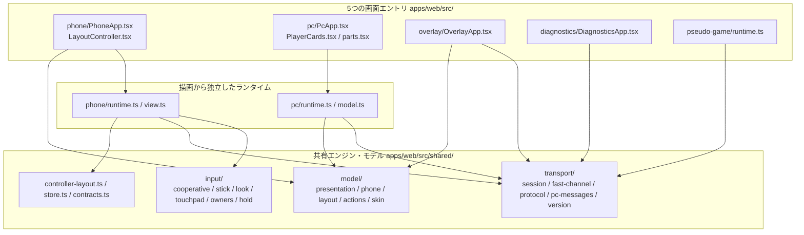

---

## 配信情報

### ローカル配信とキャッシュ戦略

PCホスト（`recooplay-host.exe`）が `apps/web/dist/` を配信します。

- **HTML・画像・API（`/`, `/app`, `/assets/logo.png`, `/api/*` 等）**：`Cache-Control: no-store` で配信し、常に最新の画面・ゲーム画像を反映します。
- **Viteが生成するハッシュ付きJS・CSS（`/assets/<name>-<8文字hash>.js|.css`）**：`Cache-Control: public, max-age=31536000, immutable` で配信します（#308）。スマホが電波の瞬断やホスト交代で再接続・再読み込みした際にもJS/CSSの再ダウンロードを省略し、即座に復帰できるようにしています。

PC専用画面（`dist/{pc,overlay,diagnostics,pseudo-game}/` 配下）へのリクエストは、ホスト側で `canonicalize` 済みの実体パスを検査し、ループバック（`127.0.0.1` / `::1`）以外のLAN端末からのアクセス（大文字小文字変化や `::$DATA` 等を含む）をすべて `403 Forbidden` で拒否します。

---

## 画面構成

### 画面遷移フロー

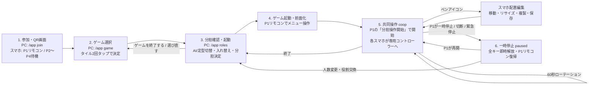

### 1. 参加画面（PC `/app` 参加ビュー ／ スマホ `/`）

**目的**: 同じローカルWi-Fi（またはPCのモバイルホットスポット）へスマートフォンを接続し、P1〜P4の参加枠へ登録します。

- **PC画面（左サイドバー＋参加ステージ）**：
  - モバイルホットスポットがOFFの場合は「ホットスポットをONにする」ボタンを表示し、押下すると `POST /api/hotspot` で一時SSID（`ReCooplay-<12桁hex>`）とパスフレーズを生成して起動します。
  - ホットスポットのIPアドレス（`192.168.137.x`）が割り当てられてから「① Wi-Fiにつなぐ」QRと「② 参加する」QRを並べて表示します（届かないアドレスのQRを先に出さない設計、#573）。
  - 参加した枠（P1〜P4）ごとにプレイヤーカラー、キャラクター、端末種別（iPhone / Android等）を表示します。
- **スマホ画面**：
  - 最初の接続端末が **P1（ホスト）** となり、即座にタッチパッド付きのPCリモコン画面（`#v-remote`）が開きます。
  - 2台目以降（P2〜P4）は待機画面（`#v-wait`）となり、現在の接続メンバーと自分のキャラクター・担当が表示されます。

| PC：ホットスポットON・参加待ち | PC：3人が参加した画面 |
|:--:|:--:|
| <a href="screenshots/device/pc-02-join-0.jpg">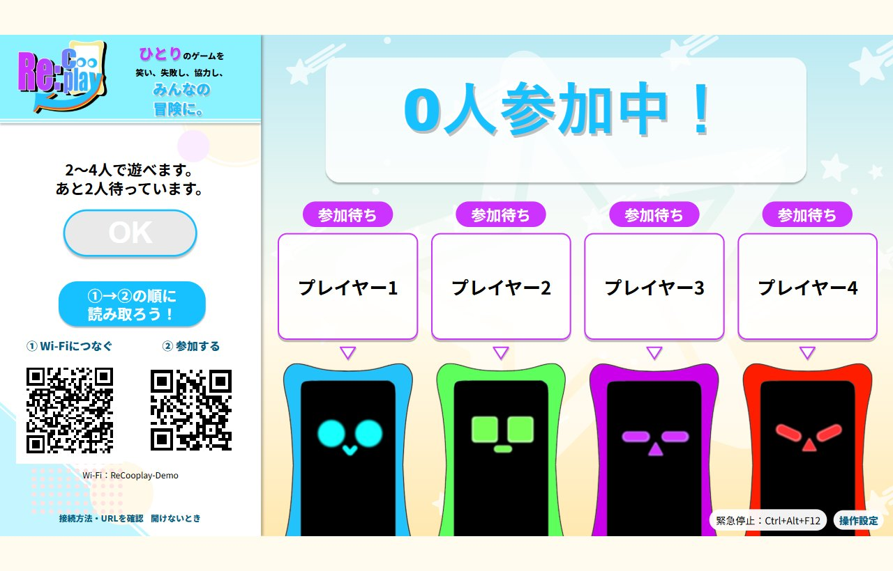</a> | <a href="screenshots/device/pc-04-join-3.jpg">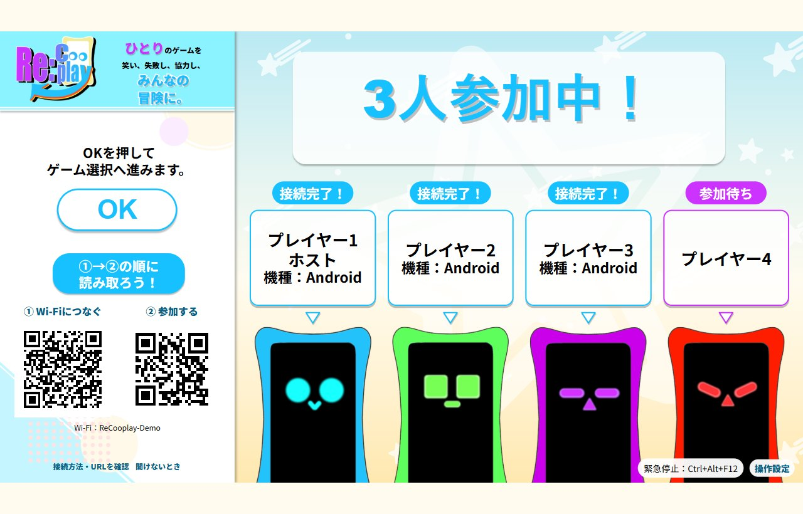</a> |

| P1（ホスト）：PCリモコン画面 | P2：参加・待機画面 | P3：参加・待機画面 |
|:--:|:--:|:--:|
| <a href="screenshots/device/phone-02-host-lobby-3.jpg">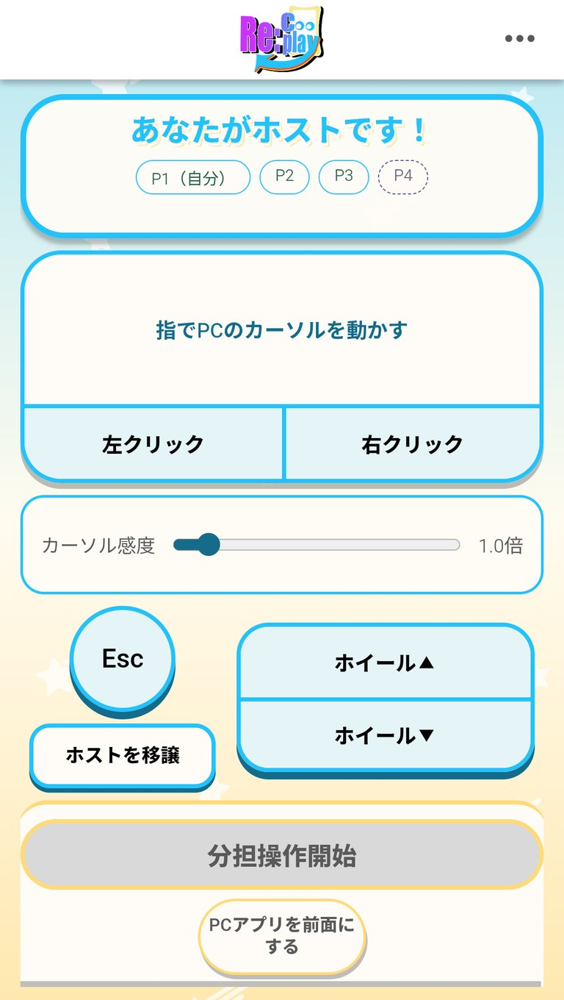</a> | <a href="screenshots/device/phone-05-wait.jpg">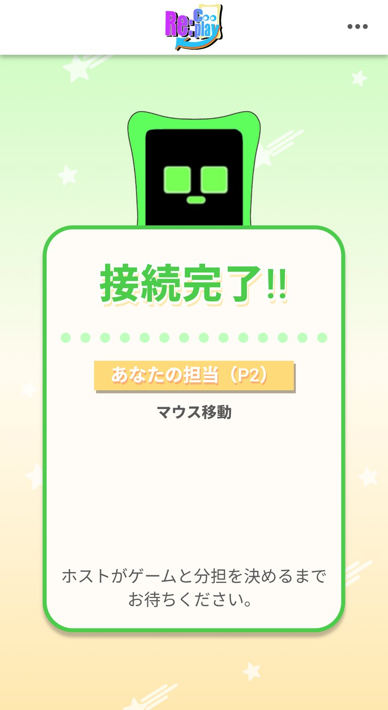</a> | <a href="screenshots/device/phone-34-p3-wait.jpg">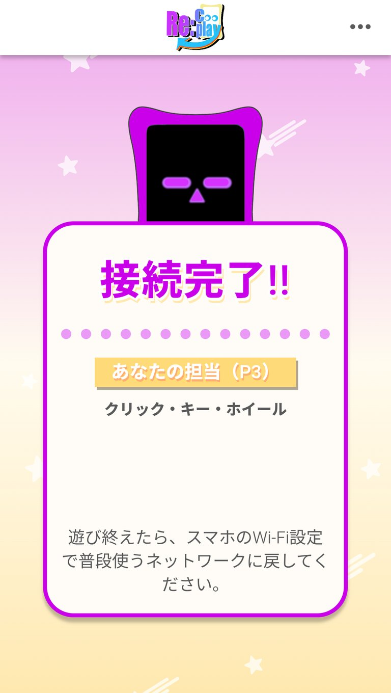</a> |

### 2. ゲーム選択画面（PC `/app` ゲーム選択ビュー）

**目的**: 共同操作する対象のPCゲームを選択します。

- **自動検出とタイル表示**：Minecraft（公式ランチャー連携）に加え、Steam・Epic Games・GOG・Ubisoft Connect・EA app・Battle.net・Xbox・Steamショートカットから検出したゲームと、PCのファイル選択（`＋ 追加`）で手動登録したゲームを画像つきタイルで一覧表示します。
- **スマホリモコンからの操作**：ホスト（P1）のスマホのタッチパッドで仮想カーソルを動かし、タイルを1回タップで選択、**2回タップ（ダブルクリック）または選んだタイルの右上に出る「▶」で分担画面へ進みます**（#445）。操作が届くか未確認のゲームには「未検証」の札を付けます。手動登録ゲームは名前の変更・登録解除も可能です。

<div align="center">
  <a href="screenshots/device/pc-08-game-selected.jpg">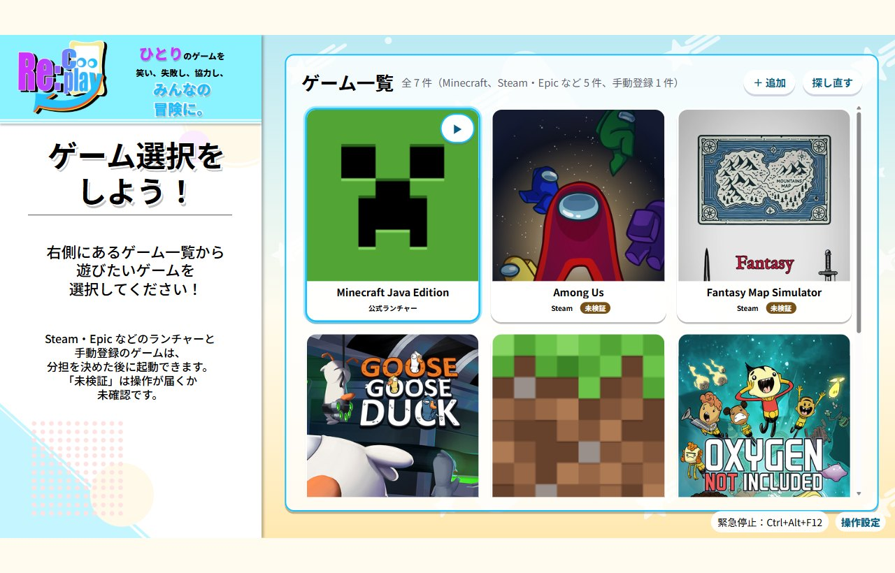</a>
  <p><sub>PC：自動検出されたインストール済みゲームのタイル一覧</sub></p>
</div>

### 3. 分担確認・ゲーム起動画面（PC `/app` 分担ビュー ／ スマホ待機・確認）

**目的**: 参加人数（2〜4人）に応じた操作の分担を確認・調整し、ゲームを起動してプレイ開始へ進みます。

- **分担の作り方（独自AI／定型ルール）の切替と再生成**：
  - 検証済みプリセットがないゲームでは、画面下部の「分担の作り方」で **「独自AI」**（既定）と **「定型ルール」** を切り替えたり、「割り当てを作り直す」で再生成したりできます（#432）。
  - 各プレイヤーの列には、ゲーム内の効果ではなく**実際にPCへ送るキー名・マウス操作**（「W / A / S / D」「マウス移動」「左クリック」など）を明示します。
- **役割の入れ替えと本人確認**：
  - 2人の列を順にクリックすると担当を入れ替えられます（`swap_roles`）。入れ替えた場合は対象者のスマホに「新しい担当を確認しました」ボタン（`#roleNotice`）が表示され、本人が押すまで開始できません。
- **分担決定とゲーム起動・ワンステップ開始**：
  - 「この分担で決定」を押すと「ゲームを起動する」ボタンが有効になります。
  - ゲームが起動して準備が整ったら、P1のスマホの **「分担操作開始」** ボタン1つで対象ゲームが前面化され、共同プレイ（`coop`）が始まります。
- **展示・交代向けの参加者再募集とゲーム終了**：
  - プレイ終了後に分担画面へ戻った際、同じゲームのまま「新たな参加者を受け付ける」で参加QRを出してメンバーを交代したり、「ゲームを終了する」（`quit_game`）で実行中のゲームに終了要求（`WM_CLOSE`）を送ってゲーム選択へ戻ったりできます（#547・#561）。

| PC：分担の確認画面 | PC：分担決定・ゲーム起動案内 |
|:--:|:--:|
| <a href="screenshots/device/pc-10-roles.jpg">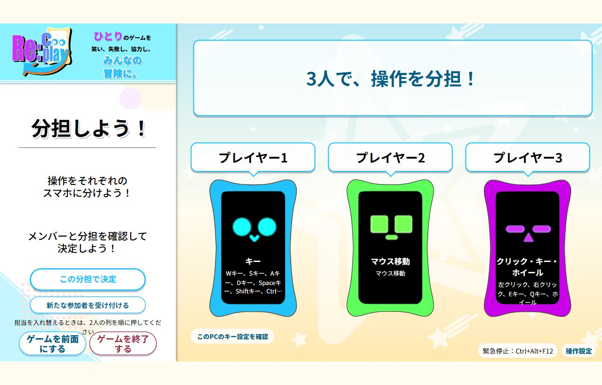</a> | <a href="screenshots/device/pc-12-roles-confirmed.jpg">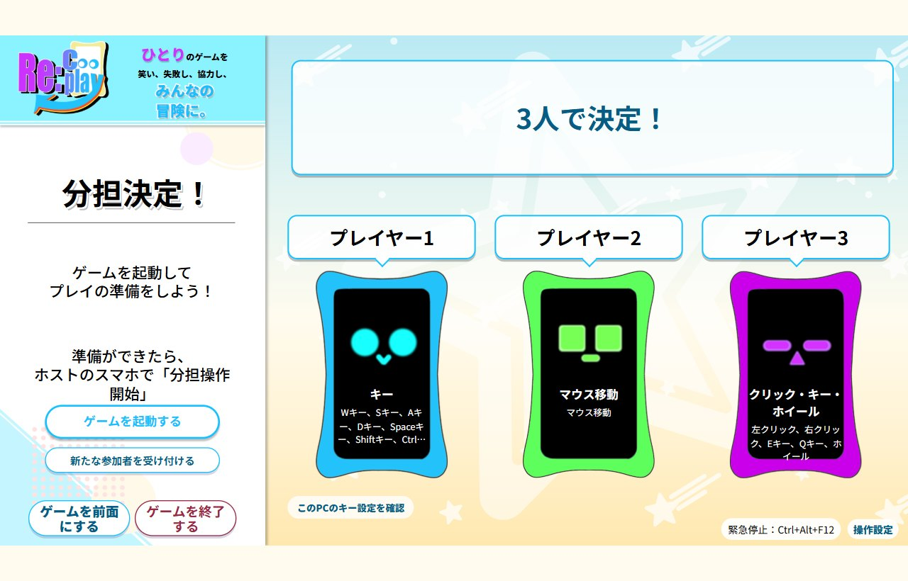</a> |

| PC：未検証のゲームの分担（独自AI／定型ルール） | PC：4人のときの分担 |
|:--:|:--:|
| <a href="screenshots/device/pc-14-roles-unverified.jpg">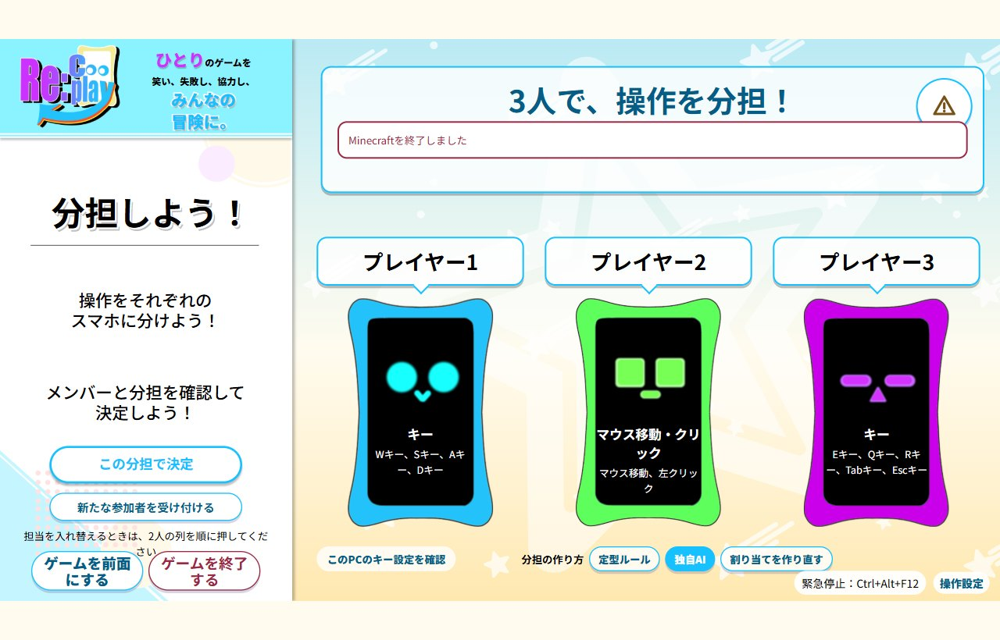</a> | <a href="screenshots/device/pc-13-roles-four.jpg">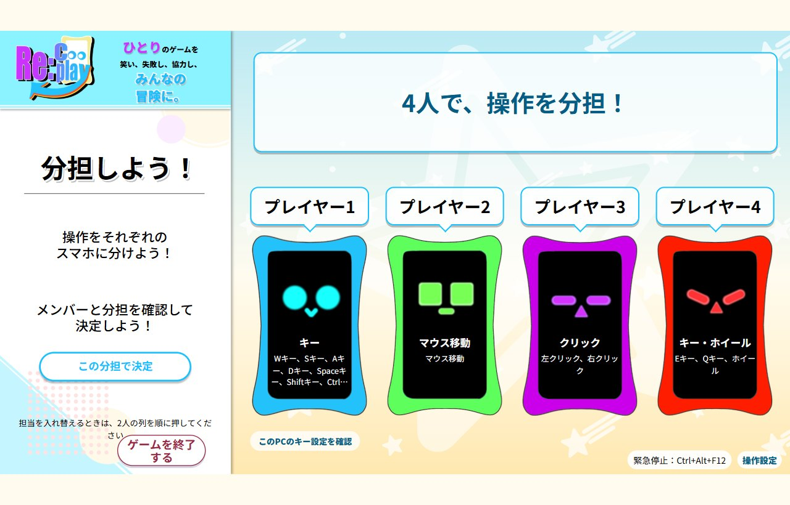</a> |

### 4. 共同操作・個人レイアウト編集・一時停止画面

**目的**: 各スマホに割り当てられた操作を低遅延に送信し、必要に応じて配置編集や一時停止・再開を行います。

- **担当別コントローラー（`#v-gen`）**：
  - 方向キー群の8方向スティック、感度調整（0.5〜6.0倍）つき視点ドラッグパッド、実キー名と操作ラベルを表示するボタンが画面いっぱいに配置されます。
  - ヘッダー右上のペンアイコン（`#genEditLayout`）を押すと、その場で**個人レイアウト編集画面**に切り替わります（編集中は入力を自動解放し、ゲームへ一切送信しません）。
  - ホスト（P1）のスマホにはヘッダー右上に一時停止ボタン（SVG一時停止アイコン `#genPause`）が表示され、いつでも一時停止できます（#559）。
- **一時停止画面（`paused`）と緊急停止**：
  - 一時停止すると全員の合成入力を即時解放し、P1のスマホはPCリモコン画面に戻ります。参加者が増減した場合はPC画面の「今のN人で分担し直す」（`change_players`）で組み直せます。
  - PCで `Ctrl+Alt+F12` を押すと緊急停止（入力OFF＋一時停止）となり、PC画面で安全を確認して「入力を再開する」を押すまで再開できません。

| 移動コントローラー | 視点コントローラー | アクションコントローラー | 個人レイアウト編集 |
|:--:|:--:|:--:|:--:|
| <a href="screenshots/device/phone-11-coop-move.jpg">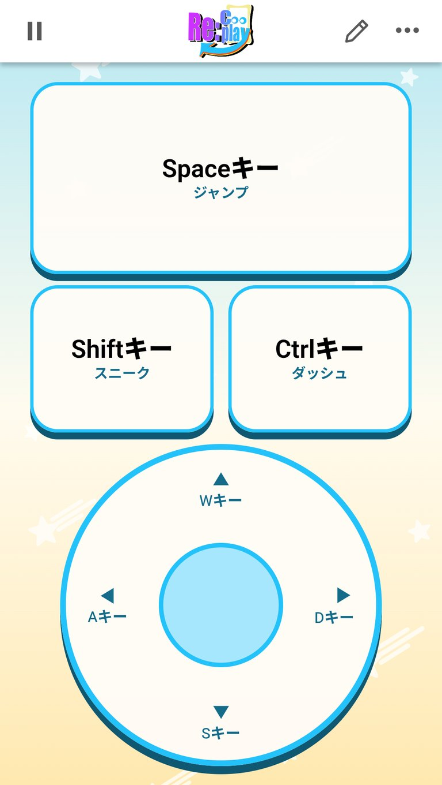</a> | <a href="screenshots/device/phone-12-coop-look.jpg">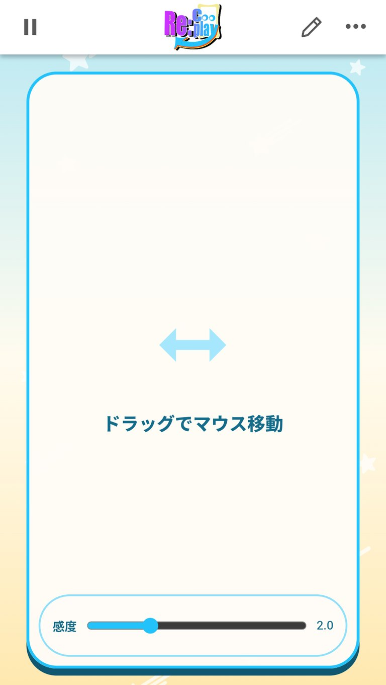</a> | <a href="screenshots/device/phone-13-coop-action.jpg">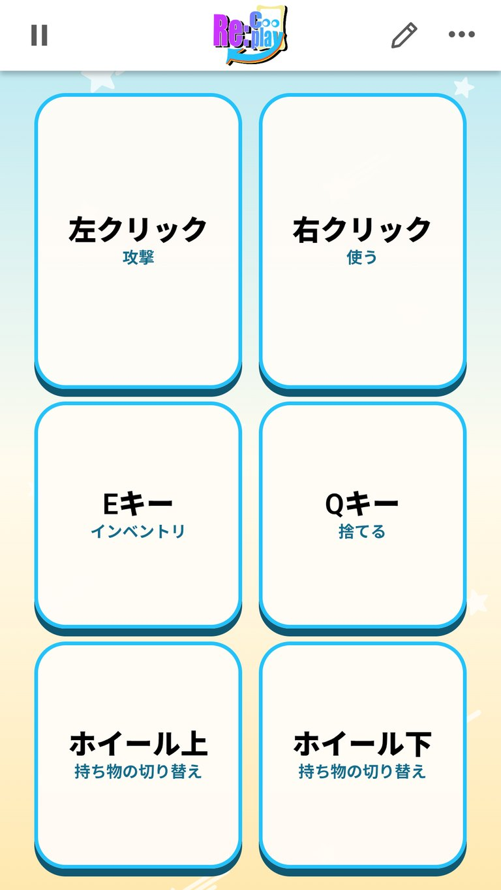</a> | <a href="screenshots/device/phone-15-layout-selected.jpg">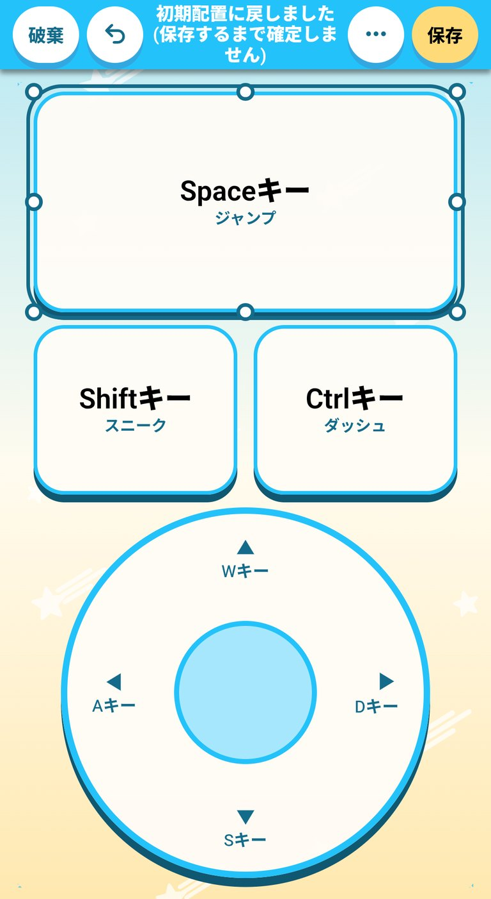</a> |

<sub>コントローラーの3枚は、Minecraft・3人のときの P1（青）の画面です。枠ごとの色（P2 緑・P3 紫・P4 赤）の画面は [画面一覧](screenshots.md#5-協力プレイ) にあります。</sub>

| PC：一時停止中 | P1：一時停止中のリモコン | PC：緊急停止後の再開確認 |
|:--:|:--:|:--:|
| <a href="screenshots/device/pc-19-paused.jpg">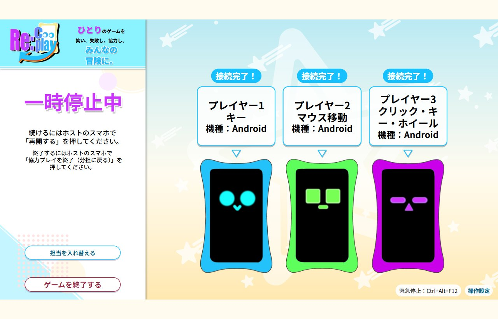</a> | <a href="screenshots/device/phone-17-host-paused.jpg">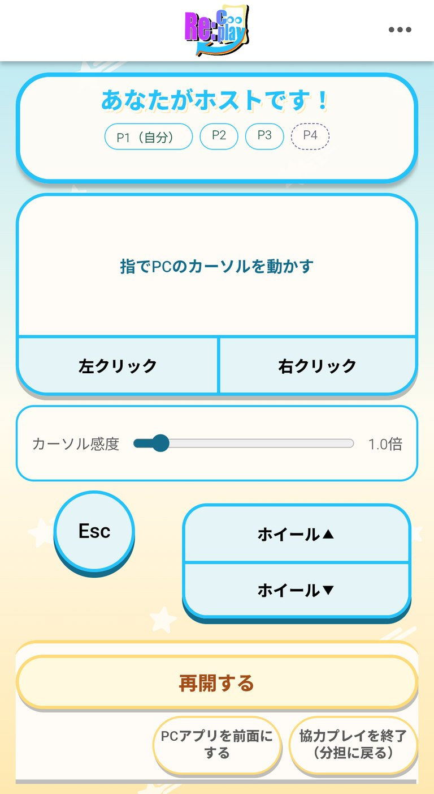</a> | <a href="screenshots/device/pc-22-emergency.jpg">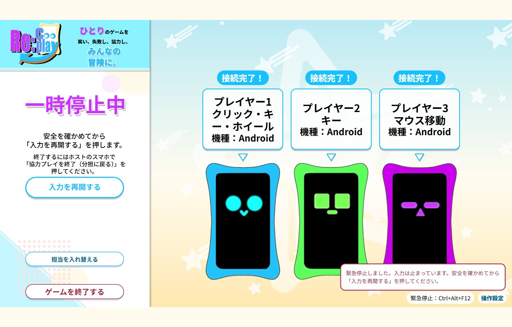</a> |

### 5. 操作設定・通信診断・接続案内ダイアログ

PC画面右下の「操作設定」および各スマホ右上のメニュー（`…`）から、キー割当の個別変更（`set_key` / `reset_keys`）、自動復帰設定（初期OFF）、60秒役割ローテーション、観客向けオーバーレイ表示、各端末のRTT・WebRTC経路・途切れ回数の通信診断を確認できます。またスマホの診断ダイアログでは、画面の配色スキン変更、回転ロック時の「持ち方」切替、ロビーでの自主退出（「退出する（次の人に交代）」）が可能です。

| PC：操作設定ダイアログ | スマホ：接続・通信診断ダイアログ |
|:--:|:--:|
| <a href="screenshots/device/pc-26-settings.jpg">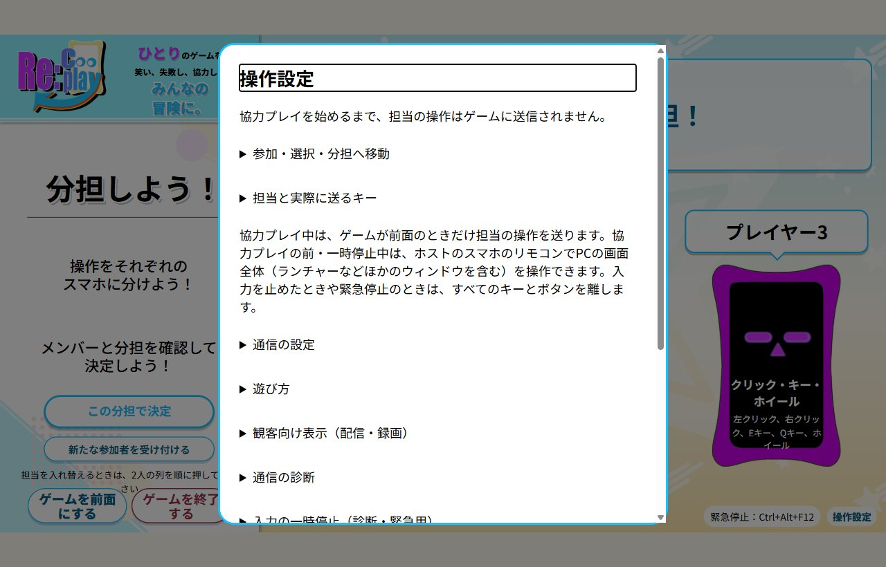</a> | <a href="screenshots/device/phone-19-menu-host.jpg">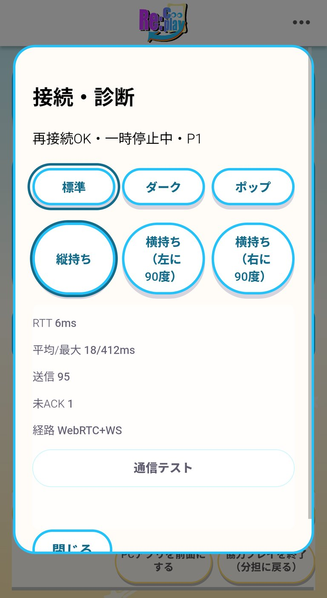</a> |

<sub>※掲載スクリーンショットの撮影条件と構成の注記は [画面一覧](screenshots.md) を参照してください。</sub>

---

## 準備・開始フロー

現在の標準開始フローでは、ロビーで分担決定とゲーム起動を行った後、PREPARE（準備中フェーズ）を挟まずに **P1スマホの「分担操作開始」（`command READY`）1回で対象ゲームの自動前面化と共同操作開始** を行います（#440・#556）。

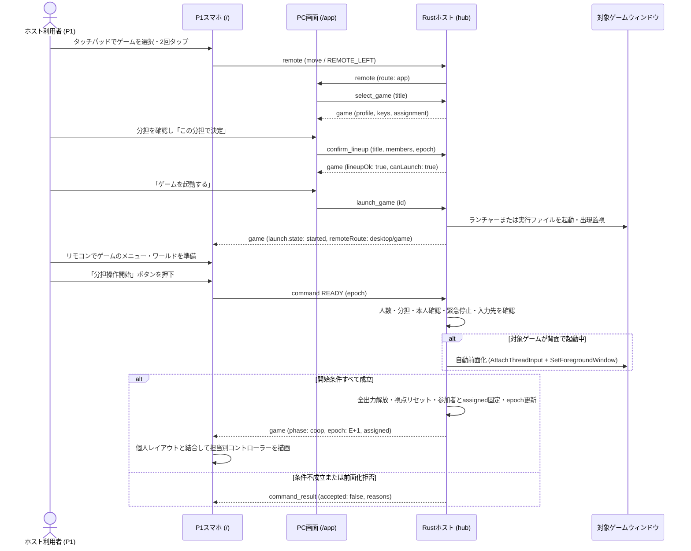

---

## 役割別コントローラー

### 1. 操作定義からの標準コントローラー生成（`shared/controller-layout.ts`）

すべてのゲーム・人数（2〜4人）で、操作定義（`game.profile`）、確定した割当（`game.assigned`）、キー設定を反映した実出力（`game.keys.actions`）からコントローラー部品を生成します。

| 操作定義の種類 | 生成される部品 | 表示・送信の規則 |
|:--|:--|:--|
| 同一グループの4方向ボタン（上下左右） | **8方向仮想スティック**（`stick`） | 定義された方向のみ送信。斜め入力は2方向を同時押下 |
| 相対マウス移動（`mouseDelta`） | **視点ドラッグパッド**（`look`） | 30Hzで累積移動量（`cx`, `cy`）を送信。端末ごとに感度（0.5〜6.0倍）を保存 |
| 単発・長押しキー／左右クリック（`button`） | **アクションボタン**（`button`） | **実際に送るキー名**（例：`Space`, `左クリック`, `E`）を大きく、操作名（例：`ジャンプ`）を小さく併記し `act:<ID>` を送信 |
| マウスホイール（`wheel`） | **前後ボタンペア**（`button`×2） | `act:<ID>:up` と `act:<ID>:down` の2つのボタンへ展開 |
| 実出力が `null`（未割当・非対応キー） | **無効表示ボタン** | 「送らない」と明示し、別のキーで代用しない |

### 2. 個人レイアウトモデルと画面内エディタ（`shared/model/layout.ts`, `phone/LayoutController.tsx`）

生成された部品は、スマホ本体基準の正規化座標（`recooplay.phone-layout` schema v2）に変換され、ゲームごとに各スマホの `localStorage` へ保存されます。

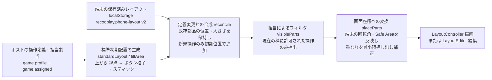

- **本体基準座標と初期敷き詰め（`fillArea`）**：
  - 未編集時は、そのプレイヤーが担当する部品だけで操作領域（`#genControls`）をいっぱいに使うよう、上から「視点パッド → ボタンの格子（端数は1段目を横長・高めに配分）→ スティック（親指位置）」の帯で自動配置します。
  - 幅 `w` は短辺比、高さ `h` は長辺比で保持し、ボタンと視点パッドは**縦横比を自由に変更可能**、スティックは常に正方形を維持します。
- **プレイ画面と完全一致する編集画面（`LayoutEditor`）**：
  - プレイ中と同じ操作領域の上に編集バー（破棄・Undo・その他・保存）を重ねるため、**編集中と保存後で部品の位置・幅・高さが1pxのズレもなく一致**します。
  - **タップ選択**：8方向のリサイズハンドル（スティックは四隅4方向）を表示してサイズ変更。
  - **ドラッグ移動**：他の部品は一切勝手に動かさず、重なる場合は最も近い配置可能な空き領域（`findFreeSpot`、最小間隔6px）を枠でプレビュー表示してスナップします。
  - **長押しメニュー**：ボタンに割り当てる担当操作の付け替え、**同じ操作ボタンの複製**（複数箇所にジャンプボタンを置くなど、最大64部品）、画面からの非表示化、および非表示部品の復元・初期配置へのリセット、最大50手のUndo履歴を備えています。
- **回転ロック時の「持ち方」切替（`shared/input/hold.ts`）**：
  - スマホの画面回転をロックしたまま横持ちで遊ぶプレイヤー向けに、診断ダイアログで「縦持ち」「横持ち（左が上）」「横持ち（右が上）」を切り替えられます（#514）。変更時は押下中の入力を即時解放し、スティックの8方向判定と視点パッドの `dx`/`dy` 軸を手元の向きに合わせて90度回転させます。

---

## ホストのリモコン

P1（ホスト）のスマホは、協力プレイ中（`coop`）以外のすべてのフェーズ（`lobby`, `preparing`, `paused`）でPCを操作するリモコン画面（`#v-remote`）になります。

- **リモコン型の操作レイアウト（#436・#536・#571）**：
  - 画面中央に大きく**タッチパッド**（1本指でカーソル移動、短いタップで左クリック、2本指タップで右クリック、2本指の上下ドラッグでスクロール）と**左右クリックボタン**、**カーソル感度スライダー**（0.5〜6.0倍）を配置しています。
  - 中段に **Esc**、**「ホストを移譲」**（ロビーで他の接続中プレイヤーへホスト権とP1枠を譲渡、ページ内確認つき）、**ホイール上下ボタン**を配置しています。
  - 下部に固定された進行ボタン枠に、状態に応じた主ボタン（**「分担操作開始」** または **「再開する」**）と、3つの補助ボタン枠（**「ゲームを前面にする」**、**「PCアプリを前面にする」**、**「ゲーム選択へ戻る」**）を配置し、ボタンの有無でタッチパッドの高さが変わらない設計にしています。
- **3つのリモコン送信先（`remoteRoute: "app" | "game" | "desktop" | "none"`）と枠外へのOSカーソル引き継ぎ（#287・#405）**：
  - **`app`**：PCアプリ（`/app`）が前面のとき、WebView内の仮想カーソルを動かしてタイル選択やボタン操作を行います。さらにデスクトップ版で仮想カーソルがウィンドウの端を越えると（`remote_leave`）、その同じ比率の座標へOSの実マウスカーソルを移動させ、そのまま `desktop` 経路へシームレスに引き継ぎます。
  - **`desktop`**：Minecraft公式ランチャーやSteamの起動ダイアログなど、PCアプリでも対象ゲームでもないウィンドウが前面のとき（または枠外へ出たとき）、OSの実際のマウス移動・クリック・ホイール・Escとして `SendInput` で送出し、PCの物理マウスに触れずにランチャーの「プレイ」押下まで完結させます。
  - **`game`**：準備中（`preparing`）や一時停止中（`paused`）に対象ゲームが前面のとき、ゲームのメニューやインベントリを操作します。

---

## WebSocket通信プロトコル

### 接続と再接続

スマホは `ws://<PCのLANアドレス>:8080/ws`、PC画面は `ws://127.0.0.1:8080/ws` へ接続します。スマホは接続直後に `hello` を送信します。

```json
{"type":"hello","protocolVersion":6,"clientId":"c-9f8a...","token":"a1b2...","ua":"Mozilla/5.0 ...","nextIseq":1,"reconnect":true}
```

- 初回参加時は `welcome` で割り当てられた `slot`（`P1`〜`P4`）と128bit乱数の `token` を `localStorage` に保存します。
- 同一ページ内で通信断から自動再接続する際は `reconnect: true` を付与します。張り直し中にPC側で「全員リセット」が行われていた場合、ホストはリセット済みトークンリストと照合して新規参加への横滑りを防ぎ、終了コード `4001` で確実に切断してリセット案内を表示します（#576）。

全メッセージの型と終了コード（`4000`〜`4010`）は [通信仕様書](protocol-specification.md) を参照してください。

---

## エラーハンドリング

- **ブラウザ標準 `confirm()` の不使用（#289）**：`window.confirm()` はJavaScriptスレッドをブロックして1秒ごとの `ping` / 50msごとの `ka` を止め、4秒無通信による切断を引き起こすため、ホスト移譲・終了・全員リセット・ゲーム終了の確認はすべて非ブロッキングなページ内 `<dialog>` で行います。
- **押下の自動解放と「指を離して操作を再開」案内（#262・#285）**：
  - スマホの画面非表示（`visibilitychange`）、フォーカス喪失（`blur`）、横向き回転、Pointer Cancel、個人レイアウト編集への移行時は、直近の入力番号 `iseq` と視点累積値 `lseq`/`cx`/`cy` を添えて `release_inputs` を送信し、自分の押下だけを即座に解放します。
  - 通信の詰まりで500ms以上遅れて破棄された押下（`ack.stale: true`）や、通信断・役割ローテーション時に押しっぱなしだった指は、一度指を画面から離すまで `指を離して操作を再開`（`#liftHint`）を表示し、古い押下が意図せず復活するのを防ぎます。
- **オフライン・終了・退出の全画面オーバーレイ（#302・#546）**：
  - PCホストと3秒以上通信できない間は操作画面を `#offline` オーバーレイで覆って誤操作を防ぎ、ホスト終了（`4009`）・全員リセット（`4001`）・自主退出（`4010`）・版不一致（`4005`）では自動再接続を止めて再読み込み案内を表示します。

---

## パフォーマンス最適化

| 処理 | フロントエンド側の最適化方式 |
|:--|:--|
| **Pointer Events の直接バインド** | スティック・視点パッド・ボタンの `pointerdown` / `pointermove` / `pointerup` はDOM要素へ直接登録し、押下状態のハイライト（`.pressed` クラス）もReactのstate更新を介さずに即時反映 |
| **30Hz累積視点送信** | `requestAnimationFrame` / タイマーで30Hzに集約して累積値 `cx`, `cy` を DataChannel `fast`（未開通時はWS）へ送信 |
| **ボタン入力の2経路同時送信＋未ACKバンドル** | 押下・解放は同じ `iseq` で WebSocket と DataChannel `fast` の両方へ即時送信。さらに DataChannel の `input` と50ms周期の `ka` に、直近500ms以内の未ACK入力（最大64件・16KiB）を `inputs` 配列として同梱し、無線パケットロス時の遅延スパイクを抑制（#451） |
| **外部ストアによる部分再描画** | `display`, `connection`, `telemetry`, `liftHint`, `offline` を独立した軽量Store（`shared/store.ts`）に分離し、1秒ごとのRTT更新でコントローラー全体が再描画されない構造 |

---

## ビルド・起動

フロントエンドを変更した後は、`apps/web` でビルドを実行して `apps/web/dist/` を生成してからホストを起動します。

```powershell
cd apps/web
npm ci
npm run build
npm run typecheck
cd ../..
cargo build --release --locked --manifest-path apps/host-rs/Cargo.toml
.\apps\host-rs\target\release\recooplay-host.exe
```

押下から `SendInput` までのエンドツーエンド遅延を計測する専用ビルドを作成する場合は、`apps/web` で `npm run build:latency`、ホストで `cargo build --release --locked --features latency-measure` を使用します（#435）。

---

## デバッグ・テスト

Node.jsによる自動テストスイート（`scripts/sim/`）で、画面モデル・レイアウト幾何・通信デコーダー・モジュール依存境界・実ブラウザ描画を検証します。

```powershell
node scripts/sim/app-view-test.mjs
node scripts/sim/phone-view-test.mjs
node scripts/sim/phone-layout-test.mjs
node scripts/sim/layout-editor-test.mjs
node scripts/sim/ui-input-test.mjs
node scripts/sim/controller-diagnostics-test.mjs
node scripts/sim/protocol-boundary-test.mjs
node scripts/sim/pc-boundary-test.mjs
node scripts/sim/product-module-graph-test.mjs
node scripts/sim/check-static-pages.mjs
```

---

## トラブルシューティング

| 症状 | 確認箇所 |
|:--|:--|
| ホスト起動時に画面が404になる | `apps/web` で `npm run build` を実行し、`apps/web/dist/phone/index.html` が生成されているか確認 |
| 接続画面から進まない | PCと同一のWi-Fi（ホットスポット）に接続しているか、ブラウザの「ローカルネットワーク／付近のデバイス」権限が許可されているか確認 |
| ボタンが「送らない」表示になる | ゲーム設定で未割当または非対応キーになっているか、PC画面の「このPCのキー設定を確認」で割り当てを変更 |
| 操作後に「指を離して操作を再開」が出る | 通信遅延（500ms以上）や状態切替により古い押下が安全破棄されたため、一度指を離して押し直す |

[症状別の詳しい対処（困ったとき）](troubleshooting.md)

---

## 関連ドキュメント

[総合仕様](README.md) ／ [ホスト仕様](host-specification.md) ／ [通信仕様](protocol-specification.md) ／ [ゲーム操作定義仕様](game-profile-specification.md) ／ [分担AI仕様](preset-model-specification.md) ／ [Web構成設計](develop/architecture/web-structure.md)

---

## 実装例集

### 1. 管理命令の送信（現在 `epoch` の付与）

```typescript
export function sendCommand(ws: WebSocket | null, cmd: string, epoch: number | undefined): void {
  if (ws && ws.readyState === WebSocket.OPEN) {
    ws.send(JSON.stringify({ type: 'command', cmd, epoch }));
  }
}
```

### 2. DataChannel での未ACK入力バンドル送信（`shared/transport/fast-channel.ts`）

DataChannel `fast` で `input` や50ms周期の `ka` を送る際、直近500ms以内に送信してまだ `ack` を受け取っていない入力を `inputs` 配列に同梱し、WebSocketの再送待ちに入る前に高速経路側で欠落を回復します。

実装：[スマホ画面](../apps/web/src/phone/PhoneApp.tsx) ／ [個人レイアウト・編集UI](../apps/web/src/phone/LayoutController.tsx) ／ [レイアウト計算](../apps/web/src/shared/model/layout.ts) ／ [PC画面](../apps/web/src/pc/PcApp.tsx) ／ [表示モデル](../apps/web/src/shared/model/presentation.ts) ／ [スマホランタイム](../apps/web/src/phone/runtime.ts)
