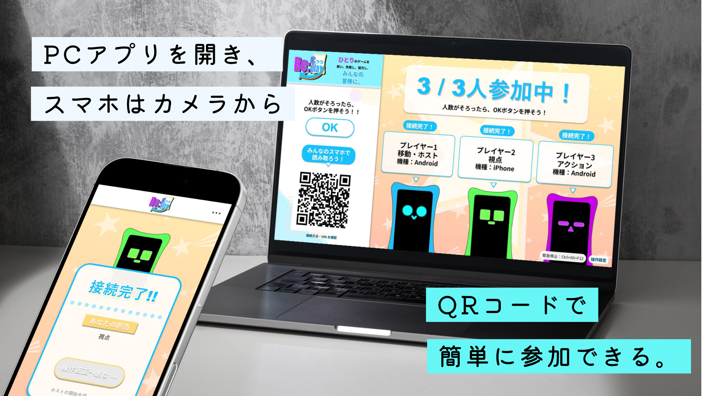
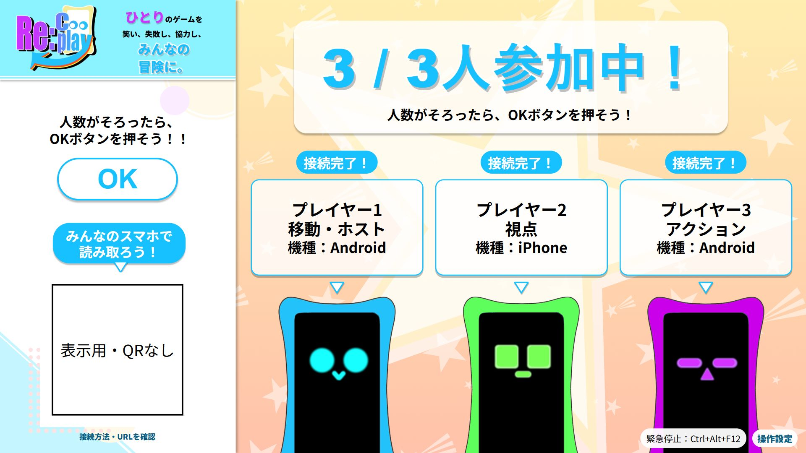

# Re:Cooplay ギャラリー

QRコードでの参加、担当別の操作画面、実際の共同プレイを紹介します。

[製品紹介](../README.md) ／ [使い方](usage.md) ／ [動作確認](verification.md)

## 実プレイ動画

https://github.com/user-attachments/assets/60d577f4-e287-45bc-bc6a-09455dd017c3

Hack Dayの開発中に撮影した3人での共同操作です。

## PCから参加・ゲーム選択・開始まで

  
  
手順1・2のイメージ。PCとスマホの画面を組み合わせた説明用画像で、実際の接続環境を撮影した写真ではありません。

1. PCに参加画面とQRコードを表示
2. スマホで参加し、PC側でゲームを選択
3. 担当する操作を確認
4. ホストが明示的にReadyして、共同操作を開始

PCアプリの表示検証画面（4枚）を見る

| 参加画面 | ゲーム選択 |
|:--:|:--:|
|  |  |
| 操作分担 | Ready待ち |
|  |  |

PC画面4枚は2026年10月25日の表示検証キャプチャです。現在のゲーム一覧・人数表示とは異なる部分があります。

## スマホのコントローラー（3人プレイ例）

  

左からP1・P2・P3の分担例です。プレゼン用の説明画像であり、現行UIの実機キャプチャではありません。現在の操作画面は実際に送るキー名・クリック等を主表示にします。

開発時の3人向け表示検証キャプチャを見る

<table>
  <tr><th align="center">P1 移動</th><th align="center">P2 視点</th><th align="center">P3 アクション</th></tr>
  <tr>
    <td></td>
    <td></td>
    <td></td>
  </tr>
</table>

3枚は2026年10月25日の模擬状態による表示検証キャプチャで、スマホ実機の写真ではありません。現在は2〜4人とも操作定義から画面を生成します。

## Hack Dayでの実プレイ

  
  
3人が同じPC画面を見ながら、各自のスマートフォンで共同操作している様子

ゲームはそのまま、遊び方を変える。**1キャラクターの移動・視点・アクションを分担**して、声を掛け合いながら遊びます。

## システム構成

[構成図と総合技術仕様](README.md) ／ [製品紹介の構成画像](../assets/images/recooplay-system-architecture.webp)

## 詳細な画面・試験資料

- [104画面の表示検証結果](../artifacts/improved-ui/README.md)（画像の採寸・表示条件）
- [PC/スマホUI比較ギャラリー](../artifacts/improved-ui/index.html)（HTML。GitHub上ではダウンロードが必要な場合があります）
- [デザイン資料](develop/design/README.md)
- [動作・検証状況](verification.md)
