# Re:Cooplay ギャラリー

QRコードでの参加、担当別の操作画面、実際の共同プレイを紹介します。

[製品紹介](../README.md) ／ [画面一覧（最新のスクリーンショット）](screenshots.md) ／ [使い方](usage.md) ／ [動作確認](verification.md)

## 実プレイ動画

https://github.com/user-attachments/assets/60d577f4-e287-45bc-bc6a-09455dd017c3

Hack Dayの開発中に撮影した3人での共同操作です。

## 実画面の録画

PCアプリとAndroid実機の画面を、2026年11月21日に録画しました。指の位置の円とPCのカーソルの輪は、見やすくするために録画後に重ねています。

**P1のスマホだけで、ゲームの選択からランチャーの「プレイ」まで**

<picture>
  <source media="(max-width: 700px)" srcset="../assets/readme/recordings/remote-start-narrow.webp" width="324">
  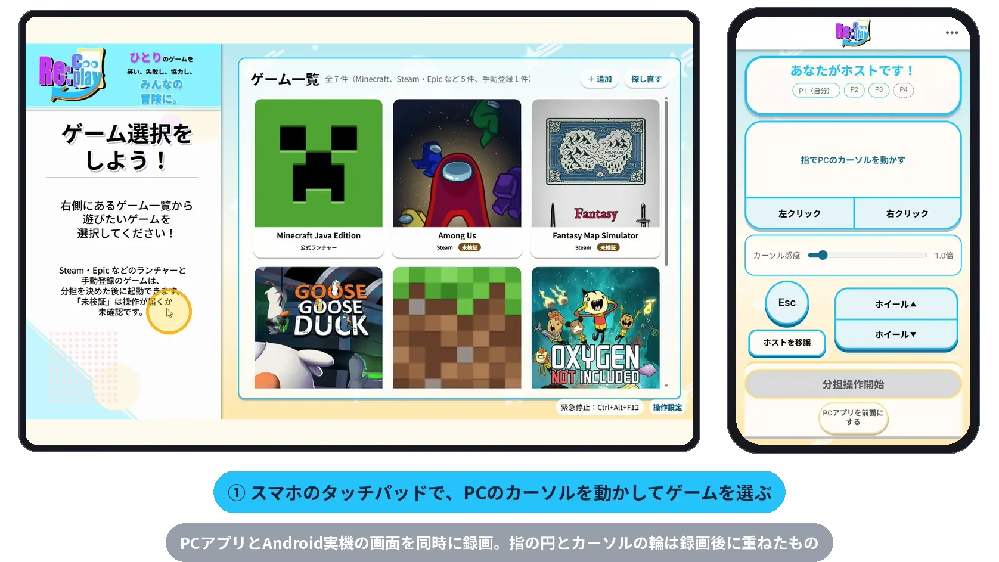
</picture>

**持ち方に合わせるUI編集**（つまみで縦横を変え、重なる場所では置ける場所を枠で示す）

<picture>
  <source media="(max-width: 700px)" srcset="../assets/readme/recordings/layout-edit-narrow.webp" width="324">
  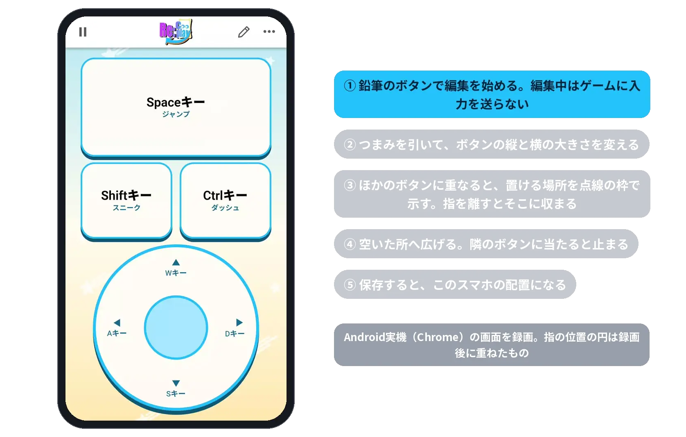
</picture>

## PCから参加・ゲーム選択・開始まで

  <a href="../assets/images/recooplay-qr-join-guide.webp">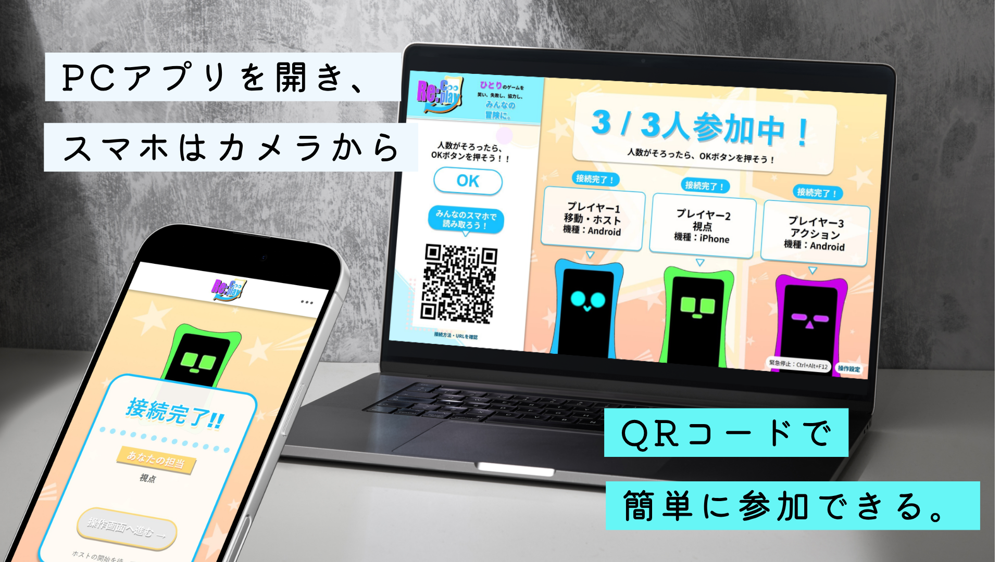</a>
  
手順1・2のイメージ。PCとスマホの画面を組み合わせた説明用画像で、実際の接続環境を撮影した写真ではありません。

1. PCに参加画面とQRコードを表示
2. スマホで参加し、PC側でゲームを選択
3. 担当する操作を確認して、ゲームを起動
4. ホストがスマホの「分担操作開始」を押して、共同操作を開始

| 参加画面 | ゲーム選択 |
|:--:|:--:|
| <a href="screenshots/device/pc-04-join-3.jpg">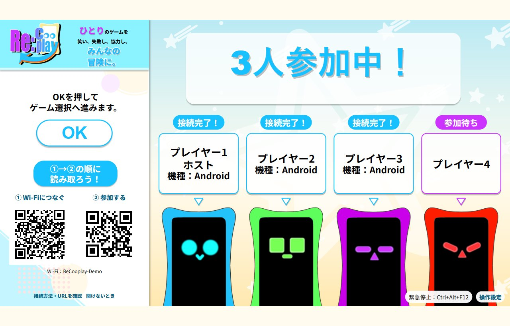</a> | <a href="screenshots/device/pc-08-game-selected.jpg">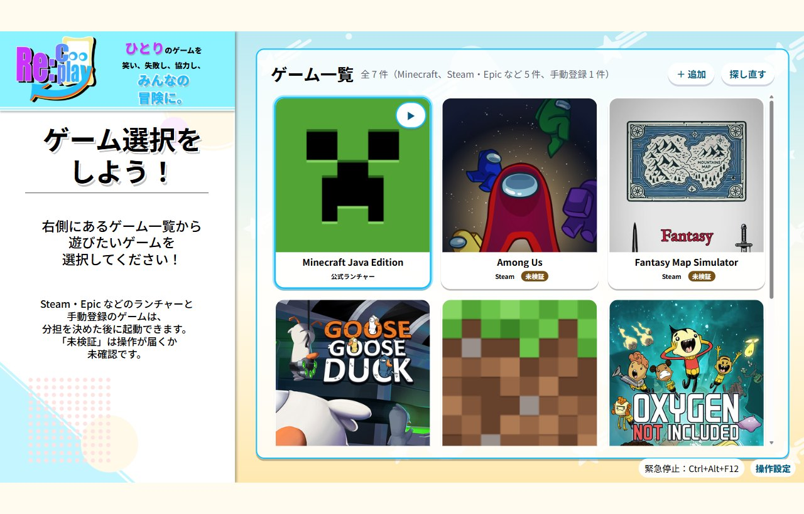</a> |
| 操作分担 | 開始待ち |
| <a href="screenshots/device/pc-10-roles.jpg">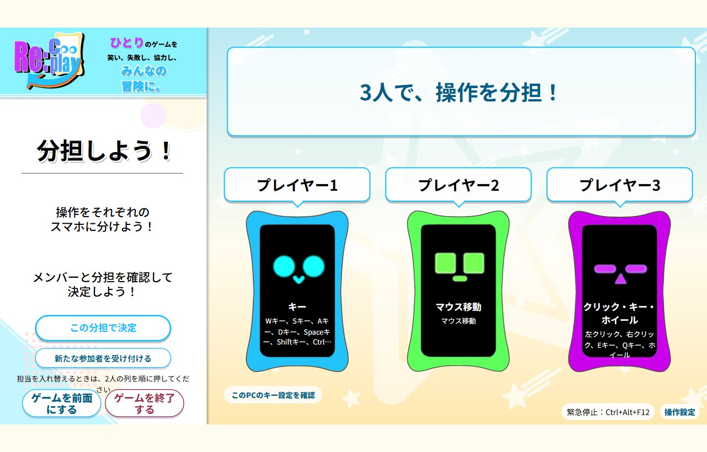</a> | <a href="screenshots/device/pc-17-launched.jpg">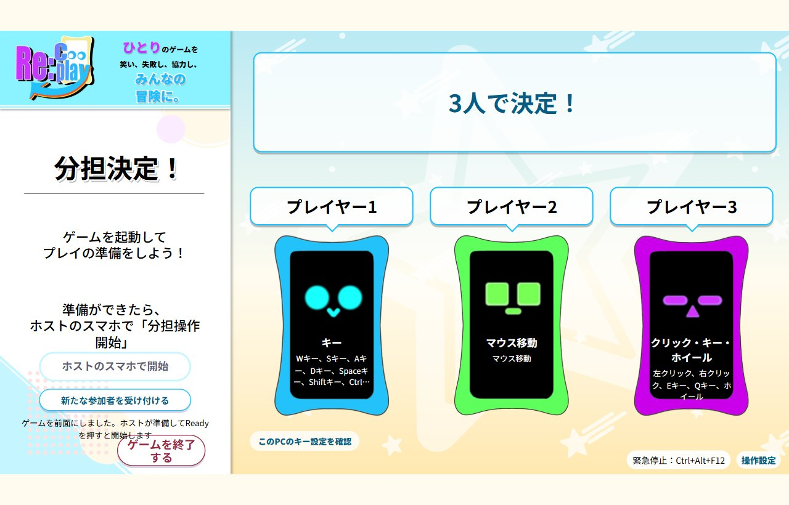</a> |

PC画面4枚は2026年11月20日に、PCアプリを通常どおり起動して撮影しました（QRとWi-Fi名は説明用に差し替えています）。ほかの画面は[画面一覧](screenshots.md)にあります。

## スマホのコントローラー（3人プレイ例）

  <a href="../assets/images/recooplay-role-controllers.webp">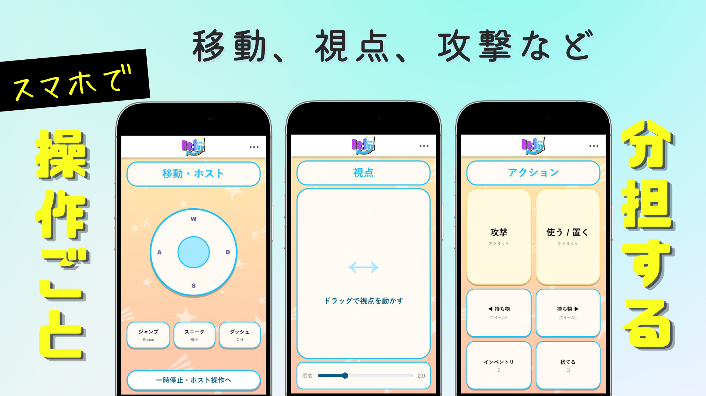</a>

左からP1・P2・P3の分担例です。プレゼン用の説明画像であり、現行UIの実機キャプチャではありません。現在の操作画面は、ゲームごとの操作の定義と分担から作り、実際に送るキー名・クリック等を主に表示します。

| 移動 | 視点 | アクション |
|:--:|:--:|:--:|
| <a href="screenshots/device/phone-11-coop-move.jpg">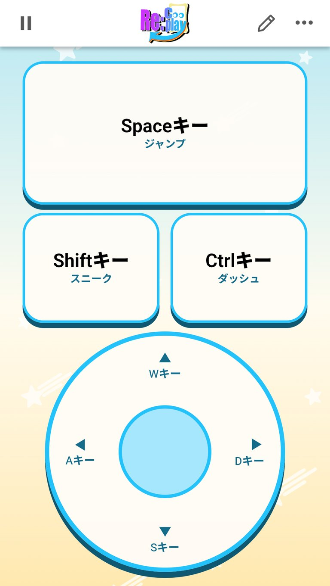</a> | <a href="screenshots/device/phone-12-coop-look.jpg">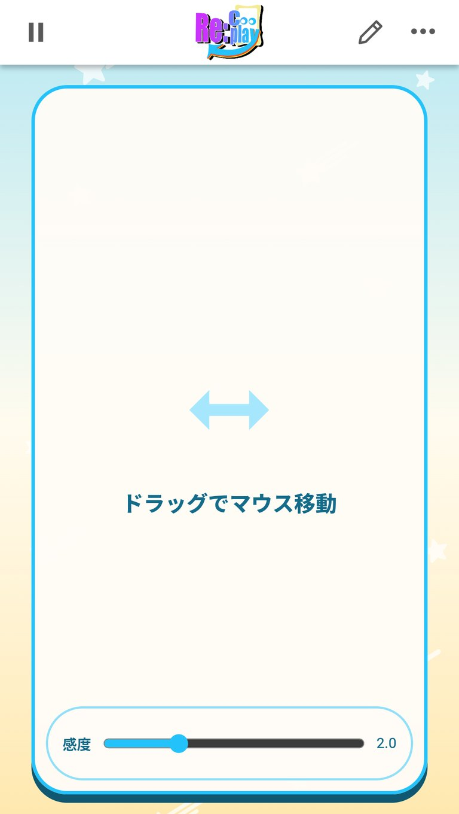</a> | <a href="screenshots/device/phone-13-coop-action.jpg">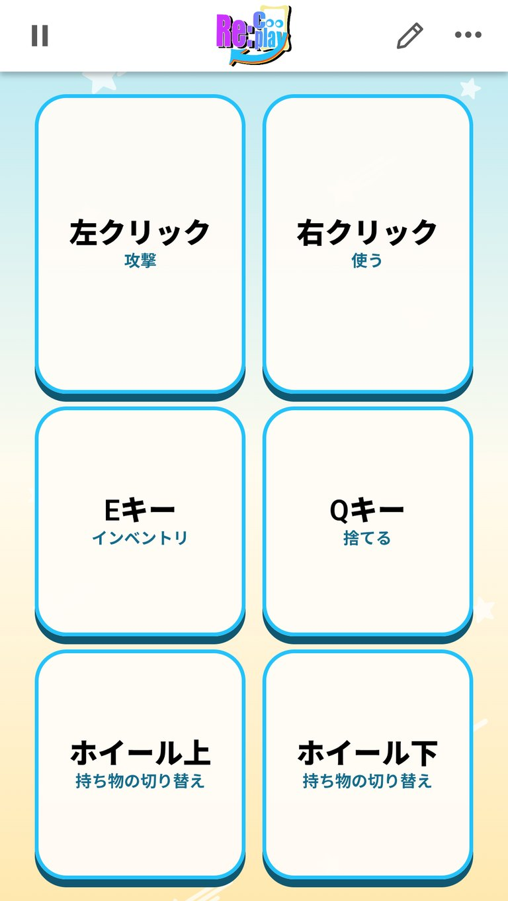</a> |

3枚は2026年11月20日に Android 実機で撮影した、Minecraft・3人のときの現行の操作画面（P1 の色）です。

## Hack Dayでの実プレイ

  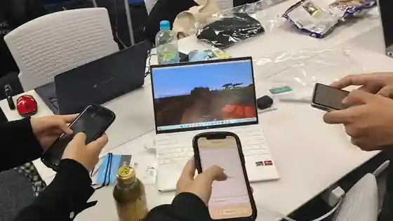
  
3人が同じPC画面を見ながら、各自のスマートフォンで共同操作している様子

ゲームはそのまま、遊び方を変える。**1キャラクターの移動・視点・アクションを分担**して、声を掛け合いながら遊びます。

## システム構成

[構成図と総合技術仕様](README.md) ／ [製品紹介の構成画像](../assets/images/recooplay-system-architecture.webp)

## 詳細な画面・試験資料

- [104画面の表示検証結果](../artifacts/improved-ui/README.md)（画像の採寸・表示条件）
- [PC/スマホUI比較ギャラリー](../artifacts/improved-ui/index.html)（HTML。GitHub上ではダウンロードが必要な場合があります）
- [デザイン資料](develop/design/README.md)
- [動作・検証状況](verification.md)
