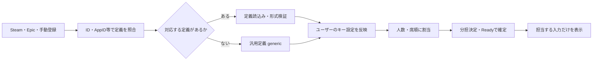
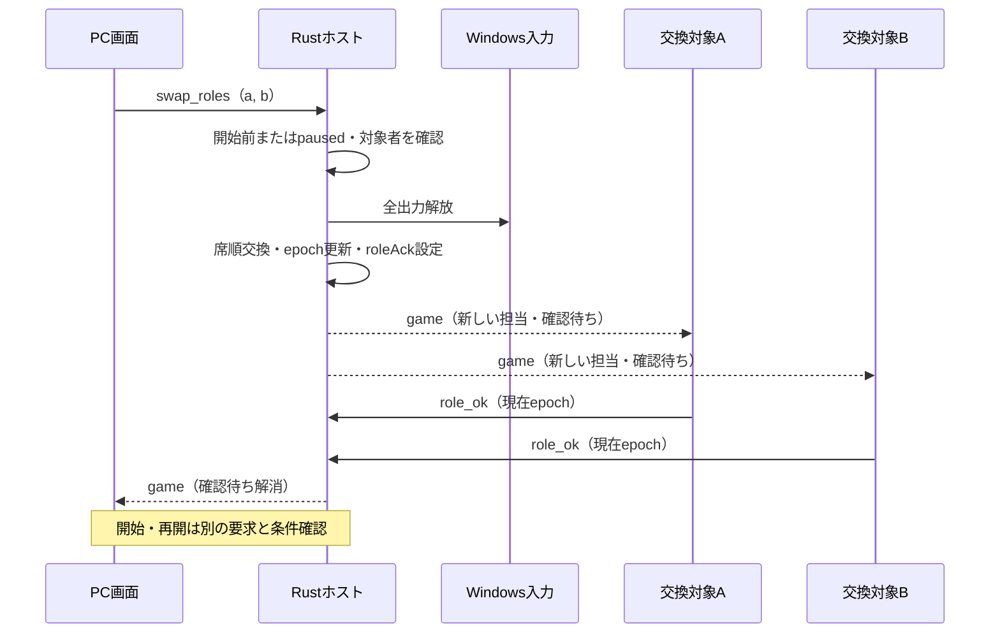

# Re:Cooplay ゲーム操作定義仕様書

**バージョン**: 0.1.0　**更新日**: 2026-10-26

[総合仕様](README.md) ／ [利用手順](usage.md) ／ [動作確認](verification.md)

---

## 📑 目次

1. [概要](#概要)
2. [技術スタック](#技術スタック)
3. [検出から操作画面まで](#検出から操作画面まで)
4. [JSON形式](#json形式)
5. [人数別の割当](#人数別の割当)
6. [役割交換](#役割交換)
7. [キー設定](#キー設定)
8. [操作画面と開始条件](#操作画面と開始条件)
9. [適用範囲](#適用範囲)
10. [開発・テスト](#開発テスト)
11. [トラブルシューティング](#トラブルシューティング)
12. [関連ドキュメント](#関連ドキュメント)

---

## 概要

ゲームの操作・初期キー・分担単位をJSONで定義し、参加人数とユーザーのキー設定から担当別の入力と画面を作ります。

---

## 技術スタック

| 構成 | 技術・実装 |
|:--|:--|
| 定義データ | JSON、schema 1 |
| 検証・割当 | Rust、profiles.rs |
| 設定読取り | keybinds.rs |
| 画面生成 | JavaScript、generated-controls.js |
| 静的抽出・カタログ | Node.js、scripts/profiles/ |

---

## 検出から操作画面まで



定義は`apps/game-profiles/*.json`から起動時に読み込みます。`RECOOPLAY_PROFILES_DIR`で場所を変更でき、Minecraft定義はホストにも同梱します。不正な定義は理由をログへ記録して使用しません。ゲームのコードは実行せず、設定ファイルを書き換えません。

Steam・Epic Gamesの検出情報はゲーム選択と入力先の判定に用います。手動登録はPCのファイル選択画面で実行ファイルを選び、スマホから任意パスを受け取りません。検出したゲームに固有定義がなければ、WASD、相対視点、左右クリック、E・1・2・Tab等を持つ`generic`を使います。

---

## JSON形式

`schema`は`1`です。最小例は次のとおりです。

```json
{
  "schema": 1,
  "id": "example-game",
  "name": "Example Game",
  "match": {"ids": ["example-game"], "steamAppIds": [], "processes": []},
  "suitability": "unknown",
  "groups": [{"id": "movement", "label": "移動", "role": "P1"}],
  "actions": [{"id": "forward", "label": "前進", "group": "movement", "type": "button", "default": "KEY_W"}],
  "verification": {"status": "unverified"}
}
```

| 項目 | 内容 |
|---|---|
| `id` | 定義のID。ゲームの選択・検出と `match` で結び付ける |
| `match.ids` / `match.steamAppIds` | このゲームを指すID・Steam AppID |
| `match.processes` / `match.titleContains` | 対象照合に使うプロセス名・タイトルの条件。検出ゲームの入力先はホストのゲーム情報に基づいて決まる |
| `suitability` | 分担に向くか：`good` / `limited` / `unsuitable`（マウスだけ・ターン制等）/ `unknown` |
| `userBindings.reader` | ユーザーの設定の読み方：`minecraft-options`・`terraria-input-profiles`・`es3-keybindings`（Unity＋Easy Save）・`unity-inputsystem-json`（SaveBindingOverridesAsJson）・`ue-input-ini`（Unreal Engine 4）・`source-cfg`・`none` |
| `userBindings.path` | 設定ファイルの場所。`%APPDATA%`・`%LOCALAPPDATA%`・`%USERPROFILE%`・`%LOCALLOW%`・`%DOCUMENTS%`（OneDriveへ移した場合も含む）を使える |
| `groups[].role` | 分担の案：`P1`・`P2`・`P3`・`host`（メニュー＝ホストのリモコン）・`none`（分担しない） |
| `groups[].split` | 担当が参加人数に足りないときに分ける単位 |
| `actions[].type` | `button`・`axis2d`・`mouseDelta`（視点）・`wheel`・`text` |
| `actions[].default` | 初期キー（`apps/host-rs/src/controls.rs` の出力ID：`KEY_W`・`SPACE`・`LSHIFT`・`MOUSE_L` 等） |
| `actions[].bind` | 設定ファイル上の名前（`key.sprint`・`Jump`・`+forward`・`15`・`0/up` 等）。ユーザーのキーで上書きする目印 |
| `actions[].control` | 既存リモコンに対応する操作名。リモコンのキー解決等に使用し、共同操作の送信IDには使わない |
| `verification.status` | `unverified`（未検証）・`template`（ジャンルの型からの仮）・`extracted`（自動抽出）・`reviewed`（人が確認）・`device`（実機で確認）。実機で確かめていない定義を「確認済み」と表示しない |

---

## 人数別の割当

1. P1〜P3を役割案に持つグループを定義順に単位とします。`host`はP1のメニュー操作、`none`は共同操作の割当外です。
2. 単位が人数に足りない場合は`split`のあるグループを部分に分け、それでも足りなければ重い単位を分割します。
3. 優先度順に各人へ配り、残りは負担の軽い人へ配ります。重みは`actions[].weight`、省略時は視点・2軸が3、ボタンが1、ホイールが0.5です。

分担関数は1〜4人の案を計算できますが、共同操作の開始にはP1を含む2〜4人が必要です。Minecraftの3人例は移動／視点／クリック・持ち物、4人例は移動／視点／クリック／持ち物です。表示は実キーと入力種類を中心にします。

`game.profile.assignment`は接続者への案、`assignments`は人数別の案です。Ready時点の参加者を`participants`、割当を`assigned`として固定します。切断で人数を減らして自動的に配り直さず、再接続を待ちます。人数を変えるときは終了して決め直します。

---

## 役割交換



共同操作中の交換は受け付けません。開始前は接続者、一時停止中は確定参加者を対象にします。ホスト権は枠P1に残り、席順は終了後も保持し、リセットで戻します。

---

## キー設定

設定は起動、ゲーム選択、PREPARE、READY、RESUMEで読み直します。共同操作中以外は設定ファイルの更新日時も確認します。ゲームによっては終了時まで設定を書き出さないため、ゲーム内変更が直ちに反映されない場合があります。

読取り先はMinecraft options、Terraria、Easy Save、Unity Input System JSON、Unreal EngineのInput.ini、Source cfg等です。対応するreaderと指定ファイルだけを扱い、エンジンの全設定階層や実行時スクリプトの挙動を再現しません。Minecraftの場所は`minecraftOptions`または`RECOOPLAY_MINECRAFT_OPTIONS`で上書きできます。

送れないキーや未設定の操作は別キーで代用せず、実出力をnullとして警告します。ファイルがない・読めない場合は初期キーを使い、その旨を表示します。同じキーへの重複も警告します。

---

## 操作画面と開始条件

全ゲーム・全人数で`generated-controls.js`を使い、ボタン・ホイール・視点パッド・方向キー群のスティックを作ります。ボタンは`keys.actions`の実キーを表示し、`act:<ID>`で送ります。サーバーは現在epoch・確定割当・操作種類・実出力を検証します。視点はその担当者だけが送れます。

`template / extracted / unverified`も開始条件が揃えばReadyできます。確認状態を理由に開始を制限しませんが、未検証表示は保持します。分担可能な操作のない定義や、生成画面・出力が扱えない種類を含む定義ではReadyを拒否します。

---

## 適用範囲

定義の検証状態は定義に付く記録であり、現行プログラム・全人数・全端末の受入結果ではありません。カタログ502件は502タイトルの動作保証ではありません。Unrealの修飾キー付き複合入力、Sourceのexec・aliasの評価、個々のゲームの設定階層や保護機構への対応には制約があります。

実装：[定義・割当](../apps/host-rs/src/profiles.rs) ／ [設定読取り](../apps/host-rs/src/keybinds.rs) ／ [生成画面](../apps/web-static/scripts/generated-controls.js) ／ [カタログ照合](../scripts/sim/profile-catalog-test.mjs)

---

## 開発・テスト

```powershell
node scripts/sim/profile-catalog-test.mjs
node scripts/sim/profile-extract-test.mjs
cargo test --release --locked --manifest-path apps/host-rs/Cargo.toml
```

参考カタログは`docs/develop/data/`、製品に同梱する定義は`apps/game-profiles/`です。カタログ生成は公開データの取得を伴い、通常の照合試験では再生成しません。

---

## トラブルシューティング

| 症状 | 確認箇所 |
|:--|:--|
| 定義が読まれない | schema、ID、グループ・操作の整合、profilesログ |
| ボタンが送らない表示になる | 実出力null、非対応キー、ゲーム設定読取り警告 |
| ゲーム内の効果が違う | 実キーとゲーム側の割当、汎用定義の適合 |

---

## 関連ドキュメント

[通信仕様](protocol-specification.md) ／ [フロントエンド仕様](frontend-specification.md) ／ [確認範囲](verification.md)
