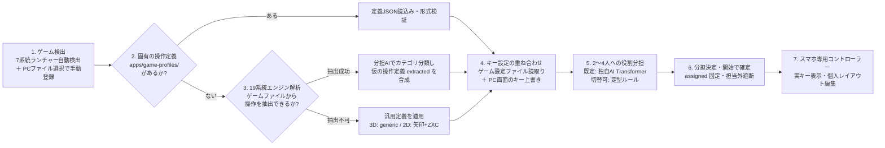
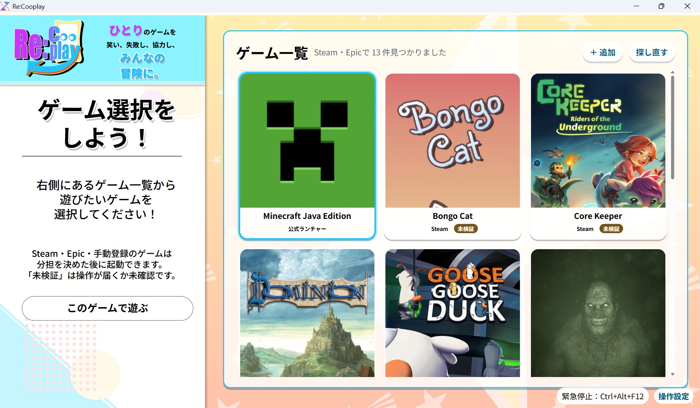
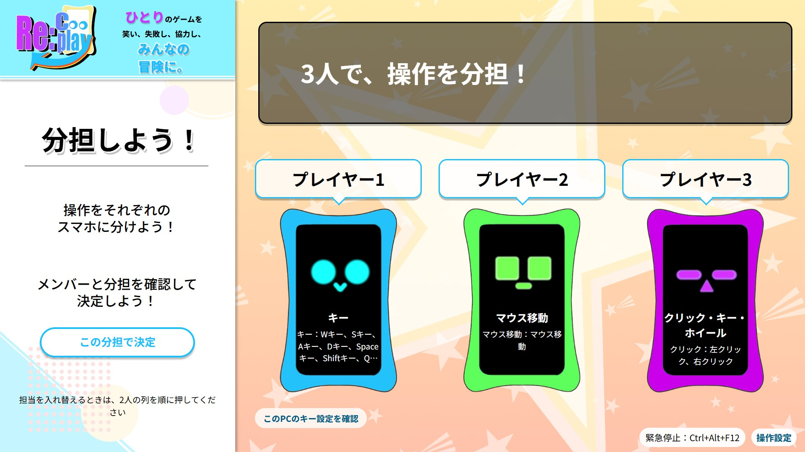
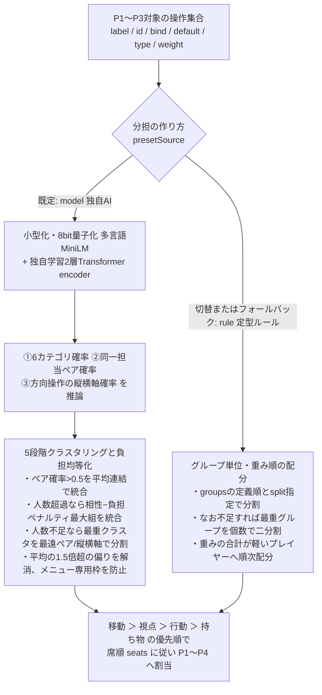
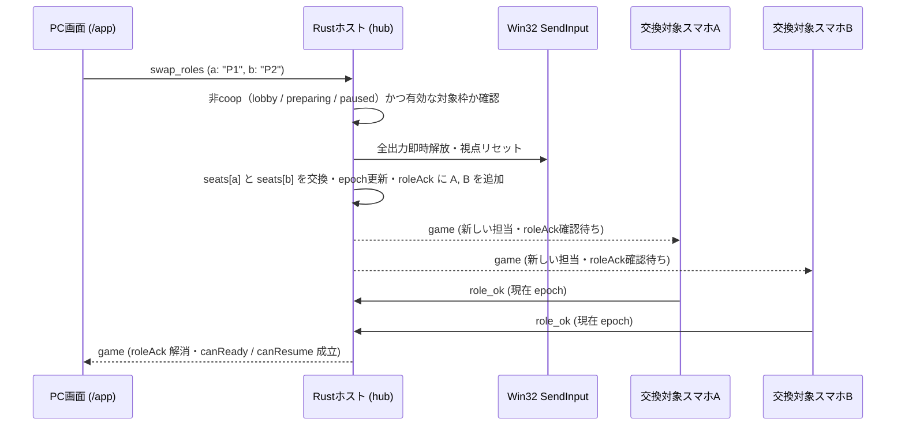
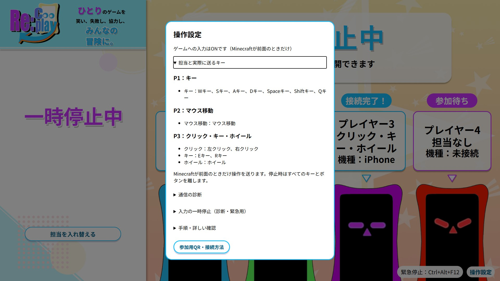
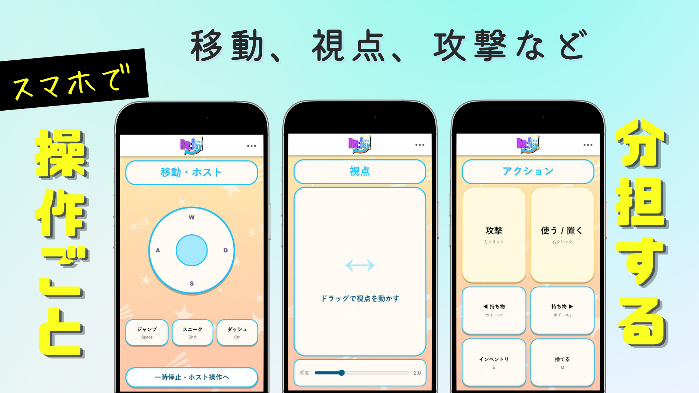

# Re:Cooplay ゲーム操作定義仕様書

**バージョン**: 0.2.0　**更新日**: 2026-11-18

[総合仕様](README.md) ／ [利用手順](usage.md) ／ [動作確認](verification.md)

---

## 📑 目次

1. [概要](#概要)
2. [技術スタック](#技術スタック)
3. [検出から操作画面まで](#検出から操作画面まで)
4. [JSON形式](#json形式)
5. [人数別の割当](#人数別の割当)
6. [役割交換](#役割交換)
7. [キー設定](#キー設定)
8. [操作画面と開始条件](#操作画面と開始条件)
9. [適用範囲](#適用範囲)
10. [開発・テスト](#開発テスト)
11. [トラブルシューティング](#トラブルシューティング)
12. [関連ドキュメント](#関連ドキュメント)

---

## 概要

PCゲームごとの操作一覧・初期キー・分担単位を共通のJSONスキーマ（`schema: 1`）で表現し、参加人数（2〜4人）とユーザーの実際のキー設定から、各スマートフォンの担当入力と専用コントローラー画面を自動生成します。

特定のゲームや3人固定のプリセットに縛られず、**①手作りの固有定義、②19系統のゲームエンジン・設定ファイルから自動抽出した定義、③汎用定義（3D用 `generic`／2D用汎用）** をすべて同一の分担AI・キー解決・画面生成パイプラインで扱います。

---

## 技術スタック

| 構成要素 | 技術・実装モジュール | 役割 |
|:--|:--|:--|
| **ランチャー検出** | Rust、`apps/host-rs/src/games.rs`・`launchers.rs` | Steam・Epic・GOG・Ubisoft・EA・Battle.net・Xbox・Steamショートカット・Minecraft・手動登録の検出 |
| **操作定義データ** | JSON（`schema: 1`）、`apps/game-profiles/*.json` | ゲームごとのアクション、グループ、初期キー、設定ファイルの読み方（`userBindings`）の定義 |
| **未定義ゲーム自動抽出** | Rust、`apps/host-rs/src/game_actions.rs`・`engines/`（19モジュール） | 事前定義のないゲームのファイルや設定から操作名・実キー・操作種類を非破壊で抽出 |
| **分担生成（AI／定型）** | Rust、`apps/host-rs/src/preset_model.rs`・`profiles.rs` | 事前学習済みMiniLM＋独自2層Transformer encoder（または定型ルール）による2〜4人分担の生成 |
| **キー設定読取り・上書き** | Rust、`apps/host-rs/src/keybinds.rs`・`key_overrides.rs` | 7種類の設定リーダーによるユーザーキー設定の反映と、PC画面からの個別キー上書き保存 |
| **コントローラー・レイアウト生成** | React + TypeScript、`shared/controller-layout.ts`・`shared/model/layout.ts`・`phone/LayoutController.tsx` | 担当アクションと実キー名からの部品生成、スマホ本体基準の初期配置と画面内ドラッグ編集 |
| **静的抽出・カタログ検証** | Node.js、`scripts/profiles/`・`scripts/sim/profile-catalog-test.mjs` | カタログ502タイトルの定義検証と、Node/Rust間のエンジン抽出一致試験 |

---

## 検出から操作画面まで



定義は `apps/game-profiles/*.json` から起動時に読み込みます（`RECOOPLAY_PROFILES_DIR` で変更可、Minecraft定義はホストバイナリにも内蔵）。ゲームの実行コードは一切動かさず、ゲーム側の設定ファイルも書き換えません。

| 処理段階 | 生成されるデータ | 安全・設計上の境界 |
|:--|:--|:--|
| **1. ゲーム検出・手動登録** | 選択可能なゲーム一覧と入力先プロセス・フォルダ条件（`Target`） | スマホから任意のパスやURLを受け取らない |
| **2. 定義照合・ファイル抽出** | 固有定義、エンジン抽出定義（`detected:<id>`）、または `generic` | 暗号化データやアンチチート保護領域は読まない |
| **3. キー設定の解決** | 各アクションIDに対する実出力 `{ out, label }` または `null`（警告付き） | 未設定・非対応キーを別のキーで勝手に代用しない |
| **4. 2〜4人への割当** | 参加枠（`P1`〜`P4`）ごとのアクションID配列 | 役割案が `host`（リモコン）や `none` の操作は共同操作に混ぜない |
| **5. スマホ画面生成・編集** | スティック・視点パッド・ボタンの個人レイアウト | レイアウトを変えてもサーバー側の担当認可や実キーは変わらない |

| PC：ゲーム自動検出と選択（`/app`） | PC：2〜4人の操作分担とAI/定型切替（`/app`） |
|:--:|:--:|
| <a href="screenshots/pc-03-game-select.jpg"></a> | <a href="screenshots/pc-04-roles.jpg"></a> |

### 定義のないゲームのファイルからの読み取り

検証済みの定義がないゲームは、インストール先のファイルやユーザー設定から操作を読み取り、分担AIで分類した仮の操作定義（`verification.status: "extracted"`・未検証）を自動合成します（#431）。読めなければ `generic` を使います。

操作の意味がエンジン仕様で確定しているもの（RPGツクール・WOLF RPGエディターの決定・キャンセル・4方向移動、2D向け汎用割当の移動と `Z`・`X`・`C`）は、抽出側でカテゴリを確定してモデルの分類より優先します。RPGの「決定（調べる・話す）」がメニュー操作に分類されてP1のリモコンに残り、協力プレイ中に誰も調べられなくなるのを防ぐためです（#512）。

ホストの `apps/host-rs/src/game_actions.rs` および `apps/host-rs/src/engines/` は、上から順に試行して最初に抽出できた方式を採用します。

| エンジン・形式 | 解析対象ファイル・レジストリ | キー情報の取得 |
|:--|:--|:--|
| **Unity Input System** | ゲーム内の `.inputactions` ＋ Windowsレジストリ `HKCU\Software\<会社名>\<製品名>`（PlayerPrefs）のBinding Override（#484） | 初期キー＋ユーザー上書き |
| **RPGツクール MV・MZ** | `rpg_core.js` / `rmmz_core.js` の `Input.keyMapper` と、有効なプラグイン内の `keyMapper[n] = '...'`（#480） | 定義キー＋プラグイン拡張 |
| **RPGツクール VX Ace・VX・XP・2000/2003** | ランタイム・データ構造からエンジン世代を特定し、エンジン標準の操作とキー（矢印・Z・X・Shift等）を生成（#480） | エンジン既定キー |
| **WOLF RPG エディター** | データファイルからウディタ作品を特定し、標準の移動・決定・キャンセル・サブキーを生成（#488） | エンジン既定キー |
| **Source 2** | Steamの `userdata/<アカウント>/<AppID>/local/cfg/*.vcfg`（#487） | ユーザーの現在設定 |
| **Creation Engine**（Skyrim SE / Fallout 4 / Starfield） | `Documents\My Games\<ゲーム>\ControlMap_Custom.txt`。未作成時は `* - Interface.ba2`（zlib圧縮BA2）内の `ControlMap.txt` または既定割当表（#486・#527） | ユーザー設定＋BA2既定 |
| **REDengine**（Cyberpunk 2077 / The Witcher 3） | Cyberpunk 2077は `r6/config/inputUserMappings.xml`、The Witcher 3は `Documents\The Witcher 3\input.settings`（#505） | あり |
| **Prism3D**（Euro Truck Simulator 2 / ATS） | プロファイル内の `controls.sii` の `mix` 行（平文のみ、#506） | ユーザーの現在設定 |
| **GIANTS Engine**（Farming Simulator） | `Documents\My Games\FarmingSimulator20xx\inputBinding.xml`（徒歩・運転の基本操作を優先し最大40件、#507） | ユーザーの現在設定 |
| **Factorio** | `%APPDATA%\Factorio\config\config.ini` の `[controls]`（未記載項目は既定キーで補完、#508） | ユーザー設定＋既定補完 |
| **Project Zomboid** | `%USERPROFILE%\Zomboid\Lua\keys.ini`（DirectInputスキャンコードとGLFWキーコードを自動判別、#509） | ユーザーの現在設定 |
| **Godot 3・4** | 独立 `.pck` または `.exe` 末尾埋め込みPCK内の `project.binary`（`InputMap`、組み込み `ui_*` は除外、#485） | あり |
| **Unreal Engine 4・5** | 非暗号化・非圧縮 `.pak` 内の `DefaultInput.ini` と `%LOCALAPPDATA%\<Project>\Saved\Config\Windows(NoEditor)\Input.ini`（#482） | 初期キー＋ユーザー設定 |
| **CryEngine** | `.pak`（ZIP形式）内の `defaultProfile.xml` 等の `actionmaps`（#489） | あり |
| **Quake 系・Source 1** | `id1/config.cfg`、`baseq2/config.cfg`、`baseq3/q3config.cfg`、`<mod>/cfg/config.cfg`（#491） | ユーザーの現在設定 |
| **GameMaker / LÖVE / HTML5系（NW.js・Electron）** | エンジン構造を判別し、2Dゲーム向け汎用割当（矢印・Z・X・C・Shift・Enter・Esc）を適用（XNA/FNA/MonoGameは3D `generic`、#490〜#495） | 2D/3D既定キー |
| **Unity 旧 Input Manager** | `globalgamemanagers` のInput軸定義をバイナリ解析（作品固有の追加軸がある場合のみ採用、#483） | あり |
| **.NET（Rewired / 操作列挙型）** | `Assembly-CSharp.dll` 内の `RewiredConsts.Action` 定数や操作系 `enum` 名を抽出 | 操作名のみ（キーなし） |

抽出結果と当時の設定ファイル更新日時は `%LOCALAPPDATA%\Re-Cooplay\detected-profiles.json` にキャッシュされます。ロビーまたは準備中にそのゲームを選択した際、設定ファイルの更新日時が変わっていれば自動的に再抽出・再分担を行います（#524）。

---

## JSON形式

操作定義の `schema` は `1` です。最小構成例と各フィールドの意味は次のとおりです。

```json
{
  "schema": 1,
  "id": "example-game",
  "name": "Example Game",
  "match": {
    "ids": ["example-game", "steam:123450"],
    "steamAppIds": [123450],
    "processes": ["ExampleGame.exe"],
    "titleContains": "Example"
  },
  "suitability": "good",
  "userBindings": {
    "reader": "ue-input-ini",
    "path": "%LOCALAPPDATA%/ExampleGame/Saved/Config/WindowsNoEditor/Input.ini"
  },
  "groups": [
    {"id": "movement", "label": "移動", "role": "P1", "split": [["forward", "back"], ["left", "right"]]},
    {"id": "camera", "label": "視点", "role": "P2"},
    {"id": "combat", "label": "アクション", "role": "P3"}
  ],
  "actions": [
    {"id": "forward", "label": "前進", "group": "movement", "type": "button", "default": "KEY_W", "bind": "MoveForward"},
    {"id": "look", "label": "視点", "group": "camera", "type": "mouseDelta", "weight": 3.0},
    {"id": "attack", "label": "攻撃", "group": "combat", "type": "button", "default": "MOUSE_L", "bind": "Fire"}
  ],
  "verification": {"status": "reviewed"}
}
```

| フィールド | 内容 |
|:--|:--|
| `id` / `name` | 操作定義の一意なIDと表示タイトル |
| `match.ids` / `steamAppIds` | 検出ゲーム（`steam:<appid>`, `epic:<AppName>`, `gog:<id>` 等）とこの定義を結び付ける識別子 |
| `match.processes` / `titleContains` | 前面ウィンドウ照合に使うプロセス名・ウィンドウタイトル条件（検出ゲームではインストール先パス照合も併用） |
| `suitability` | 共同操作への適性：`good`（適する）／ `limited`（一部制約あり）／ `unsuitable`（マウスのみ・ターン制等）／ `unknown` |
| `userBindings.reader` / `path` | ユーザー設定ファイルのパーサー名とパス（`%APPDATA%`, `%LOCALAPPDATA%`, `%USERPROFILE%`, `%LOCALLOW%`, `%DOCUMENTS%`［OneDriveリダイレクト対応］を展開） |
| `groups[].role` / `split` | 定型ルールでの初期役割案（`P1` / `P2` / `P3` / `host` / `none`）と、人数に対してグループが足りない場合の分割単位 |
| `actions[].type` | `button`（キー・左右クリック）／ `axis2d` ／ `mouseDelta`（相対視点移動）／ `wheel`（マウスホイール前後）／ `text` |
| `actions[].default` | 初期出力ID（`apps/host-rs/src/controls.rs` で定義された `KEY_W`, `SPACE`, `LSHIFT`, `MOUSE_L` 等） |
| `actions[].bind` | ゲームの設定ファイル内のバインド識別子（`key.sprint`, `Jump`, `+forward` 等） |
| `actions[].weight` | 分担の負担計算に用いる非負の重み（省略時は `mouseDelta`・`axis2d` が `3.0`、`button` が `1.0`、`wheel` が `0.5`） |
| `verification.status` | `device`（実機確認済み）／ `reviewed`（人手確認）／ `extracted`（自動抽出）／ `template`（ジャンル型）／ `unverified`（未検証） |

---

## 人数別の割当

PC画面の分担確認では、検証済みプリセットがないすべてのゲームで **「独自AI」（既定）** と **「定型ルール」** をワンクリックで切り替えられます（#432・#474）。



- **独自AIによる分担（`presetSource: "model"`）**：詳細は [分担AI仕様書](preset-model-specification.md) を参照してください。推論はバックグラウンドスレッドで行われ、`%LOCALAPPDATA%\Re-Cooplay\model-presets.json` にキャッシュされます。
- **定型ルールによる分担（`presetSource: "rule"`）**：環境変数 `RECOOPLAY_PRESETS=rule` の指定時、モデルの重みが読めない環境、またはホストがPC画面で「定型ルール」を選択したときに使用されます。
- **確定と保持**：`READY`（分担操作開始）の時点で接続していた参加者を `participants`、割当を `assigned` として固定します。プレイ中の一時的な通信断で人数が減っても勝手に担当を配り直さず、再接続を待ちます。一時停止中に人数が変わった場合は、PC画面の「今のN人で分担し直す」（`change_players`）で明示的に組み直せます。

---

## 役割交換



開始前（`lobby` / `preparing`）および一時停止中（`paused`）に2人の席順（担当束）を交換できます。席順を交換しても **P1のホスト管理権限（リモコン・開始・一時停止）はP1枠に残ります**（ホスト権そのものを譲る場合は、ロビーでP1スマホのリモコンから `transfer_host`「ホストを移譲」を実行します）。

---

## キー設定

### 1. ゲーム設定ファイルからの自動読取り（`apps/host-rs/src/keybinds.rs`）

設定はホスト起動時、ゲーム選択時、`PREPARE`、`READY`、`RESUME`、および非 `coop` 時の1秒周期の更新日時チェック（`keybinds.changed()`）で自動的に読み直されます。

| ゲーム・エンジン形式 | `userBindings.reader` | 読取り内容 |
|:--|:--|:--|
| **Minecraft Java Edition** | `minecraft-options` | `options.txt` の `key_*` 設定（LWJGLキー名・マウスボタン） |
| **Terraria** | `terraria-input-profiles` | `input profiles.json` のカスタムキー設定 |
| **Unity + Easy Save 3** | `es3-keybindings` | Easy Save形式のキー設定JSONデータ |
| **Unity Input System** | `unity-inputsystem-json` | `SaveBindingOverridesAsJson` で保存されたBinding Override JSON |
| **Unreal Engine 4 / 5** | `ue-input-ini` | `Input.ini` の `ActionMappings` / `AxisMappings` |
| **Source Engine** | `source-cfg` | `config.cfg` 等の `bind "<key>" "<command>"` |
| **設定読取りなし** | `none` | 操作定義JSONの `default` キーを使用 |

### 2. PC画面からのキー割当変更（`apps/host-rs/src/key_overrides.rs`、#50・#53・#436）

ゲーム側で独自のキー設定変更を行っていて自動読取り対象外の場合でも、PC画面の「操作設定」→「担当と実際に送るキー」から、各操作に送る物理キーを `◀` `▶` ボタンやドロップダウンで即座に切り替え（または「送らない」に設定）できます。変更は全出力解放と `epoch` 更新を伴って即時反映され、`%LOCALAPPDATA%\Re-Cooplay\key-overrides.json` にゲームごとに保存されます。

<div align="center">
  <a href="screenshots/pc-09-settings.jpg"></a>
  <p><sub>PC画面の「操作設定」から、各プレイヤーの担当操作と実際にPCへ送るキーを確認・変更できます。</sub></p>
</div>

---

## 操作画面と開始条件

全ゲーム・全人数で `shared/controller-layout.ts` と `shared/model/layout.ts` を通じてスマホ画面（`phone/LayoutController.tsx`）を生成します。

<div align="center">
  <a href="../assets/images/recooplay-role-controllers.webp"></a>
  <p><sub>操作定義と割当から各スマホに生成されるコントローラー画面（位置・大きさ・複製もスマホ上で編集可能）</sub></p>
</div>

`template` / `extracted` / `unverified` の操作定義であっても、P1を含む2人以上の接続・分担決定・本人確認・緊急停止登録・対象ゲーム前面化の開始条件が揃えばプレイを開始できます（PC画面には未検証である旨の注意アイコンと案内を表示します）。一方、マウス専用で分担可能な操作が1つもない定義（`controllerSupported: false`）では開始を拒否し、理由を案内します。

---

## 適用範囲

操作定義の登録やゲームファイルからの自動抽出は、すべてのタイトルでの実機動作を保証するものではありません。カタログ502件はスキーマと分担生成の検証母集団であり、502タイトルの実機互換保証とは区別します。Unreal Engineの修飾キー付き複合バインドやSource Engineの複雑な `alias` / `exec` スクリプト、アンチチート保護されたタイトルには制限があります。

実装：[操作定義・定型分担](../apps/host-rs/src/profiles.rs) ／ [分担AI推論](../apps/host-rs/src/preset_model.rs) ／ [未定義ゲーム抽出](../apps/host-rs/src/game_actions.rs) ／ [19系統エンジンパーサー](../apps/host-rs/src/engines/) ／ [キー設定読取り](../apps/host-rs/src/keybinds.rs) ／ [生成画面モデル](../apps/web/src/shared/controller-layout.ts)

---

## 開発・テスト

```powershell
node scripts/sim/profile-catalog-test.mjs
node scripts/sim/profile-extract-test.mjs
cargo test --release --locked --manifest-path apps/host-rs/Cargo.toml
```

---

## トラブルシューティング

| 症状 | 確認箇所 |
|:--|:--|
| 操作定義が読み込まれない | JSONの `schema: 1`、アクション・グループIDの整合性、起動時の `profiles` ログの `errors` を確認 |
| ボタンが「送らない」になる | ゲーム設定で非対応キーまたは未割当になっている。PC画面の「操作設定」でキーを割り当てるかゲーム側設定を確認 |
| ゲーム内の動作と表示が違う | PC画面の「操作設定」→「担当と実際に送るキー」で、ゲーム内のキー設定と同じキーが割り当たっているか確認 |

---

## 関連ドキュメント

[総合仕様](README.md) ／ [分担AI仕様](preset-model-specification.md) ／ [通信仕様](protocol-specification.md) ／ [フロントエンド仕様](frontend-specification.md) ／ [ホスト仕様](host-specification.md) ／ [動作確認の範囲](verification.md)
