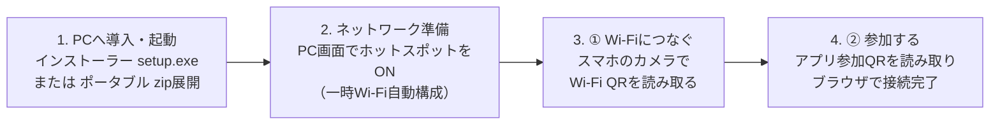
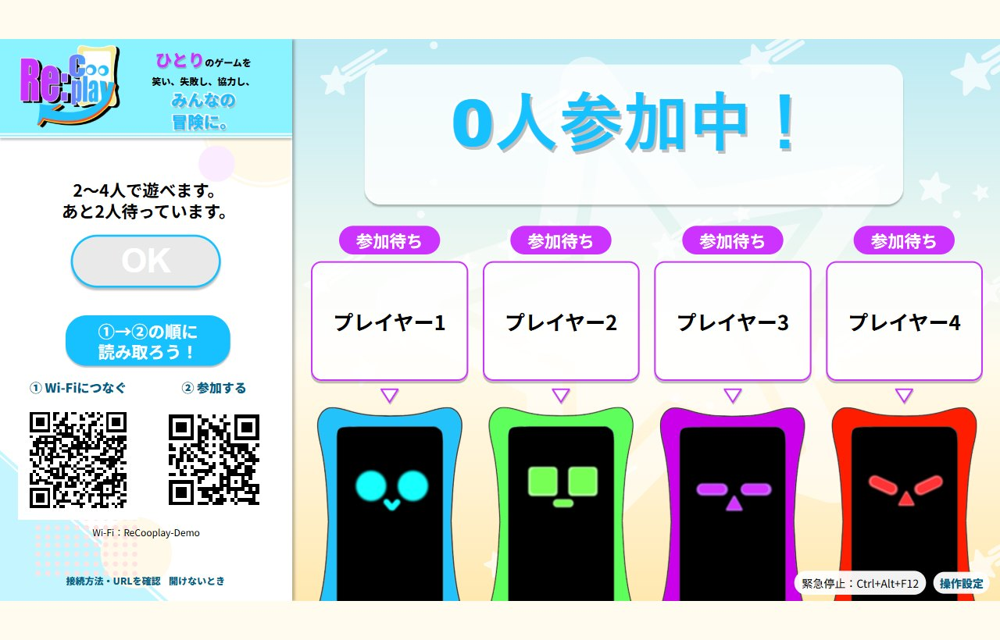

# Re:Cooplayの導入・接続

**更新日**: 2026-11-20

[使い方](usage.md) ／ [困ったとき](troubleshooting.md) ／ [動作確認](verification.md) ／ [総合仕様](README.md)

---

Windows 11 PCでRe:Cooplayを起動し、同じローカルWi-Fi（またはPCのモバイルホットスポット）につないだスマートフォンからQRコードで参加します。



---

## 必要なもの

| 項目 | 条件 |
|:--|:--|
| **PC** | Windows 11 x64 |
| **必須ランタイム** | Microsoft Edge WebView2 ランタイム（Windows 11標準搭載）、Microsoft Visual C++ v14 Redistributable（x64） |
| **スマートフォン** | 2〜4台（Android Chrome ／ iPhone Safari）。専用アプリのインストールは不要 |
| **ネットワーク** | Windows PCのモバイルホットスポット（推奨・ワンクリック起動）、または同じローカルWi-Fi |
| **ゲーム** | PCにインストールされたキーボード・マウス操作のゲーム |

ゲーム映像はPCのディスプレイ（またはプロジェクター・大型モニター）をみんなで囲んで見ます。スマホへゲーム映像は配信しません。

---

## 入手とビルド

一般向けの公開Release状況は [GitHub Releases](https://github.com/jphacks/kz_2613/releases) および [リリース判定チェックリスト](develop/acceptance/release-readiness.md) を参照してください。ソースからビルド、または配布パッケージ（インストーラー版／ポータブルzip版）を作成する場合は、[Windows構築手順](develop/handoff/SETUP_WINDOWS.md) と [配布・インストーラー手順](../apps/desktop/README.md) に従います。

---

## 導入・起動（インストーラー版 ／ ポータブルzip版）

### A. インストーラー版（`ReCooplay-<版>-windows-x64-setup.exe`）の場合

1. `ReCooplay-<版>-windows-x64-setup.exe` を実行します（管理者権限不要で `%LOCALAPPDATA%\Programs\ReCooplay` に導入されます）。
2. WebView2やVisual C++ v14ランタイムが不足している場合は、案内画面で同意するとMicrosoft公式配布元から取得・署名検証して導入できます。あわせて初回ファイアウォール許可（ローカルサブネットのみ）も選択できます。
3. スタートメニューの **「ReCooplay」** から起動します。

### B. ポータブルzip版（`ReCooplay-<版>-windows-x64.zip`）の場合

1. zipファイルをデスクトップやドキュメントなど**書き込み権限のあるフォルダ**へすべて展開します（`Program Files` 等には置かないでください）。
2. 展開したフォルダ内の `recooplay-desktop.exe` を起動します（`recooplay-host.exe`、`apps\web\dist\`、`apps\game-profiles\`、`preset-model-v2\` のフォルダ構成は変えないでください）。
3. もし `0xC0000135` やDLL不足の案内が出た場合は、[Microsoft公式のVisual C++ランタイム案内](https://learn.microsoft.com/cpp/windows/latest-supported-vc-redist)からx64版を導入してください。

---

## ネットワークとQR参加

<div align="center">
  <a href="screenshots/device/pc-02-join-0.jpg"></a>
  <p><sub>ホットスポットをONにした後の参加画面。「① Wi-Fiにつなぐ」と「② 参加する」の2つのQRコードが表示されます（画像のQRとWi-Fi名は説明用に差し替えています）。</sub></p>
</div>

1. **モバイルホットスポットを使う場合（推奨）**：
   - PC画面左側の **「ホットスポットをONにする」** ボタンを押すと、セッション用の一時Wi-Fi（`ReCooplay-...`）が起動し、**「① Wi-Fiにつなぐ」QR** と **「② 参加する」QR** が表示されます。
   - 各スマホのカメラでまず **①のQR** を読み取ってWi-Fiに接続します（「インターネット接続なし」と出ても接続を維持してください。Androidはモバイルデータ通信を一時OFFにするとより確実です）。
2. **同じ既存のWi-Fiルーターを使う場合**：
   - PCとスマホを同じWi-Fi（5GHz帯推奨）へ接続します。
3. **アプリに参加する**：
   - 各スマホのカメラで **「② 参加する」QR** を読み取り、ブラウザ（Chrome / Safari）で開きます。

スマホからページが開けない場合は、Windowsファイアウォールでローカルサブネットからの受信を許可します。ポータブルzip版に同梱の `allow-firewall.ps1` を管理者PowerShellで実行できます（ファイアウォール全体を無効化する必要はありません）。

```powershell
powershell -ExecutionPolicy Bypass -File .\allow-firewall.ps1 -Program .\recooplay-host.exe
```

---

## 接続の確認

最初に接続したスマートフォンが **P1（ホスト）** になり、スマホ画面がタッチパッド付きのPCリモコンに変わります。2台目以降はP2〜P4として登録されます。参加者が揃ったら、P1のスマホリモコンで [ゲーム選択と共同プレイ開始（使い方）](usage.md) へ進みます。
