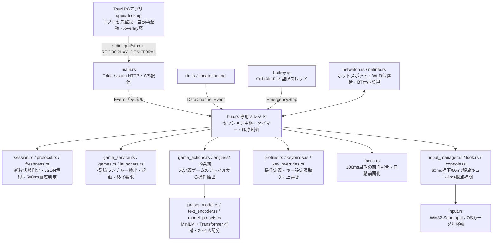
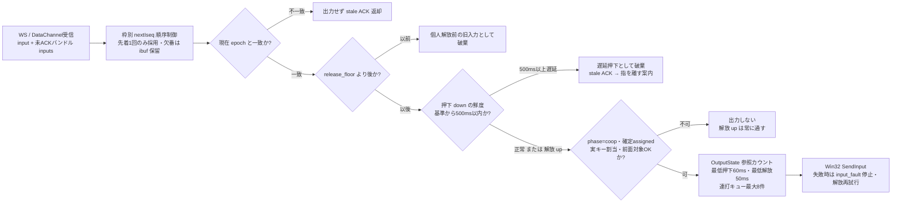
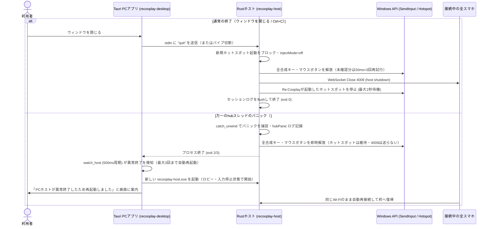
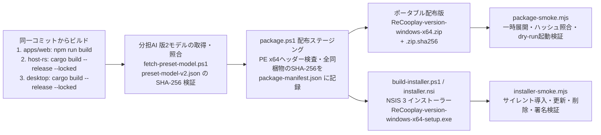

# Re:Cooplay ホスト仕様書

**バージョン**: 0.2.0　**更新日**: 2026-11-18

[総合仕様](README.md) ／ [利用手順](usage.md) ／ [動作確認](verification.md)

---

## 📑 目次

1. [概要](#概要)
2. [技術スタック](#技術スタック)
3. [実行環境・設定](#実行環境設定)
4. [ディレクトリ構造](#ディレクトリ構造)
5. [入力処理](#入力処理)
6. [セキュリティ・入力先制御](#セキュリティ入力先制御)
7. [ストップ処理](#ストップ処理)
8. [配布構成](#配布構成)
9. [開発・テスト](#開発テスト)
10. [デバッグ・監視](#デバッグ監視)
11. [トラブルシューティング](#トラブルシューティング)
12. [関連ドキュメント](#関連ドキュメント)
13. [実装例集](#実装例集)

---

## 概要

Rust製PCホスト（`apps/host-rs`、`recooplay-host.exe`）は、スマートフォンの接続認可・セッション状態管理・ゲームと操作定義の自動検出・独自AIによる2〜4人分担推論・リアルタイム入力統合を担うバックエンドサーバーです。

HTTP / WebSocket（Tokio＋axum）および WebRTC DataChannel（`libdatachannel`）の非同期コールバックから届くすべてのイベントを**1本の専用 `hub` スレッド**へ集約し、ロック競合や非同期ランタイムのスケジューリング揺らぎを排除したうえで、4ms周期の視点補間と最低押下時間保証を経て Win32 `SendInput` へ出力します。

---

## 技術スタック

### コアフレームワーク・クレート（`apps/host-rs/Cargo.toml`）

| クレート | バージョン・特徴 | 用途 |
|:--|:--|:--|
| **Rust** | edition 2021（MSVC x64, LTO `thin`） | ホスト（`recooplay-host`）およびTauriデスクトップアプリ（`recooplay-desktop`） |
| **tokio** | `1`（multi-thread, net, sync, time, signal, fs） | HTTP・WebSocketサーバーの非同期I/Oと終了シグナル監視 |
| **axum** | `0.8`（`ws` feature） | 静的画面配信、REST API（`/api/info`, `/api/hotspot`, `/api/game-image`）、WebSocket受付 |
| **datachannel** | `0.16`（`vendored`） | `libdatachannel`＋OpenSSL静的リンクによるWebRTC DataChannel通信 |
| **windows** | `0.62` | Win32 `SendInput`、ウィンドウ列挙・前面化・終了要求、グローバルホットキー、タイマー分解能 `timeBeginPeriod(1)`、WinRT モバイルホットスポット制御、Wi-Fi低遅延モード、Bluetooth音声出力検出、レジストリ読取り |
| **tokenizers** | `0.22`（純Rust `fancy-regex`） | 分担AI版2（多言語MiniLM）のサブワードトークナイザー |
| **flate2** | `1`（純Rust `rust_backend`） | ゲームエンジン解析（CryEngine pak/zip、Bethesda BA2等）のzlib/deflate展開 |
| **qrcode** | `0.14`（`svg` feature） | 参加URLおよびWi-Fi接続（`WIFI:T:WPA;...`）QRコードのオフラインSVG生成 |
| **if-addrs** | `0.13` | ローカルネットワークインターフェースとホットスポット（`192.168.137.x`）のIPv4列挙 |
| **getrandom** | `0.3` | 128bit再接続トークンおよび一時Wi-Fi（SSID・パスフレーズ）のOS暗号論的乱数生成 |
| **serde_json / chrono** | `1` / `0.4` | JSONメッセージ・操作定義・JSONLセッションログの直列化とタイムスタンプ付与 |

すべての依存バージョンは `Cargo.lock` で固定し、CIおよび配布ビルドでは `--locked` を強制します。

---

## 実行環境・設定

### 1. 環境変数と `config.json`

PCアプリ（`recooplay-desktop.exe`）は起動時に `RECOOPLAY_STDIN_CONTROL=1` および `RECOOPLAY_DESKTOP=1` を付与して同梱の `recooplay-host.exe` を子プロセスとして起動します。

| 設定・環境変数 | 既定値 | 意味・動作 |
|:--|:--|:--|
| `PORT` / `config.json` の `port` | `8080` | HTTP・WebSocketの待ち受けポート |
| `config.json` の `injectMode` | `"on"` | `"on"`（対象ゲーム前面時のみ実注入）／ `"off"`（注入停止）／ `"test"`（疑似ゲーム `/game` フォーカス時のみ注入） |
| `config.json` の `autoResume` / `settingsVersion` | `false` / `2` | 通信切断による一時停止からの15秒以内自動復帰（2026-11-10 Q40で初期OFF。旧版の設定ファイルは起動時に一度だけOFFへ安全移行） |
| `config.json` の `lookSmoothMinMs` / `MaxMs` | `30.0` / `120.0` | 視点補間の最小・最大時定数（ms） |
| `config.json` の `target` | Minecraft条件 | `processes`・`titleContains` によるベース対象ウィンドウ条件（検出ゲーム選択時はそのインストール先フォルダで自動照合） |
| `config.json` の `minecraftOptions` / `RECOOPLAY_MINECRAFT_OPTIONS` | `%APPDATA%\.minecraft\options.txt` | Minecraftのキー設定ファイルの場所の上書き |
| `RECOOPLAY_ROOT` | 自動探索 | `apps/web/dist/phone/index.html` を目印にリポジトリまたは配布ルートを特定 |
| `RECOOPLAY_PROFILES_DIR` | `apps/game-profiles` | ゲーム操作定義JSONフォルダの上書き |
| `RECOOPLAY_PRESETS` | `"model"`（既定） | `"rule"` を指定すると分担AIを使わず定型ルールを既定にする（#474） |
| `RECOOPLAY_DRY_RUN=1` | 未設定 | OSへの `SendInput`・実ゲーム起動・ウィンドウ操作・実ホットスポット操作を行わないシミュレーション検証モード |
| `RECOOPLAY_NO_CONFIG=1` | 未設定 | ローカルの `config.json` を読み書きしない（自動試験の再現性確保用） |
| `RECOOPLAY_STDIN_CONTROL=1` | PCアプリ起動時 `"1"` | 標準入力からの `quit` / `stop` 受付と、親プロセス異常終了（stdin EOF）時の即時全キー解放・終了を有効化 |
| `RECOOPLAY_DESKTOP=1` | PCアプリ起動時 `"1"` | Tauriデスクトップアプリからの起動を示し、前面プロセス名（`recooplay-desktop.exe`）によるPCアプリ復帰検知や `OPEN_APP`・枠外OSカーソル引き継ぎを有効化 |

### 2. ユーザーデータ保存先（`%LOCALAPPDATA%\Re-Cooplay\`）

インストール先や配布フォルダを汚さず、アップデート時も設定を引き継げるよう、ユーザー固有の学習・カスタマイズデータは `%LOCALAPPDATA%\Re-Cooplay\` にJSONで保存します。

- `manual-games.json`：PCのファイル選択から手動登録したゲーム一覧（#49・#56）
- `key-overrides.json`：PC画面の「操作設定」でゲームごとに変更したキー割当（#50・#53）
- `model-presets.json`：分担AIが推論してキャッシュしたゲーム別・2〜4人別の分担案（#431）
- `detected-profiles.json`：操作定義のないゲームのファイルから自動抽出した仮の操作定義と設定ファイルの更新日時（#431・#524）

---

## ディレクトリ構造



### モジュール一覧（`apps/host-rs/src/`）

| カテゴリ | モジュール | 責務 |
|:--|:--|:--|
| **受付・設定** | `main.rs`, `config.rs`, `protocol_version.rs` | HTTP/WebSocket配信、PC専用画面のアクセス拒否、Origin検査、`config.json` 読込・移行 |
| **セッション中枢** | `hub.rs`, `session.rs`, `protocol.rs`, `freshness.rs` | 専用スレッドイベントループ、状態遷移・開始可否の純粋判定、受信JSONデコード、遅延押下（500ms）の鮮度判定 |
| **高速通信・無線** | `rtc.rs`, `netinfo.rs`, `netwatch.rs` | `libdatachannel` Peer/DataChannel管理、QR生成、一時モバイルホットスポット生成・ローテーション・停止、Wi-Fiストリーミングモード、Bluetooth音声検出 |
| **入力キュー・注入** | `input_manager.rs`, `look.rs`, `controls.rs`, `input.rs` | 出力ごとの保持者集合・最低押下60ms/解放50msキュー、4ms周期の視点指数平滑補間、スキャンコード定義、Win32 `SendInput` |
| **前面制御・緊急停止** | `focus.rs`, `hotkey.rs` | 対象ゲームウィンドウの照合（プロセス名・タイトル・インストール先パス）、自動前面化、`WM_CLOSE` による安全終了、`Ctrl+Alt+F12` 緊急停止 |
| **ゲーム検出・起動** | `game_service.rs`, `games.rs`, `launchers.rs` | Steam・Epic・GOG・Ubisoft・EA・Battle.net・Xbox・Steamショートカット・Minecraft公式ランチャー・手動登録ゲームの検出と起動監視 |
| **操作定義・キー設定** | `profiles.rs`, `keybinds.rs`, `key_overrides.rs` | `apps/game-profiles/*.json` 検証、定型ルール分担、各ゲーム設定ファイルのキー読取り、ユーザーのキー上書き保存 |
| **未定義ゲーム操作抽出** | `game_actions.rs`, `engines/`（19ファイル） | Unity / UE4・5 / Godot / RPGツクール / WOLF / Source 1・2 / Creation / REDengine / CryEngine / GIANTS / Prism3D / Factorio / Zomboid 等のファイルから操作一覧を抽出 |
| **分担AI推論** | `preset_model.rs`, `text_encoder.rs`, `model_presets.rs` | 多言語MiniLM（8bit量子化）＋2層Transformer encoderのRust推論、凝集型クラスタリングによる2〜4人分担の組み立てとキャッシュ |
| **計測・診断** | `latency.rs`, `runtime_measure.rs`, `input_trace.rs`, `hub_measurement.rs` | エンドツーエンド遅延計測（`latency-measure` feature）、hub処理時間・WS送信待ち計測、入力トレース記録 |

---

## 入力処理



### 1. 重複排除・鮮度判定・個人解放境界

- **2経路の先着採用（`nextIseq` + `ibuf`）**：スマホはボタンの押下・解放を同じ `iseq` で WebSocket と DataChannel `fast`（および直近500msの未ACKバンドル `inputs`）へ送ります。ホストは枠ごとの `nextIseq` により先着した1回だけを処理し、後着の重複を捨てます。番号が飛んだ場合は `ibuf`（最大200件）で前番の到着を待つため、押下と解放の順序が逆転することはありません。
- **遅延押下の自動破棄（`freshness.rs`、#285）**：直近15〜30秒の `ping` / `ka` / `input` から端末とホストの時計差の基準（最小値）を更新し、押下（`down`）が基準から **500ms以上遅れて届いた場合** は実行せずに `ack`（`stale: true`）を返します。解放（`up`）は押しっぱなしを防ぐため遅延していても常に適用します。
- **端末単位の部分解放（`release_inputs`、#262）**：スマホ1台が回転・非表示・編集開始で `release_inputs`（`iseq`, `lseq`, `cx`, `cy` 付き）を送った場合、他の参加者の押下や全体の `epoch` を止めずに**その端末の押下と連打キューだけを解放**し、`release_floor = iseq` 以下の遅れて届く押下をすべて遮断します。

### 2. 複数人保持の参照管理と60ms/50ms出力キュー（`input_manager.rs`）

- 同じ物理キーやマウスボタンを複数人が同時に操作しうる場合でも、出力ごとに保持者の集合（`holders`）を管理し、最初の1人が押した時点で `down`、全員が離した時点で `up` を送ります。
- 無線のバースト到着で押下と解放が数ms間隔で連続してもゲーム側のポーリング（50ms周期）が取りこぼさないよう、通常時は**最低押下時間 60ms（`MIN_HOLD_MS`）・最低解放時間 50ms（`MIN_GAP_MS`）**を保証します。連打キューは最大8件（4往復分）で、超えた分は古い押下・解放のペアから破棄して遅延の蓄積を防ぎます。
- 一時停止・切断・フォーカス喪失・緊急停止などの**安全停止時は、最低押下時間を一切待たずに全出力を即時解放**し、保留キューを破棄します。

### 3. 4ms周期の適応型視点補間（`look.rs`）

- 視点担当のスマホから30Hzで届く累積移動量（`cx`, `cy`）の差分を未処理プールへ加算し、`timeBeginPeriod(1)` による **4ms周期（`LOOK_TICK`、250Hz）** のタイマーで指数平滑補間して相対マウス移動（`MOUSEEVENTF_MOVE`）を送出します。
- 平滑化の時定数 `tau` は、直近2秒間のパケット最大到着間隔の半分を **30ms〜120ms** にクランプして自動調整します。通信が安定している端末では30msで機敏に追従し、無線が揺らいだ端末では時定数を広げて視点のカクつきを抑えます。

---

## セキュリティ・入力先制御

### 1. 7系統ランチャー検出とゲームの起動・前面化・安全終了

ホストは起動時および「探し直す」（`refresh_games`）要求時に、バックグラウンドスレッドでPC内のレジストリとマニフェストを走査し、以下のゲームを自動検出します（ネットワーク通信は一切行いません）。

| 検出元（`source`） | 検出対象・起動方式 | 入力先ウィンドウ（`Target`）の照合基準 |
|:--|:--|:--|
| `minecraft`（独立枠） | Microsoft Store / Xbox版（AUMID `shell:AppsFolder\...`）および従来版 `Minecraft.exe`。公式ランチャーを開き、出現時に自動前面化（待機上限300秒） | `javaw.exe` / `java.exe` ＋ タイトル条件 |
| `steam` / `steam-shortcut` | Steamの `libraryfolders.vdf`・`appmanifest_*.acf`、および非Steam登録ゲームの `shortcuts.vdf`（待機上限90秒） | 検出したインストール先フォルダ（`install_dir`）配下の実行プロセス |
| `epic` | Epic Games Launcherの `Manifests/*.item`（待機上限90秒） | 検出した `InstallLocation` 配下の実行プロセス |
| `gog` / `ubisoft` / `ea` / `battlenet` / `xbox` | 各ランチャーのWindowsレジストリ、`product.db`、各ドライブの `XboxGames\*\MicrosoftGame.config`（#265、待機上限90秒） | 検出したインストール先フォルダ配下の実行プロセス |
| `registered`（手動登録） | PC上のネイティブファイル選択ダイアログで選んだ `.exe`（スマホから任意パスは受け取らない、待機上限90秒） | 選択した実行ファイルのフルパスおよび親フォルダ |

- **自動前面化（`focus.rs`）**：可視の本編ウィンドウを優先して特定し、最小化されている場合のみ復元したうえで、`AttachThreadInput` による一時的な入力スレッド結合と `BringWindowToTop`・`SetForegroundWindow` を用いて30ms間隔で最大7回（失敗時は1回再試行）前面化を確認します。実際の前面ウィンドウが対象と一致したときだけ成功と判定します。
- **PCアプリからのゲーム安全終了（`quit_game`、#547・#570）**：協力プレイ終了後に別のゲームへ切り替える際、PC画面の「ゲームを終了する」から対象ゲームのウィンドウへ `WM_CLOSE` を送って安全に閉じ、ゲーム選択画面へ戻せます。プロセス強制終了（kill）は行わず、保存確認ダイアログ等で閉じなかった場合は手動終了を案内します。

### 2. セッション単位の一時モバイルホットスポット制御（`netinfo.rs`、#415・#562・#563）

- PC画面で「ホットスポットをONにする」を押すと、WinRTの `NetworkOperatorTetheringSessionAccessPointConfiguration` を用いて、起動ごとにランダムな一時SSID（`ReCooplay-<12桁hex>`）とパスフレーズを生成してホットスポットを起動します（元のWindows設定を書き換えません）。
- 展示等で「接続中のスマホをすべてリセット」（`reset` + `rotateWifi: true`）を実行すると、全員を切断すると同時にホットスポットのSSIDとパスワードを新しい乱数へ自動で張り直し、前の参加者のスマホがバックグラウンドで再接続してしまうのを防ぎます。
- PCアプリ終了時には、Re:Cooplay自身が起動したホットスポットだけを自動でOFF（`stop_owned_hotspot`）にして後始末します。

### 3. 安全停止条件と出力失敗時のフェイルセーフ

| 契機 | ホストの動作 |
|:--|:--|
| **PAUSE ／ 参加者切断（4秒無受信）** | `paused` へ遷移、全参加者の保持出力・連打キュー・未処理視点を即時解放・破棄、`epoch` 更新 |
| **PCアプリ（`recooplay-desktop.exe`）への手動復帰** | `paused` へ遷移、通信切断の自動復帰タイマーを解除し、ホストの明示再開を待つ |
| **緊急停止（`Ctrl+Alt+F12` ／ `stdin: stop`）** | 全出力即時解放、`injectMode` を `off` に変更、`coop` 中なら `paused`（理由 `emergency stop`）へ遷移 |
| **SendInput の失敗（UIPI拒否等）** | 即座に `input_fault = true`・`injectMode = off` として新規入力を遮断し、未解放出力（`release_pending`）を50ms間隔で最大3回自動再送（#191） |
| **対象ゲームのフォーカス喪失（Alt+Tab等）** | 100ms周期の `FocusCheck` で検知し、全出力解放・視点破棄・`epoch` 更新・60秒ローテーション時計の一時凍結 |
| **60秒役割ローテーション到来** | `coop` を維持したまま全出力解放・未処理入力と視点を破棄・`epoch` 更新後に参加者の席順を1つシフト |

---

## ストップ処理



---

## 配布構成



- **ポータブルzip版（`scripts/windows/package.ps1`）**：
  - `recooplay-desktop.exe`、`recooplay-host.exe`、`apps/web/dist/`、`apps/game-profiles/`、`preset-model-v2/`（MiniLM量子化重み・語彙・ライセンス表示）、`config.example.json`、`allow-firewall.ps1`、`LICENSE`、`README.txt`、`package-manifest.json` を同梱します。
- **推奨インストーラー版（`scripts/windows/build-installer.ps1`、#219）**：
  - 管理者権限不要で `%LOCALAPPDATA%\Programs\ReCooplay` へ導入し、スタートメニューショートカットを作成します。
  - OS/CPUチェック（Windows 11 x64正式対応）と、WebView2およびVisual C++ v14 Redistributable（x64、14.40以上）の不足チェックを行い、不足時はユーザーの明示同意を得たうえでMicrosoft公式配布元から取得し、**Microsoft CorporationのAuthenticode署名を検証してから導入**します。

---

## 開発・テスト

```powershell
cargo build --release --locked --manifest-path apps/host-rs/Cargo.toml
cargo test --release --locked --manifest-path apps/host-rs/Cargo.toml
cargo test --release --locked --manifest-path apps/desktop/Cargo.toml
node scripts/sim/protocol-sim.mjs
node scripts/sim/shutdown-sim.mjs
node scripts/sim/input-probe-sim.mjs
```

---

## デバッグ・監視

PC本体の `/host`（診断画面）へ枠の状態・注入イベント・100msごとの視点移動集計・ログをリアルタイム配信し、`/game`（疑似ゲーム画面）ではOSが実際に受け取った入力イベントとホストの注入記録を1件ずつ照合します。

プライバシー保護（#22）のため、セッションログ（`logs/session-*.jsonl`）にはクライアントのIPアドレス、生のUser-Agent文字列、`clientId`、再接続 `token`、Wi-FiのSSID・パスフレーズ、PC上のゲーム名やユーザー名を含むファイルパスを一切記録せず、枠名（`P1`〜`P4`）と端末種別（`iOS` / `Android` / `Windows` / `other`）のみを記録します。

---

## トラブルシューティング

| 症状 | 確認箇所 |
|:--|:--|
| ホストが `0xC0000135` で終了する | Microsoft Visual C++ v14 Redistributable（x64）が導入されているか、zipがすべて展開されているか確認 |
| ポート競合で起動しない | 8080番ポートを既存のホストプロセスが使用していないか確認（`config.json` の `port` または `PORT` で変更可） |
| すべての入力が拒否される | 緊急停止（`Ctrl+Alt+F12`）や `input_fault` で `injectMode` が `off` になっていないか、対象ゲームが前面か確認 |

[導入・対処（困ったとき）](troubleshooting.md) ／ [Windows構築手順](develop/handoff/SETUP_WINDOWS.md)

---

## 関連ドキュメント

[総合仕様](README.md) ／ [通信仕様](protocol-specification.md) ／ [フロントエンド仕様](frontend-specification.md) ／ [ゲーム操作定義仕様](game-profile-specification.md) ／ [分担AI仕様](preset-model-specification.md) ／ [配布・インストーラー手順](../apps/desktop/README.md)

---

## 実装例集

### 状態変更時の全出力解放・ローテーション時計管理・epoch更新（`apps/host-rs/src/hub.rs`）

```rust
fn set_phase(&mut self, phase: Phase, reason: &str) {
    let Some(change) = session::phase_change(self.game.phase, phase) else {
        return;
    };
    let now = now_ms();
    if self.game.phase == Phase::Coop && self.rotation_at != 0 {
        self.rotation_left = self.rotation_at.saturating_sub(now).max(1);
    }
    self.release_outputs(None);
    self.reset_look();
    if phase == Phase::Coop && self.input_fault {
        self.stop_input_failure();
        return;
    }
    self.game.phase = phase;
    if phase == Phase::Coop {
        self.remote_outside = false;
    }
    if change.clear_lineup {
        self.assigned.clear();
        self.participants.clear();
        self.lineup = None;
    }
    self.game.reason = Some(reason.to_string());
    self.advance_epoch();
    if phase == Phase::Lobby {
        self.rotation_secs = 0;
    }
    self.sync_rotation_clock(now);
    self.log("phase", json!({ "phase": phase.name(), "reason": reason, "epoch": self.game.epoch }));
    self.update_low_latency();
    self.push_game();
}
```

状態を切り替える前に必ず全出力と視点を解放し、`epoch` を進めて旧状態の遅延パケットを無効化してから全端末へ新しい `game` スナップショットを配信します。

実装：[HTTP・WS受付](../apps/host-rs/src/main.rs) ／ [hub中枢](../apps/host-rs/src/hub.rs) ／ [純粋セッション判定](../apps/host-rs/src/session.rs) ／ [SendInput注入](../apps/host-rs/src/input.rs) ／ [Tauriアプリ](../apps/desktop/src/main.rs) ／ [配布梱包](../scripts/windows/package.ps1)
