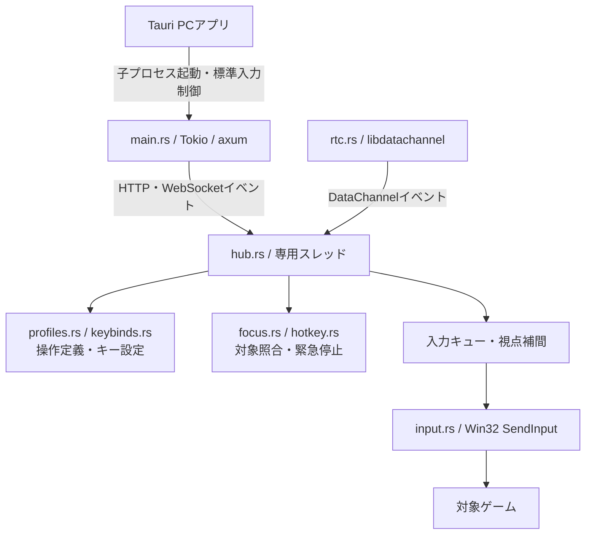
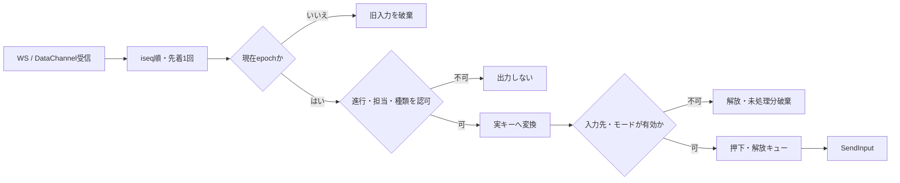
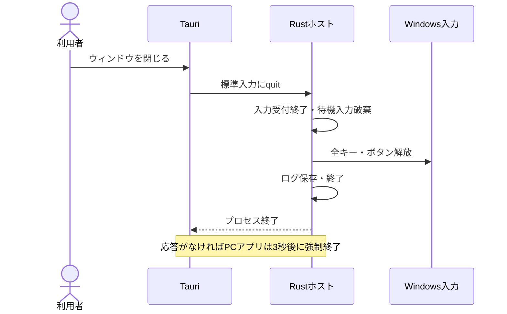

# Re:Cooplay ホスト仕様書

**バージョン**: 0.1.0　**更新日**: 2026-10-26

[総合仕様](README.md) ／ [利用手順](usage.md) ／ [動作確認](verification.md)

---

## 📑 目次

1. [概要](#概要)
2. [技術スタック](#技術スタック)
3. [実行環境・設定](#実行環境設定)
4. [ディレクトリ構造](#ディレクトリ構造)
5. [入力処理](#入力処理)
6. [セキュリティ・入力先制御](#セキュリティ入力先制御)
7. [ストップ処理](#ストップ処理)
8. [配布構成](#配布構成)
9. [開発・テスト](#開発テスト)
10. [デバッグ・監視](#デバッグ監視)
11. [トラブルシューティング](#トラブルシューティング)
12. [関連ドキュメント](#関連ドキュメント)
13. [実装例集](#実装例集)

---

## 概要

Rustホストが参加者・役割・進行を管理し、許可された操作をWindowsのキーボード・マウス入力へ変換します。

ゲーム別・汎用の操作定義とキー設定から2〜4人の担当を決め、スマホからの認証済みイベントを1本のhubへ集約します。ゲーム本体を変更せず、状態変更とOS出力の順序を管理します。

---

## 技術スタック

### コアフレームワーク

| 技術 | Cargo指定 | 用途 |
|:--|:--|:--|
| Rust | edition 2021 | ホストとPCアプリ |
| Tokio | 1 | 非同期ランタイム |
| axum | 0.8 | HTTP・WebSocket |
| datachannel | 0.16、vendored | libdatachannel、OpenSSLの同梱ビルド |
| windows | 0.62 | Win32・ネットワーク等のWindows API |
| serde_json | 1 | 設定・メッセージ・操作定義 |
| getrandom | 0.3 | 再接続tokenの乱数 |

依存の解決版はCargo.lockで固定します。

---

## 実行環境・設定

PCアプリは同梱の`recooplay-host.exe`を起動し、`/app`を開きます。ポート競合や子プロセスの異常終了は画面に案内します。

| 設定 | 意味 |
|:--|:--|
| `PORT` / `config.json`の`port` | HTTP・WebSocketポート。既定8080 |
| `injectMode` | `on / off / test`。既定`on` |
| `target` | 対象プロセス・タイトルの照合条件 |
| `minecraftOptions` | Minecraftの設定ファイル |
| `RECOOPLAY_PROFILES_DIR` | 操作定義フォルダの上書き |
| `RECOOPLAY_DRY_RUN=1` | OS入力を送らない検証モード |
| `RECOOPLAY_NO_CONFIG=1` | ローカル設定を読まない |

`on`は無条件の許可ではありません。進行・担当・入力先・ドライバー・緊急停止の条件を確認して送ります。`test`は疑似ゲーム画面への照合用です。

---

## ディレクトリ構造



HTTPやWebSocketハンドラーからOS入力を直接送りません。hubの専用スレッドで状態を変更し、libdatachannelのコールバックもイベントとして渡します。Tauriは画面とプロセスの枠を提供し、入力統合・通信・注入はホスト側で行います。

| モジュール | 責務 |
|:--|:--|
| `main.rs` | 静的配信、HTTP・WebSocket受付、終了要求 |
| `hub.rs` | 認可、進行、割当、入力順序、出力キュー、心拍 |
| `rtc.rs` | WebRTC接続、候補交換、DataChannel |
| `controls.rs / input.rs` | 出力対応、スキャンコード、マウス入力 |
| `focus.rs / hotkey.rs` | 対象ウィンドウ、前面化、緊急停止 |
| `games.rs / profiles.rs / keybinds.rs` | ゲーム検出、操作定義、実キー解決 |

### ファイル構造

```text
apps/host-rs/src/
├── main.rs        HTTP・WebSocket受付
├── hub.rs         状態・認可・入力統合
├── rtc.rs         DataChannel
├── controls.rs    出力対応
├── input.rs       SendInput
├── focus.rs       対象確認・前面化
├── hotkey.rs      緊急停止
├── games.rs       ゲーム検出
├── profiles.rs    操作定義・分担
└── keybinds.rs    キー設定読取り
```

---

## 入力処理



同じ出力を複数人が保持する場合は参照を管理し、全員が離した時点で解放します。通常入力は最低押下60ms・最低解放50msを維持します。キューは最大8件で、あふれた分は古い押下・解放の組から整理します。安全停止は最低時間を待たず全員分を解放します。

視点は30Hzの累積値から差分を受け取り、4ms周期で補間します。時定数は直近2秒の最大到着間隔の半分を30〜120msに制限した値です。epoch変更で累積値・未処理分を捨てます。キーはスキャンコード、マウスは相対移動・左右ボタン・ホイールで送信します。タイマーには`timeBeginPeriod(1)`を使います。

---

## セキュリティ・入力先制御

Minecraftはプロセス・タイトルで、検出したゲームはインストール先との照合等で入力先を絞ります。対象を確認できない場合は許可しません。

### ゲーム起動と前面化

起動要求は選択中のゲームと決定済みの分担に対してだけ受け付け、起動先はPCで検出・登録した情報から解決します。既存の対象ウィンドウがあれば再起動せず前面化します。

| 対象 | 起動方法 | ウィンドウ出現の待機上限 |
|:--|:--|:--|
| Steam・Epic Games | 検出情報からランチャーへ要求 | 90秒 |
| 手動登録 | PCで選んだ実行ファイルを引数なしで起動 | 90秒 |
| Minecraft | 検出した公式ランチャーを開く。ログイン・更新・「プレイ」は利用者が操作 | 300秒 |

Microsoft Store・Xbox版のMinecraftランチャーはアプリID、従来版は実行ファイルで開きます。ランチャー未検出時は手動起動が必要です。起動要求の成功だけで共同操作を開始せず、ゲームの準備後にReadyの条件を確認します。

前面化は可視の対象ウィンドウを探し、補助・ツールウィンドウより本体を優先します。最小化時だけ復元し、前面スレッドへの一時的な`AttachThreadInput`と`BringWindowToTop`・`SetForegroundWindow`を使います。30ms間隔で最大7回確認し、失敗時に1回だけ再試行します。実際の前面ウィンドウが対象に一致した場合だけ成功とします。Windowsが切替を許可しない場合は手動切替を案内します。

起動・前面化の実装と、実ウィンドウでの確認範囲は[動作確認](verification.md)で区別しています。

### 停止条件

| 契機 | 動作 |
|:--|:--|
| PAUSE・参加者切断 | paused、全員分の出力・待機入力・視点を解放・破棄 |
| PCアプリへ手動復帰 | paused、自動復帰を取り消し、明示再開を待つ |
| Ctrl+Alt+F12・デスクトップのstop | 全解放、入力OFF、共同操作中ならpaused |
| ゲーム変更・リセット・終了 | 全解放、旧epochの入力を無効化 |
| 対象フォーカス喪失 | 入力停止・全解放。進行状態とは別に管理 |

緊急停止後はPCで「入力を再開する」を押し、条件が整ってからP1が再開します。Ready・再開の前面化に失敗すると停止を保ちます。自動復帰条件は[通信仕様](protocol-specification.md)に従います。

### アクセス制御

PC管理画面と管理用接続はループバックだけを許可します。スマホはサーバーが割り当てた枠・担当で操作し、任意の実行パスやOSキーコードを送れません。手動ゲーム登録はPC上のファイル選択で行います。

---

## ストップ処理



標準入力制御が有効なホストは、親プロセスの終了で標準入力が閉じた場合も停止します。強制終了や実際のホットキーを含む実機での受入範囲は[動作確認](verification.md)を参照してください。

---

## 配布構成

Windows x64用zipにはPCアプリ、ホスト、静的画面、操作定義、設定例、許可スクリプトを同梱します。ゲーム本体は含みません。WebView2とVisual C++ v14 Redistributable（x64）が必要です。

`package-manifest.json`は版・ソースcommit・dirty状態と同梱物のSHA-256を記録します。zipの隣にも照合値を出力します。これは実行ファイルの署名ではありません。

---

## 開発・テスト

```powershell
cargo build --release --locked --manifest-path apps/host-rs/Cargo.toml
cargo test --release --locked --manifest-path apps/host-rs/Cargo.toml
node scripts/sim/protocol-sim.mjs
node scripts/sim/shutdown-sim.mjs
```

通信シミュレーションはホストをdry-runで起動します。実ゲームへの入力到達は[実機の確認範囲](verification.md)で区別します。

---

## デバッグ・監視

PC本体の`/host`へ状態・注入イベント・視点集計・ログを配信します。診断用の`/game`はOSが受け取った入力と注入通知を照合します。再接続token、Wi-Fiパスフレーズ、ゲームのインストール先を公開ログへ転記しません。

---

## トラブルシューティング

| 症状 | 確認箇所 |
|:--|:--|
| ホストが起動しない | exeの配置、Visual C++ランタイム、ポート競合 |
| 全入力が拒否される | 緊急停止登録、入力モード、対象ウィンドウ |
| 終了できない | 子プロセスの終了要求、ログ、標準入力制御 |

[導入・対処](troubleshooting.md) ／ [Windows構築](develop/handoff/SETUP_WINDOWS.md)

---

## 関連ドキュメント

[通信仕様](protocol-specification.md) ／ [画面仕様](frontend-specification.md) ／ [配布手順](../apps/desktop/README.md)

---

## 実装例集

### 状態変更時の入力解放

```rust
fn set_phase(&mut self, phase: Phase, reason: &str) {
        if self.game.phase == phase {
            return;
        }
        self.release_outputs(None);
        self.reset_look();
        self.game.phase = phase;
        if phase == Phase::Lobby { self.assigned.clear(); self.participants.clear(); self.lineup = None; }
        self.game.reason = Some(reason.to_string());
        self.advance_epoch();
        self.log("phase", json!({ "phase": phase.name(), "reason": reason, "epoch": self.game.epoch }));
        self.update_low_latency();
        self.push_game();
    }
```

状態を切り替える前に全出力と視点を解放し、変更後のepochと状態を通知します。

実装：[hub](../apps/host-rs/src/hub.rs) ／ [入力](../apps/host-rs/src/input.rs) ／ [PCアプリ](../apps/desktop/src/main.rs) ／ [梱包](../scripts/windows/package.ps1)
