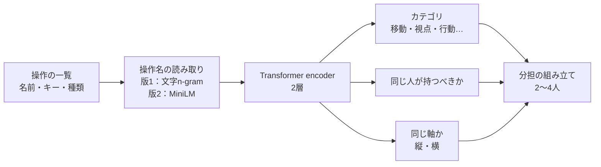

# Re:Cooplay 分担AI仕様書

**バージョン**: 0.1.0　**更新日**: 2026-11-15

[総合仕様](README.md) ／ [ゲーム操作定義](game-profile-specification.md) ／ [動作確認](verification.md)

---

## 📑 目次

1. [概要](#概要)
2. [技術スタック](#技術スタック)
3. [モデルの構成](#モデルの構成)
4. [学習](#学習)
5. [推論と分担の組み立て](#推論と分担の組み立て)
6. [評価](#評価)
7. [定義のないゲームの読み取り](#定義のないゲームの読み取り)
8. [配布と設定](#配布と設定)
9. [適用範囲](#適用範囲)
10. [関連ドキュメント](#関連ドキュメント)

---

## 概要

ゲームの操作の一覧（操作名・キー・種類）を読み、2〜4人の分担を作る独自のAIです。PC画面の分担では「独自AI」と表示し、従来の「定型ルール」と切り替えられます。既定は独自AIで、検証済みのプリセットがあるゲーム（Minecraftなど）の分担は変えません。

操作名とキーを読む小さな **Transformer encoder** を、実在のゲームの操作定義で**学習させ**、推論はRustホストの中だけで行います。Pythonやネットへの通信は使いません。

---

## 技術スタック

| 構成 | 技術・実装 |
|:--|:--|
| 学習 | Python（PyTorch）、`scripts/preset-model/` |
| 推論 | Rust、`apps/host-rs/src/preset_model.rs` |
| 操作名の読み取り（版2） | 多言語MiniLM（`paraphrase-multilingual-MiniLM-L12-v2`）を小型化、Rustの `tokenizers` クレート、`apps/host-rs/src/text_encoder.rs` |
| 一致試験 | Pythonの出力（`parity.json`）とRustの推論をCIで照合 |

---

## モデルの構成

| 項目 | 内容 |
|:--|:--|
| 入力 | 操作ごとの名前（`label`・`id`・設定名）、初期キー、種類。グループ名は使わない |
| 操作名の読み取り | 版1：文字n-gram（2048個に振り分けて平均）。版2：多言語MiniLM（語彙を約4.4万語に絞り、重みを8ビット化、約40MB） |
| 本体 | post-LNのTransformer encoder 2層（隠れ32次元・4ヘッド、版2は64次元）。位置埋め込みを使わず、操作の**集合**として読む |
| 出力 | ①カテゴリ（移動・視点・行動・持ち物・メニュー・会話）の確率、②2つの操作を同じ人が持つべき確率、③同じまとまりの中で同じ軸（方向の縦と横）にある確率 |

---

## 学習

| 項目 | 内容 |
|:--|:--|
| データ | 実在のゲーム14本・578操作（このPCのゲームのファイルから読んだ操作名とキー、リポジトリの手作りの定義）と、各操作がどの概念（前進・ジャンプ・撃つ・武器1・メニュー…）かの注釈。知らない操作名への当てはまりを補うため、記憶から書いた実在のゲームの操作一覧も加えた（誤りが混ざる可能性あり、使わない学習も選べる） |
| 自己教師ありの課題 | 一部の操作のキーや名前を伏せ、周りの操作から当てる（BERTの穴埋めと同じ考え方） |
| 水増し | データが少ないため、操作の一部を落とし、ラベル・設定名・キーを時々消して学習する |
| 使わないもの | ジャンルの型から作った仮の定義（488本）は学習に使わず、評価だけに使う |

学習データはリポジトリに置いていません（2026-11-13）。手順は `scripts/preset-model/README.md` を参照してください。

---

## 推論と分担の組み立て

推論の結果から、決まった手順で2〜4人に配ります。配る対象は、定型ルールと同じく役割案がP1〜P3の操作だけです（モデルは送ってよい操作を増やしません）。

1. 同じ人が持つべき確率が0.5を超える操作をまとめる
2. まとまりが人数より多ければ、近さとカテゴリの相性（例：狙う＋撃つ）から負担の罰則を引いた点数が最も高い組を統合する
3. 少なければ、最も重いまとまりを、中で最も遠い2つの操作を境に分ける（方向は縦横の軸で分ける）
4. 負担が平均の1.5倍を超える人がいれば組み替える
5. 移動＞視点＞行動＞持ち物の順にP1、P2…へ並べる

人の評価を受けて、持ち物・メニュー・会話**だけ**の担当（することがない担当）を作らない、方向の移動をP1にする、同じグループのカーソルとクリックを同じ人に持たせる、を加えました。

計算はホストの裏のスレッドで行い、入力・通信を待たせません。ゲーム一覧の読み込み時に、プリセットのないゲームだけ1回作って保存し（`%LOCALAPPDATA%\Re-Cooplay\model-presets.json`）、協力プレイ中は作りません。14操作の推論は約80msです。

---

## 評価

| 評価 | 結果 |
|:--|:--|
| 人による比較（19タイトル・43件、2026-11-13） | 独自AIが良い30件、定型ルールが良い11件、どちらもダメ2件 |
| 全定義502本の2〜4人 | 重複・漏れ・偏りがないことを自動試験 |
| PythonとRustの一致 | 文字列・ベクトル（cos > 0.9999）・カテゴリ・同じ人・軸の出力の一致をCIで照合 |

実機での独自AIの分担の受け入れ（操作定義のないゲームを2〜4人で遊ぶ）は未実施です（#432）。

---

## 定義のないゲームの読み取り

検証済みの定義がないゲームは、インストール先のファイルから操作を読み、分担AIで分類して仮の定義（未検証）を作ります。エンジンごとの読み取り（RPGツクール・Unity・Unreal Engine・Godot・Source など）は[ゲーム操作定義仕様書](game-profile-specification.md#定義のないゲームのファイルからの読み取り)を参照してください。読めないゲームは汎用の割当を使います。

---

## 配布と設定

| 項目 | 内容 |
|:--|:--|
| 版1の重み | 約340KB。ホストのexeに埋め込み |
| 版2の重み | 約57MB。Hugging Face から版を固定して取得し、SHA-256を照合して配布物に同梱（`preset-model-v2\`）。ライセンスは CC BY-NC-ND 4.0（ソースコードのMITとは別） |
| 既定の分担 | 独自AI。`RECOOPLAY_PRESETS=rule` で定型ルールに戻す。重みを読めないときも定型ルール |
| 読み込み | 版2の重みは起動時に裏のスレッドで読み、ホストの待ち受けの開始を遅らせない |

---

## 適用範囲

分担は定義された操作の相対的な負担から作り、実プレイ中の操作回数を測ったものではありません。各人の負担を均等にすることは保証しません。独自AIが作った分担は未検証として表示します。

実装：[推論・組み立て](../apps/host-rs/src/preset_model.rs) ／ [操作名の読み取り](../apps/host-rs/src/text_encoder.rs) ／ [学習](../scripts/preset-model/README.md)

---

## 関連ドキュメント

[ゲーム操作定義](game-profile-specification.md) ／ [ホスト](host-specification.md) ／ [技術選定の理由](technology-selection.md) ／ [動作確認](verification.md)
