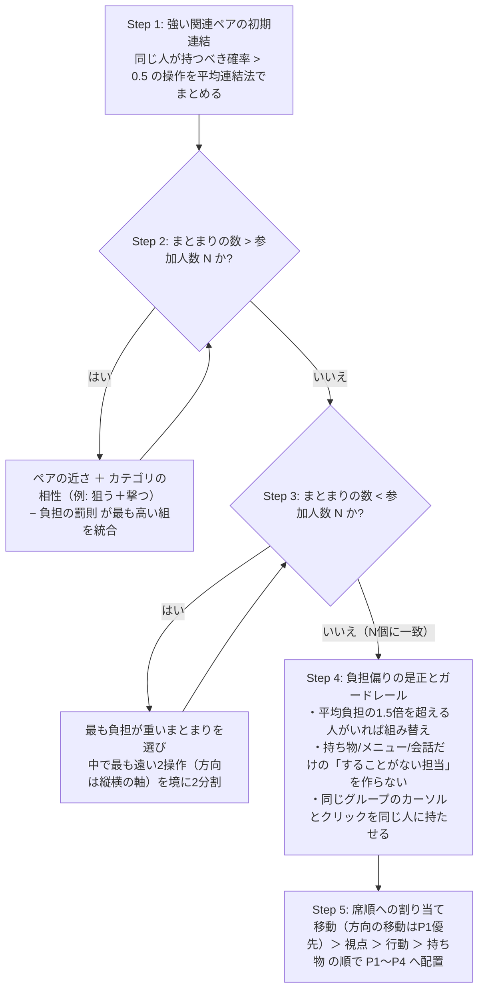

# Re:Cooplay 分担AI仕様書

**バージョン**: 0.2.0　**更新日**: 2026-11-20

[総合仕様](README.md) ／ [ゲーム操作定義](game-profile-specification.md) ／ [動作確認](verification.md)

---

## 📑 目次

1. [概要](#概要)
2. [技術スタック](#技術スタック)
3. [モデルの構成](#モデルの構成)
4. [学習](#学習)
5. [推論と分担の組み立て](#推論と分担の組み立て)
6. [評価](#評価)
7. [定義のないゲームの読み取り](#定義のないゲームの読み取り)
8. [配布と設定](#配布と設定)
9. [適用範囲](#適用範囲)
10. [関連ドキュメント](#関連ドキュメント)

---

## 概要

**Re:Cooplay Preset Model v2**（[YOSHI0209/recooplay-preset-model-v2](https://huggingface.co/YOSHI0209/recooplay-preset-model-v2#recooplay-preset-model-v2)）は、1つのPCゲームを2〜4人で分担して遊ぶための「人数別の分担（プリセット）」を作る独自AIモデルです。ゲームの操作一覧（操作名・初期キー・入力種類）を一度に読み、どの操作を誰が持つと遊びやすいかを判断します。

- **初めて見る操作名・日英両言語に強い**：操作名は、多言語の事前学習済みモデル（[`sentence-transformers/paraphrase-multilingual-MiniLM-L12-v2`](https://huggingface.co/sentence-transformers/paraphrase-multilingual-MiniLM-L12-v2)）の語彙を絞り8ビット量子化した小型エンコーダで読み取ります。操作定義の日本語名だけでなく、`IA_Jump`、`+attack`、`MoveForward` のようなゲームのファイル内にある説明のない英語識別子も事前学習で得た言葉の知識で読み取ります。
- **分担に必要な3つの判断を同時出力**：後段の2層Transformerエンコーダ（104,136パラメータ）により、①操作ごとの**カテゴリ**（6種類）、②2つの操作を**同じ人が持つべきか**、③同じまとまりの中で**同じ軸か**（方向の縦と横）を同時に推定します。
- **オフライン・追加ランタイム不要で高速推論**：PCホスト（Rust）が独自バイナリ形式（`RCTE`・`RCPM`）を直接読み込んで推論するため、外部への通信やPython等の追加ランタイムは不要です。操作の定義がまだないゲームを見つけたときにPCの中だけで裏で1回推論して保存し、**14操作のゲームで約80ミリ秒**（8スレッドのPC）で完了します。
- **「独自AI」と「定型ルール」の切り替え**：PC画面の分担確認では既定で「独自AI」が選択され、従来の「定型ルール」とのワンクリック切り替えや再生成も可能です（Minecraftなど検証済みプリセットがあるゲームの標準分担はそのまま維持します）。

---

## 技術スタック

| 構成要素 | 技術・実装モジュール | 役割 |
|:--|:--|:--|
| **学習パイプライン** | Python（PyTorch）、`scripts/preset-model/` | 分担判断用Transformerの教師あり（カテゴリ・同じ人・軸）＋自己教師あり（伏せたキーの予測）学習、量子化・書き出し |
| **操作名の読み取り（`text-encoder.bin`）** | `sentence-transformers/paraphrase-multilingual-MiniLM-L12-v2`（語彙削減・行ごと8ビット量子化、形式 `RCTE`）、Rust `tokenizers`、`apps/host-rs/src/text_encoder.rs` | 日本語名およびゲーム内の英語識別子（`label`, `id`, `bind`）から384次元の意味ベクトルを算出 |
| **分担の判断・組み立て（`preset-model.bin`）** | 2層Transformerエンコーダ（形式 `RCPM`）、Rustネイティブ実装、`apps/host-rs/src/preset_model.rs` | 3つの出力（カテゴリ・同じ人・同じ軸）の推論と、決定論的クラスタリングによる2〜4人への役割配分 |
| **非同期キャッシュ管理** | Rust、`apps/host-rs/src/model_presets.rs`・`hub.rs` | バックグラウンドスレッドでの非ブロッキング推論と `%LOCALAPPDATA%\Re-Cooplay\model-presets.json` への保存 |
| **公開モデルリポジトリ** | Hugging Face（[YOSHI0209/recooplay-preset-model-v2](https://huggingface.co/YOSHI0209/recooplay-preset-model-v2#recooplay-preset-model-v2)） | SHA-256固定（`scripts/windows/preset-model-v2.json`）による配布物への同梱と再現性検証 |
| **Python / Rust 一致検証** | `parity.json` ＋ `cargo test` | 操作名の文字列・384次元ベクトル（$\cos > 0.9999$）・分担判断の出力がPythonと一致することをCIで照合 |

---

## モデルの構成

モデルは**「操作名の読み取り（事前学習済みのエンコーダ、固定）」**と**「分担の判断（独自学習したTransformerエンコーダ）」**の2段階で構成されます。

```mermaid
flowchart LR
    Actions[操作一覧 最大160個<br/>表示名・ID・設定名<br/>初期キー86種・種類5種] --> Norm[文字列の正規化<br/>単語分割・小文字化<br/>' | ' で連結 最大48トークン]
    Norm --> TextEnc[操作名の読み取り text-encoder.bin<br/>版2: 多言語MiniLM 12層・384次元<br/>語彙43,691語・行ごと8bit量子化 約40MB]
    TextEnc --> Pool[平均プーリング<br/>384次元ベクトル → 64次元へ射影]
    KeyEnc[初期キー 86種 ＋ 種類 5種<br/>埋め込みベクトル] --> Combine[特徴量の結合<br/>位置情報なし＝順序不変の集合]
    Pool --> Combine
    Combine --> Encoder[分担の判断 preset-model.bin<br/>post-LN 2層Transformer 約410KB<br/>隠れ64次元・4ヘッド・FFN 128次元]
    Encoder --> Head1[① カテゴリ確率 6種<br/>移動・視点・行動・持ち物・メニュー・会話]
    Encoder --> Head2[② 同じ人の判定確率<br/>操作の組ごとの同一担当確率]
    Encoder --> Head3[③ 同じ軸の判定確率<br/>同じまとまり内の縦軸・横軸]
    Head1 --> Build[2〜4人の分担を組み立て]
    Head2 --> Build
    Head3 --> Build
```

### 1. 操作名の読み取り（`text-encoder.bin`、形式 `RCTE`、約40MB）

| 項目 | 仕様 |
|:--|:--|
| **元のモデル** | [`sentence-transformers/paraphrase-multilingual-MiniLM-L12-v2`](https://huggingface.co/sentence-transformers/paraphrase-multilingual-MiniLM-L12-v2)（BERT型） |
| **ネットワーク構造** | 12層 ／ 隠れ層の次元：384 ／ 注意のヘッド数：12 ／ FFNの次元：1,536（GELU・post-LN） |
| **語彙の絞り込み** | **43,691語**（約4.4万語：ゲームの操作名に使うトークン・英単語・かな・漢字。語彙外のトークンは `<unk>` に変換） |
| **重みの量子化** | 2次元の重みは**行ごとの8ビット整数（`int8`、倍率は `float32`）**、それ以外は `float32`。トークナイザー（`tokenizer.json`、約17MB）と合わせて配布可能なサイズに圧縮 |
| **文字列の正規化と出力** | 表示名（`label`）・ID（`id`）・設定名（`bind`）をそれぞれ単語に分けて小文字にし、空白でつないで ` \| ` で連結（例：`MoveForward` → `move forward`）。最大 **48トークン** まで読み、平均プーリングで操作1つを **384次元のベクトル** に変換 |
| **内蔵フォールバック（版1）** | `preset-model-v2` フォルダがない開発環境では、ホストのexeに埋め込んだ版1（文字n-gram 2,048バケット平均＋隠れ32次元2層Transformer、約340KB）へ自動フォールバック |

### 2. 分担の判断（`preset-model.bin`、形式 `RCPM`、約410KB）

| 項目 | 仕様 |
|:--|:--|
| **パラメータ数** | **104,136** |
| **ネットワーク構造** | BERTと同じ **post-LNのTransformerエンコーダ 2層** ／ 隠れ層の次元：64 ／ 注意のヘッド数：4 ／ FFNの次元：128 |
| **モデルの入力** | 操作名のベクトル（384次元を64次元へ射影）＋ **初期キー（86種類）** ＋ **入力の種類（5種類）**。人手で付けたグループ名（`group`）や**位置の情報は使わず**、一度に **160操作** までを順序に依存しない集合として読む |
| **モデルの出力** | ① **カテゴリ6種類**（移動・視点・行動・持ち物・メニュー・会話）の確率<br>② 操作の組ごとの**「同じ人が持つべきか」**の確率<br>③ 同じまとまりの中で**「同じ軸（方向の縦と横）か」**の確率 |

---

## 学習

| 項目 | 内容 |
|:--|:--|
| **学習の段階** | **事前学習済みのエンコーダ（MiniLM）は固定**し、後段の**分担の判断（2層Transformer）だけ**を、教師あり学習と自己教師あり学習で訓練 |
| **教師ありの課題** | 各操作の概念アノテーション（前進・ジャンプ・撃つ・武器1・メニュー等）から導出した①カテゴリ（6種）、②同じ人が持つべき操作ペア、③同じまとまり内の方向軸（縦・横）を学習 |
| **自己教師ありの課題** | BERTの穴埋めと同じく、15%の操作の初期キーを伏せて名前と周りの操作から当てる課題（キーはゲーム開発者が決めた実データ）と、15%の操作名をマスクしてカテゴリを当てる課題を併用 |
| **学習データの構成** | 実在のゲームの操作一覧（①ゲームのファイルから読んだもの、②Re:Cooplayの手作りの操作定義、③GitHub上のUnity `.inputactions`・Godot `project.godot` の操作定義）と、④初めて見る操作名への当てはまりを補うためにClaude Codeが知識から書いた実在ゲームの初期キー設定を使用。元のライセンスが多様なデータを含むため学習データは非公開 |
| **水増し（Augmentation）** | 実データが少ないため、操作の一部をランダムに落とし、ラベル・設定名・初期キーを時々消去して学習 |

学習スクリプトと手順の詳細は `scripts/preset-model/README.md` を参照してください。

---

## 推論と分担の組み立て

モデルの出力から、決まった決定論的アルゴリズム（`apps/host-rs/src/preset_model.rs`）で2〜4人のプレイヤー（P1〜P4）へ役割を配分します。**モデルは「どの操作を誰が持つか」を判断するだけであり、スマホから送ってよい操作自体は操作定義が決めます**（役割案がP1〜P3の操作のみを配分し、未許可のOSキーを増やすことはありません）。



ホストは、ゲームの一覧を読み込んだときに、操作の定義がまだないゲームだけを裏のスレッドで1回推論し、2〜4人の分担を保存します（`%LOCALAPPDATA%\Re-Cooplay\model-presets.json`）。以後は保存した分担を使うため、入力・通信処理を待たせません。また、協力プレイ中（`coop`）は裏の推論を行いません。

---

## 評価

### 1. 学習に使っていないゲームでの定量評価

学習に使っていないゲームで測定した結果です（どれもゲームごとの平均、単位は `%`）。

| 評価に使ったゲーム | カテゴリ | 同じ人の判定 | 同じまとまりの再現率 | 同じ軸の判定 |
|:--|--:|--:|--:|--:|
| **GitHub の Unity・Godot の操作定義 57本**（生の名前、4組に分けた評価） | **88.1%** | **94.5%** | **91.8%** | **94.6%** |
| **ゲームのファイルから読んだ操作 6本**（生の名前、1本ずつ外した評価） | **76.0%** | **89.3%** | **75.9%** | **91.5%** |

また、**人が正解を確かめた30本（246操作）でのカテゴリの正解率は 87.4%** です。

### 2. 人による比較評価・自動試験・実機確認

| 評価項目 | 結果 |
|:--|:--|
| **人による比較（19タイトル・43件、2026-11-13）** | **独自AIが良い：30件** ／ 定型ルールが良い：11件 ／ どちらも課題あり：2件 |
| **全定義502本の2〜4人分担** | 全1,506パターンで重複・漏れ・偏りがないことを自動試験で検証 |
| **PythonとRustの推論一致** | 操作名の文字列・ベクトル（$\cos > 0.9999$）・カテゴリ・同じ人・同じ軸の出力の一致を `parity.json` でCI照合 |
| **実機（操作定義のないゲーム、2026-11-15）** | RPGツクールXP製の『青鬼』で、ファイルから自動で読み取った6操作（上下左右・決定・キャンセル）を独自AIが3人に分担し、Android実機と模擬スマホ2台で全操作がゲームに届くことを確認（#432・#512） |

<div align="center">
  <a href="screenshots/device/pc-14-roles-unverified.jpg"></a>
  <p><sub>PC画面の分担確認ビュー（未検証のゲーム Among Us を独自AIで3人に分担した例）。画面下部で「独自AI」と「定型ルール」の切り替えや再生成を行えます。</sub></p>
</div>

---

## 定義のないゲームの読み取り

検証済みの定義がないゲームは、インストール先のファイルから19系統のエンジン別パーサー（`apps/host-rs/src/engines/`）で操作名とキーを読み取り、本モデルで分類・分担して仮の定義（未検証）を作ります。エンジンごとの読み取り（RPGツクール・Unity・Unreal Engine・Godot・Source など）は [ゲーム操作定義仕様書（定義のないゲームのファイルからの読み取り）](game-profile-specification.md#定義のないゲームのファイルからの読み取り) を参照してください。ファイルから読めないゲームは汎用の割当を使います。

---

## 配布と設定

| 項目 | 仕様 |
|:--|:--|
| **版2の重みとファイル構成（約57MB）** | 配布物（zip・インストーラー）の `preset-model-v2\` フォルダに同梱。内訳は `text-encoder.bin`（約39.9MB、形式 `RCTE`）、`tokenizer.json`（約17.1MB）、`preset-model.bin`（約419KB、形式 `RCPM`）、`README.md`、`NOTICE`、`LICENSE-APACHE-2.0`。取得元リビジョンとSHA-256は `scripts/windows/preset-model-v2.json` に固定して照合 |
| **独自バイナリ形式（`RCTE`・`RCPM`）** | 先頭4バイトが識別子（`RCTE` または `RCPM`）、続く4バイトがヘッダー長（リトルエンディアン `uint32`）、その後にJSONヘッダー（テンソル名・形状・型 `i8`/`f32`・語彙等）と重みバイト列が続く構造 |
| **版1の重み（内蔵フォールバック）** | 約340KB。`apps/host-rs/assets/preset-model.bin` としてホストexeに埋め込み。`preset-model-v2` フォルダ（または `RECOOPLAY_PRESET_MODEL_DIR`）がない・読めないときは版1または定型ルールに戻る |
| **既定の分担と切り替え** | 現行ホスト（#474以降）の既定は「独自AI（`model`）」。PC画面の「定型ルール」ボタン、または起動時の環境変数 `RECOOPLAY_PRESETS=rule` で定型ルールに切り替え可能 |
| **起動時の裏スレッド読み込み** | 版2の重みは起動時にバックグラウンドスレッド（`profiles::warm_model()`）で読み込み、ホストのHTTP/WebSocket待ち受け開始を遅らせない |
| **ライセンスと帰属表示** | モデルリポジトリ（[YOSHI0209/recooplay-preset-model-v2](https://huggingface.co/YOSHI0209/recooplay-preset-model-v2#recooplay-preset-model-v2)、作者：`YOSHI0209`）のファイルは **[CC BY-NC-ND 4.0](https://creativecommons.org/licenses/by-nc-nd/4.0/deed.ja)**（表示・非営利・改変禁止）で提供しており、Re:Cooplay本体のソースコード（MIT）とは別ライセンスです。`text-encoder.bin` とトークナイザーは [`sentence-transformers/paraphrase-multilingual-MiniLM-L12-v2`](https://huggingface.co/sentence-transformers/paraphrase-multilingual-MiniLM-L12-v2)（Apache License 2.0、Nils Reimers, Iryna Gurevych）の改変物であり、Apache License 2.0の条件に従い `LICENSE-APACHE-2.0` と改変内容を記した `NOTICE` を同梱しています |

---

## 適用範囲

よい結果を得るための運用方針と、現在のモデルが持つ制限事項は以下のとおりです。

- **操作名の正規化の統一**：表示名・ID・設定名を単語分割・小文字化して ` | ` でつなぐ正規化規則（`apps/host-rs/src/preset_model.rs` の `text_of`）と一致している必要があります。
- **人が確かめてから使う**：独自AIが作った分担はPC画面上で「未検証」として表示し、遊ぶ前にホスト（人間）が内容を確認・選択してから使用します。また、分担は定義された操作の相対的な負担から作るものであり、実プレイ中の操作回数をリアルタイム計測したものではありません。
- **送ってよい操作の境界**：モデルは「誰が持つか」を判断するだけで、スマホから送信可能な操作の種類は操作定義側が管理します。
- **モデルの不得意な領域と評価上の留意点**：
  - 乗り物（車・飛行機・ドローン）の操作は、ゲームごとに操作名が多様なため、まとまりの判断が比較的苦手です。
  - 英語・日本語以外の操作名は、絞り込んだ語彙（43,691語）の外のトークンが `<unk>` になり、うまく読めないことがあります。
  - 学習と評価の正解の多くは機械（Claude Code）が付けたもので、人が確かめたのは一部（30本・246操作）です。
  - 実機での受け入れ確認は操作定義のないゲーム1本（『青鬼』、3人）で実施済みであり、他タイトル・他人数（2人・4人）での実機確認は今後の範囲です。

実装：[推論・組み立て](../apps/host-rs/src/preset_model.rs) ／ [操作名の読み取り](../apps/host-rs/src/text_encoder.rs) ／ [キャッシュ管理](../apps/host-rs/src/model_presets.rs) ／ [学習・固定スクリプト](../scripts/preset-model/README.md)

---

## 関連ドキュメント

[総合仕様](README.md) ／ [ゲーム操作定義](game-profile-specification.md) ／ [ホスト](host-specification.md) ／ [技術選定の理由](technology-selection.md) ／ [動作確認](verification.md)
