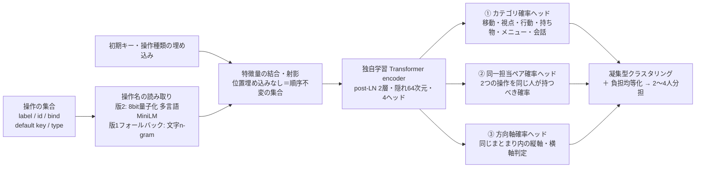
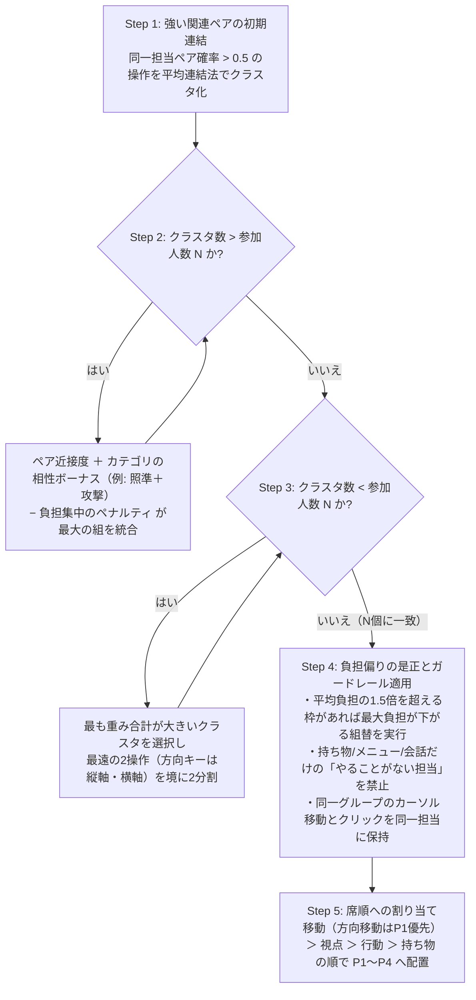
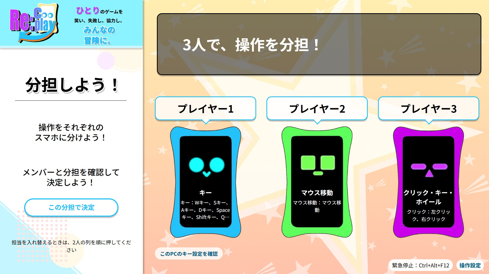

# Re:Cooplay 分担AI仕様書

**バージョン**: 0.2.0　**更新日**: 2026-11-18

[総合仕様](README.md) ／ [ゲーム操作定義](game-profile-specification.md) ／ [動作確認](verification.md)

---

## 📑 目次

1. [概要](#概要)
2. [技術スタック](#技術スタック)
3. [モデルの構成](#モデルの構成)
4. [学習](#学習)
5. [推論と分担の組み立て](#推論と分担の組み立て)
6. [評価](#評価)
7. [定義のないゲームの読み取り](#定義のないゲームの読み取り)
8. [配布と設定](#配布と設定)
9. [適用範囲](#適用範囲)
10. [関連ドキュメント](#関連ドキュメント)

---

## 概要

ゲームの操作一覧（操作名・初期キー・操作種類）から、意味的なカテゴリや操作同士の関連性を解析し、**2〜4人への自然な役割分担を自動生成する独自AI**です。

事前学習済みの多言語BERT系モデル（小型化・8bit量子化した **MiniLM**）と、実在ゲームの操作定義で独自に学習させた **2層Transformer encoder** を組み合わせ、ゲームごとの専用ルールを手書きすることなく、初見のPCゲームでもプレイしやすい2〜4人分担を生成します。推論はPythonや外部通信を一切使わず、**Rustホスト内のネイティブコードだけ**で完結します（14操作で約80ms）。

PC画面の分担確認では既定で「独自AI」が選択され、従来の「定型ルール」とのワンクリック切り替えや再生成も可能です（Minecraftなど検証済みプリセットがあるゲームの標準分担はそのまま維持します）。

---

## 技術スタック

| 構成要素 | 技術・実装モジュール | 役割 |
|:--|:--|:--|
| **学習パイプライン** | Python（PyTorch）、`scripts/preset-model/` | 自己教師あり（マスク復元）＋教師ありマルチタスク学習、重みの量子化・エクスポート |
| **意味埋め込み（版2）** | 多言語MiniLM（`paraphrase-multilingual-MiniLM-L12-v2` を小型化・8bit量子化）、Rust `tokenizers`、`apps/host-rs/src/text_encoder.rs` | 多言語・表記ゆれを含む生の操作名（`label`, `id`, `bind`）から意味ベクトルを抽出 |
| **関係推論・分担生成** | Rustネイティブ実装、`apps/host-rs/src/preset_model.rs` | 2層Transformer encoderによる3ヘッド推論と、凝集型クラスタリングによる2〜4人への役割配分 |
| **非同期キャッシュ管理** | Rust、`apps/host-rs/src/model_presets.rs`・`hub.rs` | バックグラウンドスレッドでの非ブロッキング推論と `%LOCALAPPDATA%\Re-Cooplay\model-presets.json` への永続化 |
| **公開モデルリポジトリ** | Hugging Face（[YOSHI0209/recooplay-preset-model-v2](https://huggingface.co/YOSHI0209/recooplay-preset-model-v2#recooplay-preset-model-v2)） | SHA-256固定（`scripts/windows/preset-model-v2.json`）による配布物への同梱と再現性検証 |
| **Python/Rust一致検証** | `parity.json` ＋ `cargo test` | トークナイズ結果、埋め込みベクトル（$\cos > 0.9999$）、全出力ロジットの完全一致をCIで自動検査 |

---

## モデルの構成

| 項目 | 仕様・設計上の工夫 |
|:--|:--|
| **モデルの入力** | 各操作の文字列（`label`・`id`・設定ファイル上の `bind` 名）、初期キー（`default`）、操作種類（`type`）。人手で付けたグループ名（`group`）には依存しないため、生ファイルから抽出したフラットな操作一覧でもそのまま推論可能 |
| **操作名の読み取り** | **版2（標準）**：多言語MiniLMの語彙を使用頻度の高い約4.4万語に削減し、重みを8ビット整数（INT8）へ量子化（約40MB）。英語・日本語・略語・スネークケース等の表記ゆれを吸収。 **版1（内蔵フォールバック）**：文字n-gramハッシュ（2,048バケット、約340KB、ホストexeに埋め込み） |
| **Transformer本体** | **位置埋め込み（Positional Encoding）を持たない** post-LN Transformer encoder 2層（版2は隠れ64次元・4ヘッド、版1は32次元・4ヘッド）。操作の並び順に左右されず、**「そのゲームが持つ操作全体の文脈（集合）」**から各操作の役割とペア関係を推論 |
| **3つの同時出力** | ① **カテゴリ確率**（移動・視点・行動・持ち物・メニュー・会話の6分類） ② **同一担当ペア確率** $P_{\text{pair}}(i, j)$（前後左右の4キー、照準と射撃、武器スロット群など、同じプレイヤーが担当すべき確率） ③ **同一方向軸確率** $P_{\text{axis}}(i, j)$（方向操作を2人で分ける際に「前後」と「左右」の軸で綺麗に割るための確率） |

---

## 学習

| 項目 | 内容 |
|:--|:--|
| **学習データ** | 実在PCゲームの設定・定義から抽出した操作集合と概念アノテーション（前進・後退・ジャンプ・照準・攻撃・リロード・インベントリ・メニュー等）、および未知の命名パターンへの汎化を高めるための実在タイトル操作セット |
| **自己教師あり学習（Masked Action Modeling）** | BERTの穴埋め課題と同様に、集合内の一部の操作の「キー」や「操作名」をマスクし、周囲の操作群から元のキーや概念を予測させることで、ゲーム操作の構造的な共起関係を学習 |
| **データ拡張（Augmentation）** | 定義のないゲームの不完全な抽出データにも頑健になるよう、操作の部分サブセット化や、`label`・`bind`・`default` キーのランダムなドロップアウトを加えて学習 |
| **評価データの厳格な分離** | 評価に用いる未学習ゲーム群（Unity・Godot抽出57本、実ゲーム30本、およびジャンルテンプレート488本）は学習データから完全に除外 |

学習スクリプトと手順の詳細は `scripts/preset-model/README.md` を参照してください。

---

## 推論と分担の組み立て

Transformer encoderが出力した確率行列から、以下の5段階の決定論的アルゴリズムで2〜4人のプレイヤー（P1〜P4）へ役割を配分します。配分対象は操作定義で共同操作が許可された操作のみとし、モデルが勝手に未許可のOSキーを増やすことはありません。

推論はRustホストのバックグラウンドスレッド（`model-preset` / `model-detect`）で1本ずつ非同期実行され、4ms周期の視点補間やWebSocket/WebRTCの入力処理を一切ブロックしません。協力プレイ中（`coop`）はバックグラウンド推論を一時停止し、入力処理を最優先します。

---

## 評価

### 1. 未知のゲームに対する汎化性能（未学習ゲームの生の操作名による定量評価）

学習に一切使用していないゲームの「生の操作名・キー情報」を入力した際の、操作カテゴリ分類精度およびペア振分判定精度は以下のとおりです。

| 評価データセット | 操作分類精度 | 振分判定精度 | 評価対象の説明 |
|:--|:--:|:--:|:--|
| **Unity・Godot（57本）** | **88.1%** | **94.5%** | 実際のUnity（`.inputactions` 等）およびGodot（`project.binary`）作品57本から自動抽出した生の操作名 |
| **実ゲーム（30本）** | **87.4%** | **89.3%** | ジャンルを横断する実在PCゲーム30タイトルの未学習操作定義 |

### 2. 人手比較評価・カタログ網羅試験・実機受入

| 評価項目 | 結果 |
|:--|:--|
| **人手によるブラインド比較（19タイトル・43ケース）** | **独自AIが良い：30件（69.8%）** ／ 定型ルールが良い：11件 ／ どちらも課題あり：2件 |
| **全定義502タイトル×2〜4人の自動網羅試験** | 全1,506パターンで操作の重複・欠落・空枠・過大な負担偏りがないことをCIで検証 |
| **Python / Rust 推論一致試験** | 文字列正規化、MiniLMベクトル（$\cos > 0.9999$）、カテゴリ・ペア・軸出力が完全一致することをCIで照合 |
| **定義のない実ゲームでの実機共同操作（『青鬼』）** | 事前定義のないRPGツクールXP製『青鬼』から6操作（上下左右・決定・キャンセル）を自動抽出し、独自AIが3人へ自動分担して実機で全操作がゲームへ到達することを確認（#432・#512） |

  
  
PC画面の分担確認ビュー。画面下部で「独自AI」と「定型ルール」の切り替えや再生成を行えます。

---

## 定義のないゲームの読み取り

検証済み定義がないゲームでは、19系統のエンジン別パーサー（`apps/host-rs/src/engines/`）でゲームのファイルから操作名とキーを抽出し、本モデルでカテゴリ分類と2〜4人分担を自動生成します。対応エンジンと抽出規則の詳細は [ゲーム操作定義仕様書（定義のないゲームのファイルからの読み取り）](game-profile-specification.md#定義のないゲームのファイルからの読み取り) を参照してください。

---

## 配布と設定

| 項目 | 仕様 |
|:--|:--|
| **版2の重み（標準・同梱）** | 約57MB（量子化MiniLM＋2層Transformer）。Hugging Faceから `scripts/windows/preset-model-v2.json` に固定したリビジョンとSHA-256で検証して配布物の `preset-model-v2\` に同梱。ライセンスは **CC BY-NC-ND 4.0**（ソースコードのMITとは別管理） |
| **版1の重み（内蔵フォールバック）** | 約340KB（文字n-gram＋2層Transformer）。`apps/host-rs/assets/preset-model.bin` としてホストexeにコンパイル時埋め込み。版2ファイルがない開発環境でも即座に動作 |
| **起動時の非同期ウォームアップ** | `profiles::warm_model()` により起動時にバックグラウンドスレッドで版2重みをロードし、HTTP/WebSocketの待ち受け開始を一切遅らせない（#474） |
| **定型ルールへの切り替え** | PC画面の「定型ルール」ボタン、または起動時の環境変数 `RECOOPLAY_PRESETS=rule` でいつでも定型ルールに切り替え可能 |

---

## 適用範囲

分担AIは抽出された操作名・キー・種類の静的な意味関係と標準重みから役割を構成するものであり、実際のゲームプレイ中のボタン押下頻度をリアルタイム計測して再配分するものではありません。独自AIが生成した分担やファイルから自動抽出した定義は、PC画面上で「未検証」の注意案内とともに表示し、実機確認済み定義と明確に区別します。

実装：[Transformer推論・クラスタリング](../apps/host-rs/src/preset_model.rs) ／ [MiniLMトークナイザー・埋め込み](../apps/host-rs/src/text_encoder.rs) ／ [キャッシュ管理](../apps/host-rs/src/model_presets.rs) ／ [学習・量子化スクリプト](../scripts/preset-model/README.md)

---

## 関連ドキュメント

[総合仕様](README.md) ／ [ゲーム操作定義仕様](game-profile-specification.md) ／ [ホスト仕様](host-specification.md) ／ [技術選定の理由](technology-selection.md) ／ [動作確認の範囲](verification.md)
