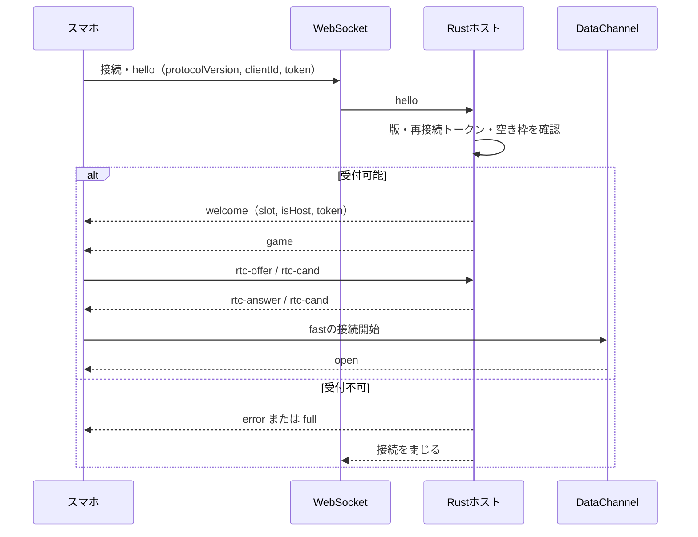
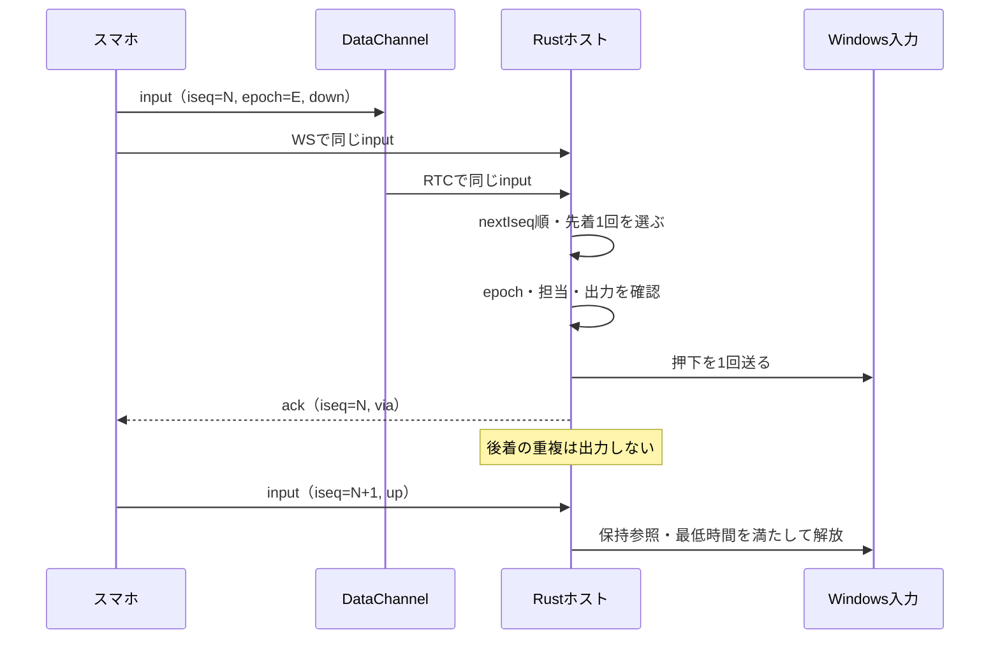
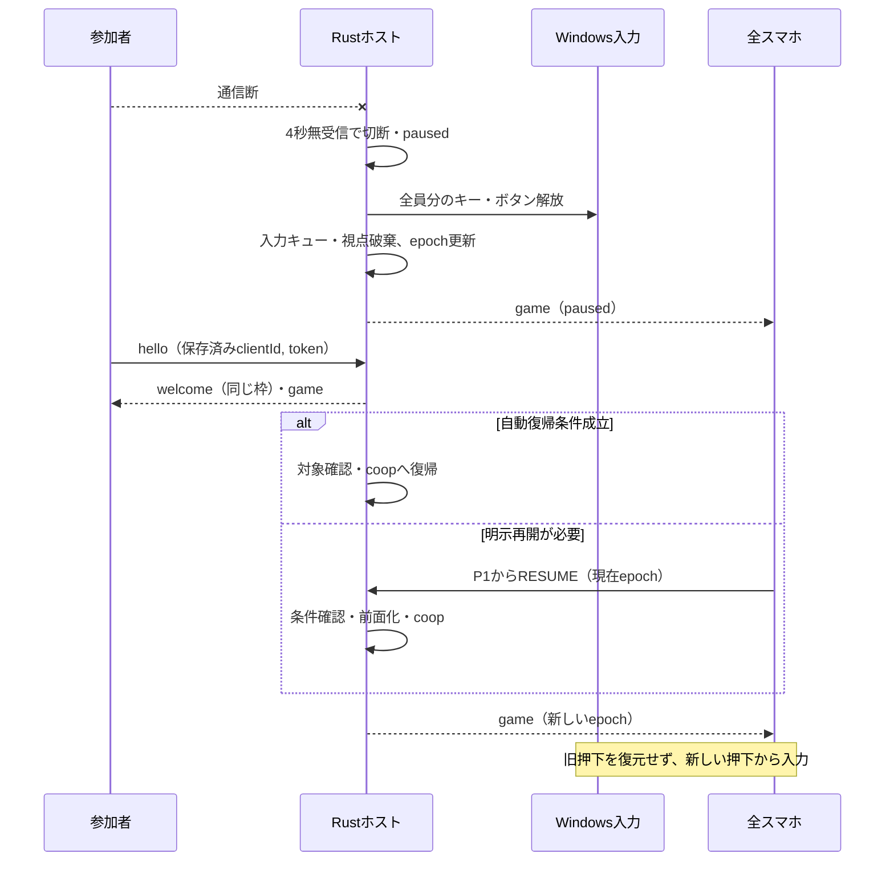

# Re:Cooplay 通信仕様書

**バージョン**: 0.1.0　**更新日**: 2026-10-26

[総合仕様](README.md) ／ [利用手順](usage.md) ／ [動作確認](verification.md)

---

## 📑 目次

1. [概要](#概要)
2. [接続情報](#接続情報)
3. [WebSocket接続フロー](#websocket接続フロー)
4. [スマホからホスト](#スマホからホスト)
5. [ホストからスマホ](#ホストからスマホ)
6. [メッセージ形式](#メッセージ形式)
7. [入力順序と二重送信](#入力順序と二重送信)
8. [切断・停止・再接続](#切断停止再接続)
9. [PC画面とホスト](#pc画面とホスト)
10. [安全停止の境界](#安全停止の境界)
11. [エラーハンドリング](#エラーハンドリング)
12. [開発・テスト](#開発テスト)
13. [関連ドキュメント](#関連ドキュメント)

---

## 概要

スマートフォンとPCホストはWebSocketで参加・状態・操作を交換し、WebRTC DataChannelを入力の速達経路として併用します。

---

## 接続情報

**通信契約**: `protocolVersion = 4`。版がない・一致しないhelloは枠を割り当てず拒否します。DataChannelは`fast`、`ordered:false`、`maxRetransmits:0`です。待ち受けは既定`0.0.0.0:8080`、`PORT`で変更できます。STUN/TURNは使いません。

| パス | 用途 | アクセス |
|:--|:--|:--|
| `GET /` | スマホの操作画面 | LAN |
| `GET /app` | PCの参加・ゲーム選択・分担画面 | ループバックのみ |
| `GET /host` | 診断画面 | ループバックのみ |
| `GET /game` | 疑似ゲーム画面 | ループバックのみ |
| `GET /api/info` | 参加URL・QR | LAN。Wi-Fi情報はPC本体のみ |
| `POST /api/hotspot` | ホットスポット有効化 | ループバック・PC画面と一致するOriginのみ |
| `GET /api/game-image?id=...` | 検出ゲームの画像 | ループバックのみ。画像なしは404 |
| `GET /ws` | WebSocketへアップグレード | 参加者はLAN、monitorはループバックのみ |

---

## WebSocket接続フロー



サーバーがP1〜P4の枠を割り当て、最初の端末をP1・ホストにします。`clientId`は最大64文字で、同じIDの再接続には保存済みのtokenが必要です。tokenはOS乱数128bitの16進32文字で、スマホのlocalStorageへ保存します。PC画面やログには出しません。

| 終了コード | 意味 |
|:--|:--|
| 4000 | 同じ端末の別接続へ置き換え |
| 4001 | PCでリセット |
| 4002 | clientIdなし |
| 4003 | PC以外からmonitor接続 |
| 4004 | 満員 |
| 4005 | 通信版不一致。再読み込みが必要 |
| 4006 | 再接続token不一致。PCでリセットして再参加 |

---

## スマホからホスト

| type | 経路 | 主な項目・処理 |
|:--|:--|:--|
| `hello` | WS | `protocolVersion`, `clientId`, `token`, `ua`, `nextIseq`。参加・再接続 |
| `ping` | WS | `t`, `stats`。1秒ごとの生存確認・通信統計 |
| `command` | WS | `cmd`, `epoch`。P1のみ。PREPARE / READY / PAUSE / RESUME / END / OPEN_GAME |
| `input` | WS＋RTC | `iseq`, `epoch`, `button`, `state:down/up`, `t`。WS版は`seq`も使用 |
| `look` | RTC、未接続時WS | `lseq`, `epoch`, `cx`, `cy`。30Hzの累積視点移動 |
| `ka` | RTC | `t`。共同操作中50msごとの生存確認 |
| `rtc-offer / rtc-cand` | WS | `sdp`、または`cand`, `mid` |
| `remote` | WS | `epoch`, `rseq`, `kind:move/scroll/release`, `dx`, `dy`。P1の非coop時のみ |
| `release_inputs` | WS | 現在`epoch`。認証済み端末から全解放・保留破棄を要求 |
| `role_ok` | WS | 現在`epoch`。担当が変わった本人による確認 |

PREPARE / READY / RESUME / OPEN_GAMEは現在epochを必須とします。PREPAREは分担決定後にpreparingへ移すだけで、READYが開始条件を満たしたときだけcoopへ進みます。監視画面からcoopを強制できません。

### 操作の認可

共同操作中の`button`は`act:<操作ID>`、ホイールは`act:<操作ID>:up`または`:down`です。全ゲーム・全人数で確定した`assigned`を使い、担当外・状態外・操作種類や実キーが無効な入力を送りません。固定の`FWD`等は共同操作中に受け付けません。視点を送れるのは確定分担で視点を割り当てた枠です。

非coop時のP1リモコンは矢印・Enter・Escや`REMOTE_LEFT / REMOTE_RIGHT / REMOTE_E / REMOTE_WHEEL_UP / REMOTE_WHEEL_DOWN`等を使用します。`remote`は30Hz以下、移動量は各軸±120に制限し、PC画面か対象ゲームの片方へ送ります。2本指スクロールは`dy`を送り、ゲーム経路では40pxごとにホイール1段、最大3段へ変換します。

---

## ホストからスマホ

| type | 主な項目 |
|:--|:--|
| `welcome` | `protocolVersion`, `token`, `slot`, `role`, `isHost`, `reconnected` |
| `error / full` | 拒否理由。errorは`code`と必要に応じてホストの版 |
| `game` | セッション状態`game` |
| `command_result` | `cmd`, `accepted`, `reasons` |
| `ack` | `iseq`, `t`, `via:ws/rtc`、旧epochなら`stale:true` |
| `pong / kpong` | 対応する`t` |
| `rtc-answer / rtc-cand` | `sdp`, `sdpType`、または`cand`, `mid` |

### gameの主要項目

| 項目 | 意味 |
|:--|:--|
| `phase / reason / epoch` | lobby / preparing / coop / paused、遷移理由、入力の世代 |
| `required / maxPlayers / connected` | 最低2人、最大4枠、接続中の枠 |
| `canPrepare / canReady / canResume / readyReasons` | 要求可否と拒否理由 |
| `title / titleName / launch` | 選択ゲーム、表示名、起動要求の状態 |
| `lineup / lineupOk` | 決定したゲームとメンバー、現在との一致 |
| `participants / assigned` | Readyで固定した参加者と操作割当 |
| `roleOf / roleAck / canSwap` | 枠と席順、本人確認待ち、交換可否 |
| `keys / profile` | 実キー・読取り警告、操作定義の要約・分担案 |
| `hostReady / prepareStatus / canLaunch` | 準備・起動の状態 |
| `remoteRoute` | app / game / none |
| `inputActive / inputTarget` | 入力可能か、onだが対象が前面でないか |
| `autoResume / autoResumeMs / autoResumeUntil` | 自動復帰設定、待機時間、期限 |

`keys.actions`は操作IDから実出力の`{out,label}`またはnullへの対応です。`profile.assignment`は現在接続者への案、`profile.assignments`は人数別の案です。`assigned`が現在の共同操作の認可に使う確定値です。

---

## メッセージ形式

### Client → Server（操作入力）

```json
{"type":"input","iseq":1,"epoch":2,"button":"act:forward","state":"down","t":1000}
```

### Server → Client（受信確認）

```json
{"type":"ack","iseq":1,"t":1000,"via":"rtc"}
```

数値は形式例です。実際のepochは最新のgame、iseqは端末の送信順序を使います。ACKは受信・処理順序の確認であり、ゲーム内の動作を保証する応答ではありません。

---

## 入力順序と二重送信



枠ごとの`nextIseq`により番号が欠けたときは後続を保留します。旧epochも番号を消費しますが、押下・解放は実行せずstale ACKを返します。視点は累積値の差分を使い、同じepoch内の欠落を次の値で補います。epoch変更ではスマホとホストの視点累積値・順序基準をリセットします。

---

## 切断・停止・再接続



スマホは3秒応答がないと再接続します。ホストは4秒無受信で切断とし、coopからpausedへ移ると全員分を即時解放します。最低押下時間・連打キューより停止を優先します。

設定の既定値は`autoResume:true`、待機時間15秒です。通信切断による停止で、期限内に参加者・担当確認・入力条件が揃い、WebRTCの接続処理が落ち着くと自動復帰を試みます。期限内の別参加者の切断は期限を延長しますが、接続の置き換えや期限後の再接続は期限を復活させません。手動PAUSE、PC画面への復帰、緊急停止は自動復帰しません。前面化に失敗した場合も期限を解除して明示操作を待ちます。

---

## PC画面とホスト

| 方向 | type | 内容 |
|---|---|---|
| 画面 → ホスト | `monitor` | `page`: `host`/`game`/`app`（PCアプリの画面） |
| 画面 → ホスト | `inject_mode` | `mode`: `off`/`test`/`on` |
| 画面 → ホスト | `focus` | `focused`。疑似ゲーム画面（`game`）では選択状態（`test` モードの条件になる）。ブラウザで開いたPCアプリ（`app`）では前面になったこと：協力プレイ中に前面へ戻ると、ホストは全解放して `paused`（`reason: app focus`、自動復帰しない）へ移し、P1をリモコンに戻す。**デスクトップアプリから起動したホスト（`RECOOPLAY_DESKTOP=1`）はこの知らせを使わず、前面のプロセス名（`recooplay-desktop.exe`）で判定する**（WebView2の画面は背面になっても `blur` を受け取らないため） |
| 画面 → ホスト | `select_game` | `title`（`minecraft-java`、診断用の `pseudo-game`、検出したゲームの `id`）。選んだゲームはホストが保持し `game.title` で配る。ロビー以外で別のゲームに変えると、全解放して `lobby`（`reason: game change`）へ戻す。参加者・役割は保つ。同じ・未知の値は無視する |
| 画面 → ホスト | `launch_game` | `id`（`state.games` の項目）。ホストは手元の一覧から起動方法を引き、検出時に確かめた値だけで起動する（Steam：`steam://rungameid/<appid>`、Epic：`com.epicgames.launcher://apps/...`）。パス・URLは受け取らない。**選択中のゲーム（`game.title`）で、メンバー・分担の決定（`game.lineupOk`）が有効なときだけ**、ロビー・準備中に、全解放・epoch更新の後に起動し、ウィンドウが現れたら前面にする。起動中の同じ要求は無視する。すでにウィンドウがあれば起動し直さず前面にする。協力プレイ中・一時停止中・決定前・選択と違うid・一覧にない値は起動せず `game.launch.state: failed` を返す。dry-runでは起動しない |
| 画面 → ホスト | `confirm_lineup` | `title`・`members`・`epoch`（画面が見ていたゲーム・接続中の枠・状態の世代）。ロビー・準備中に、今の選択・接続者・epochと一致し、P1を含む2人以上なら、メンバーと分担を決定する。一致しなければ無視する |
| 画面 → ホスト | `unconfirm_lineup` | 分担の画面から戻ったときに、ロビーでの決定を取り消す |
| 画面 → ホスト | `swap_roles` | `a`・`b`（枠名）。開始前（接続中の人）と一時停止中（参加者）に、2人の担当（席順）を入れ替える。全解放・epoch更新の後、2人の確認待ち（`game.roleAck`）にする。協力プレイ中は無視する |
| 画面 → ホスト | `refresh_games` | インストール済みのゲームを探し直す |
| 画面 → ホスト | `add_game` | ゲームを手動で登録する。ホストがPC上にWindowsのファイル選択の画面を出し、PCの前の人が `.exe` を選ぶ。場所は画面から受け取らない。結果は `manual_result`（`ok`・`message`） |
| 画面 → ホスト | `rename_game`（`id`・`name`）／`remove_game`（`id`） | 手動登録したゲーム（`id` が `manual:` で始まる）の名前の変更・登録の解除。名前は制御文字を除いて60文字まで |
| 画面 → ホスト | `auto_resume` / `phase` / `reset` | 自動復帰のON/OFF、進行の変更（`lobby`＝終了、`paused`＝一時停止のみ）、全枠の解放。人数は接続人数で決まり、`required` メッセージは  で廃止した |
| 画面 → ホスト | `observe` | 疑似ゲーム画面の照合結果。ログに記録する |
| ホスト → 画面 | `state` | 全枠の状態、`game`、`inject`（モード・有効かどうか・出力一覧・押下中の出力・緊急停止キー `emergencyHotkey` とその登録エラー `emergencyHotkeyError`、入力先 `target`（`ok`・`expect`・前面の `process`・`title`））、`games`（検出したゲーム：`id`・`name`・`source`（`steam`/`epic`/`manual`）・`verified`（常に `false`）・`launchable`・`image`（タイルの画像があるか、）。インストール先・画像の場所は送らない）、`gamesScanning`、`network`（`bluetoothAudio`：既定の音の出力先がBluetoothか、`lowLatency`：Wi-Fiのメディアストリーミングモードが有効か。）、各枠の `net`（直近10秒の受信の途切れの回数 `stalls` と最大の空白 `maxStallMs`）、`minecraft`（Minecraftのランチャーを見つけたか `detected`・画像があるか `image`。。Minecraftは `games` には入れない）。1秒ごとと変化時に送る。`games` はPC画面にだけ送り、スマホには送らない |
| ホスト → 画面 | `inject` / `look` / `log` | 注入1件ごと、視点の100msごとの集計、イベントログ |
| ホスト → 画面 | `remote` | `control`（`UP`/`DOWN`/`LEFT`/`RIGHT`/`ENTER`/`ESC`）、`state`。ロビー・一時停止中のP1のリモコン操作。PCアプリの画面は自分が前面（`document.hasFocus()`）のときだけ反応する。OSへの注入は前面がMinecraftのときだけなので、画面とゲームが同時に反応しない |

**参加の案内：** `GET /api/info` は参加用のURL・QR（`urls`）を返す。Wi-Fiの接続QR（`wifi`：`ssid`・パスフレーズを含む `qr`）とホットスポットの状態（`hotspot`：`on`）は**PC本体（ループバック）からの要求にだけ**含め、LANの端末には `null` を返す。Wi-Fiはモバイルホットスポットの設定（Windowsの `NetworkOperatorTetheringManager`）を優先し、読めなければ `config.json` の `wifi` を使う。`POST /api/hotspot` はホットスポットをONにする（PC画面のボタンを押したときだけ）。PC本体からで、Origin がPCの画面と一致する要求だけを受け付ける（Origin なし・別の Origin は403）。SSID・パスフレーズはログに残さない。

**ゲーム一覧の画像：** `GET /api/game-image?id=<項目ID>` は、検出した項目の画像（Steamがユーザーの PC に保存しているライブラリの画像）を返す。PC本体（ループバック）からの要求だけに応じ、項目IDだけを受け取ってホストの表から場所を引く。場所・パスは受け取らない。一覧にない・画像のない項目は404。`id=minecraft-java` はMinecraftのランチャーの画像。画像は保存させない（`no-store`）。

---

## 安全停止の境界

入力OFF、対象喪失、セッション変更、終了時は合成入力と保留分を解放・破棄します。古いepochの`release_inputs`は新しいセッションに影響させません。ホストのPC経路とゲーム経路は排他的です。未検証の操作定義であっても開始条件が成立すればReadyできますが、割当不能・非対応の種類は拒否します。

実装：[受付](../apps/host-rs/src/main.rs) ／ [通信・認可](../apps/host-rs/src/hub.rs) ／ [DataChannel](../apps/host-rs/src/rtc.rs) ／ [通信試験](../scripts/sim/protocol-sim.mjs)

---

## エラーハンドリング

通信版不一致・token不一致・満員は接続時に拒否します。古いepochの開始要求は`command_result`で理由を返し、旧入力はstale ACKを返します。再読み込み・再参加の手順は[困ったとき](troubleshooting.md)を参照してください。

---

## 開発・テスト

```powershell
node scripts/sim/protocol-sim.mjs
node scripts/sim/shutdown-sim.mjs
```

実装：[HTTP・WS受付](../apps/host-rs/src/main.rs) ／ [認可・順序制御](../apps/host-rs/src/hub.rs) ／ [RTC](../apps/host-rs/src/rtc.rs)

---

## 関連ドキュメント

[画面仕様](frontend-specification.md) ／ [ホスト仕様](host-specification.md) ／ [操作定義](game-profile-specification.md)
