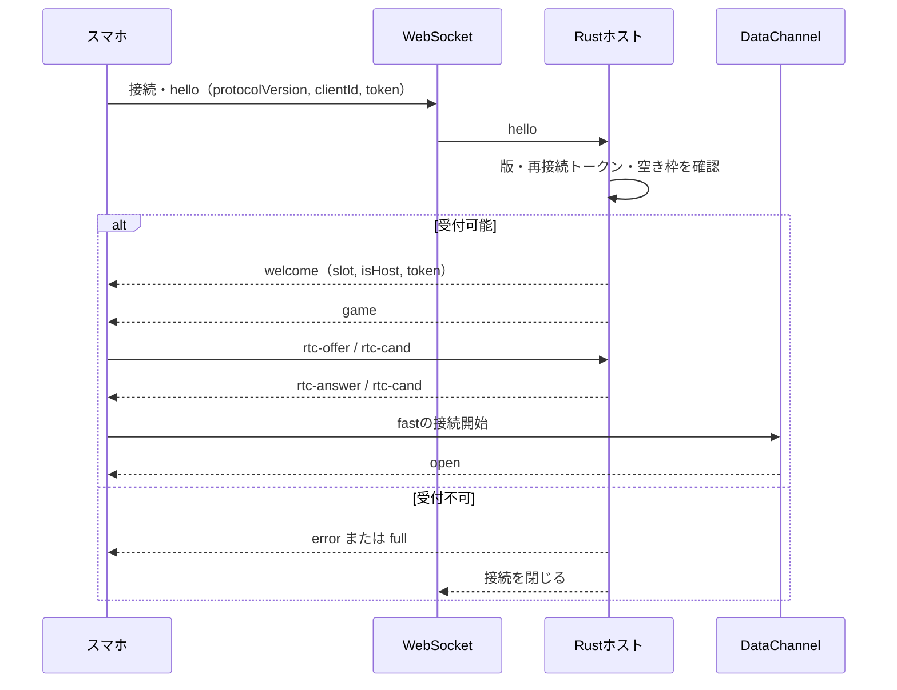
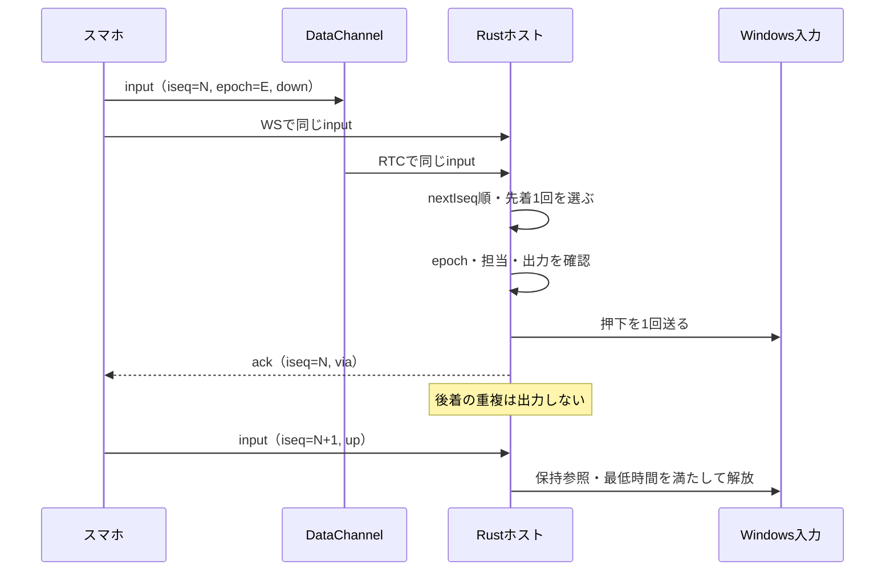
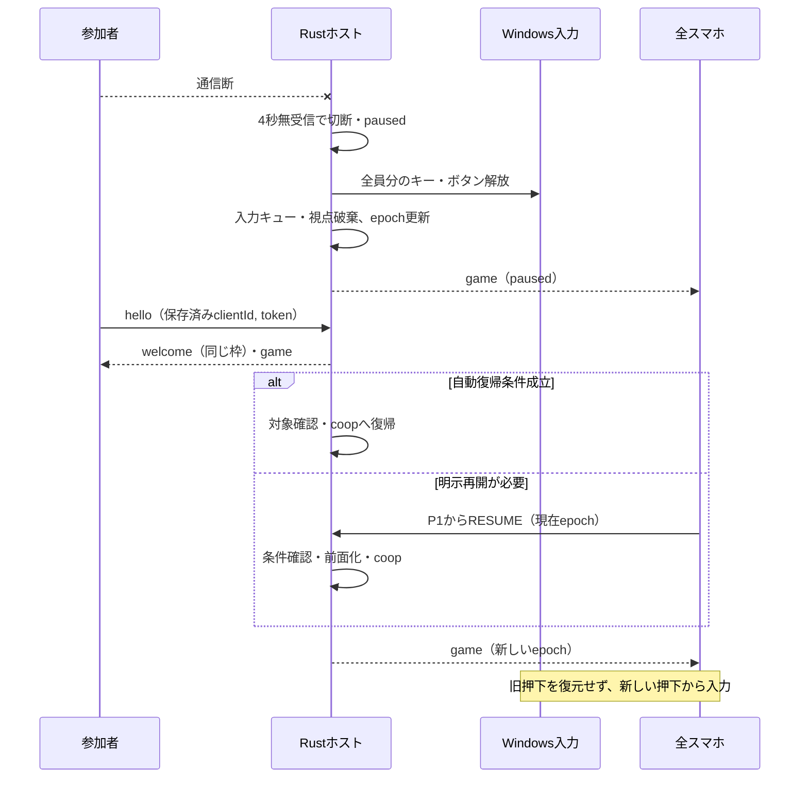

# Re:Cooplay 通信仕様書

**バージョン**: 0.1.0　**更新日**: 2026-10-26

[総合仕様](README.md) ／ [利用手順](usage.md) ／ [動作確認](verification.md)

---

## 📑 目次

1. [概要](#概要)
2. [接続情報](#接続情報)
3. [WebSocket接続フロー](#websocket接続フロー)
4. [スマホからホスト](#スマホからホスト)
5. [ホストからスマホ](#ホストからスマホ)
6. [メッセージ形式](#メッセージ形式)
7. [入力順序と二重送信](#入力順序と二重送信)
8. [切断・停止・再接続](#切断停止再接続)
9. [PC画面とホスト](#pc画面とホスト)
10. [安全停止の境界](#安全停止の境界)
11. [エラーハンドリング](#エラーハンドリング)
12. [開発・テスト](#開発テスト)
13. [関連ドキュメント](#関連ドキュメント)

---

## 概要

スマートフォンとPCホストはWebSocketで参加・状態・操作を交換し、WebRTC DataChannelを入力の速達経路として併用します。

---

## 接続情報

**通信契約**: `protocolVersion = 4`。版がない・一致しないhelloは枠を割り当てず拒否します。DataChannelは`fast`、`ordered:false`、`maxRetransmits:0`です。待ち受けは既定`0.0.0.0:8080`、`PORT`で変更できます。STUN/TURNは使いません。

| パス | 用途 | アクセス |
|:--|:--|:--|
| `GET /` | スマホの操作画面 | LAN |
| `GET /app` | PCの参加・ゲーム選択・分担画面 | ループバックのみ |
| `GET /host` | 診断画面 | ループバックのみ |
| `GET /game` | 疑似ゲーム画面 | ループバックのみ |
| `GET /api/info` | 参加URL・QR | LAN。Wi-Fi情報はPC本体のみ |
| `POST /api/hotspot` | ホットスポット有効化 | ループバック・PC画面と一致するOriginのみ |
| `GET /api/game-image?id=...` | 検出ゲームの画像 | ループバックのみ。画像なしは404 |
| `GET /ws` | WebSocketへアップグレード | 参加者はLAN、monitorはループバックのみ |

---

## WebSocket接続フロー



サーバーがP1〜P4の枠を割り当て、最初の端末をP1・ホストにします。`clientId`は最大64文字で、同じIDの再接続には保存済みのtokenが必要です。tokenはOS乱数128bitの16進32文字で、スマホのlocalStorageへ保存します。PC画面やログには出しません。

| 終了コード | 意味 |
|:--|:--|
| 4000 | 同じ端末の別接続へ置き換え |
| 4001 | PCでリセット |
| 4002 | clientIdなし |
| 4003 | PC以外からmonitor接続 |
| 4004 | 満員 |
| 4005 | 通信版不一致。再読み込みが必要 |
| 4006 | 再接続token不一致。PCでリセットして再参加 |

---

## スマホからホスト

| type | 経路 | 主な項目・処理 |
|:--|:--|:--|
| `hello` | WS | `protocolVersion`, `clientId`, `token`, `ua`, `nextIseq`。参加・再接続 |
| `ping` | WS | `t`, `stats`。1秒ごとの生存確認・通信統計 |
| `command` | WS | `cmd`, `epoch`。P1のみ。PREPARE / READY / PAUSE / RESUME / END / OPEN_GAME |
| `input` | WS＋RTC | `iseq`, `epoch`, `button`, `state:down/up`, `t`。WS版は`seq`も使用 |
| `look` | RTC、未接続時WS | `lseq`, `epoch`, `cx`, `cy`。30Hzの累積視点移動 |
| `ka` | RTC | `t`。共同操作中50msごとの生存確認 |
| `rtc-offer / rtc-cand` | WS | `sdp`、または`cand`, `mid` |
| `remote` | WS | `epoch`, `rseq`, `kind:move/scroll/release`, `dx`, `dy`。P1の非coop時のみ |
| `release_inputs` | WS | 現在`epoch`。認証済み端末から全解放・保留破棄を要求 |
| `role_ok` | WS | 現在`epoch`。担当が変わった本人による確認 |

PREPARE / READY / RESUME / OPEN_GAMEは現在epochを必須とします。PREPAREは分担決定後にpreparingへ移すだけで、READYが開始条件を満たしたときだけcoopへ進みます。監視画面からcoopを強制できません。

### 操作の認可

共同操作中の`button`は`act:<操作ID>`、ホイールは`act:<操作ID>:up`または`:down`です。全ゲーム・全人数で確定した`assigned`を使い、担当外・状態外・操作種類や実キーが無効な入力を送りません。固定の`FWD`等は共同操作中に受け付けません。視点を送れるのは確定分担で視点を割り当てた枠です。

非coop時のP1リモコンは矢印・Enter・Escや`REMOTE_LEFT / REMOTE_RIGHT / REMOTE_E / REMOTE_WHEEL_UP / REMOTE_WHEEL_DOWN`等を使用します。`remote`は30Hz以下、移動量は各軸±120に制限し、PC画面か対象ゲームの片方へ送ります。2本指スクロールは`dy`を送り、ゲーム経路では40pxごとにホイール1段、最大3段へ変換します。

---

## ホストからスマホ

| type | 主な項目 |
|:--|:--|
| `welcome` | `protocolVersion`, `token`, `slot`, `role`, `isHost`, `reconnected` |
| `error / full` | 拒否理由。errorは`code`と必要に応じてホストの版 |
| `game` | セッション状態`game` |
| `command_result` | `cmd`, `accepted`, `reasons` |
| `ack` | `iseq`, `t`, `via:ws/rtc`、旧epochなら`stale:true` |
| `pong / kpong` | 対応する`t` |
| `rtc-answer / rtc-cand` | `sdp`, `sdpType`、または`cand`, `mid` |

### gameの主要項目

| 項目 | 意味 |
|:--|:--|
| `phase / reason / epoch` | lobby / preparing / coop / paused、遷移理由、入力の世代 |
| `required / maxPlayers / connected` | 最低2人、最大4枠、接続中の枠 |
| `canPrepare / canReady / canResume / readyReasons` | 要求可否と拒否理由 |
| `title / titleName / launch` | 選択ゲーム、表示名、起動要求の状態 |
| `lineup / lineupOk` | 決定したゲームとメンバー、現在との一致 |
| `participants / assigned` | Readyで固定した参加者と操作割当 |
| `roleOf / roleAck / canSwap` | 枠と席順、本人確認待ち、交換可否 |
| `keys / profile` | 実キー・読取り警告、操作定義の要約・分担案 |
| `hostReady / prepareStatus / canLaunch` | 準備・起動の状態 |
| `remoteRoute` | app / game / none |
| `inputActive / inputTarget` | 入力可能か、onだが対象が前面でないか |
| `autoResume / autoResumeMs / autoResumeUntil` | 自動復帰設定、待機時間、期限 |

`keys.actions`は操作IDから実出力の`{out,label}`またはnullへの対応です。`profile.assignment`は現在接続者への案、`profile.assignments`は人数別の案です。`assigned`が現在の共同操作の認可に使う確定値です。

---

## メッセージ形式

### Client → Server（操作入力）

```json
{"type":"input","iseq":1,"epoch":2,"button":"act:forward","state":"down","t":1000}
```

### Server → Client（受信確認）

```json
{"type":"ack","iseq":1,"t":1000,"via":"rtc"}
```

数値は形式例です。実際のepochは最新のgame、iseqは端末の送信順序を使います。ACKは受信・処理順序の確認であり、ゲーム内の動作を保証する応答ではありません。

---

## 入力順序と二重送信



枠ごとの`nextIseq`により番号が欠けたときは後続を保留します。旧epochも番号を消費しますが、押下・解放は実行せずstale ACKを返します。視点は累積値の差分を使い、同じepoch内の欠落を次の値で補います。epoch変更ではスマホとホストの視点累積値・順序基準をリセットします。

---

## 切断・停止・再接続



スマホは3秒応答がないと再接続します。ホストは4秒無受信で切断とし、coopからpausedへ移ると全員分を即時解放します。最低押下時間・連打キューより停止を優先します。

設定の既定値は`autoResume:true`、待機時間15秒です。通信切断による停止で、期限内に参加者・担当確認・入力条件が揃い、WebRTCの接続処理が落ち着くと自動復帰を試みます。期限内の別参加者の切断は期限を延長しますが、接続の置き換えや期限後の再接続は期限を復活させません。手動PAUSE、PC画面への復帰、緊急停止は自動復帰しません。前面化に失敗した場合も期限を解除して明示操作を待ちます。

---

## PC画面とホスト

### 管理メッセージ

| 方向 | type | 主な項目・処理 |
|:--|:--|:--|
| 画面 → ホスト | `monitor` | `page:app/host/game`。ループバックから管理接続を登録 |
| 画面 → ホスト | `inject_mode` | `mode:on/off/test` |
| 画面 → ホスト | `focus` | `focused`。疑似ゲームとブラウザ版PC画面のフォーカス |
| 画面 → ホスト | `select_game` | `title`。ホストの一覧にあるゲームを選択 |
| 画面 → ホスト | `confirm_lineup` | `title`, `members`, `epoch`。現在のゲーム・接続者と一致する分担を決定 |
| 画面 → ホスト | `unconfirm_lineup` | ロビーで分担の決定を取り消す |
| 画面 → ホスト | `launch_game` | `id`。決定済み・選択中のゲームを起動 |
| 画面 → ホスト | `prepare / open_game` | 準備への移行・対象ゲームの前面化 |
| 画面 → ホスト | `swap_roles` | `a`, `b`。開始前・一時停止中の席順を交換 |
| 画面 → ホスト | `refresh_games` | インストール済みゲームの再検出 |
| 画面 → ホスト | `add_game` | PCでファイル選択画面を開き、ゲームを手動登録 |
| 画面 → ホスト | `rename_game / remove_game` | `id`、変更時は`name`。手動登録項目の変更・解除 |
| 画面 → ホスト | `auto_resume` | 自動復帰の有効・無効 |
| 画面 → ホスト | `phase` | `lobby`への終了、`paused`への停止。coopの強制は禁止 |
| 画面 → ホスト | `reset` | 全枠・セッションをリセット |
| 画面 → ホスト | `observe` | 疑似ゲームで受信した入力の照合結果 |
| ホスト → 画面 | `state` | 枠、game、入力先、ゲーム一覧、通信診断 |
| ホスト → 画面 | `manual_result` | `ok`, `message`。手動登録の結果 |
| ホスト → 画面 | `inject / look / log` | 注入イベント、視点の100ms集計、ログ |
| ホスト → 画面 | `remote` | P1のPC画面向けリモコン。`route`, `epoch`, `control/state`または`kind/dx/dy` |

### ゲーム選択・起動の条件

`confirm_lineup`はロビー・準備中だけ受け付けます。ゲーム・接続者・epochが一致し、P1を含む2人以上が必要です。ゲームを変更すると旧割当を解放し、ロビーへ戻ります。参加枠と役割の席順は保持します。

`launch_game`は決定済みメンバーと選択ゲームが一致するロビー・準備中に限ります。ホストの一覧から起動方法を引き、端末から任意のパス・URLを受け取りません。Steamは検出済みAppID、Epicは検出済み起動情報、手動登録はPCで選んだ実行ファイルを使います。起動前に全解放・epoch更新を行い、既存ウィンドウがあれば新規起動せず前面化します。

共同操作中・一時停止中・分担未決定・選択と異なるIDの起動は拒否します。`game.launch.state`は`launching / started / failed / timeout`です。dry-runでは実ゲームを起動しません。

手動登録の`add_game`はPC上のファイル選択を使います。`manual:`項目だけを名前変更・解除でき、名前は制御文字を除いて60文字までです。

### stateの構成

| 項目 | 内容 |
|:--|:--|
| 枠の状態 | 接続、UA、再接続回数、押下、通信統計、RTC状態 |
| `game` | スマホにも配る進行・割当・入力状態 |
| `inject` | モード、入力可能か、出力・押下中一覧 |
| `inject.emergencyHotkey / emergencyHotkeyError` | 緊急停止キーと登録エラー |
| `inject.target` | 対象照合の`ok / expect`、前面の`process / title` |
| `games / gamesScanning` | 検出一覧と再検出状態 |
| `network.bluetoothAudio / lowLatency` | Bluetooth音声とWi-Fi低遅延モードの状態 |
| 各枠の`net` | 直近10秒の受信途切れ`stalls`と最大空白`maxStallMs` |
| `minecraft` | ランチャーの`detected`と画像の有無`image` |

stateは変化時と1秒ごとに通知します。`games`の項目は`id / name / source / verified / launchable / image`を持ち、sourceは`steam / epic / manual`です。検出項目のverifiedはfalseで、インストール先や画像のファイルパスは送りません。Minecraftは独立した情報として扱い、gamesには含めません。一覧はPC画面にだけ送り、スマホへは送りません。

### フォーカスとリモコン

デスクトップ起動（`RECOOPLAY_DESKTOP=1`）では前面プロセス名でPCアプリへの復帰を検出します。ブラウザ代替では接続ごとのfocus変化を使い、閉じた画面のfocusを引き継ぎません。復帰時はpausedへ移し、自動復帰を解除します。

P1のリモコンはPC画面と対象ゲームへ排他的に送ります。PC側の仮想カーソルはOSカーソルを動かしません。共同操作の視点とリモコン移動は別の経路・順序番号で扱います。

### 参加情報・ゲーム画像のHTTP応答

`GET /api/info`の`urls`は参加URL・QRです。Wi-Fi接続情報`wifi`（ssid・接続QR）と`hotspot.on`はループバックだけに返し、LAN端末にはnullを返します。Wi-Fi情報はWindowsのモバイルホットスポット設定を優先し、読めない場合にconfig.jsonのwifiを使います。SSID・パスフレーズはログへ残しません。

`POST /api/hotspot`はPCのボタン操作から有効化を要求します。PC本体かつPC画面と同じOriginのみ許可し、Originなし・不一致は403です。

`GET /api/game-image?id=<項目ID>`はホストの一覧から画像を解決し、ループバックだけに返します。ID以外のパスを受け取らず、不明・画像なしは404、応答はno-storeです。`id=minecraft-java`はランチャーの画像です。

---

## 安全停止の境界

入力OFF、対象喪失、セッション変更、終了時は合成入力と保留分を解放・破棄します。古いepochの`release_inputs`は新しいセッションに影響させません。ホストのPC経路とゲーム経路は排他的です。未検証の操作定義であっても開始条件が成立すればReadyできますが、割当不能・非対応の種類は拒否します。

実装：[受付](../apps/host-rs/src/main.rs) ／ [通信・認可](../apps/host-rs/src/hub.rs) ／ [DataChannel](../apps/host-rs/src/rtc.rs) ／ [通信試験](../scripts/sim/protocol-sim.mjs)

---

## エラーハンドリング

通信版不一致・token不一致・満員は接続時に拒否します。古いepochの開始要求は`command_result`で理由を返し、旧入力はstale ACKを返します。再読み込み・再参加の手順は[困ったとき](troubleshooting.md)を参照してください。

---

## 開発・テスト

```powershell
node scripts/sim/protocol-sim.mjs
node scripts/sim/shutdown-sim.mjs
```

実装：[HTTP・WS受付](../apps/host-rs/src/main.rs) ／ [認可・順序制御](../apps/host-rs/src/hub.rs) ／ [RTC](../apps/host-rs/src/rtc.rs)

---

## 関連ドキュメント

[画面仕様](frontend-specification.md) ／ [ホスト仕様](host-specification.md) ／ [操作定義](game-profile-specification.md)
