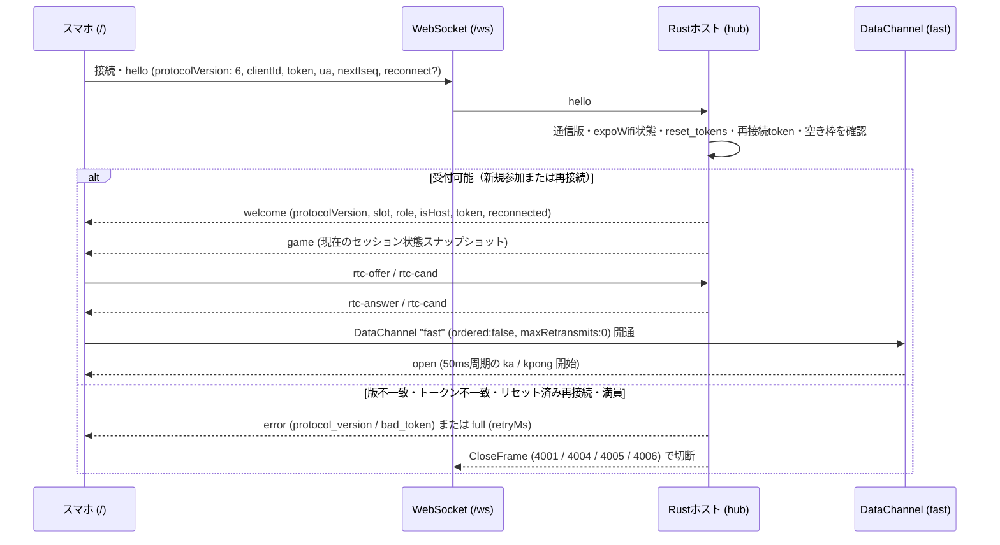
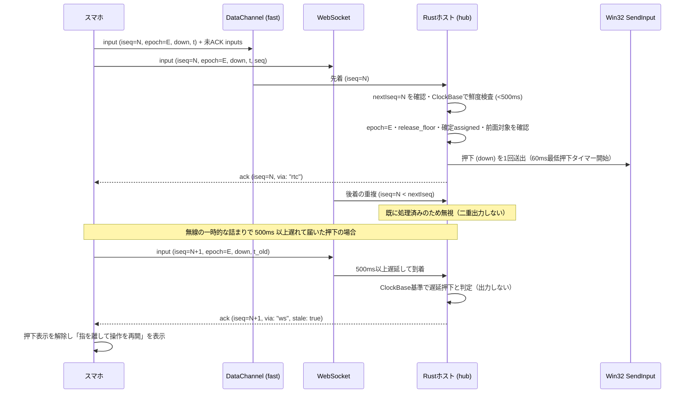
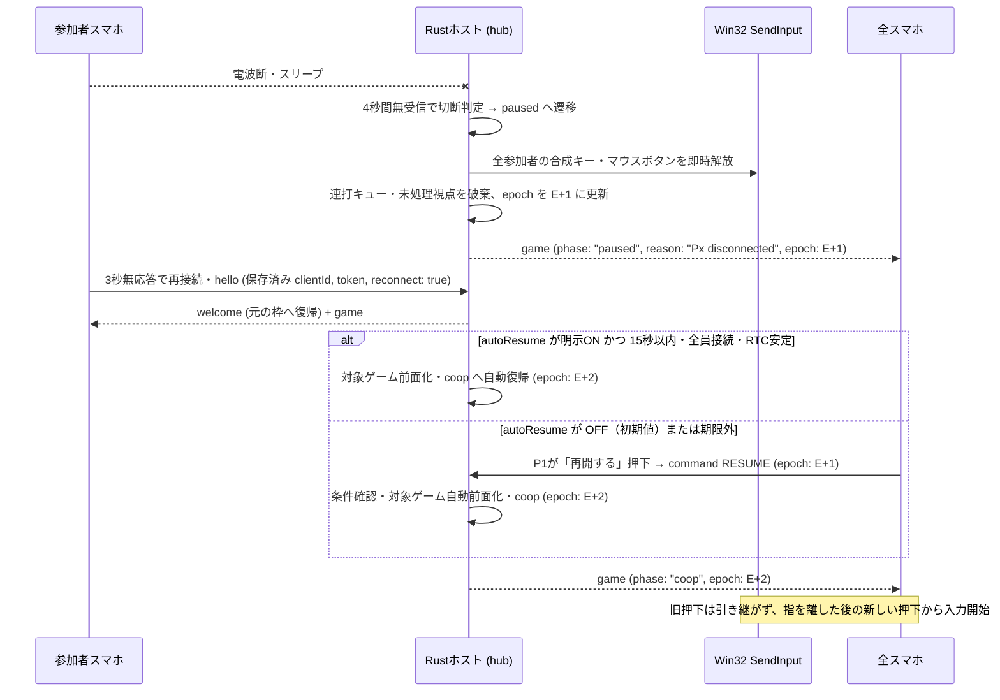
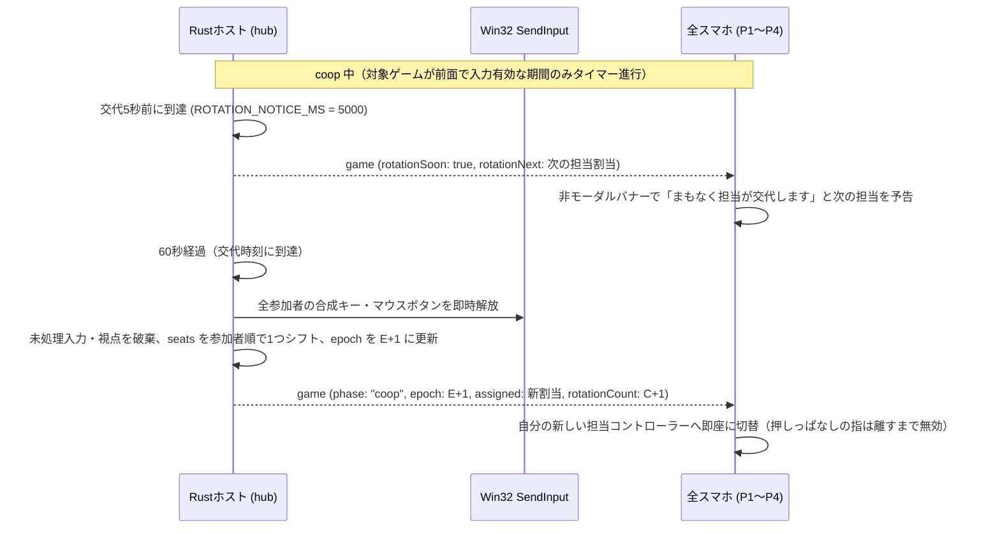

# Re:Cooplay 通信仕様書

**バージョン**: 0.2.0　**更新日**: 2026-11-18

[総合仕様](README.md) ／ [利用手順](usage.md) ／ [動作確認](verification.md)

---

## 📑 目次

1. [概要](#概要)
2. [接続情報](#接続情報)
3. [WebSocket接続フロー](#websocket接続フロー)
4. [スマホからホスト](#スマホからホスト)
5. [ホストからスマホ](#ホストからスマホ)
6. [メッセージ形式](#メッセージ形式)
7. [入力順序と二重送信](#入力順序と二重送信)
8. [切断・停止・再接続](#切断停止再接続)
9. [PC画面とホスト](#pc画面とホスト)
10. [安全停止の境界](#安全停止の境界)
11. [エラーハンドリング](#エラーハンドリング)
12. [開発・テスト](#開発テスト)
13. [関連ドキュメント](#関連ドキュメント)

---

## 概要

スマートフォンとPCホストは **WebSocket** で参加認可・セッション状態・リモコン操作・管理命令を交換し、**WebRTC DataChannel**（ラベル `fast`、`ordered: false`、`maxRetransmits: 0`）をボタン入力と30Hz累積視点移動の低遅延速達経路として併用します。

ゲームと参加人数（2〜4人）に応じた操作の分担はすべてホストが決定し、各端末へアクションID・実キー表示・確定担当（`assigned`）を通知します。スマホから任意のOSキーコードや実行ファイルパスを送ることはできず、ホストは受信時に「現在の接続枠・進行状態（`phase`）・世代（`epoch`）・確定担当・入力鮮度・前面ウィンドウ」を厳格に照合します。

---

## 接続情報

**通信契約**: `protocolVersion = 6`。版がない・一致しない `hello` は参加枠を割り当てずに `4005` で拒否します。DataChannelは `fast`、`ordered:false`、`maxRetransmits:0` です。待ち受けは既定 `0.0.0.0:8080`、環境変数 `PORT` または `config.json` の `port` で変更できます。STUN/TURNは使用しません。

速達経路（DataChannel `fast`）の `input` と50ms周期の `ka` は、直近500ms以内に送信してまだ `ack` が届いていない入力を `inputs` 配列として同梱できます（1フレームに現入力と合わせて最大64件、UTF-8で最大16KiB、ブラウザの送信サイズ上限も遵守）。ホストは同梱分も通常の `nextIseq` 連番・`epoch`・`release_floor`・500ms遅延破棄の判定に通します。WebSocket経路は各入力を1件ずつ送信します。

### 通信版の更新手順

1. 互換性が変わる場合は、正本の `apps/host-rs/protocol-version.txt` を更新し、`python scripts/sync-protocol-version.py` でRust（`apps/host-rs/src/protocol_version.rs`）とWeb（`apps/web/src/shared/transport/version.ts`）の定数を生成します。正本・生成物・本仕様書を同一コミットに含めます。
2. 同じコミットからホストとWebをビルドし、`node scripts/sim/protocol-sim.mjs` で現行版の参加と旧版・新版・版なしの拒否（枠を消費しないこと）を検証します。
3. CIの `python scripts/sync-protocol-version.py --check` が正本・生成定数・本仕様書の一致を検査します。

### HTTP / WebSocket エンドポイント一覧

| パス | 用途 | アクセス範囲 | キャッシュ制御 |
|:--|:--|:--|:--|
| `GET /` | スマホの操作・リモコン画面（`phone/index.html`） | LAN | `no-store` |
| `GET /app` | PCの参加・ゲーム選択・分担・設定画面（`pc/index.html`） | ループバックのみ（LANは403） | `no-store` |
| `GET /overlay` | 観客・配信向け透過オーバーレイ画面（`overlay/index.html`） | ループバックのみ（LANは403） | `no-store` |
| `GET /host` | 通信・入力注入の診断画面（`diagnostics/index.html`） | ループバックのみ（LANは403） | `no-store` |
| `GET /game` | OS入力照合用の疑似ゲーム画面（`pseudo-game/index.html`） | ループバックのみ（LANは403） | `no-store` |
| `GET /assets/<name>-<8文字hash>.js\|.css` | Viteビルドのハッシュ付きスクリプト・スタイル | LAN | `public, max-age=31536000, immutable` |
| `GET /api/info` | 参加URL・QR（Wi-Fi接続QR・ホットスポット状態・`build` 版情報はループバックのみ） | LAN（Wi-Fi情報はPC本体のみ） | `no-store` |
| `POST /api/hotspot` | Windowsモバイルホットスポット起動（一時SSID・パスフレーズ生成） | ループバック＋PC画面と一致するOriginのみ | `no-store` |
| `GET /api/game-image?id=...` | 検出ゲームおよびMinecraftランチャーのタイル画像（不明・画像なしは404） | ループバックのみ | `no-store` |
| `GET /ws` | WebSocketアップグレード（DNS再束縛対策のため `Host` と `Origin` を検証） | 参加者はLAN、`monitor` はループバックのみ | ― |

### RustとWebの実行時境界検査

| 境界 | 実行時に検査するモジュール | CIでの自動検証 |
|:--|:--|:--|
| **スマホ → ホスト**（入力・視点・制御） | Rustの `protocol.rs` がJSONと有限数値を解釈し、`hub.rs`・`session.rs`・`freshness.rs` が接続・担当・`epoch`・連番・鮮度を検証 | `cargo test`（`protocol.rs` / `session.rs` / `hub.rs`）＋ `protocol-sim.mjs` |
| **ホスト → スマホ**（参加応答・状態・ACK） | Webの `shared/transport/protocol.ts`（`decodeServerMessage`, `isPhoneGame`）が全フィールドの型を検証し、未知 `type` を隔離 | `protocol-boundary-test.mjs` ＋ Rust実出力と照合する `protocol-sim.mjs` |
| **ホスト → PC画面 / overlay**（状態・リモコン通知） | Webの `shared/transport/pc-messages.ts`（`decodePcMessage`, `decodeHotspotResult`）が実行時検証 | `pc-boundary-test.mjs` ＋ `protocol-sim.mjs` |

---

## WebSocket接続フロー



サーバーがP1〜P4の枠を割り当て、最初の端末をP1（ホスト）にします。ロビーで切断した枠は15秒間保持された後に解放され、P1が空いた場合は接続中で最も若い枠をP1へ移します（元のホストが後から戻った場合は空いている参加者枠へ入ります）。準備中（`preparing`）・協力プレイ中（`coop`）・一時停止中（`paused`）は切断枠を保持し、ホストの自動交代は行いません。

### WebSocket 終了コード一覧

| 終了コード | 意味・発生条件 | スマホ側の挙動 |
|:--|:--|:--|
| `4000` | 同じ `clientId`・`token` を持つ別タブ／新接続による置き換え | 旧接続は全解放して閉じ、新接続へ引き継ぐ |
| `4001` | PCで「全員リセット」実行、または張り直し中にリセットされた旧端末からの `reconnect: true` 付き `hello`（#576） | 自動再接続を停止し、「リセットされました。再読み込みして参加し直してください」と案内 |
| `4002` | `clientId` が空または欠落 | 再接続しない |
| `4003` | ループバック以外（LAN）からの `monitor` 管理接続要求 | 拒否・切断 |
| `4004` | 4枠すべて使用中（満員）。直前に `full`（ロビー保持枠が最も早く空くまでの `retryMs` 付き）を送信 | 自動再接続を停止し、満員と空き見込み秒数を表示 |
| `4005` | `protocolVersion` の不一致 | 自動再接続を停止し、ページの再読み込みを案内 |
| `4006` | 既存枠の `clientId` に対する再接続 `token` の不一致 | 自動再接続を停止し、PCでのリセットを案内 |
| `4007` | すでに `hello` または `monitor` で役割確定済みの接続からの二重識別要求 | 切断 |
| `4008` | ロビーでのホスト自動交代または手動移譲（`transfer_host`）による枠の移動 | 同じ `token` で即座に自動再接続し、新しい枠の `welcome` とWebRTC接続を受け取る |
| `4009` | PCアプリ（ホスト）の正常終了（全出力解放の後に送信、#302） | 自動再接続を停止し、「PCアプリが終了しました」と全画面で案内 |
| `4010` | 参加者自身の自主退出（`leave`、#546） | 自動再接続を停止し、退出完了と再参加時の再読み込みを案内 |

読取りが詰まった接続は、送信キューが **4,096件（`WS_QUEUE_LIMIT`）** に達するか、1回の送信が **4秒（`WS_SEND_TIMEOUT`）** を超えた時点でホスト側から切断し、通常の切断処理で出力を全解放します（#197）。

---

## スマホからホスト

| `type` | 経路 | 主な項目とホスト側の処理 |
|:--|:--|:--|
| `hello` | WS | `protocolVersion`, `clientId`, `token`, `ua`, `nextIseq`, 任意の `reconnect`。新規参加または再接続。`reconnect: true` は同一ページでの自動再接続を示し、全員リセットで無効化された直近32件の `reset_tokens` に一致する場合は新規枠を割り当てず `4001` で閉じる（#576） |
| `ping` | WS | `t`, `stats`（`avg`, `p95`, `max`, `unacked`, `path`, `rtc`）。1秒ごとの生存確認・通信統計の報告・遅延基準（`ClockBase`）の更新 |
| `transfer_host` | WS | `to`（`"P2"`〜`"P4"`）, `epoch`。ロビーのP1のみ有効。指定した接続中メンバーとP1の枠を入れ替え、双方を `4008` で再接続させてホスト権を移譲する（#233） |
| `leave` | WS | 項目なし。ロビーのP2〜P4のみ有効。15秒の切断保持を待たずに自分の枠を即座に削除して空け、分担決定をクリアして `4010` で閉じる（#546） |
| `command` | WS | `cmd`, `epoch`。P1のみ有効。`READY` / `PAUSE` / `RESUME` / `END` / `OPEN_GAME` / `OPEN_APP` / `PREPARE`。`READY` はロビーまたは準備中から対象ゲームを自動前面化して `coop` を開始する。`END` はゲームを閉じずにロビー（分担画面）へ戻り、デスクトップ版ではPCアプリを前面へ戻す |
| `input` | WS＋RTC | `iseq`, `epoch`, `button`（`act:<操作ID>` または `act:<操作ID>:up\|down`）, `state`（`"down"` / `"up"`）, `t`（`performance.now`）, 任意の `burst`。WSは連番検知用の `seq`、RTCは直近500msの未ACK配列 `inputs` も同梱可 |
| `look` | RTC（未接続時WS） | `lseq`, `epoch`, `cx`, `cy`。30Hzの累積視点移動。確定分担で `mouseDelta` 操作を担当する枠のみ受理 |
| `ka` | RTC | `t`, 任意の未ACK配列 `inputs`。共同操作中50msごとの生存確認・無線スリープ抑止・未ACK入力の速達再送 |
| `rtc-offer / rtc-cand` | WS | `sdp`、または `cand`, `mid`。WebRTC DataChannelのシグナリング |
| `remote` | WS | `epoch`, `rseq`, `kind`（`"move"` / `"scroll"` / `"release"`）, `dx`, `dy`。非 `coop` 時のP1のみ有効。各軸±120にクランプし、`remoteRoute`（`app` / `game` / `desktop`）に応じて排他的に送出 |
| `release_inputs` | WS | `epoch`, `iseq`, `lseq`, `cx`, `cy`。スマホ1台のblur・回転・非表示・編集開始時に送信。その端末の `iseq` 以下の押下と連打保留だけを解放し、他の参加者の押下と全体 `epoch` は維持する（#262） |
| `role_ok` | WS | `epoch`。役割交換（`swap_roles`）や人数変更（`change_players`）で担当が変わった本人による確認通知 |
| `latency` | WS | **遅延計測ビルド（feature `latency-measure`）専用**。`iseq`, `touchMs`（タッチから送信まで）, `rttMs`（送信からACK受信まで）。ホスト側の「受信から `SendInput` 完了まで（`hostMs`）」と合算して `totalMs = touchMs + rttMs/2 + hostMs` をログに記録する（#435） |

---

## ホストからスマホ

| `type` | 主な項目と意味 |
|:--|:--|
| `welcome` | `protocolVersion`, `token`, `slot`（`"P1"`〜`"P4"`）, `role`, `isHost`, `reconnected` |
| `error / full` | 拒否理由。`error` は `code`（`"protocol_version"` / `"bad_token"`）とホストの版。`full` の `retryMs` はロビーで保持中の切断枠が空くまでの最短残り時間（ms、真の満員時は `null`） |
| `game` | セッション全体の状態オブジェクト `game`（下表参照） |
| `command_result` | `cmd`, `accepted`, `reasons`（開始・再開・前面化が拒否された場合の具体的な理由リスト） |
| `ack` | `iseq`, `t`, `via`（`"ws"` / `"rtc"`）、旧 `epoch`・解放済み・500ms以上遅延した押下なら `stale: true` |
| `pong / kpong` | `ping` / `ka` に対応するエコー時刻 `t` |
| `rtc-answer / rtc-cand` | `sdp`, `sdpType`、または `cand`, `mid` |

### `game` オブジェクトの主要項目

| 項目 | 型・値 | 意味 |
|:--|:--|:--|
| `phase / reason / epoch` | `"lobby" \| "preparing" \| "coop" \| "paused"`, `string \| null`, `u64` | 現在の進行フェーズ、遷移理由、入力世代番号 |
| `required / maxPlayers / connected` | `2`, `4`, `Slot[]` | 最低参加人数（2人）、最大枠（4枠）、現在接続中の枠リスト |
| `canPrepare / canReady / canResume / readyReasons` | `boolean`, `string[]` | 各進行要求の可否と、開始できない理由の案内文 |
| `title / titleName / launch` | `string`, `string`, `{ id, state, message } \| null` | 選択中のゲームID（未選択時は `""`）、表示名、起動監視状態（`launching / started / failed / timeout`） |
| `quit` | `{ busy: boolean, can: boolean, message: string }` | PCアプリからのゲーム安全終了（`quit_game`）の実行中フラグ・実行可否・結果メッセージ（#547） |
| `lineup / lineupOk / lineupDisconnected` | `{ title, members } \| null`, `boolean`, `Slot[]` | PC画面で決定したメンバー、現在の接続との一致判定、決定後に切断・期限切れになった枠（#305） |
| `participants / assigned` | `Slot[]`, `Record<Slot, string[]>` | `READY` 時点で固定した協力プレイ参加者と、認可に使う確定アクション割当 |
| `roleOf / roleAck / canSwap / canChangePlayers` | `Record<Slot, Slot>`, `Slot[]`, `boolean`, `boolean` | 枠から席順への対応、担当変更の本人確認待ちリスト、役割交換可否、一時停止中の人数組み直し可否 |
| `rotationSeconds / rotationSoon / rotationNext / rotationCount` | `0 \| 60`, `boolean`, `Record<Slot, string[]> \| null`, `u64` | 時間制役割ローテーションの間隔（秒）、5秒前予告フラグ、次の担当割当、累計交代回数（#161） |
| `keys` | `{ source, warnings, controls, actions, edited }` | 操作IDから実出力 `{ out, label } \| null` への解決結果、設定読取り警告、PCで上書き編集された操作IDリスト |
| `profile` | `Profile \| null` | 選択ゲームの操作定義要約、現在人数の分担案 `assignment`、人数別案 `assignments`、作り方 `presetSource`（`"model" \| "rule"`）、`modelPresetAvailable`、`presetChoosable` |
| `canLaunch / canOpenApp` | `boolean`, `boolean` | ゲーム起動要求の可否、P1スマホからPCアプリを前面に戻すボタン（`OPEN_APP`）の表示可否（#292） |
| `remoteRoute / remoteLeave` | `"app" \| "game" \| "desktop" \| "none"`, `boolean` | P1リモコンの現在の送信先と、PCアプリ画面端からOS実カーソルへ引き継げるかの判定（#287・#405） |
| `inputActive / inputTarget` | `boolean`, `boolean` | 現在OSへの入力注入が有効か、`injectMode: "on"` だが対象ゲームが前面にない状態か |
| `autoResume / autoResumeMs / autoResumeUntil` | `boolean`, `u64`, `u64` | 自動復帰設定（初期OFF）、待機時間（15,000ms）、復帰期限のUnix時刻（ms） |

---

## メッセージ形式

### Client → Server（DataChannel `fast` での未ACKバンドル付き操作入力）

```json
{
  "type": "input",
  "iseq": 42,
  "epoch": 5,
  "button": "act:jump",
  "state": "down",
  "t": 18420.5,
  "inputs": [
    {"type": "input", "iseq": 41, "epoch": 5, "button": "act:forward", "state": "down", "t": 18360.2}
  ]
}
```

### Server → Client（受信確認 ACK）

```json
{"type": "ack", "iseq": 42, "t": 18420.5, "via": "rtc"}
```

---

## 入力順序と二重送信



---

## 切断・停止・再接続

### 1. 通信切断・全解放・再接続フロー



### 2. 時間制の役割ローテーション（60秒交代、#161）



---

## PC画面とホスト

### 管理メッセージ一覧（ループバック `monitor` 接続専用）

| 方向 | `type` | 主な項目と処理内容 |
|:--|:--|:--|
| 画面 → ホスト | `monitor` | `page: "app" \| "host" \| "game"`。ループバックからの管理接続として登録し、直ちに最新 `state` を受信 |
| 画面 → ホスト | `inject_mode` | `mode: "on" \| "off" \| "test"`。変更時は全出力解放・`epoch` 更新。`input_fault` からの再開にも使用 |
| 画面 → ホスト | `focus` | `focused: boolean`。疑似ゲーム（`/game`）およびブラウザで開いた `/app` のフォーカス状態を通知 |
| 画面 → ホスト | `select_game` | `title`。検出一覧または `minecraft-java` / `pseudo-game` を選択。旧分担決定をクリアしキー設定とAI分担を準備 |
| 画面 → ホスト | `confirm_lineup` | `title`, `members`, `epoch`。現在のゲームと接続メンバー（P1を含む2〜4人）に一致する分担を決定 |
| 画面 → ホスト | `unconfirm_lineup` | ロビーで分担画面からゲーム選択へ戻る際、決定を取り消す |
| 画面 → ホスト | `preset_source` | `source: "model" \| "rule"`。ロビーで分担の作り方（独自AI／定型ルール）を切り替える（#432） |
| 画面 → ホスト | `remake_preset` | ロビーで選択中ゲームのAI分担（未定義ゲームはファイルからの操作抽出を含む）を再実行する（#432） |
| 画面 → ホスト | `launch_game` | `id`。決定済みの選択ゲームを起動（既にウィンドウがあれば再起動せず前面化） |
| 画面 → ホスト | `quit_game` | `title`, `epoch`。非 `coop` 時に選択中ゲームのウィンドウへ `WM_CLOSE` を送って終了し、ゲーム未選択のロビーへ戻す（#547・#570） |
| 画面 → ホスト | `prepare / open_game` | 準備フェーズへの移行・対象ゲームウィンドウの前面化 |
| 画面 → ホスト | `swap_roles` | `a`, `b`（`"P1"`〜`"P4"`）。開始前または一時停止中に2人の席順（担当束）を交換し、双方の `role_ok` 確認待ちにする |
| 画面 → ホスト | `change_players` | `epoch`。一時停止中に現在の接続メンバーで参加者と分担を組み直し、全員の `role_ok` 確認待ちにする（#162） |
| 画面 → ホスト | `set_key` / `reset_keys` | 操作ID `action` に割り当てる実キー `output`（出力IDまたは「送らない」を示す `null`）の変更と初期値へのリセット。`%LOCALAPPDATA%\Re-Cooplay\key-overrides.json` へ保存（#50・#53） |
| 画面 → ホスト | `rotation` | `seconds: 0 \| 60`。60秒ごとの時間制役割ローテーションのON/OFF（非 `coop` 時のみ変更可、ロビー帰還で0に戻る、#161） |
| 画面 → ホスト | `auto_resume` | `on: boolean`。通信切断からの自動復帰のON/OFF。明示選択として `config.json`（`settingsVersion: 2`）へ保存（#225） |
| 画面 → ホスト | `refresh_games` | インストール済みゲームの再スキャンを要求 |
| 画面 → ホスト | `add_game` | PC上でWindowsのファイル選択ダイアログを開き、`.exe` を手動登録 |
| 画面 → ホスト | `rename_game / remove_game` | `id`（`"manual:..."`）, 変更時は `name`（最大60文字）。手動登録ゲームの名前変更・登録解除 |
| 画面 → ホスト | `remote_leave` | `x`, `y`, `w`, `h`（CSS px）。PCアプリの仮想カーソルがウィンドウ端を越えた際、前面ウィンドウの同割合の位置へOSカーソルを移し `remoteRoute: "desktop"` へ引き継ぐ（#405） |
| 画面 → ホスト | `phase` | `phase: "lobby" \| "paused"`。ダッシュボードからの終了・一時停止（`coop` の強制開始は不可） |
| 画面 → ホスト | `reset` | 任意の `rotateWifi: boolean`。全枠を `4001` で切断してセッションを初期化し、トークンを `reset_tokens` に記録。`rotateWifi: true`（`/app` からの全員リセット）ではRe:Cooplayが起動したホットスポットのSSID・パスワードも自動で再生成する（#563） |
| 画面 → ホスト | `observe` | `events`。疑似ゲーム（`/game`）が実際に受け取ったOS入力イベントの照合記録 |
| ホスト → 画面 | `state` | 全枠の詳細統計、`game`、`inject`、検出 `games`、`minecraft`、`network`、`expoWifi` を含む全体状態（変化時および1秒周期） |
| ホスト → 画面 | `key_result` | `ok: boolean`。`set_key` / `reset_keys` のファイル保存結果 |
| ホスト → 画面 | `manual_result` | `ok: boolean`, `message: string`。手動ゲーム登録の結果通知 |
| ホスト → 画面 | `inject / look / log` | 注入イベント、100msごとの視点移動集計、セッションログエントリ |
| ホスト → 画面 | `remote / remote_input` | P1のPC画面向け仮想カーソル通知（`remote`）およびOS/ゲーム向けリモコン注入記録（`remote_input`） |

### `state` メッセージの構成

| 項目 | 内容 |
|:--|:--|
| `slots` | P1〜P4の接続状態、端末情報、再接続回数、押下中操作、RTT統計、WebRTC状態、直近10秒の途切れ `net`（`stalls`, `maxStallMs`, 閾値3回到達時の `lastWarning`） |
| `game` | スマホにも配信されるセッション進行・割当・キー・起動・終了状態 |
| `inject` | 注入モード、有効判定、`inputFault`、未確認解放出力 `releaseUnconfirmed`、再試行回数 `releaseRetryAttempts`、緊急停止キー登録状態、前面対象照合 `target`（`ok`, `expect`, `process`, `title`）、押下中物理出力 `down` |
| `games / gamesScanning` | 7系統ランチャー＋手動登録から検出したゲーム一覧（`id`, `name`, `source`, `verified`, `launchable`, `image`）とスキャン中フラグ（インストール先パスは送らない） |
| `minecraft` | 公式ランチャーの `detected`, `image`, `launchable` |
| `network` | `bluetoothAudio`（既定音声出力がBluetoothか）および `lowLatency`（Wi-Fiメディアストリーミングモードが有効か） |
| `expoWifi` | 全員リセット時の一時Wi-Fi張り直し状態（`"switching" \| "ready" \| "failed" \| null`、#563） |

---

## 安全停止の境界

入力OFF、対象ウィンドウのフォーカス喪失、フェーズやゲームの切り替え、60秒役割ローテーション、全員リセット、ゲーム終了、アプリ終了時は、必ず合成入力と保留キュー・未処理視点をすべて解放・破棄し、`epoch` を更新します。

端末1台のblur・回転・非表示・レイアウト編集開始（`release_inputs`）では、その端末の押下と連打保留だけを解放し、他の参加者のプレイを妨げません（#262）。ホストのリモコン経路（`app` / `desktop` / `game`）と協力プレイの注入経路は完全に排他的です。

---

## エラーハンドリング

通信版不一致（`4005`）・再接続トークン不一致（`4006`）・全員リセット後の旧タブ自動再接続（`4001`）・満員（`4004`）はすべて枠を確保する前に接続境界で拒否します。古い `epoch` の開始・再開要求は `command_result` で理由を返して拒否し、古い `epoch` や500ms以上遅延した押下入力は出力せずに `stale: true` のACKを返します。

---

## 開発・テスト

```powershell
node scripts/sim/protocol-sim.mjs
node scripts/sim/shutdown-sim.mjs
node scripts/sim/protocol-boundary-test.mjs
node scripts/sim/pc-boundary-test.mjs
python scripts/sync-protocol-version.py --check
```

実装：[HTTP・WS受付](../apps/host-rs/src/main.rs) ／ [JSONデコード境界](../apps/host-rs/src/protocol.rs) ／ [認可・順序制御](../apps/host-rs/src/hub.rs) ／ [純粋セッション判定](../apps/host-rs/src/session.rs) ／ [DataChannel](../apps/host-rs/src/rtc.rs) ／ [Web受信検証](../apps/web/src/shared/transport/protocol.ts)

---

## 関連ドキュメント

[総合仕様](README.md) ／ [フロントエンド仕様](frontend-specification.md) ／ [ホスト仕様](host-specification.md) ／ [ゲーム操作定義仕様](game-profile-specification.md) ／ [分担AI仕様](preset-model-specification.md)
