# Re:Cooplay READMEのデザイン

[製品紹介](../README.md) ／ [文字だけのREADME](../README-text.md) ／ [README用の図版](../assets/readme/README.md) ／ [ギャラリー](gallery.md)

Re:CooplayのREADMEは見出し・目次・図の1枚1枚まで作り込んでいます。開いて驚いた方もいるかもしれません。この資料は、READMEのデザインを手がけた作者が、何を狙い、どう判断したかをまとめたものです。こだわりの裏にある考え方を、**判断の理由**を中心に残します。

図の作り方や配信の仕組みの細かな手順は [README用の図版](../assets/readme/README.md) に、制作中の作業と確認の記録は [開発資料](develop/README.md) にあります。

## はじまり：「最強のREADMEをつくろう」

今回のREADMEの刷新は「最強のREADMEをつくろう」というコンセプトから始めました。

いちばん大事にしたのは**遊び心**です。Re:Cooplayはゲームに関わる、楽しい製品です。その製品を紹介するREADMEにも、遊び心がほしいと考えました。作品名の見出しで「。」と「:」が繰り広げる物語（2節）や、見出しの横で項目の内容を演じるキャラクター（3節）に、この遊び心が表れています。

刷新を始めるときには、次のことを決めました。

- 装飾を足すのではなく、情報の並べ方・見た目の階層・文字・図まで含めて、README全体を1つのプロダクトとしてデザインする。
- 手段を先に決めず、この作品にとって最適なREADMEは何かを考える。
- GitHub上で機能しない表現は使わない。

このデザインはほかのリポジトリを参考にしたものではありません。作者がAIと壁打ちしながら、自分のアイデアで形にしました。

## この資料の読み方

上から順に読むと、「何を狙ったか」から「どう作るか」へ進むように並べています。

| まとまり | 節 | 内容 |
|---|---|---|
| 狙い | 1〜3 | READMEで読み手に何を感じてもらうか。最初の見出しと、下へ進むほど増える要素 |
| 土台 | 4 | すべての図に共通する、ライト・ダーク × PC・スマホの4種類の画像 |
| 配置 | 5 | 図の見た目より先に決めた、冒頭と各項目の並べ方 |
| 見た目の決まり | 6〜12 | 色・文字・部品・見出し・キャラクター・動き・実際の画面 |
| 画像の形式と代わりの手段 | 13〜14 | SVGとWebPの使い分けと、画像が読み込めないときの文字だけのREADME |
| 作り方 | 15〜16 | 作るときの判断と、ほかのREADMEに持ち出すときのチェックリスト |

### 画像の示し方

特定の部分のデザインを説明する所には、READMEで使っている画像の実物を置いています。画像はすべて「画像1」のような番号の見出しと、ファイルの場所を書いた枠の中に入れています。**枠の中は画像、枠の外はこの資料の本文です。** とくに見出しの画像は本物の見出しと見分けがつかないように作っているため、枠の外に置くとこの資料の見出しと区別できなくなります。

画像はREADMEと同じ方法で、閲覧している画面のテーマ（ライト・ダーク）と幅（PC・スマホ）に合う1枚を表示します。4種類をすべて並べているのは、4節の画像3だけです。

## 1. いちばんの狙い：「ぱっと見ふつう」から「えええ」へ

このREADMEは最初から圧倒するのではなく、**驚きを段階的に大きくする**ように作っています。

1. 開いた瞬間は、ありきたりな製品紹介のREADMEに見えます。作品名の見出しも概要文もGitHubでいつも見る見た目です。
2. 概要文を読んでいると、見出しがいきなり動き出します。いつも見ているものだと思っていたら、いつもではありえないことが始まります。ここで最初の驚きを届けます。
3. 下へ読み進めると、ふつうのREADMEではまず見ない要素が続きます。見出しの横で演じるキャラクター、実機の操作の録画、ライト・ダークとスマホに合わせた図。最後は「圧巻」と感じてもらうことを狙っています。

最初から派手にすると、読み手は「凝ったページだ」と身構え、驚きは小さくなります。**期待を一度ふつうまで下げてから裏切る**ことで、同じ演出でも印象が大きく変わります。

## 2. 作品名の見出し（h1）：ふつうの見出しに錯覚させる

作品名の見出しは、GitHubのふつうの見出しと見分けがつかないことを最優先にしています。動きの物語は、その錯覚が成立してから始まります。

<table><tr><th align="left">画像1　作品名の見出し（約5秒後に動き出す）<br><sub>READMEで使っている画像の実物：<code>assets/readme/title-*.svg</code></sub></th></tr><tr><td><picture><source media="(min-width: 481px)" srcset="../assets/readme/hide.svg" width="0" height="0"><source media="(prefers-color-scheme: dark)" srcset="../assets/readme/title-narrow-dark.svg"></picture><picture><source media="(max-width: 480px), (min-width: 1266px)" srcset="../assets/readme/hide.svg" width="0" height="0"><source media="(prefers-color-scheme: dark)" srcset="../assets/readme/title-narrow-dark.svg"></picture><picture><source media="(max-width: 1265px)" srcset="../assets/readme/hide.svg" width="0" height="0"><source media="(prefers-color-scheme: dark)" srcset="../assets/readme/title-dark.svg"></picture></td></tr></table>

### 2.1 錯覚を成立させる工夫

| 工夫 | 理由 |
|---|---|
| 文字はGitHub本体と同じフォント指定・大きさ・太さ（作品名はh1の32px、キャッチコピーはh2と同じ24px、太さ600）で描く | 画像だと気づかれないようにする |
| 1文字ずつの位置は、GitHubの見出しをChromeで実測した幅で置く | OSの書体の差で文字の並びが不自然にならないようにする |
| `<h1>` の中に `align="absbottom"` で画像を入れる | 見出しの下線までの間隔を、ふつうの見出しと同じにする |
| 一番上に「※JPHACKS 2026 Award Dayでの内容です」を、GitHubの引用と同じ見た目で描く | 下の2つを参照 |

注釈を入れる形は、前年のJPHACKS作品（[kz_2504](https://github.com/jphacks/kz_2504)）のREADMEと同じです。一番上の「※」の注釈には、2つの役割があります。

- 蹴られた「。」の放物線が見える場所になります。注釈の行と見出しの間の余白を、ボールが飛ぶ空間として使います。
- 不自然な余白を作りません。放物線のための余白を何もない空白として取ると、見出しの上が妙に空いて、画像だと気づかれます。引用の行で埋めると、READMEの先頭に注釈と見出しを並べたときと同じ位置になり、違和感がなくなります。

### 2.2 動き出す時刻

- 表示してから約5秒はまったく動きません（止まった時間3.5秒と、赤が歩き出すまでの約1.5秒）。1周は20.5秒です。
- 見出しのすぐ下に概要文を置いています。読み手が概要文を読み始めたころに、視界の端で見出しが動き出す配置です。
- 5秒より短いと、読み手が見出しを「ふつう」と思い込む前に動いてしまいます。長すぎると、見出しの下を読み終えてスクロールした後に動き、見てもらえません。

### 2.3 物語

赤のキャラクターがためてから文末の「。」を蹴ります。「。」は行をまたいで「Re:Cooplay」の「:」に当たり、「:」は2つの点に割れて落ちます。やってしまった赤は「。」を拾ってみんなに謝り、青と緑が点を1つずつ元へ戻します。みんなで喜んだ後、3体は去り、赤は「。」を文末へ戻して去ります。

- 製品のテーマを演じています。1人の失敗をみんなで直す流れは、1つのキャラクターをみんなで動かす協力プレイそのものです。
- 見出しの文字を素材にします。句読点の「。」と「:」という、ふつうは誰も気にしない記号が動くので、「見出しだと思っていたもの」が動いた驚きが強くなります。
- 終わったら元の見出しに戻ります。最後は完全に元の見た目に戻り、また止まります。何度見ても、ふつうの見出しから始まります。
- キャラクターは歩いて来て、歩いて去ります。文字に乗れる高さを計算し、点を戻すときだけ文字の段を上ります。

## 3. 下へ進むほど増える「見たことのない要素」

1の狙いに沿って、ページの下に行くほど、ふつうのREADMEにはない要素を重ねています。

| 位置 | 要素 | 驚きの種類 |
|---|---|---|
| 冒頭 | 作品名の見出しのアニメーション | ふつうの見出しが動く |
| 冒頭 | 紹介動画・受賞結果・目次を、カードの図にそろえる | 見出しの画像まで含めて、1つのデザインで統一されている |
| 冒頭 | 受賞結果の見出しの点がキャラクターになり、金沢から東京へのJPHACKSの道のりを演じる | 目次と同じ見出しだと思っていた点が動き出す |
| 各項目の見出し | 見出しの横で、スマホの形をしたキャラクターが項目の内容を演じる | 見出しごとに違う小さな劇がある |
| 製品説明・注力したこと | 図の中のスマホ画面で、実機の操作の録画が動く | 図だと思ったら本物の画面が動いている |
| 全体 | ライト・ダークのテーマと、スマホの画面幅に合わせて、図が描き直される | どの環境で開いても崩れない |
| 末尾 | 締めの「さあ、みんなで遊ぼう！」 | 製品の世界観で終わる |

<table><tr><th align="left">画像2　項目の見出しと、横で内容を演じるキャラクター<br><sub>READMEで使っている画像の実物：<code>assets/readme/heads/play-03-*.svg</code></sub></th></tr><tr><td><picture><source media="(min-width: 481px)" srcset="../assets/readme/hide.svg" width="0" height="0"><source media="(prefers-color-scheme: dark)" srcset="../assets/readme/heads/play-03-narrow-dark.svg"></picture><picture><source media="(max-width: 480px), (min-width: 668px) and (max-width: 767px), (min-width: 932px)" srcset="../assets/readme/hide.svg" width="0" height="0"><source media="(prefers-color-scheme: dark)" srcset="../assets/readme/heads/play-03-compact-dark.svg"></picture><picture><source media="(max-width: 667px), (min-width: 768px) and (max-width: 931px), (min-width: 1266px)" srcset="../assets/readme/hide.svg" width="0" height="0"><source media="(prefers-color-scheme: dark)" srcset="../assets/readme/heads/play-03-mid-dark.svg"></picture><picture><source media="(max-width: 1265px)" srcset="../assets/readme/hide.svg" width="0" height="0"><source media="(prefers-color-scheme: dark)" srcset="../assets/readme/heads/play-03-dark.svg"></picture></td></tr></table>

## 4. 1つの図に4種類の画像を用意する

READMEの図は見出し・目次・カード・録画の図まで含めて、**すべて4種類の画像を用意しています**。ライトとダークの2つのテーマと、PCとスマホの2つの画面幅の組み合わせです。閲覧者の環境に合う1枚だけを表示するので、どの環境で開いても、その環境のために描いた図が出ます。

色を反転させたり、PC用の図を縮めたりして済ませないのは、それでは崩れるからです。ダークの画面で白い背景の図は浮き、スマホでPC用の図を縮めると文字が読めないほど小さくなります。「ふつうのREADMEに見える」ことを狙う以上、どの環境でもGitHubの本文になじむ必要があります。

### 4.1 4種類の画像

| 種類 | ファイル名の末尾 | 画像の幅 | 表示する環境 |
|---|---|---|---|
| PC・ライト | `-light` | 838px | 画面の幅が1266px以上で、ライトのテーマ |
| PC・ダーク | `-dark` | 838px | 画面の幅が1266px以上で、ダークのテーマ |
| スマホ・ライト | `-narrow-light` | 324px | 画面の幅が1265px以下で、ライトのテーマ |
| スマホ・ダーク | `-narrow-dark` | 324px | 画面の幅が1265px以下で、ダークのテーマ |

「スマホ」の画像は、タブレットや狭いPCの画面にも使います（4.6節）。

作品名の見出しの4種類を、切り替えずにすべて並べると次のようになります。ダークの2枚は暗い背景用の色なので、ライトの画面では文字が薄く見えます。

<table><tr><th align="left">画像3　作品名の見出しの4種類（切り替えずに4枚とも並べたもの）<br><sub>READMEで使っている画像の実物：<code>assets/readme/title-*.svg</code></sub></th></tr><tr><td><sub>PC・ライト：<code>title-light.svg</code>（幅838px）</sub><br></td></tr><tr><td><sub>PC・ダーク：<code>title-dark.svg</code>（幅838px）</sub><br></td></tr><tr><td><sub>スマホ・ライト：<code>title-narrow-light.svg</code>（幅324px）</sub><br></td></tr><tr><td><sub>スマホ・ダーク：<code>title-narrow-dark.svg</code>（幅324px）</sub><br></td></tr></table>

### 4.2 切り替え方

READMEでは、図1つを、PC用とスマホ用の2つの `<picture>` に分けて隙間なく並べます。それぞれの最初の `<source>` は、その版を使わない画面幅で、幅0・高さ0の透明な画像（`hide.svg`）に差し替えて消すためのものです。2つ目の `<source>` はダークのテーマの条件だけを持ちます。

```html
<picture><source media="(min-width: 1266px)" srcset="assets/readme/hide.svg" width="0" height="0"><source media="(prefers-color-scheme: dark)" srcset="assets/readme/features-narrow-dark.svg"></picture><picture><source media="(max-width: 1265px)" srcset="assets/readme/hide.svg" width="0" height="0"><source media="(prefers-color-scheme: dark)" srcset="assets/readme/features-dark.svg"></picture>
```

1つの `<source>` に「画面幅」と「テーマ」の条件を一緒に書かないのは、GitHubが `<picture>` を `<themed-picture>` で包み、外観を「ライト」か「ダーク」に固定した利用者には、テーマの条件を含む `<source>` の条件を丸ごと書き換えるためです（2026-11-22に確認）。`(max-width: 700px) and (prefers-color-scheme: dark)` と書くと幅の条件も消え、ダークに固定した利用者には、PCでもスマホ用の図が出ていました。

この形は手では書きにくいので、上の4.1節の4枚を1つの `<picture>` に並べた書きやすい形（`(max-width: 700px) and (prefers-color-scheme: dark)` などの旧形式）で書き、`python scripts/readme/markup.py migrate` で書き換えます。`python scripts/readme/markup.py check`（CIの `structure` でも実行）が、テーマの条件とほかの条件を一緒に書いていないかを確かめます。

### 4.3 画像の幅は、GitHubの本文欄の幅に合わせる

- 図はGitHubの本文欄と同じ幅で描きます。PCは838px、幅390pxのスマホは324pxです（どちらも実測）。本文欄の幅は画面の幅どおりには変わらず、画面幅1012〜1279pxでは555〜823px、768〜1011pxでは391〜634pxです（右の欄が下へ回るため）。
- READMEでは幅を指定せず、原寸で表示します。縮小も拡大もしないので、ぼやけません。
- 原寸で表示するので、図の中の文字の大きさがそのまま画面上の大きさになります。本文の16pxと図の文字の大きさの比が、PCとスマホでそろいます。
- 図の文字はPC用で13px以上、スマホ用で14.1px以上にします（スマホ用は `build_art.svg()` が引き上げる）。`python scripts/readme/check_text_size.py` が、実測した25通りの画面幅（版の境目の両側を含む）で表示時の大きさを計算し、12.5px以上かを確かめます。幅360pxのAndroidでもスマホ用の図は0.89〜0.91倍に縮むので、スマホ用は少し大きめにしています。
- 図の文字は閲覧者の端末のフォントで描くので、端末によって字幅が変わります。`node scripts/readme/check_text_fit.mjs` が、Windows・Android（Noto）・macOSとiPhone（Arialとヒラギノに近いNoto Sans JP）の字幅で描き、文字が枠や図の外にはみ出さないかを確かめます。

### 4.4 スマホ用の画像は、縮めずに組み替える

- 文字の大きさはPC用と同じにして、配置を組み替えます。横に並べたカードは縦1列にし、見出しは改行の位置を変えます。
- 作品名の見出しは、PC用では「Re:Cooplay（リコープレイ）」と「ゲームはそのまま。1キャラを、みんなで操作。」の2行、スマホ用では4行に分けています（画像3）。
- 画面の幅で見え方を変えるのはGitHub本体も同じなので、スマホで開いても「ふつうのREADME」に見えます。

### 4.5 ライトとダークは、テーマごとに描き直す

ライトとダークで、背景・文字・線の色を別々に決めています。図は背景を塗らずに枠線と文字で組むので（8節）、テーマで変わるのは主に文字と線の色です。

| 役割 | ライト | ダーク |
|---|---|---|
| 文字 | `#2E2B48` | `#EEF1F7` |
| 補助の文字 | `#625E72` | `#AEB4C2` |
| 線 | `#D8DEE8` | `#343B4E` |
| 大見出しの帯の背景 | `#E8FAFF` → `#FFF5DC` | `#141827` → `#231B35` |
| 目次の項目名（GitHubのリンク色） | `#0969DA` | `#4493F8` |

ブランドのグラデーションとキャラクターの4色は、どちらのテーマでも同じ色です（6節）。

### 4.6 タブレットや狭いPCの画面では、スマホ用を原寸で左端に置く

GitHubは画面の幅が768px以上になると、本文の横に欄を出し、本文欄が狭くなります。PC用の図（幅838px）は、本文欄が808pxより狭いと縮み、13pxの文字が12.5pxを下回ります。iPadの縦向き（768〜834px）では本文欄が391〜457pxになり、文字が6〜7pxまで縮んでいました。

そこで、PC用の図は画面の幅1266px以上だけで使い、それより狭い画面ではすべての図をスマホ用にします。スマホ用の図は幅324pxの原寸で表示し、本文欄が広くても、本文と同じく左端に置きます。中央に置く案も試しましたが、左寄せの本文と図の左端がずれ、見た目が不自然でした。

ただし、スマホ用を原寸で置くと、本文欄が広い画面（iPadの横向き、幅1100pxのPCなど）では図の右に大きな空きができます。そこで、本文欄が555px以上になる画面幅（668〜767pxと932〜1265px）には、幅620pxで描いた中間の版を用意し、本文欄の幅いっぱいに表示します。本文欄が555〜808pxなので、0.895〜1.30倍で表示されます。縮んでも12.5pxを下回らないよう、文字はスマホ用と同じく14.1px以上にします。中間の版はまず、項目の見出し・大見出し・目次・動画への誘導に用意しました。項目の見出しは、PC用と同じく番号の右に英字ラベルと見出しを並べ、右に舞台を置きます。長い見出しは2行に折り返します。目次の項目と、録画の図の切り絵（幅を%で指定した画像）は、画面幅420〜1265pxでは別の `<picture>` で幅をpxで指定し、本文欄の幅に合わせて拡大されないようにします。

## 5. 配置

図を作り込むほど、並べ方が乱れていると読み手の負担になります。そこで、図の見た目より先に、冒頭と各項目の並べ方を決めました。

### 5.1 冒頭は軽くし、目次まで自然に流す

- 冒頭は「作品名の見出し → 概要文 → 紹介動画 → 受賞結果 → 目次」の順です。何の製品か、どんなものか、評価されたかが目次までの短い間に伝わります。
- 実プレイ映像は冒頭ではなく、「試遊での反応」に置きます。

### 5.2 各項目は「文章 → 図」の順にする

- 各項目ではまず文章で要点を述べ、その後に図・表・画像で見せます。
- 図と図の間に文章を挟みません。挟むと詰まって見えます。
- 図1枚でページを占有しないようにします。横長の図にしたり、小さな図を2枚並べたりして、PCでもスマホでも読み進めやすくします。
- 図と文字の間には余白を取り、カードの中の文字の始まりの高さもそろえます。
- 背景の考え方は1枚の図で示します。

## 6. 色

- ブランドのグラデーションは紫 `#C03BFF` → 青 `#6F86FF` → 水色 `#22C4FA` です。使う場所を、大きな数字・細い線・矢印・札の縁に限ります。面を塗ることはほとんどなく、塗るときも不透明度を14%に抑えます。派手にせず、要所だけを目立たせるためです。
- キャラクターの4色はP1青 `#24C2FA`・P2緑 `#5EFF5D`・P3紫 `#CB00EA`・P4赤 `#FF1D00` です。アプリの `colors.css` と同じ色です。図の中で「誰の担当か」を示すときは、必ずこの4色を使います。**色に役割の意味を持たせ、最後まで同じ意味で使う**ので、読み手は色だけで担当を追えます。
- 文字の黒は純粋な黒ではなく、ブランドの色になじむ青紫寄りの黒です（4.5の表）。
- 色の上に載せる文字は色ごとに濃い色か白かを選びます。目次の項目名はGitHubのリンク色で描き、画像でも押せるリンクに見えるようにします。

<table><tr><th align="left">画像4　ブランドのグラデーションを数字と棒に使う<br><sub>READMEで使っている画像の実物：<code>assets/readme/stats-*.svg</code></sub></th></tr><tr><td><picture><source media="(min-width: 481px)" srcset="../assets/readme/hide.svg" width="0" height="0"><source media="(prefers-color-scheme: dark)" srcset="../assets/readme/stats-narrow-dark.svg">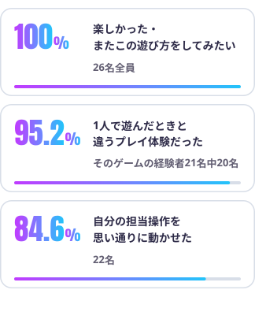</picture><picture><source media="(max-width: 480px), (min-width: 1266px)" srcset="../assets/readme/hide.svg" width="0" height="0"><source media="(prefers-color-scheme: dark)" srcset="../assets/readme/stats-narrow-dark.svg"></picture><picture><source media="(max-width: 1265px)" srcset="../assets/readme/hide.svg" width="0" height="0"><source media="(prefers-color-scheme: dark)" srcset="../assets/readme/stats-dark.svg">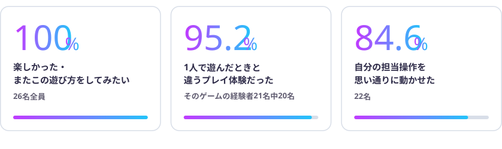</picture></td></tr></table>

<table><tr><th align="left">画像5　役割の4色で担当を示す札<br><sub>READMEで使っている画像の実物：<code>assets/readme/genres-*.svg</code></sub></th></tr><tr><td><picture><source media="(min-width: 481px)" srcset="../assets/readme/hide.svg" width="0" height="0"><source media="(prefers-color-scheme: dark)" srcset="../assets/readme/genres-narrow-dark.svg">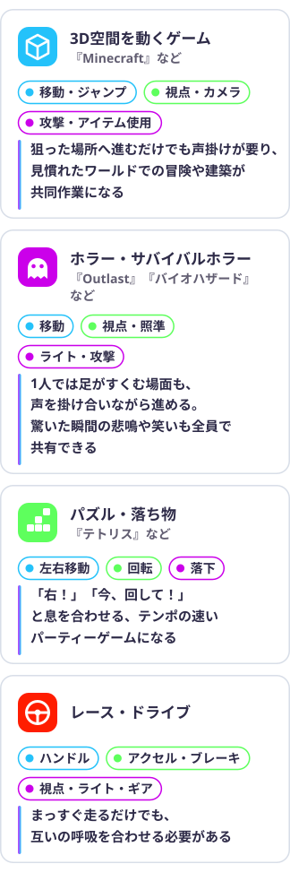</picture><picture><source media="(max-width: 480px), (min-width: 1266px)" srcset="../assets/readme/hide.svg" width="0" height="0"><source media="(prefers-color-scheme: dark)" srcset="../assets/readme/genres-narrow-dark.svg"></picture><picture><source media="(max-width: 1265px)" srcset="../assets/readme/hide.svg" width="0" height="0"><source media="(prefers-color-scheme: dark)" srcset="../assets/readme/genres-dark.svg">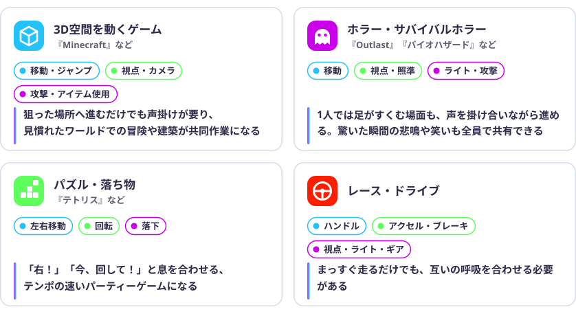</picture></td></tr></table>

## 7. 文字

| 種類 | 書体 | 使う場所 |
|---|---|---|
| 本文・見出し | GitHub本体と同じフォント指定 | ほぼすべての文字 |
| 数字 | 縦長の表示用書体（Anton の輪郭）＋ブランドのグラデーション | 項目の番号、アンケートの割合、遅延のミリ秒、PARTの番号 |
| 英字ラベル | 13px・太さ600・補助の色・字間を広げる | 「FEATURES」「PRODUCT」「NOW / NEXT」など |
| 埋め込みフォント | M PLUS Rounded 1c・Yusei Magic（使う字だけに絞る） | 締めのカードと、項目の見出しの横の吹き出し |

- 基本はGitHubと同じ書体にして、本文から浮かないようにします。個性を出すのは、数字と、締めのカード・吹き出しの文字だけです。
- 「日本語の見出し＋小さな英字ラベル」の2段の組み方を、見出し・カード・展望でくり返します。
- 日本語の折り返しは、行頭の禁則（「、」「。」「）」「ー」など）、句読点の後での改行、行の長さの釣り合いを、生成スクリプトで処理します。行頭の「（」は字下げに見えるので、半文字ぶん左へ寄せます。

<table><tr><th align="left">画像6　埋め込みフォントを使う締めのカード<br><sub>READMEで使っている画像の実物：<code>assets/readme/footer-*.svg</code></sub></th></tr><tr><td><picture><source media="(min-width: 481px)" srcset="../assets/readme/hide.svg" width="0" height="0"><source media="(prefers-color-scheme: dark)" srcset="../assets/readme/footer-narrow-dark.svg">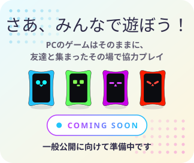</picture><picture><source media="(max-width: 480px), (min-width: 1266px)" srcset="../assets/readme/hide.svg" width="0" height="0"><source media="(prefers-color-scheme: dark)" srcset="../assets/readme/footer-narrow-dark.svg"></picture><picture><source media="(max-width: 1265px)" srcset="../assets/readme/hide.svg" width="0" height="0"><source media="(prefers-color-scheme: dark)" srcset="../assets/readme/footer-dark.svg">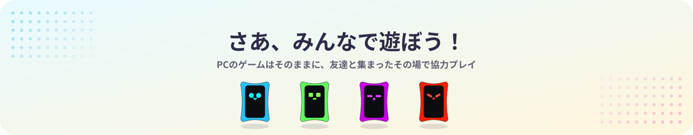</picture></td></tr></table>

## 8. 形と部品

部品の種類を絞り、すべての図で使い回しています。10枚以上の図が1つの体系に見えるのは、このためです。

- カードは線の太さ1.5px・角丸14px・塗りなしです。背景を塗らないので、ライト・ダークのどちらの背景にもなじみます。
- 例外はシステム構成の図です。部品の数が多く、どこまでが同じ段か、どこまでがRustホストかを見分ける必要があるため、段にはうすい面を敷き、ローカルWi-Fiの帯は通信の色、Rustホストの範囲はPCホストの色で薄く塗ります。箱は白い面（ダークでは少し明るい面）にして、背景から浮かせます。
- 札は色で塗った丸い札（「P1」「STEP 1」など）と、枠線だけの丸い札に役割の色の点を付けたもの（分担の中身）の2種類です。
- アイコンのタイルは角丸の正方形を役割の色で塗り、白い線のアイコンを載せます。
- 説明の左の縦線、進み具合の棒、手順をつなぐ「›」を、ブランドのグラデーションで描きます。
- 飾りとして、大見出しと締めのカードの角に、薄い色の点を並べます。節の見出しの右端に、キャラクターの4色の点を並べます。

<table><tr><th align="left">画像7　枠線だけのカード・アイコンのタイル・グラデーションの番号<br><sub>READMEで使っている画像の実物：<code>assets/readme/features-*.svg</code></sub></th></tr><tr><td><picture><source media="(min-width: 481px)" srcset="../assets/readme/hide.svg" width="0" height="0"><source media="(prefers-color-scheme: dark)" srcset="../assets/readme/features-narrow-dark.svg">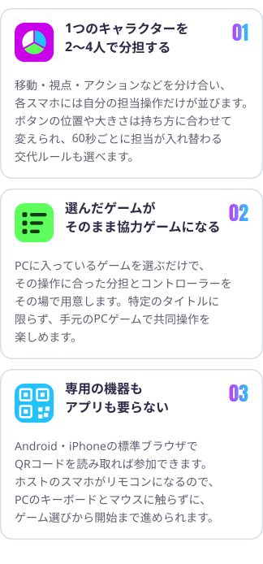</picture><picture><source media="(max-width: 480px), (min-width: 1266px)" srcset="../assets/readme/hide.svg" width="0" height="0"><source media="(prefers-color-scheme: dark)" srcset="../assets/readme/features-narrow-dark.svg"></picture><picture><source media="(max-width: 1265px)" srcset="../assets/readme/hide.svg" width="0" height="0"><source media="(prefers-color-scheme: dark)" srcset="../assets/readme/features-dark.svg">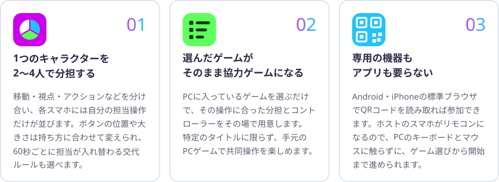</picture></td></tr></table>

<table><tr><th align="left">画像8　色で塗った札と、手順をつなぐ「›」<br><sub>READMEで使っている画像の実物：<code>assets/readme/flow-*.svg</code></sub></th></tr><tr><td><picture><source media="(min-width: 481px)" srcset="../assets/readme/hide.svg" width="0" height="0"><source media="(prefers-color-scheme: dark)" srcset="../assets/readme/flow-narrow-dark.svg">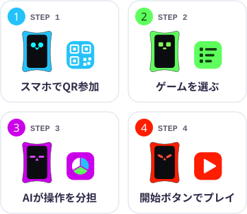</picture><picture><source media="(max-width: 480px), (min-width: 1266px)" srcset="../assets/readme/hide.svg" width="0" height="0"><source media="(prefers-color-scheme: dark)" srcset="../assets/readme/flow-narrow-dark.svg"></picture><picture><source media="(max-width: 1265px)" srcset="../assets/readme/hide.svg" width="0" height="0"><source media="(prefers-color-scheme: dark)" srcset="../assets/readme/flow-dark.svg">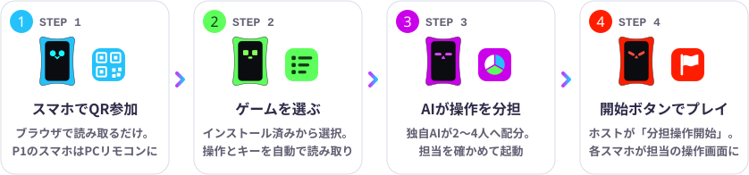</picture></td></tr></table>

<table><tr><th align="left">画像9　グラデーションの点線でまとめる枠<br><sub>READMEで使っている画像の実物：<code>assets/readme/architecture-*.svg</code></sub></th></tr><tr><td><picture><source media="(min-width: 481px)" srcset="../assets/readme/hide.svg" width="0" height="0"><source media="(prefers-color-scheme: dark)" srcset="../assets/readme/architecture-narrow-dark.svg">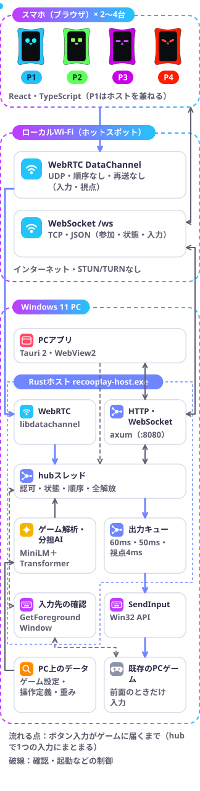</picture><picture><source media="(max-width: 480px), (min-width: 1266px)" srcset="../assets/readme/hide.svg" width="0" height="0"><source media="(prefers-color-scheme: dark)" srcset="../assets/readme/architecture-narrow-dark.svg"></picture><picture><source media="(max-width: 1265px)" srcset="../assets/readme/hide.svg" width="0" height="0"><source media="(prefers-color-scheme: dark)" srcset="../assets/readme/architecture-dark.svg">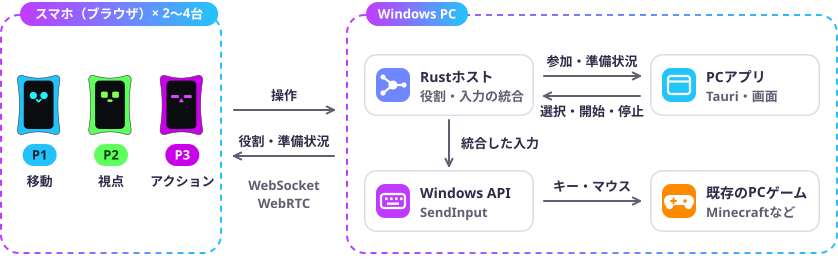</picture></td></tr></table>

## 9. 見出しの階層

| 段 | 見た目 |
|---|---|
| 作品名（h1） | GitHubの見出しと同じ見た目。2節で説明 |
| 大見出し（PART 1・2） | 薄いグラデーションの背景の帯、左端のグラデーションの縦線、大きな番号、右に「SECTIONS 01 – 07」 |
| 項目の見出し（01〜11） | グラデーションの番号＋英字ラベル＋見出し。右側でキャラクターが内容を演じる（画像2） |
| 節の見出し（目次・受賞結果） | 番号なし。見出し＋英字ラベル＋細い線＋4色の点 |
| 目次 | 「PART 1」「PART 2」の2列。番号＋リンク色の項目名＋下線 |

- 背景の帯を使うのは大見出しだけにして、格の違いを背景の有無で示します。
- 目次は表を使わず、本文欄の幅の49%ずつの画像を並べます。表は幅いっぱいに広がらず、中央に浮いてしまうためです。
- 見出しを画像にしても、`<a id>` を置いて目次のリンクが効くようにします。

<table><tr><th align="left">画像10　大見出し（PART）<br><sub>READMEで使っている画像の実物：<code>assets/readme/heads/part-1-*.svg</code></sub></th></tr><tr><td><picture><source media="(min-width: 481px)" srcset="../assets/readme/hide.svg" width="0" height="0"><source media="(prefers-color-scheme: dark)" srcset="../assets/readme/heads/part-1-narrow-dark.svg">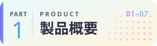</picture><picture><source media="(max-width: 480px), (min-width: 668px) and (max-width: 767px), (min-width: 932px)" srcset="../assets/readme/hide.svg" width="0" height="0"><source media="(prefers-color-scheme: dark)" srcset="../assets/readme/heads/part-1-compact-dark.svg">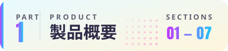</picture><picture><source media="(max-width: 667px), (min-width: 768px) and (max-width: 931px), (min-width: 1266px)" srcset="../assets/readme/hide.svg" width="0" height="0"><source media="(prefers-color-scheme: dark)" srcset="../assets/readme/heads/part-1-mid-dark.svg">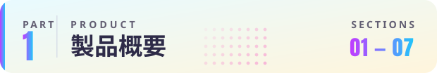</picture><picture><source media="(max-width: 1265px)" srcset="../assets/readme/hide.svg" width="0" height="0"><source media="(prefers-color-scheme: dark)" srcset="../assets/readme/heads/part-1-dark.svg">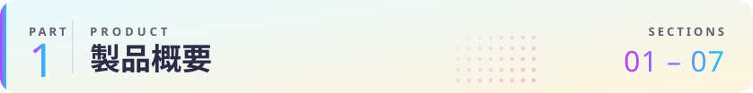</picture></td></tr></table>

<table><tr><th align="left">画像11　節の見出しと目次<br><sub>READMEで使っている画像の実物：<code>assets/readme/heads/toc-*.svg</code></sub></th></tr><tr><td><picture><source media="(min-width: 481px)" srcset="../assets/readme/hide.svg" width="0" height="0"><source media="(prefers-color-scheme: dark)" srcset="../assets/readme/heads/toc-title-narrow-dark.svg"></picture><picture><source media="(max-width: 480px), (min-width: 668px) and (max-width: 767px), (min-width: 932px)" srcset="../assets/readme/hide.svg" width="0" height="0"><source media="(prefers-color-scheme: dark)" srcset="../assets/readme/heads/toc-title-compact-dark.svg"></picture><picture><source media="(max-width: 667px), (min-width: 768px) and (max-width: 931px), (min-width: 1266px)" srcset="../assets/readme/hide.svg" width="0" height="0"><source media="(prefers-color-scheme: dark)" srcset="../assets/readme/heads/toc-title-mid-dark.svg"></picture><picture><source media="(max-width: 1265px)" srcset="../assets/readme/hide.svg" width="0" height="0"><source media="(prefers-color-scheme: dark)" srcset="../assets/readme/heads/toc-title-dark.svg"></picture><br><picture><source media="(min-width: 481px)" srcset="../assets/readme/hide.svg" width="0" height="0"><source media="(prefers-color-scheme: dark)" srcset="../assets/readme/heads/toc-part-1-narrow-dark.svg">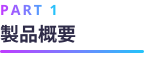</picture><picture><source media="(max-width: 480px), (min-width: 668px) and (max-width: 767px), (min-width: 932px)" srcset="../assets/readme/hide.svg" width="0" height="0"><source media="(prefers-color-scheme: dark)" srcset="../assets/readme/heads/toc-part-1-compact-dark.svg">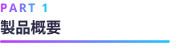</picture><picture><source media="(max-width: 667px), (min-width: 768px) and (max-width: 931px), (min-width: 1266px)" srcset="../assets/readme/hide.svg" width="0" height="0"><source media="(prefers-color-scheme: dark)" srcset="../assets/readme/heads/toc-part-1-mid-dark.svg">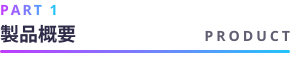</picture><picture><source media="(max-width: 1265px)" srcset="../assets/readme/hide.svg" width="0" height="0"><source media="(prefers-color-scheme: dark)" srcset="../assets/readme/heads/toc-part-1-dark.svg">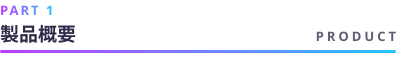</picture> <picture><source media="(min-width: 481px)" srcset="../assets/readme/hide.svg" width="0" height="0"><source media="(prefers-color-scheme: dark)" srcset="../assets/readme/heads/toc-part-2-narrow-dark.svg">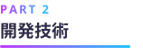</picture><picture><source media="(max-width: 480px), (min-width: 668px) and (max-width: 767px), (min-width: 932px)" srcset="../assets/readme/hide.svg" width="0" height="0"><source media="(prefers-color-scheme: dark)" srcset="../assets/readme/heads/toc-part-2-compact-dark.svg">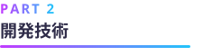</picture><picture><source media="(max-width: 667px), (min-width: 768px) and (max-width: 931px), (min-width: 1266px)" srcset="../assets/readme/hide.svg" width="0" height="0"><source media="(prefers-color-scheme: dark)" srcset="../assets/readme/heads/toc-part-2-mid-dark.svg">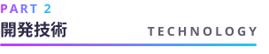</picture><picture><source media="(max-width: 1265px)" srcset="../assets/readme/hide.svg" width="0" height="0"><source media="(prefers-color-scheme: dark)" srcset="../assets/readme/heads/toc-part-2-dark.svg">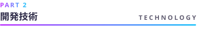</picture><br><picture><source media="(min-width: 481px)" srcset="../assets/readme/hide.svg" width="0" height="0"><source media="(prefers-color-scheme: dark)" srcset="../assets/readme/heads/toc-01-narrow-dark.svg"></picture><picture><source media="(max-width: 480px), (min-width: 668px) and (max-width: 767px), (min-width: 932px)" srcset="../assets/readme/hide.svg" width="0" height="0"><source media="(prefers-color-scheme: dark)" srcset="../assets/readme/heads/toc-01-compact-dark.svg"></picture><picture><source media="(max-width: 667px), (min-width: 768px) and (max-width: 931px), (min-width: 1266px)" srcset="../assets/readme/hide.svg" width="0" height="0"><source media="(prefers-color-scheme: dark)" srcset="../assets/readme/heads/toc-01-mid-dark.svg"></picture><picture><source media="(max-width: 1265px)" srcset="../assets/readme/hide.svg" width="0" height="0"><source media="(prefers-color-scheme: dark)" srcset="../assets/readme/heads/toc-01-dark.svg"></picture> <picture><source media="(min-width: 481px)" srcset="../assets/readme/hide.svg" width="0" height="0"><source media="(prefers-color-scheme: dark)" srcset="../assets/readme/heads/toc-08-narrow-dark.svg"></picture><picture><source media="(max-width: 480px), (min-width: 668px) and (max-width: 767px), (min-width: 932px)" srcset="../assets/readme/hide.svg" width="0" height="0"><source media="(prefers-color-scheme: dark)" srcset="../assets/readme/heads/toc-08-compact-dark.svg"></picture><picture><source media="(max-width: 667px), (min-width: 768px) and (max-width: 931px), (min-width: 1266px)" srcset="../assets/readme/hide.svg" width="0" height="0"><source media="(prefers-color-scheme: dark)" srcset="../assets/readme/heads/toc-08-mid-dark.svg"></picture><picture><source media="(max-width: 1265px)" srcset="../assets/readme/hide.svg" width="0" height="0"><source media="(prefers-color-scheme: dark)" srcset="../assets/readme/heads/toc-08-dark.svg"></picture></td></tr></table>

## 10. キャラクター

- 製品のコントローラーそのものがキャラクターです。4体ともスマホの形（四辺が少しくびれた縦長の枠に黒い画面）です。顔だけで性格を分けます（青は丸い目、緑は四角い目、紫は細い目、赤は吊り目）。
- キャラクターは作品名の見出し（画像1）、受賞結果、項目の見出しの横（画像2）、手順や構成の図（画像8・画像9）、締めのカード（画像6）に使います。**文章と表には使いません**。読む場所は読むことに集中してもらうためです。
- 遊びと事実を見た目で分けます。実際の画面を見せる図ではキャラクターの形を使わず、ふつうのスマホの枠に入れます（画像12）。演出と証拠が混ざらないようにするためです。
- 項目の見出しの横では、画面が顔から操作画面に切り替わる、カメラで読み取る、横に寝かせて横持ちになる、といった、スマホらしい動きで各項目を表します。キャラクターはスマホそのものなので、場面は製品の使い方に関わるものにしています。
- 見出しの横の演技は、見出しの文字を邪魔しないこと、決めた領域に収まること、自然で納得感があることにこだわりました。品質のためなら、場面の筋書きを変えてもよいとしています。

- 受賞結果では、実際の流れをそのまま物語にしています。私たちは3人のチームなので、動くのは見出しの青・緑・紫の3体だけで、赤は点のまま残します。観客賞（Hack Day の勝者）で画面に王冠が映り、決勝進出では3人分の切符が届いて、灰色だった金沢→東京の路線が光って開通します（Award Day への資格を得た瞬間）。新幹線で東京へ行き、発表と展示をして、発表直前にドキドキしてから3つの賞を受け取ります。セリフは使わず、記号と動きだけで伝えます。PCは路線を横、スマホは縦の路線図にし、それぞれの画面の形に合わせて移動の向きを変えています。

## 11. 動き

- アニメーションの原則として、着地でつぶれ、跳ぶと伸びる動きと、動く前のため（予備動作）を入れます。動きは位置・姿勢・影の3層に分けます。
- ふだんの動きは、上下にゆっくり揺れる、まばたきする、くらいの控えめなものにとどめ、キャラクターごとに動きの始まりをずらします。読む邪魔をしないためです。
- 最初は止めておきます。作品名の見出しと同じく、にぎやかさは後から来るようにします。
- システム構成の図は伝えたいことを1つに絞っています。各スマホのボタン入力が、ローカルWi-Fiを通ってPCのRustホストに直接届き、hubで1つの入力にまとまり、SendInputで既存のゲームに届く流れです。スマホとPCのあいだに中継はないので、通信の技術（WebRTC DataChannel・WebSocket）はRustホストの受け口の箱に書き、各スマホからその箱へ直接の矢印を引きます。P1の道は左の列にまっすぐ通し、1つの点がたどってループします。点がたどる道は太い線にし、ほかの矢印は細い線にします。矢印はすべてまっすぐな線にし、見出しの札にかからない位置に置きます。余白は枠の内側・箱と箱の間・枠と枠の間でそれぞれ同じ値にそろえます。点はSVGのアニメーション（`animateMotion`）で線に沿って動かし、箱の中を通る間は見せません。
- OSで「視差効果を減らす」を選んだ閲覧者には、すべての動きを止めます。

## 12. 実際の画面と録画

- 図の中のスマホ画面は作ったモックではなく、**実機で撮った画面と、実際の指の操作の録画**です。主張に証拠を添えるためです。
- 録画は黒いふちとカメラ穴のあるふつうのスマホの枠に入れます。指の位置は円で、PCのカーソルは輪で重ねます。加工はそれと、読み込み中の早送りだけにします。
- 最初のコマは静止画の図と同じ見た目にし、最後に少し止めてから最初に戻ります。
- 録画は図の元の見た目と要素をほとんど変えずに、動きだけを足すものにしています。説明文がなくても見れば分かる操作を選びます。説明の文を大きく添えた録画は、READMEのテンポと重さを考えて、[画面一覧](screenshots.md) や仕様書に置いています。
- 分担の図では各担当のスマホに、その担当の実際の操作画面を入れています。

**画像12　実機の操作の録画を入れた図（文字はSVG、スマホ画面はアニメーションWebP）**<br>
<sub>READMEで使っている画像の実物：<code>assets/readme/pieces/controllers-*</code>。表の枠の中では幅の割合が決まらないため、この画像だけ表に入れずに置いています</sub>

<p><picture><source media="(min-width: 481px)" srcset="../assets/readme/hide.svg" width="0" height="0"><source media="(prefers-color-scheme: dark)" srcset="../assets/readme/pieces/controllers-narrow-dark-1a.svg">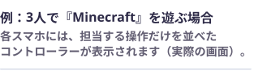</picture><picture><source media="(max-width: 480px), (min-width: 1266px)" srcset="../assets/readme/hide.svg" width="0" height="0"><source media="(prefers-color-scheme: dark)" srcset="../assets/readme/pieces/controllers-narrow-dark-1a.svg"></picture><picture><source media="(max-width: 1265px)" srcset="../assets/readme/hide.svg" width="0" height="0"><source media="(prefers-color-scheme: dark)" srcset="../assets/readme/pieces/controllers-wide-dark-1a.svg">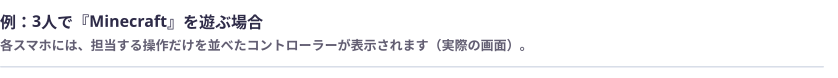</picture><br>
<picture><source media="(prefers-reduced-motion: reduce), (min-width: 481px)" srcset="../assets/readme/hide.svg" width="0" height="0"><source media="(prefers-color-scheme: dark)" srcset="../assets/readme/pieces/controllers-narrow-dark-2a.webp">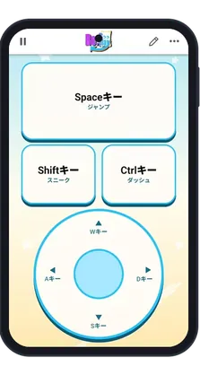</picture><picture><source media="(prefers-reduced-motion: no-preference), (min-width: 481px)" srcset="../assets/readme/hide.svg" width="0" height="0"><source media="(prefers-color-scheme: dark)" srcset="../assets/readme/pieces/controllers-narrow-dark-2a-still.webp">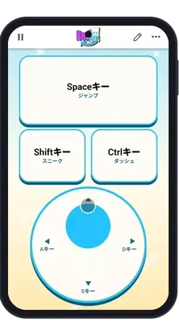</picture><picture><source media="(prefers-reduced-motion: reduce), (max-width: 480px), (min-width: 1266px)" srcset="../assets/readme/hide.svg" width="0" height="0"><source media="(prefers-color-scheme: dark)" srcset="../assets/readme/pieces/controllers-narrow-dark-2a.webp"></picture><picture><source media="(prefers-reduced-motion: no-preference), (max-width: 480px), (min-width: 1266px)" srcset="../assets/readme/hide.svg" width="0" height="0"><source media="(prefers-color-scheme: dark)" srcset="../assets/readme/pieces/controllers-narrow-dark-2a-still.webp"></picture><picture><source media="(max-width: 1265px)" srcset="../assets/readme/hide.svg" width="0" height="0"><source media="(prefers-color-scheme: dark)" srcset="../assets/readme/pieces/controllers-wide-dark-2a.svg"></picture><picture><source media="(min-width: 481px)" srcset="../assets/readme/hide.svg" width="0" height="0"><source media="(prefers-color-scheme: dark)" srcset="../assets/readme/pieces/controllers-narrow-dark-2b.svg">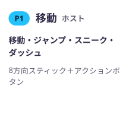</picture><picture><source media="(max-width: 480px), (min-width: 1266px)" srcset="../assets/readme/hide.svg" width="0" height="0"><source media="(prefers-color-scheme: dark)" srcset="../assets/readme/pieces/controllers-narrow-dark-2b.svg"></picture><picture><source media="(max-width: 1265px)" srcset="../assets/readme/hide.svg" width="0" height="0"><source media="(prefers-color-scheme: dark)" srcset="../assets/readme/pieces/controllers-wide-dark-2b.svg"></picture><br>
<picture><source media="(prefers-reduced-motion: reduce), (min-width: 481px)" srcset="../assets/readme/hide.svg" width="0" height="0"><source media="(prefers-color-scheme: dark)" srcset="../assets/readme/pieces/controllers-narrow-dark-3a.webp">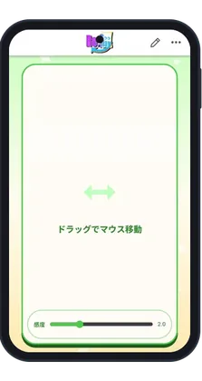</picture><picture><source media="(prefers-reduced-motion: no-preference), (min-width: 481px)" srcset="../assets/readme/hide.svg" width="0" height="0"><source media="(prefers-color-scheme: dark)" srcset="../assets/readme/pieces/controllers-narrow-dark-3a-still.webp">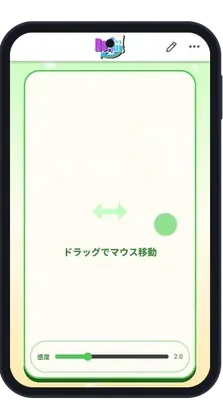</picture><picture><source media="(prefers-reduced-motion: reduce), (max-width: 480px), (min-width: 1266px)" srcset="../assets/readme/hide.svg" width="0" height="0"><source media="(prefers-color-scheme: dark)" srcset="../assets/readme/pieces/controllers-narrow-dark-3a.webp"></picture><picture><source media="(prefers-reduced-motion: no-preference), (max-width: 480px), (min-width: 1266px)" srcset="../assets/readme/hide.svg" width="0" height="0"><source media="(prefers-color-scheme: dark)" srcset="../assets/readme/pieces/controllers-narrow-dark-3a-still.webp"></picture><picture><source media="(prefers-reduced-motion: reduce), (max-width: 1265px)" srcset="../assets/readme/hide.svg" width="0" height="0"><source media="(prefers-color-scheme: dark)" srcset="../assets/readme/pieces/controllers-wide-dark-3a.webp">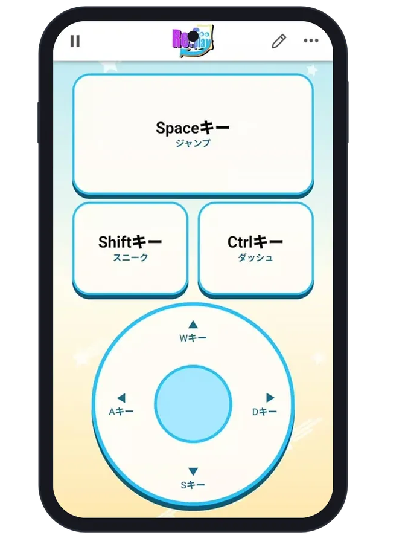</picture><picture><source media="(prefers-reduced-motion: no-preference), (max-width: 1265px)" srcset="../assets/readme/hide.svg" width="0" height="0"><source media="(prefers-color-scheme: dark)" srcset="../assets/readme/pieces/controllers-wide-dark-3a-still.webp">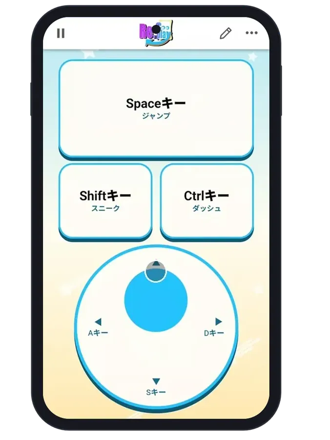</picture><picture><source media="(min-width: 481px)" srcset="../assets/readme/hide.svg" width="0" height="0"><source media="(prefers-color-scheme: dark)" srcset="../assets/readme/pieces/controllers-narrow-dark-3b.svg">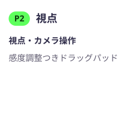</picture><picture><source media="(max-width: 480px), (min-width: 1266px)" srcset="../assets/readme/hide.svg" width="0" height="0"><source media="(prefers-color-scheme: dark)" srcset="../assets/readme/pieces/controllers-narrow-dark-3b.svg"></picture><picture><source media="(prefers-reduced-motion: reduce), (max-width: 1265px)" srcset="../assets/readme/hide.svg" width="0" height="0"><source media="(prefers-color-scheme: dark)" srcset="../assets/readme/pieces/controllers-wide-dark-3b.webp">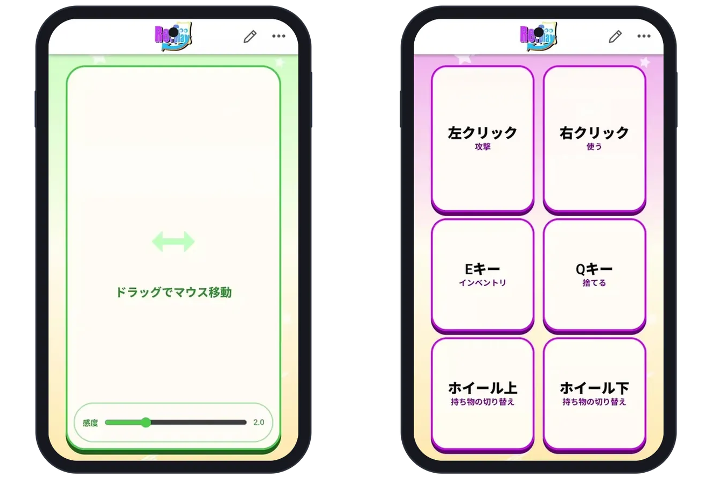</picture><picture><source media="(prefers-reduced-motion: no-preference), (max-width: 1265px)" srcset="../assets/readme/hide.svg" width="0" height="0"><source media="(prefers-color-scheme: dark)" srcset="../assets/readme/pieces/controllers-wide-dark-3b-still.webp">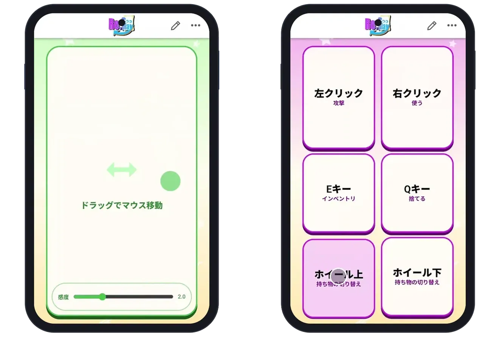</picture><br>
<picture><source media="(prefers-reduced-motion: reduce), (min-width: 481px)" srcset="../assets/readme/hide.svg" width="0" height="0"><source media="(prefers-color-scheme: dark)" srcset="../assets/readme/pieces/controllers-narrow-dark-4a.webp">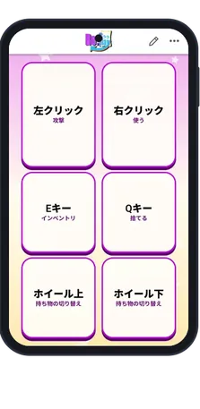</picture><picture><source media="(prefers-reduced-motion: no-preference), (min-width: 481px)" srcset="../assets/readme/hide.svg" width="0" height="0"><source media="(prefers-color-scheme: dark)" srcset="../assets/readme/pieces/controllers-narrow-dark-4a-still.webp">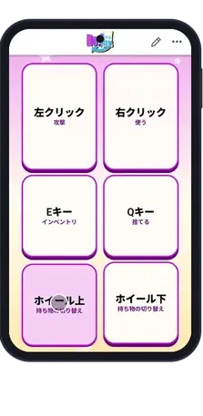</picture><picture><source media="(prefers-reduced-motion: reduce), (max-width: 480px), (min-width: 1266px)" srcset="../assets/readme/hide.svg" width="0" height="0"><source media="(prefers-color-scheme: dark)" srcset="../assets/readme/pieces/controllers-narrow-dark-4a.webp"></picture><picture><source media="(prefers-reduced-motion: no-preference), (max-width: 480px), (min-width: 1266px)" srcset="../assets/readme/hide.svg" width="0" height="0"><source media="(prefers-color-scheme: dark)" srcset="../assets/readme/pieces/controllers-narrow-dark-4a-still.webp"></picture><picture><source media="(max-width: 1265px)" srcset="../assets/readme/hide.svg" width="0" height="0"><source media="(prefers-color-scheme: dark)" srcset="../assets/readme/pieces/controllers-wide-dark-4a.svg">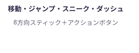</picture><picture><source media="(min-width: 481px)" srcset="../assets/readme/hide.svg" width="0" height="0"><source media="(prefers-color-scheme: dark)" srcset="../assets/readme/pieces/controllers-narrow-dark-4b.svg">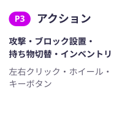</picture><picture><source media="(max-width: 480px), (min-width: 1266px)" srcset="../assets/readme/hide.svg" width="0" height="0"><source media="(prefers-color-scheme: dark)" srcset="../assets/readme/pieces/controllers-narrow-dark-4b.svg"></picture><picture><source media="(max-width: 1265px)" srcset="../assets/readme/hide.svg" width="0" height="0"><source media="(prefers-color-scheme: dark)" srcset="../assets/readme/pieces/controllers-wide-dark-4b.svg">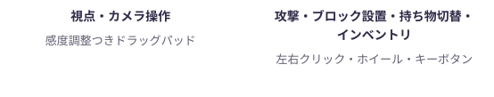</picture></p>

## 13. SVGとWebPの使い分け

READMEの図は**SVGを基本**にし、**実機の録画を含む図だけ、スマホ画面の部分をアニメーションWebP**にしています。この図も、4節と同じ4種類を用意しています。

| 形式 | 使う図 | 選んだ理由 |
|---|---|---|
| SVG | 見出し・目次・受賞結果・特長・アンケート・構成図など、ほとんどの図（画像1〜11） | 下の「SVGを基本にする理由」を参照 |
| アニメーションWebP | 製品説明の分担の図（`controllers`）と、注力したことの図（`focus`）の、スマホ画面の部分だけ（画像12）。文字の部分はSVG | 下の「録画を含む図の作り方」を参照 |
| JPEG（SVGに埋め込む） | SVGの図の中に置く、実機で撮った静止画 | 写真はベクターで描けないため。縮めてからBase64でSVGに入れる |
| WebP | 紹介動画のサムネイル（`assets/images/recooplay-thumbnail.webp`。元のPNGから `scripts/readme/thumbnail.py` で幅1676pxに縮める） | YouTubeへのリンクの画像として置く |

### 13.1 SVGを基本にする理由

- 文字を文字のまま描ける。図の文字は閲覧者の端末のフォントで、GitHub本体と同じ指定のまま表示されます。画像の中の文字が本文と同じ書体になるので、図が本文から浮きません。画像1の見出しの錯覚も文字を文字として描けるから成り立ちます。
- 拡大してもぼやけない。高解像度の画面でも線と文字がくっきり表示されます。
- CSSで動かせる。キャラクターのまばたきや見出しの物語は、SVGの中のCSSアニメーションで動かしています。動きを足してもファイルはほとんど大きくならず、「視差効果を減らす」の設定で止めることもできます。
- 4種類の描き分けが安い。ライト・ダークとPC・スマホの4種類は、同じ生成スクリプトで色と配置を変えて書き出すだけです。
- 検査できる。文字がデータとして残るので、`check_text_size.py` で表示時の文字の大きさを計算できます。代替テキストと `README-text.md` も図と同じデータから作れます。
- 軽い。SVGはgzipで配信されるので、録画を含まない約50枚を合わせても転送量は約230〜250KBです（2026-11-22の計算）。

グラデーションで塗る文字（数字・「PART 1」・「COMING SOON」など）だけは、文字ではなくフォントの輪郭（`<path>`）で描きます。iPhone の Safari は、グラデーションで塗った文字をいったん画像にしてから描き、その画像を端末の倍率を考えずに作るため、文字がぼやけるからです（利用者が iPhone で見出しの番号のぼやけを確かめた。原因は WebKit の描き方からの推測）。同じ理由で、マスクは使わず、光彩のフィルタはにじみの部分だけに使い、元の図形はフィルタの外にベクターのまま重ねます。輪郭にする書体は google/fonts の固定した版の Anton（Impact に近い数字。Impact と同じ高さになるよう0.93倍）・Noto Sans・Noto Sans JP で、どの端末でも同じ形になります（`scripts/readme/vector.py`）。

SVGには制約もあります。READMEの画像は `raw.githubusercontent.com` から `Content-Security-Policy: default-src 'none'` 付きで配信され、`` で表示したSVGは外部の画像もフォントも読めません。そのため、写真はJPEGに縮めてBase64で、締めのフォントは使う字だけに絞ってSVGに埋め込んでいます。Base64で増えた分は、gzipでほぼ打ち消せることを実測で確かめています（JPEGを3枚埋め込んだ `controllers-light.svg` は、94KBのファイルが転送量59KB。JPEGとSVGを別のファイルに分けると計68KBで、2回の通信が要る）。

### 13.2 録画を含む図の作り方

- SVGの中で録画を動かすと重い。SVGの中に動く画像を入れると、ブラウザは画像が1コマ進むたびにSVG全体を描き直します。録画が複数ある図では重くなり、止まって見えます。
- 動く所だけをWebPにする。`bake.py` が、SVGの図をChromeで3倍の解像度・透明の背景で撮り、スマホ画面の位置に録画のコマを重ねて、スマホの部分だけをアニメーションWebPに切り出します（PC用は約2.4倍、スマホ用は2倍の画素）。変わった所（スマホの画面）だけを描き直すので、動きが滑らかになります。
- 文字はSVGのまま残す。以前は図ごと1本のWebPにしていましたが、見出しや説明の文字までラスタになり、ぼやけて見えました。いまは図を段と列の枠に切り、文字の枠は元のSVGを `viewBox` で切り出したSVGにしています。READMEでは各枠を `` で隙間なく並べます。枠の幅が親の幅に対する割合なので、GitHub上のどの横幅でも同じ比率で縮み、継ぎ目がずれません。`align="absbottom"` で、画像の下に文字の下がり分の隙間もできません。同じ段の枠は表示の高さがぴったりそろうように、WebPの画素数を枠の幅に比例させ、SVGの高さもそこから決めています（そろわないと、カードの枠線の継ぎ目に1px弱の切れ目が出ます）。
- PC用とスマホ用で枠の幅をそろえる。PC用とスマホ用の枠を同じ行に並べ、使わない版を幅0の画像で消すので（4.2節）、段の数と各段の枠の幅の並びを両方の版でそろえています。片方の版で使わない段には高さがほぼ0の画像を入れ、その段は1行分（約24px）の空きになるので、もともと空きのある所に置いています。画面幅420〜1265pxでは、スマホ用の枠を%ではなくpxの原寸（段の合計329px）で並べ、本文欄の左端に置きます（4.6節）。
- 動きを止める設定に合わせる。アニメーションWebPは `` の中では止められないので、OSで「視差効果を減らす」を選んだ閲覧者には、録画の1コマを止めた静止画（`*-still.webp`、`recordings/stills.py`）を出します。枠の合計は99.8%にして、ブラウザの丸めで最後の枠が次の行に落ちないようにしています。詳しくは `scripts/readme/recordings/pieces.py` を参照してください。
- 画質と大きさを比べて決めた。Pillow（libwebp）の品質80で書き出しています。ffmpegの品質90で書き出すより元の画像に近く（PSNRで0.5〜1.4dB上）、ファイルは21〜24%小さくなります（2026-11-21の比較）。
- 重さのほとんどはこのWebPにある。閲覧1回の転送量は、PCで約2.3MB、タブレットとスマホで約1.3MBで、その8割前後がこのWebPです（2026-11-22の計算。紹介動画のサムネイルをPNGの約880KBからWebPの約140KBにした後）。GitHubは `` の `loading` 属性を取り除くため、遅延読み込みでは軽くできません。

切り分ける前の元のSVG（`controllers-*.svg`・`focus-*.svg`）は残しています。文字の大きさの確認は同じ名前のSVGで行います。枠はすべてこのSVGから作るので、図の中身はSVGの生成スクリプトで直します。

## 14. 画像が読み込めないときの、文字だけのREADME

リポジトリの直下に、画像を使わず文字だけで読める `README-text.md` を置いています（2026-11-20 に追加）。READMEのほとんどが画像なので、画像が読み込めないときにも同じ内容を読めるようにするためです。

- `scripts/readme/text_readme.py` が `README.md` から作ります。直接は編集しません。
- 文章は `README.md` のまま使い、画像（`<picture>`）だけを、同じ内容の見出し・表・箇条書きに置き換えます。
- 図の中身は `showcase.py`・`build_art.py` と同じデータから書くので、図と文字の内容がずれません。画像が残ると生成を止めます。
- 目次のリンクは `README.md` と同じ `<a id>` を使います。先頭には図の入った通常版の `README.md` への案内を置いています。

あわせて、`README.md` の画像には図の内容をすべて書いた代替テキスト（`alt`）を付けています。数値や受賞名を変えるときは、本文・代替テキスト・`README-text.md` をそろえて直します。

## 15. 作り方の判断

- 図は生成スクリプトから書き出します。SVGは手で直さず、`scripts/readme/` のスクリプトを直してから書き出します。4種類の画像、文字だけのREADME（`README-text.md`）、画像の代替テキストを、同じデータから作るためです。
- 案は並べて選びます。作品名の見出しや項目の見出しは、比較用のブランチで複数の案を作り、GitHub上で見比べてから決めました。
- GitHub上で確かめます。手元のブラウザだけでなく、GitHubに表示したREADMEを、PCとスマホ、ライトとダークで撮って確かめます。
- READMEの変更は、作者が確認してからmainへ入れます。

## 16. ほかのREADMEに持ち出すときのチェックリスト

どのREADMEにも使えることだけを並べます。「ぱっと見ふつう」から驚かせる見せ方（1〜3節）とキャラクターの演出は、遊び心をテーマにしたこのREADMEのためのものなので、ここには入れていません。

1. 図の見た目より先に並べ方を決める。各項目は「文章 → 図」の順にし、図1枚でページを占有しない。
2. すべての図に、ライト・ダーク × PC・スマホの4種類の画像を作り、`<picture>` で切り替える。
3. 図は本文欄の幅で描き、原寸で表示する。文字は13px以上にする。
4. スマホ用の画像は縮めずに組み替える。
5. 背景を塗らず、枠線と文字で組んで、どちらのテーマにもなじませる。
6. ブランドの色は数字・線・矢印などの要所に絞る。
7. 色に意味を持たせ、最後まで同じ意味で使う。
8. 文字はGitHubと同じ書体にし、別の書体を使う所を絞る。
9. 部品の種類を絞り、すべての図で使い回す。
10. 飾りの絵と、実際の画面を見せる画像を、見た目で分ける。
11. 動きを入れるなら控えめにし、「視差効果を減らす」の設定を尊重する。
12. 図はSVGを基本にし、録画の部分だけをアニメーションWebPにして、文字はSVGのまま並べる。
13. 画像が読み込めないときのために、同じデータから文字だけのREADMEを作る。
