# Re:Cooplay 画面一覧（PC・スマホ）

参加からゲーム選択、操作分担、協力プレイ、一時停止・緊急停止まで、最新のPC画面とスマホ画面を流れに沿って並べています。画像を押すと原寸で開きます。

[製品紹介](../README.md) ／ [ギャラリー](gallery.md) ／ [使い方](usage.md) ／ [フロントエンド仕様書](frontend-specification.md)

> **撮影について**
> - 2026年10月26日に、最新のRustホストと画面（`apps/web-static`）を使って撮影しました。PCは1920×1080、スマホは402×874（2倍の解像度）です。
> - ホストを試験用の設定（dry-run）で動かして撮影しました。PCへのキー入力やゲームの操作は行っていません。そのため、ゲームのウィンドウは疑似のもので、ゲーム一覧（Minecraft・Gamma・Stardew Valley）も試験用のデータです。
> - QRコード・URLのIPアドレスは説明用のアドレス（192.0.2.10）に、Wi-Fiの名前は「ReCooplay-Demo」に差し替えています。このQRを読み取っても接続できません。
> - 3人で遊ぶ例です（P1がiPhone、P2がAndroid、P3がiPhone）。2〜4人で遊べるので、4人目の枠は「参加待ち」と表示されています。

## 目次

1. [参加する](#1-参加する)
2. [ゲームを選ぶ](#2-ゲームを選ぶ)
3. [操作を分担する](#3-操作を分担する)
4. [準備してReady](#4-準備してready)
5. [協力プレイ](#5-協力プレイ)
6. [一時停止](#6-一時停止)
7. [設定・接続・診断](#7-設定接続診断)
8. [緊急停止](#8-緊急停止)

## 1. 参加する

PCアプリを起動すると、参加用のQRコードが表示されます。①でPCのホットスポット（Wi-Fi）につなぎ、②で参加します。最初に参加した人（P1）がホストになります。

<a href="screenshots/pc-01-join-waiting.jpg">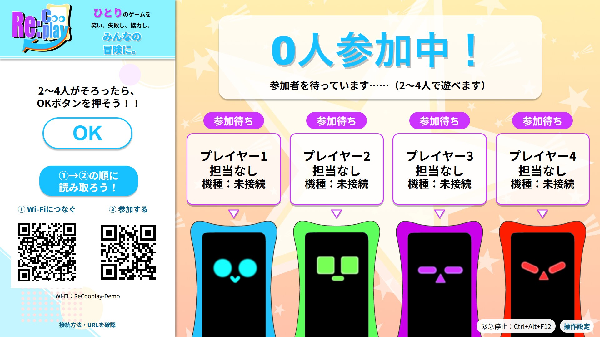</a>

PC：参加を待っている画面

<a href="screenshots/pc-02-join-ready.jpg">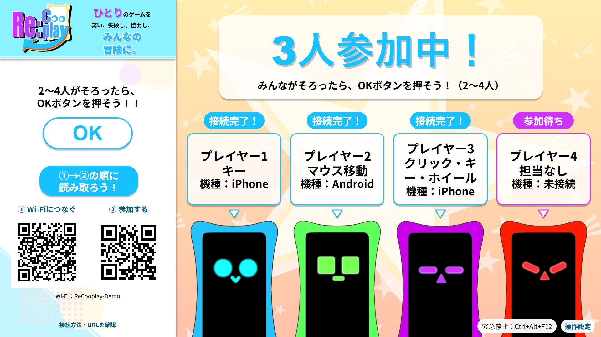</a>

PC：3人が参加した画面。プレイヤーごとの色・担当・機種が並びます

| P1（ホスト） | P2 | P3 |
|:--:|:--:|:--:|
| <a href="screenshots/phone-p1-01-host-lobby.jpg">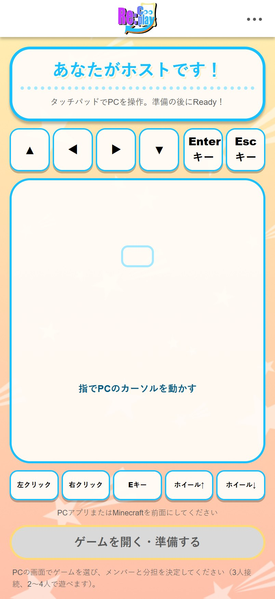</a> | <a href="screenshots/phone-p2-01-waiting.jpg">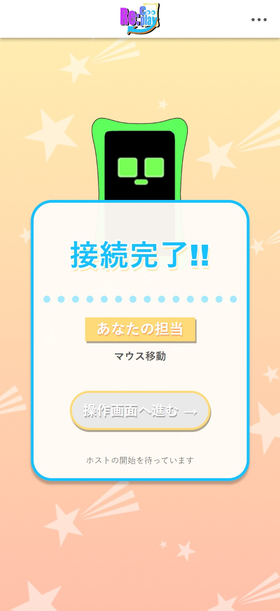</a> | <a href="screenshots/phone-p3-01-waiting.jpg">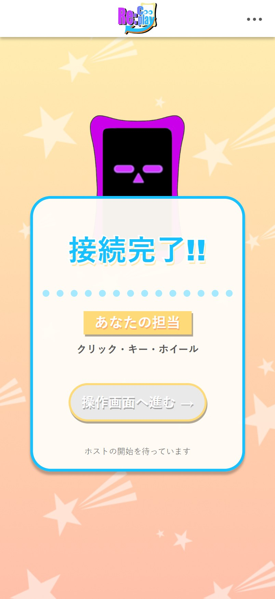</a> |
| ホストのスマホはPC画面のリモコンになります（矢印・Enter・タッチパッド） | 自分の担当を確認して、ホストの開始を待ちます | 同じく担当を確認して待ちます |

## 2. ゲームを選ぶ

ホストがスマホのリモコンで、PCに入っているゲームの一覧から遊ぶゲームを選びます。Steam・Epic Gamesのゲームを自動で見つけ、Minecraftは公式ランチャーから起動できます。操作が届くかまだ確かめていないゲームには「未検証」と表示します。

<a href="screenshots/pc-03-game-select.jpg">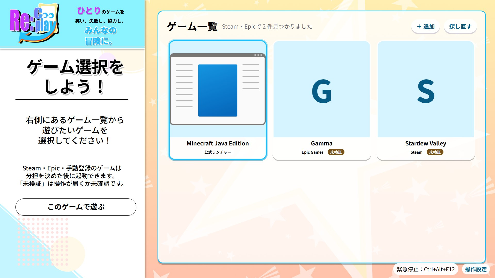</a>

PC：ゲーム選択（一覧は試験用のデータです）

## 3. 操作を分担する

選んだゲームの操作を、参加している人数に合わせて分担します。各担当には、実際にPCへ送るキーの名前を表示します。一時停止中は、2人の列を順に押して担当を入れ替えることもできます。

PC：分担の確認

<a href="screenshots/pc-05-roles-confirmed.jpg">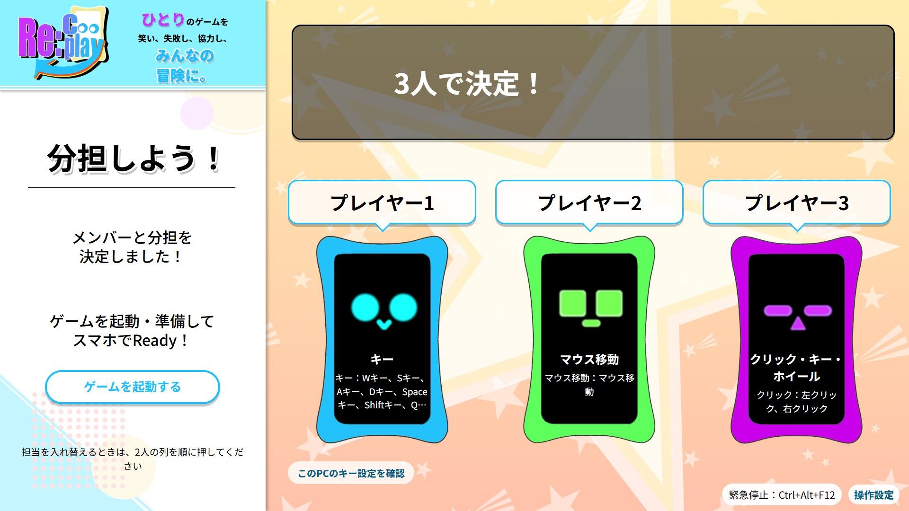</a>

PC：分担を決定した後。「ゲームを起動する」で起動できます

## 4. 準備してReady

ゲームを起動し、プレイしたい画面まで進めたら、ホストがスマホで「Ready」を押します。Readyを押せるのはホストだけです。

<a href="screenshots/pc-06-ready.jpg">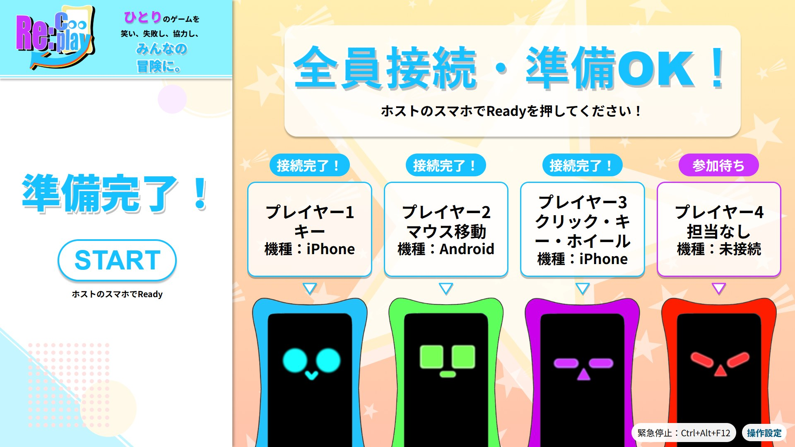</a>

PC：全員が接続し、準備ができた画面

| P1（ホスト） | P2 |
|:--:|:--:|
| <a href="screenshots/phone-p1-02-host-ready.jpg">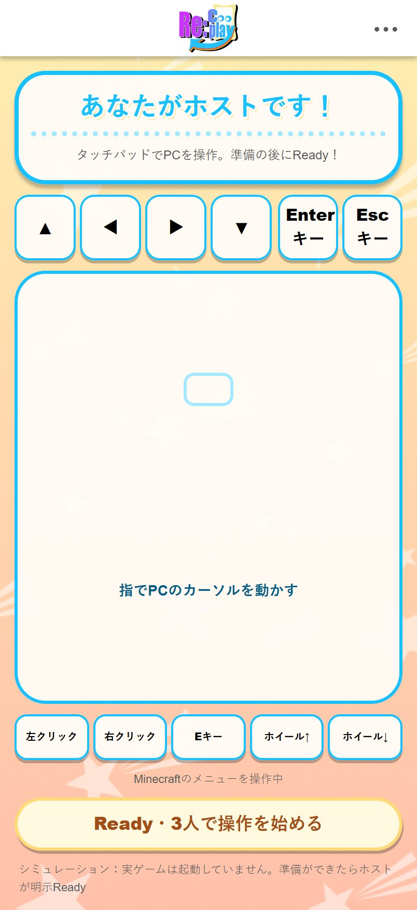</a> |  |
| 「Ready・3人で操作を始める」を押すと協力プレイが始まります | ホストのReadyを待ちます |

## 5. 協力プレイ

Readyの後は、各自のスマホが担当の操作画面に切り替わり、3人で1つのキャラクターを動かします。操作画面は、ゲームごとの操作定義と分担から自動で作ります。

<a href="screenshots/pc-07-coop.jpg">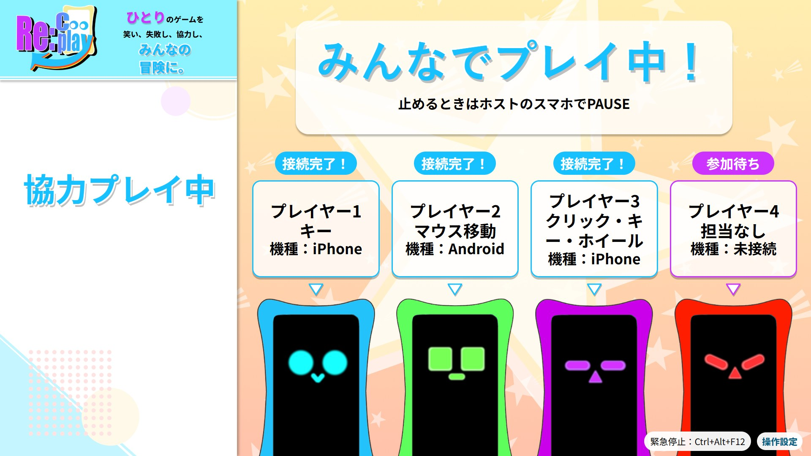</a>

PC：協力プレイ中。実際に遊ぶときは、この上にゲームの画面が前面に出ます

| P1：移動 | P2：視点 | P3：アクション |
|:--:|:--:|:--:|
| <a href="screenshots/phone-p1-03-coop-move.jpg">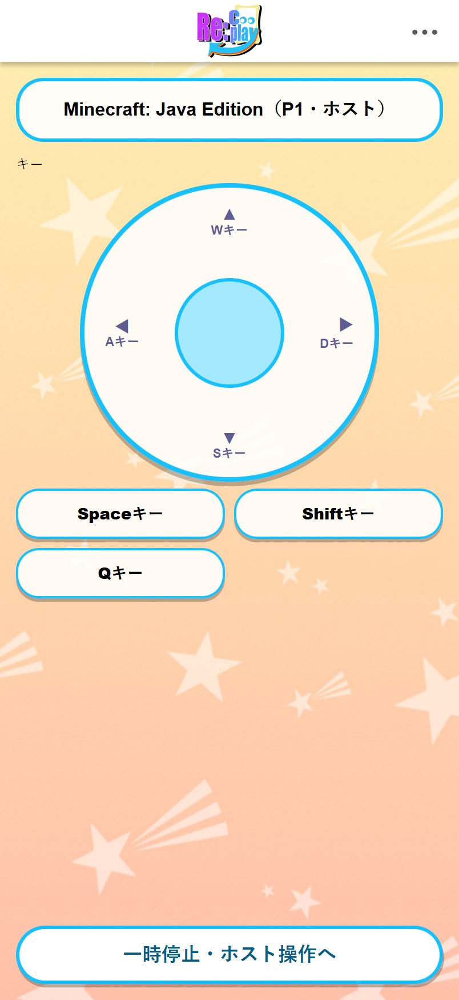</a> | <a href="screenshots/phone-p2-03-coop-look.jpg">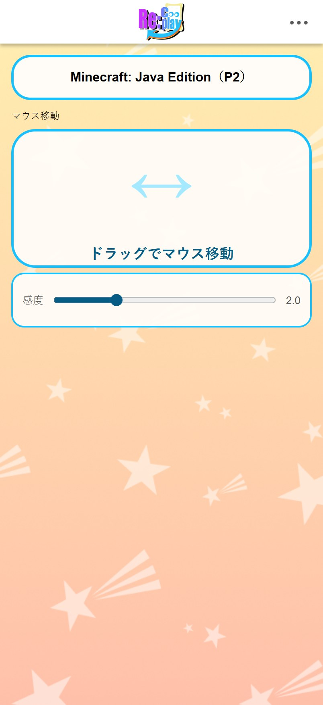</a> | <a href="screenshots/phone-p3-02-coop-action.jpg">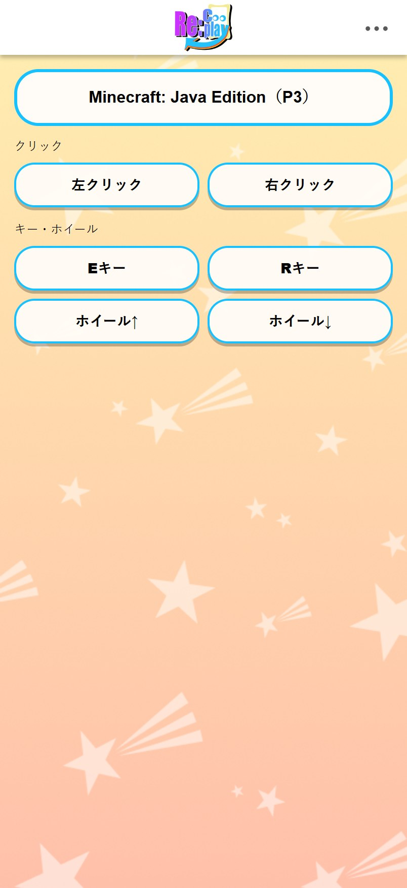</a> |
| スティックでWASD、ボタンでジャンプ・しゃがみなど | 画面をドラッグして視点（マウス）を動かします | クリックで攻撃・アイテムの使用、ホイールで持ち替え |

## 6. 一時停止

ホストのスマホで一時停止すると、全員の操作が止まり、押していたキーもすべて離します。ホストのスマホはPCを操作するリモコンに戻ります。

<a href="screenshots/pc-08-paused.jpg">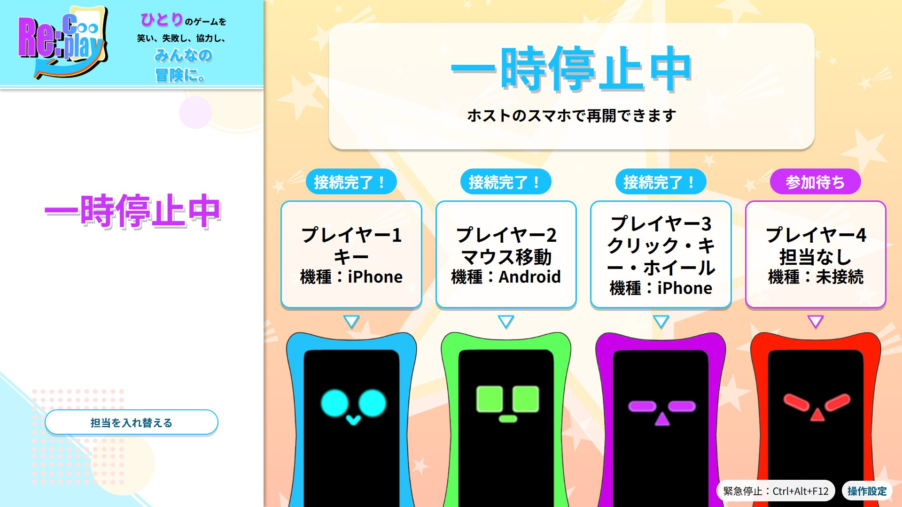</a>

PC：一時停止中

| P1（ホスト） | P2 |
|:--:|:--:|
| <a href="screenshots/phone-p1-04-host-paused.jpg">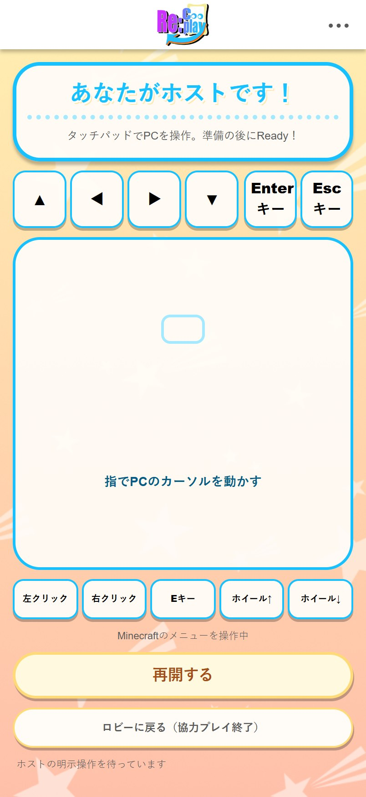</a> | <a href="screenshots/phone-p2-04-paused.jpg">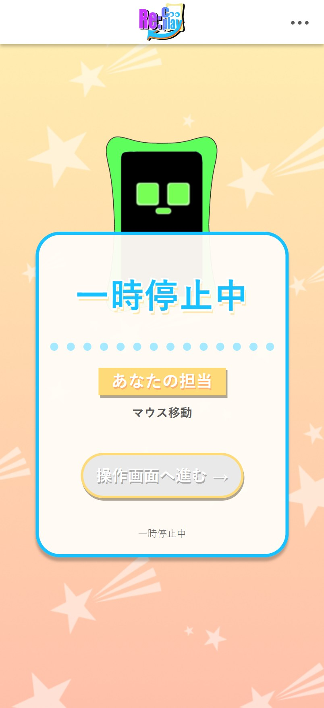</a> |
| 「再開する」で協力プレイに戻ります | 再開を待ちます |

## 7. 設定・接続・診断

<a href="screenshots/pc-09-settings.jpg">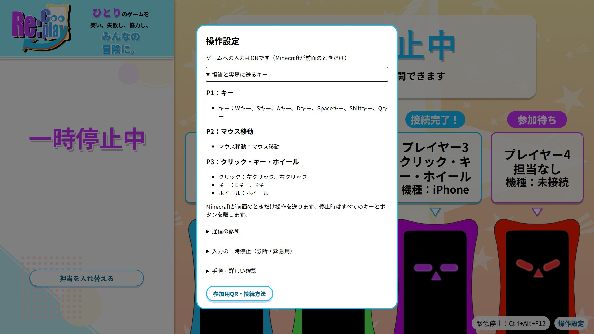</a>

PC：操作設定。担当ごとに実際に送るキーを確認できます

<a href="screenshots/pc-10-connection-help.jpg">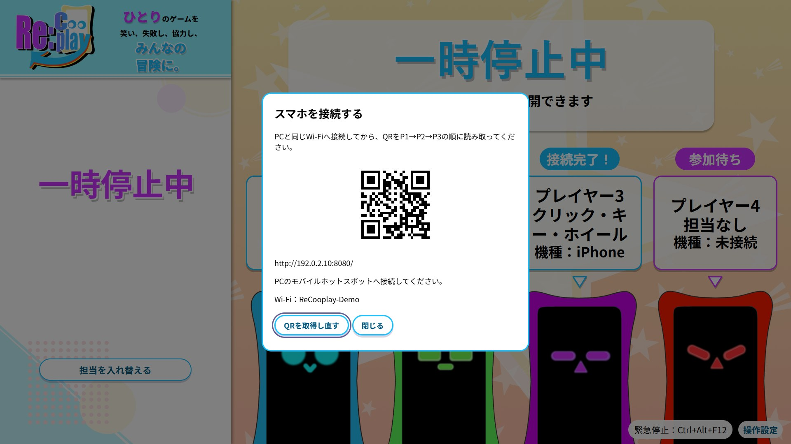</a>

PC：接続方法・URLの確認（IPアドレスは説明用のものです）

| スマホの接続・診断 |
|:--:|
| <a href="screenshots/phone-p2-05-diagnostics.jpg">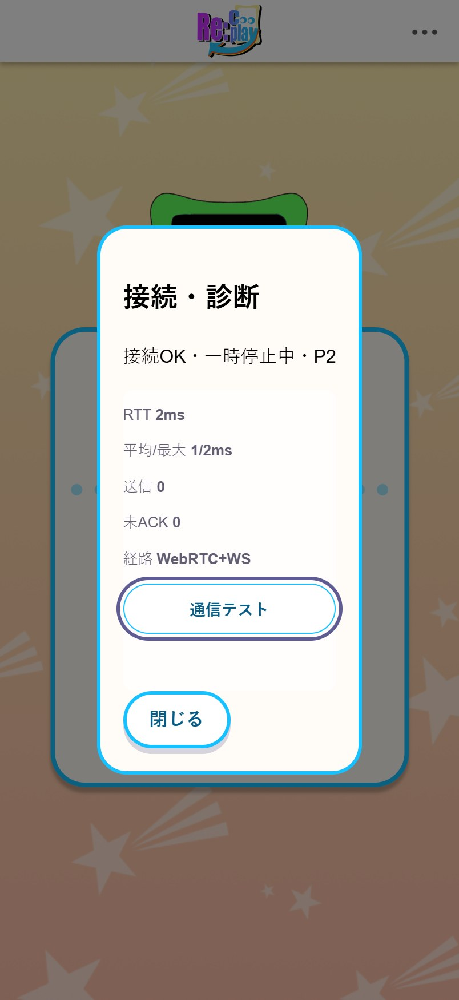</a> |
| 右上の「…」から、通信の往復時間や経路（WebRTC＋WebSocket）を確認できます |

## 8. 緊急停止

PCのキーボードで Ctrl+Alt+F12 を押すと、すぐに入力を止めて一時停止します。PCの前の人が安全を確かめて「入力を再開する」を押すまで、再開できません。

<a href="screenshots/pc-11-emergency-stop.jpg">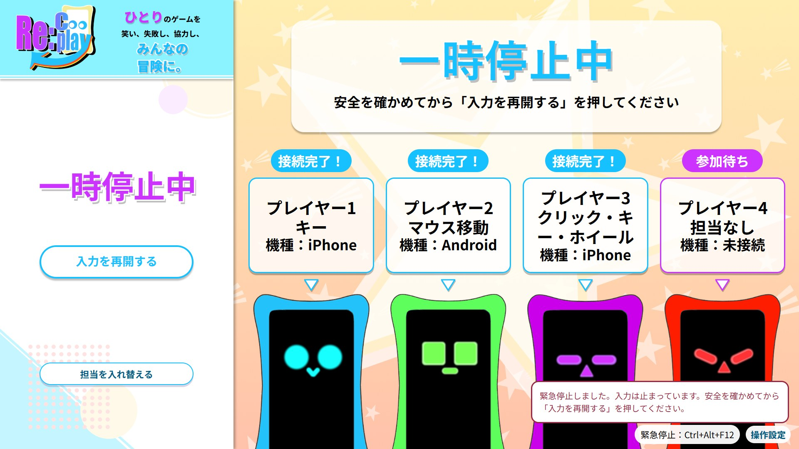</a>

PC：緊急停止の後

| P1（ホスト） |
|:--:|
| <a href="screenshots/phone-p1-05-emergency-stop.jpg">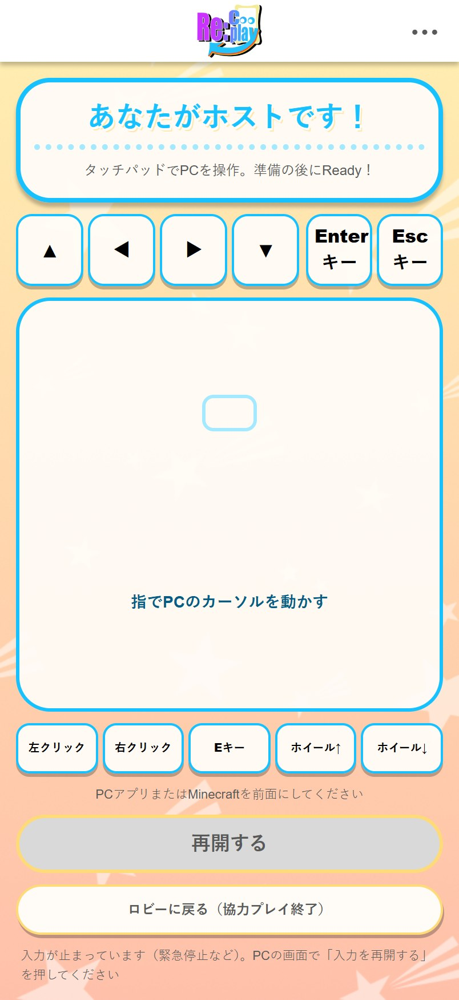</a> |
| PCで入力を再開するまで「再開する」は押せません |

---

撮影し直すときは、ホストをビルドしてから `node scripts/sim/capture-screens.mjs --bin apps/host-rs/target/release/recooplay-host.exe` を実行します（Chrome または Edge を使います）。画像は `docs/screenshots/` に保存されます。この撮影はPC上のシミュレーションで、実機での動作確認やゲームとの互換性を示すものではありません。
