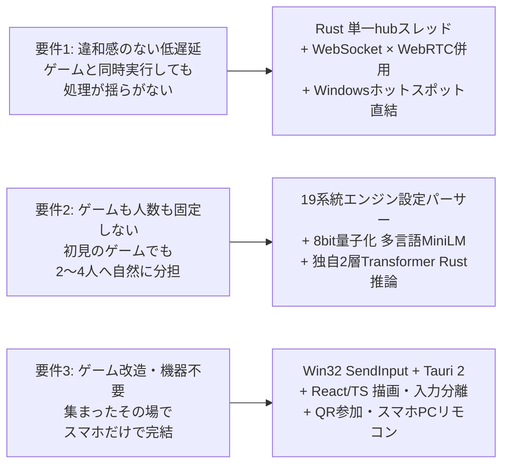
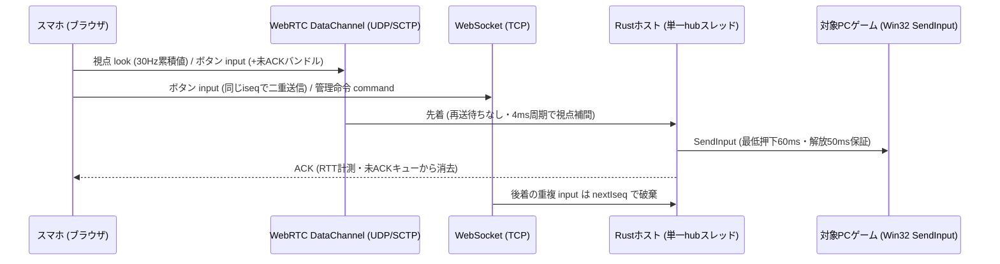

# Re:Cooplay 技術選定の理由

**バージョン**: 0.2.0　**更新日**: 2026-11-18

[総合仕様](README.md) ／ [利用手順](usage.md) ／ [動作確認](verification.md)

---

Re:Cooplayは、2〜4人のスマートフォンから同時に届く操作を1つに統合し、既存のPCゲームへリアルタイムに反映します。共同操作の楽しさを損なわないよう、**①極限まで入力の遅れを抑えること、②どんなPCゲーム・人数でも事前準備なしで遊べること、③ゲーム本体を改造せず安全・気軽に参加できること**を基準に技術を選定しました。

---

## 採用した技術と選定理由

| 領域 | 採用技術 | 選定理由 |
|:--|:--|:--|
| **PCホスト** | **Rust**（Tokio・axum・単一 `hub` スレッド） | 3Dゲームを動かしながら250Hz（4ms周期）の視点補間と入力順序制御を回すため、GC停止がなくCPU・メモリ負荷が最小限のRustを採用しました。すべての状態遷移とタイマーを専用スレッド1本で処理し、ロック競合を排除しています。 |
| **状態・制御通信** | **WebSocket**（JSON） | QR参加後のトークン認証、役割・進行状態の同期、ホストのリモコン操作、開始・停止命令など、欠落なく確実に届ける必要がある通信を担当します。 |
| **高速入力通信** | **WebRTC DataChannel**（`libdatachannel`、`ordered:false`, `maxRetransmits:0`） | 30Hzの視点移動や連打入力では、TCP（WebSocket）の再送待ち（Head-of-Line Blocking）が致命的な遅延になります。非順序・再送なしのUDPベースDataChannelを併用し、さらに直近500msの未ACK入力をバンドル送信することで、無線ロス時の遅延スパイクを抑えています。 |
| **ネットワーク** | **Windowsモバイルホットスポット（ローカルWi-Fi直結）** | 外部ルーターやクラウドを介さず、PCとスマホを1ホップで直接通信させることで往復遅延を最小化しました。起動ごとに一時SSID・パスワードを自動構成し、電波が混線しやすい展示会場でも安定した通信を実現しています。 |
| **OS入力注入** | **Windows API（`SendInput`）＋ `timeBeginPeriod(1)`** | ゲーム本体へのMOD導入や、署名・ブルースクリーンリスクのある仮想HIDドライバー導入を避け、Windows標準の `SendInput`（スキャンコード・相対マウス移動・ホイール）で非侵襲に入力を統合します。 |
| **PCデスクトップ枠** | **Tauri 2 ／ WebView2** | Chromium丸ごと同梱するElectronと比較してメモリ・CPU消費が圧倒的に小さく、ゲームとの同時実行に適しています。ホスト子プロセスの監視・自動再起動や、最前面透過オーバーレイ（`/overlay`）の表示も担います。 |
| **フロントエンド・入力エンジン** | **React 19 ＋ TypeScript strict（Vite）＋ Pointer Events API** | 5画面のUI部品化と通信境界の厳格な型検査のためにReact＋TS strictへ統一しつつ、Pointer Eventsによるスティック・視点・タッチパッド処理を描画から完全に分離して低遅延を維持しています。 |
| **ゲーム・操作自動検出** | **7系統ランチャー検出 ＋ 19系統エンジン設定パーサー（Rust）** | Steam・Epic・GOG・Xbox等の自動検出に加え、Unity・UE・Godot・RPGツクール・Source等のファイルから操作名とキー設定を直接読み取ることで、事前登録のないPCゲームにもその場で対応します。 |
| **操作分担AI** | **事前学習済み多言語MiniLM（8bit量子化）＋ 独自2層Transformer encoder** | ゲームごとに異なる操作名から「意味カテゴリ」「同じ人が持つべき操作ペア」「方向軸」を推定するため、事前学習済みBERT系モデルと独自Transformerを組み合わせました。Python不要のRustネイティブ推論（約80ms）により、配布PC単体でオフライン動作します。 |

---

## 通信を2つの経路（WebSocket＋WebRTC）に分けた理由と実測効果

共同操作では、参加・役割・一時停止などの**確実な状態共有**と、視点移動・ジャンプなどの**1フレームを争う操作入力**の両立が求められます。

### 1. 実機でのエンドツーエンド遅延測定（Rustホスト＋モバイルホットスポット）

PCのモバイルホットスポットへスマートフォンを直接接続した実機測定（計測ビルド `latency-measure`）において、以下の低遅延を達成しました。

| 測定項目 | 実測値（中央値） | 備考 |
|:--|:--:|:--|
| **Wi-Fi通信の往復遅延（RTT）** | **9.0 ms** | PCホットスポット直結時のWebRTC / WebSocket往復時間 |
| **スマホ操作 → PC入力実行（SendInput）推定遅延** | **26.0 ms** | タッチ検知（`touchMs`）＋ 片道通信（`rttMs / 2`）＋ ホスト処理〜`SendInput` 完了（`hostMs`）の合計 |

60fpsのゲームにおける1フレーム（16.7ms）〜2フレーム相当の極めて小さい遅延に収まっており、試遊アンケートでも84.6%が「担当操作を思い通りに動かせた」と回答し、「ラグを全く感じず快適」と評価されています。

### 2. 不安定な無線環境での途切れ抑制（通信試作品での比較検証）

通信方式の選定時に実施した**Node.js通信試作品**による比較試験では、無線状態が不安定なAndroid端末において、WebSocketのみでは視点操作が途切れた区間の割合が **42%**（最大往復遅延 **2,015ms**）だったのに対し、WebRTC DataChannelを併用することで **1.7%**（最大往復遅延 **221ms**）へと大幅に改善しました。

※この42%→1.7%の数値は通信試作品の特定条件で通信方式（WS単体 vs WS+WebRTC）を比較した記録であり、測定条件の詳細は [通信試作品の検証記録](develop/decisions/2026-10-24-prototype-validated.md)、現行システムの確認範囲は [動作確認の範囲](verification.md) を参照してください。

---

## 比較・検討した代替案と不採用の理由

| 比較した選択肢 | 判断と理由 |
|:--|:--|
| **Python ＋ FastAPI（初期仮案）** | OS入力とWebサーバーを記述しやすいものの、WebRTCには `aiortc`（PyAV等の重いネイティブ依存）が必要で、GILやGCによる4ms周期タイマーの揺らぎも懸念されたため、Rustへ全面移行しました。 |
| **Electron（PCデスクトップ枠）** | ChromiumとNode.jsを同梱するため配布サイズとメモリ消費が大きく、重い3Dゲームと同時実行した際のリソース競合を避けるため、OS標準のWebView2を使う **Tauri 2** を採用しました。 |
| **WebSocketのみの単一経路** | TCPの再送制御により、無線パケットが1つ欠落しただけで後続の視点移動が最大2秒近く詰まって一気にジャンプする現象が実測されたため、WebRTC DataChannelの併用を必須としました。 |
| **WebTransport / Web Bluetooth（HOGP）** | WebTransportはローカルオフライン環境での自己署名HTTPS証明書配布が障壁となり、Web BluetoothはブラウザがCentral専用かつHIDサービス（`0x1812`）がブロックリストで禁止されている（iOS Safariも非対応）ため不採用としました。 |
| **スマホ専用ネイティブアプリ** | 友達と集まったその場でApp Store / Google Playからのインストールや権限設定を求めるのは参加障壁が高いため、標準ブラウザ＋QRコードのみで即参加できるWeb方式を採用しました。 |
| **分担を定型ルールだけで作る** | 手作りの操作定義があるゲームでは安定して機能する一方、ゲームファイルから自動抽出した未知の操作名や表記ゆれに対応できないため、定型ルールをフォールバックとして残しつつ、**事前学習済みBERT系モデル（MiniLM）＋独自Transformer** によるAI分担を標準としました。 |
| **独自カーネルドライバー・仮想ゲームパッド** | 管理者権限でのドライバー導入リスクや、キーボード・マウス操作を前提とするPCゲームでの非互換を避け、まずはユーザー空間の標準APIである Win32 `SendInput` を採用しました。 |

---

## 関連資料

- [システム仕様書](README.md) — システム全体構成と状態機械
- [通信仕様書](protocol-specification.md) — WebSocketとWebRTCのメッセージ契約・順序制御
- [ホスト仕様書](host-specification.md) — Rust単一hubスレッド・入力キュー・安全停止
- [フロントエンド仕様書](frontend-specification.md) — React+TS構成と個人レイアウト編集UI
- [ゲーム操作定義仕様書](game-profile-specification.md) — 19系統エンジン自動抽出とキー設定読取り
- [分担AI仕様書](preset-model-specification.md) — MiniLM＋Transformerの構成と未知ゲーム汎化性能
- [技術構成の検証記録](develop/decisions/tech-stack.md) — 試作品からの技術判断の経緯
