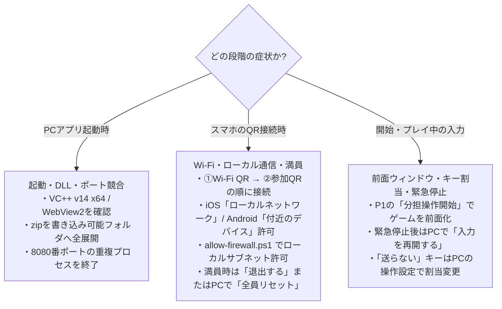
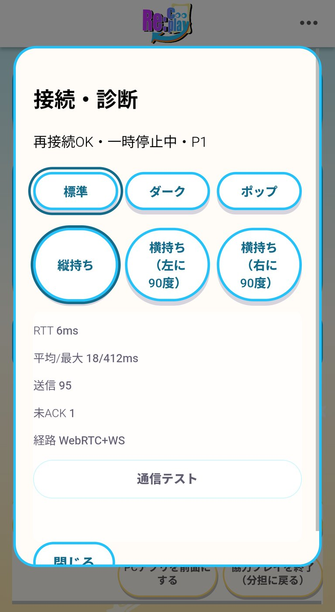
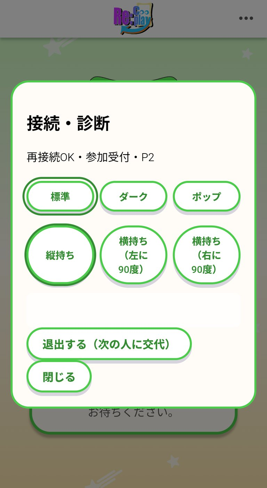

# 困ったとき

**更新日**: 2026-11-20

[導入・接続](getting-started.md) ／ [使い方](usage.md) ／ [動作確認](verification.md) ／ [総合仕様](README.md)

---

PC画面の案内メッセージとスマートフォンの接続ステータス・通信診断を確認し、症状に応じて対処します。

---

## 症状別の確認と対処

| 症状 | 原因と確認・対処方法 |
|:--|:--|
| **PCアプリが起動しない・`0xC0000135` が出る** | Windows 11 x64、WebView2、および [Microsoft Visual C++ v14 Redistributable（x64）](https://learn.microsoft.com/cpp/windows/latest-supported-vc-redist) が導入されているか確認し、zip版はすべてのファイルを書き込み可能な場所へ展開してください。 |
| **ホストがポートエラーで終了する** | 8080番ポートを別のプログラム（既に起動している `recooplay-host.exe` など）が使っています。既存のプロセスを閉じるか、`config.json` の `port`（または環境変数 `PORT`）を変更してください。 |
| **ホットスポットをONにできない** | PCが上流ネットワークに接続されていない場合など、Windowsのモバイルホットスポット機能が利用できない環境では、Windowsの「設定」→「ネットワークとインターネット」→「モバイルホットスポット」を確認するか、同じWi-Fiルーターを使用してください。 |
| **QRから参加ページが開かない** | ①先にPCのホットスポット（または同じWi-Fi）へ接続しているか確認します。 ② **iPhone**：設定 → プライバシーとセキュリティ → ローカルネットワークでブラウザをONにします。 ③ **Android**：モバイルデータ通信を一時OFFにするか、ブラウザの「付近のデバイス」権限があれば許可します。 ④ PC側で `allow-firewall.ps1` によるローカルサブネット許可を確認します（PC画面の「開けないとき」ボタンでも手順を確認できます）。 |
| **「部屋が満員です」と出る** | 4枠すべてが使用中、またはロビーで切断後15秒間の枠保持中です。交代する人がスマホ右上の `…` から **「退出する（次の人に交代）」** を押すか、PC画面の「操作設定」→ **「接続中のスマホをすべてリセット」** で枠を空けてから再読み込みしてください。 |
| **「PCでリセットされました」と出る** | PC側で全員リセットが実行されました。新しいWi-Fi（リセットで更新された場合）へつなぎ直し、スマホのブラウザを再読み込みして参加し直してください。 |
| **通信版不一致・トークン不一致が出る** | スマホのブラウザでページを再読み込みしてください。トークン不一致が続く場合はPC画面で全員リセットを実行します。 |
| **「分担操作開始」や「再開する」が押せない** | PC画面とP1スマホに表示されている理由（2人以上の接続、PC画面での「この分担で決定」、役割交換後の「新しい担当を確認しました」押下、対象ゲームの起動）を確認してください。 |
| **操作がゲームに届かない** | 協力プレイ中は**選択したゲームが前面にあるときだけ**入力を送ります。P1スマホの「ゲームを前面にする」を押すか、PCでゲームをクリックして前面にしてください。また、緊急停止（`Ctrl+Alt+F12`）の後はPC画面で **「入力を再開する」** を押す必要があります。 |
| **一部のボタンが「送らない」になる** | ゲーム側で未割当または非対応キーになっています。PC画面の「このPCのキー設定を確認」（または「操作設定」→「担当と実際に送るキー」）から、ゲーム内の設定に合わせて送るキーを変更できます。 |
| **「指を離して操作を再開」と出る** | 通信の一時的な詰まり（500ms以上の遅延）や状態切り替えにより、古い押下が安全のために破棄されました。一度画面から指を離して押し直すとそのまま操作を再開できます。 |
| **左クリックを押したまま右クリックが効かない** | PCにOrchisなどのマウスジェスチャー・マウスフック系常駐ソフトが入っている場合、合成マウスの同時押しが横取りされることがあります。該当ソフトを一時終了または無効化してください。 |

---

## 通信診断の確認方法

PC画面の「操作設定」→「通信の診断」、または各スマホ右上の `…`（接続・診断）から、端末ごとの **通信経路（`WebRTC+WS` / `WS`）**、**往復遅延（RTT）**、**未ACK件数**、**直近10秒の途切れ回数（`stalls`）** をリアルタイムで確認できます。

| ホスト：接続・診断（一時停止中） | 参加者：接続・診断（ロビー） |
|:--:|:--:|
|  |  |

スマホ右上の「…」から、RTT・経路の確認、通信テスト（協力プレイ中以外）、画面の色・持ち方の切り替え、退出（ロビーのホスト以外）ができます。

通信が途切れやすい場合は、PCのモバイルホットスポット（5GHz帯）を使用し、スマホの省電力モードやPCのBluetooth音声出力の影響を確認してください。

---

## 改善しない場合

Windows・スマートフォンのOSとブラウザ版本、対象ゲーム名、参加人数、再現手順、セッションログ（`logs/session-*.jsonl`）を添えて [GitHub Issues](https://github.com/jphacks/kz_2613/issues) で報告できます。ログにはIPアドレスやトークン・パスフレーズを出力しない設計ですが、公開前に個人環境の情報が含まれていないか確認してください。
