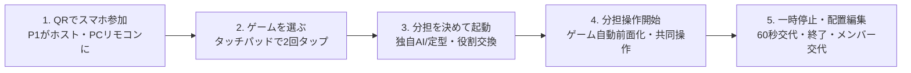
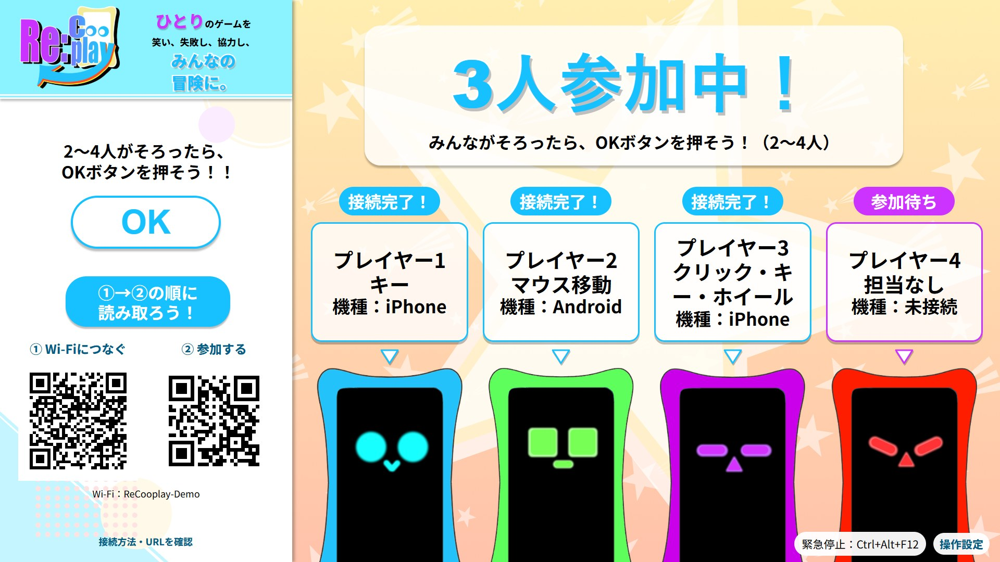
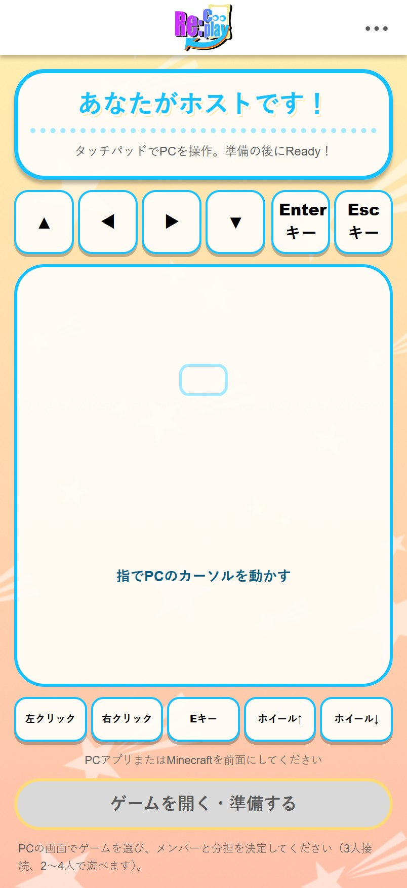
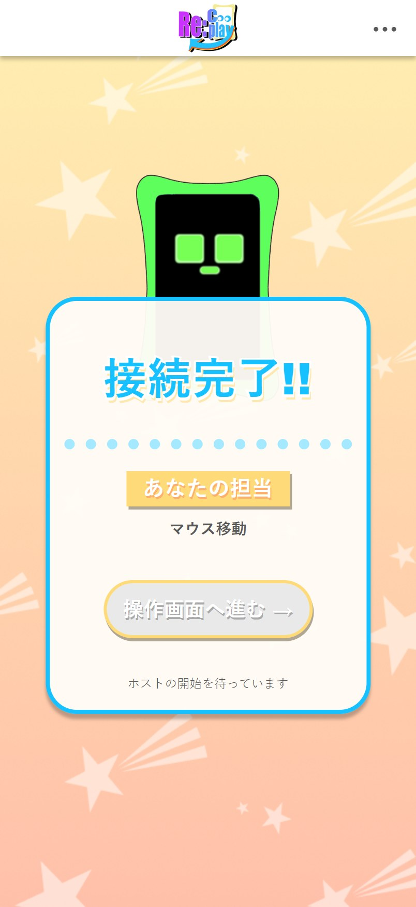
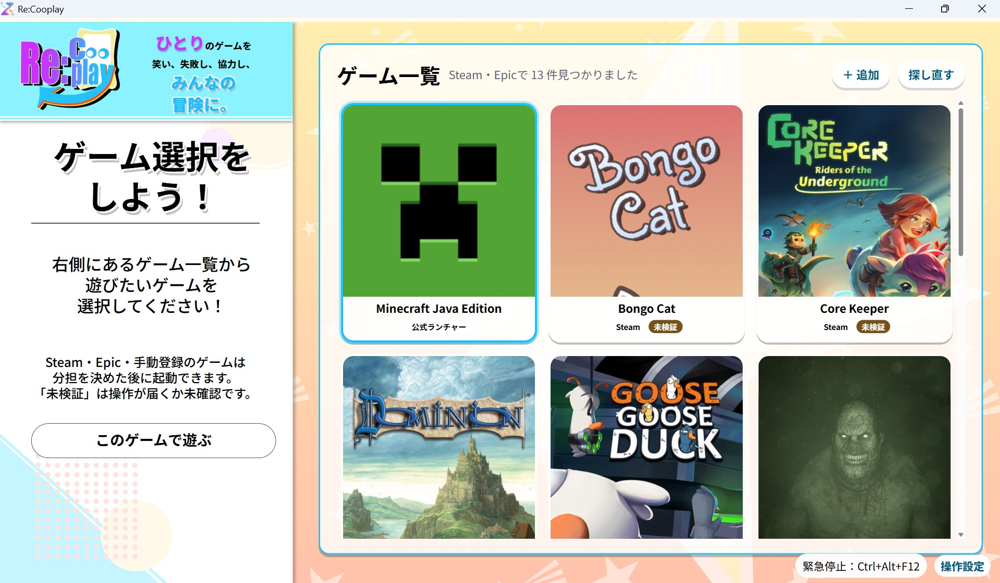
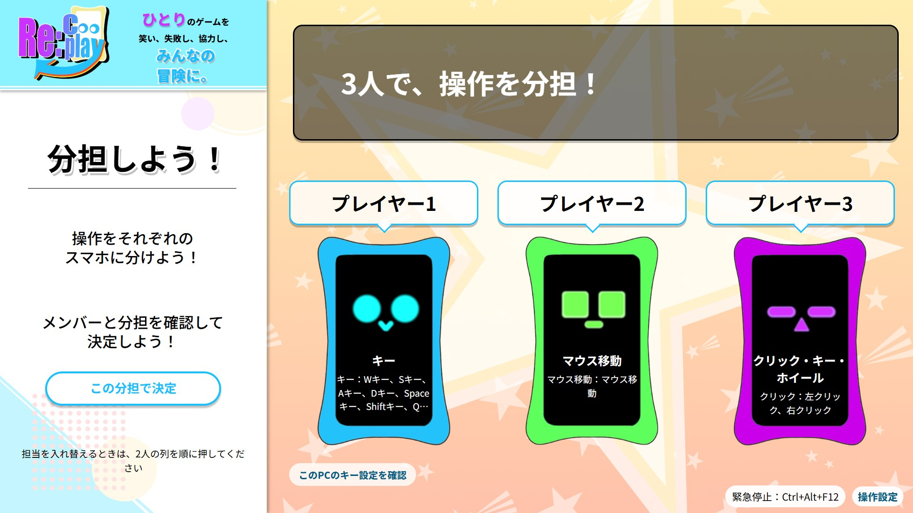
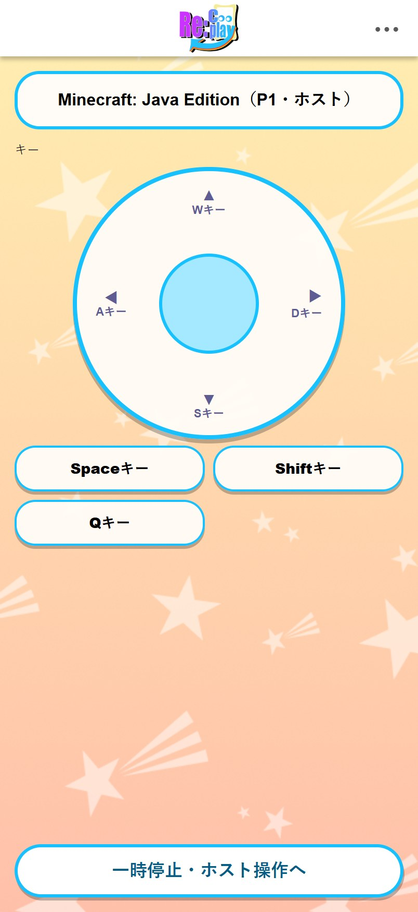
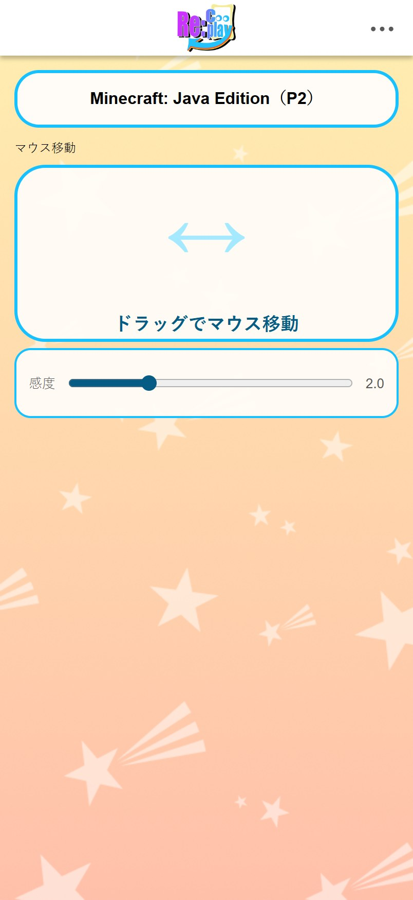
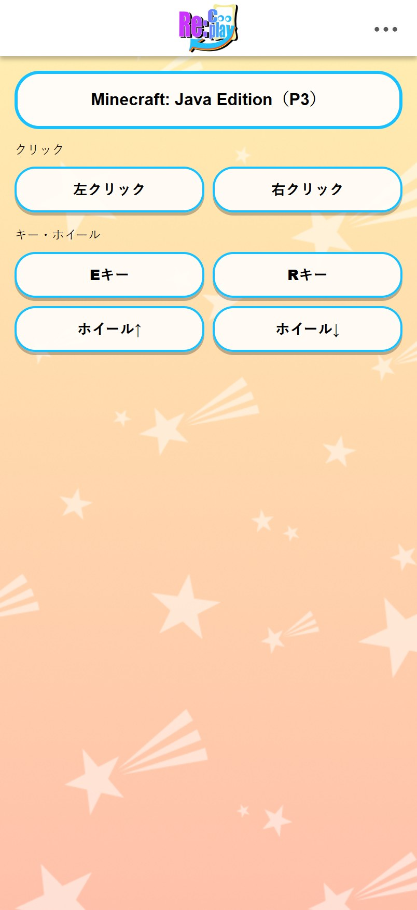

# Re:Cooplayの使い方

**更新日**: 2026-11-18

[導入・接続](getting-started.md) ／ [困ったとき](troubleshooting.md) ／ [画面一覧](screenshots.md) ／ [総合仕様](README.md)

---

PCアプリを起動してQRコードでスマートフォン2〜4台を接続し、**ホスト（P1）のスマホリモコンからゲーム選択・役割分担・プレイ開始まで一貫して操作**します。

---

## 1. スマートフォンで参加する

1. PCで `Re:Cooplay`（`recooplay-desktop.exe`）を起動します。
2. モバイルホットスポットを使う場合は、PC画面左側の **「ホットスポットをONにする」** を押します。一時的なWi-Fi（`ReCooplay-...`）が自動作成され、**「① Wi-Fiにつなぐ」QR** と **「② 参加する」QR** が表示されます。
3. 各スマートフォンのカメラで①のQRを読んでWi-Fiに接続し、続けて②のQRを読んでブラウザを開きます（2〜4人）。
4. **最初に参加した1台目がホスト（P1）** になり、スマホ画面がタッチパッド付きのPCリモコンになります。2台目以降（P2〜P4）は待機画面になります。

| PC：3人が参加した画面 | P1（ホスト）：PCリモコン画面 | P2：待機画面 |
|:--:|:--:|:--:|
|  |  |  |

- **ホストを他の人に譲る場合**：ロビーでP1スマホのリモコンにある **「ホストを移譲」** を押し、譲る相手（P2〜P4）を選ぶとホスト権とP1枠を入れ替えられます。
- **ホストのスマホのリモコン操作**：タッチパッドを1本指でなぞるとPC画面のカーソルが動き、短いタップで左クリック、2本指タップで右クリック、2本指の上下ドラッグでスクロールできます。

---

## 2. ゲームを選ぶ

1. P1のスマホリモコン（またはPCのマウス）で「ゲーム選択へ」進みます。
2. Steam・Epic Games・GOG・Ubisoft・EA・Battle.net・Xboxなどのインストール済みゲームとMinecraftがタイルで表示されます。一覧にないゲームは画面右上の **「＋ 追加」** からPCの実行ファイル（`.exe`）を選んで手動登録できます。
3. 遊びたいゲームのタイルを**2回タップ（ダブルクリック）**するか、選択して左側の「このゲームで分担へ」を押します。

  

---

## 3. メンバーと操作の分担を決めてゲームを起動する

1. 参加している人数（2〜4人）に合わせて、各プレイヤーが担当する操作と**実際にPCへ送るキー名**（「W / A / S / D」「マウス移動」「左クリック」など）が表示されます。
2. **分担の作り方を切り替える（任意）**：画面下部で **「独自AI」**（既定）と **「定型ルール」** を切り替えたり、「割り当てを作り直す」で再生成したりできます。
3. **担当を入れ替える（任意）**：交換したい2人の列を順にクリックすると担当を入れ替えられます。入れ替えた場合は、対象者のスマホに出る **「新しい担当を確認しました」** を本人が押します。
4. **分担を決定して起動する**：左側の **「この分担で決定」** を押し、続けて **「ゲームを起動する」** を押します。
   - **Minecraftの場合**：公式ランチャーが開いて前面に出るので、P1スマホのリモコン（タッチパッドと左クリック）でランチャーの「プレイ」を押し、ワールドに入ります。

| PC：分担の確認 | PC：分担決定・ゲーム起動 |
|:--:|:--:|
|  |  |

---

## 4. 「分担操作開始」で共同プレイを始める

1. ゲームが起動してプレイしたい画面まで進んだら、P1のスマホ下部にある **「分担操作開始」** を押します（ゲームが背面にあっても自動で前面に切り替わります）。
2. 全員のスマホがそれぞれの担当コントローラーに切り替わり、共同操作（`coop`）が始まります。

| P1：移動スティック＋ボタン | P2：視点ドラッグパッド | P3：アクション＋ホイール |
|:--:|:--:|:--:|
|  |  |  |

### スマホ操作画面のカスタマイズ（個人レイアウト編集・横持ち設定）

- **ボタンの位置・大きさ・複製の編集**：プレイ画面右上の**ペンアイコン（配置を編集）**を押すと、編集中は入力を止めた状態で、ボタンやスティックをドラッグで移動したり、四隅・辺のハンドルで縦横サイズを変えたり、長押しメニューから同じボタンを複製・非表示にしたりできます。「保存」を押すとそのスマホに保存されます。
- **回転ロックのまま横持ちで遊ぶ場合**：スマホ右上のメニュー（`…`）→「持ち方」から **「横持ち（左が上）」** または **「横持ち（右が上）」** を選ぶと、手元の向きに合わせてスティックと視点の上下左右が切り替わります。

---

## 5. 一時停止・役割ローテーション・再開

- **一時停止**：P1スマホの右上にある**一時停止ボタン（`||`）**を押すと、全員の押下キー・マウスボタンを即座に解放して一時停止（`paused`）し、P1のスマホはPCリモコンへ戻ります（ゲーム本体のポーズメニューを開く場合はリモコンの `Esc` を押します）。
- **一時停止中の役割交換・人数変更**：一時停止中にも担当の入れ替えや、PC画面の「今のN人で分担し直す」による人数の組み直しが可能です。本人がスマホで確認した後、P1が **「再開する」** を押すと共同プレイに戻ります。
- **60秒ごとの役割ローテーション**：開始前または一時停止中にPC画面の「操作設定」→「遊び方」→「時間で担当を交代する」を **「60秒ごと」** にすると、共同プレイを止めずに60秒ごとに担当が1つずつ回ります（5秒前に次の担当が画面上部で予告されます）。

---

## 6. 終了・参加者の交代・緊急停止

- **プレイを終了して分担画面へ戻る**：一時停止中にP1スマホの「ゲーム選択へ戻る」（または終了）を押すと、ゲームを起動したままロビー（分担画面）へ戻ります。
  - **参加者を一部交代する**：交代する人が自分のスマホ右上の `…` から **「退出する（次の人に交代）」** を押し、PC画面の **「新たな参加者を受け付ける」** で参加QRを出して次の人を参加させます。
  - **全員を交代する**：PC画面の「操作設定」→ **「接続中のスマホをすべてリセット」** を実行すると、全員を切断し、Re:Cooplayが起動したホットスポットのWi-Fi名とパスワードも新しいものに自動更新して次のグループを迎えられます。
  - **ゲーム自体を閉じて別のゲームを選ぶ**：PC画面左側の **「ゲームを終了する」** を押すと、ゲームに閉じる操作を送ってゲーム選択画面へ戻ります。
- **緊急停止（`Ctrl+Alt+F12`）**：PCのキーボードで `Ctrl+Alt+F12` を押すと、いつでも即座に全キーを解放して入力をOFFにします。再開するときはPC画面で安全を確認して **「入力を再開する」** を押してから、P1スマホで再開します。
