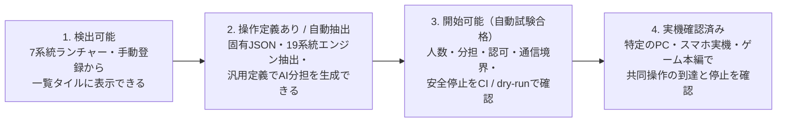

# 動作確認の範囲

**更新日**: 2026-11-18

[総合仕様](README.md) ／ [導入・接続](getting-started.md) ／ [ギャラリー](gallery.md) ／ [リリース判定チェックリスト](develop/acceptance/release-readiness.md)

---

ゲームの自動検出、操作定義の抽出、開始条件の成立、CIでの自動シミュレーション試験、および実機でのゲーム入力到達は、それぞれ明確に区別して記録・管理しています。

## 製品通信と試験経路の方針

[2026-11-09のユーザー判断](develop/decisions/2026-11-09-wifi-product-baseline.md)により、製品利用と性能受入は**ローカルWi-Fi（PCのモバイルホットスポットを含む）**を前提としています。USB/ADB reverseは開発・原因切り分け用の補助手段であり、無線受入の代替にはしません（ADBを端末操作のトリガーに使う場合も、製品のHTTP/WebSocket/WebRTCが実Wi-Fiを通ることを確認して測定しています）。

---

## 機能別の確認状況（2026-11-18時点）

| 対象領域 | 自動試験・実機で確認できていること | 残る確認・既知の制限 |
|:--|:--|:--|
| **『Minecraft Java Edition』の2〜4人共同操作** | Windows 11 PC＋スマホ実機（iPhone Safari・Android Chrome）で**2人・3人・4人の共同操作**、担当外入力の遮断、5台目の満員拒否（`4004`）を実機確認（2026-10-25、2026-11-13）。試遊アンケート26名全員が「楽しかった」「また遊びたい」と回答 | 異なるPC環境・長時間連続プレイ・全異常系組み合わせの反復受入 |
| **『Outlast』『Terraria』『Among Us』での共同操作** | 『Outlast』2人実プレイ動画、『Terraria』紹介動画実演、『Among Us』（Steam）でのTauri PCアプリ＋ホットスポットQR参加＋スマホリモコン＋共同操作＋ゲーム終了までの実画面通し確認（2026-11-16） | 各タイトルの全シーン・全停止条件での網羅的受入 |
| **定義のないゲームからの操作自動検出＋独自AI分担** | 19系統エンジンパーサーの単体・抽出試験、未学習Unity・Godot 57本（分類**88.1%**・振分**94.5%**）および実ゲーム30本（分類**87.4%**・振分**89.3%**）での汎化評価、定義のないRPGツクールXP製**『青鬼』での自動抽出＋独自AI 3人分担による実機全操作到達**（2026-11-15、#432・#512） | 他エンジン作品での実ゲーム網羅確認（暗号化アーカイブやEnhanced Input等は対象外） |
| **低遅延通信（WebSocket＋WebRTC＋ホットスポット）** | 実機測定で**Wi-Fi往復遅延中央値 9.0ms**、**スマホ操作→PC `SendInput` 実行までの推定遅延中央値 26.0ms**を達成。未ACK入力のDataChannelバンドル送信（#451）、500ms遅延押下の自動破棄（#285）、展示会場の混線環境での安定動作を確認 | 一部iPhone端末での連続タップ遅延（#437）・Android無通信張り直し（#426）の継続調査 |
| **スマホUI（React+TS・個人レイアウト編集・横持ち）** | 5画面すべてのReact+TS strict化、スマホ上でのボタン移動・縦横自由リサイズ・複製・保存（#271・#516）、回転ロック時の横持ちスティック・視点90度変換（#514）、P1リモコンのダブルタップ選択（#445）をCIおよびAndroid実機（実Wi-Fi）で確認 | iPhone実機でのレイアウト編集・回転ロック横持ちの追試 |
| **開始・交代・展示向けWi-Fi管理** | ロビーからの「分担操作開始」ワンステップ開始と背面の対象ゲーム自動前面化（#440・#556）、60秒役割ローテーション（#161）、ホスト移譲（#233）、参加者の自主退出（#546）、PCからのゲーム安全終了（#547）、起動時・全員リセット時の一時Wi-Fi生成と切り替え・終了時OFF（#562・#563・#576）をCIおよびAndroid実機で確認 | 複数iPhone混在時のWi-Fi張り直し通し確認 |
| **安全停止・異常終了復旧** | 切断・PAUSE・フォーカス喪失・緊急停止（`Ctrl+Alt+F12`）・終了時の全出力即時解放、`SendInput` 失敗時の50ms×3回再試行、`hub` パニック時の `catch_unwind` 全解放＋Tauri側の自動再起動（最大3回、#222・#517・#522）を単体試験・通信シミュレーション・Android実機Wi-Fi切断で確認 | 物理ホットキー・Alt+Tab・通信断の全組み合わせ実機試験 |
| **配布zip・NSISインストーラー** | `package.ps1`（`preset-model-v2` 同梱・SHA-256マニフェスト照合・`package-smoke.mjs`）および `build-installer.ps1`（NSISサイレント導入・更新・削除・Authenticode署名検証・`installer-smoke.mjs`）をWindows CIで毎回自動検証 | 開発環境・ランタイム未導入のクリーンPCでの対話導入受入、コード署名証明書の付与 |

---

## ゲーム対応の4段階の区別

| 段階 | 意味 |
|:--|:--|
| **1. 検出可能** | 7系統のランチャー（Steam・Epic・GOG・Ubisoft・EA・Battle.net・Xbox）または手動登録からゲームを一覧に表示できる |
| **2. 操作定義あり ／ 自動抽出可能** | 手作りの操作定義JSON（`apps/game-profiles/`）があるか、19系統のエンジンパーサーでゲームのファイルから操作一覧を抽出できる |
| **3. 開始可能** | 2〜4人の分担生成・キー解決・入力先条件を満たし、`READY`（分担操作開始）を受け付けられる |
| **4. 実機確認済み** | 特定のゲーム版・参加人数・スマートフォン実機で、ゲーム本編内のキャラクターが意図どおりに動き安全に停止できることを確認した記録がある |

参考カタログ502件（`docs/develop/data/top500-games.json`）はスキーマとAI分担の網羅検証データであり、502タイトルの実機動作保証を示すものではありません。

---

## 記録と検証エビデンスへのリンク

- [製品紹介・実演動画・試遊アンケート結果](../README.md)
- [PC・スマホの画面一覧](screenshots.md) ／ [実プレイ動画・写真ギャラリー](gallery.md)
- [一般向けリリースの判定チェックリスト](develop/acceptance/release-readiness.md)
- [Award Day 実機受入試験手順・記録](develop/acceptance/README.md)
- [開発・自動試験・実機受入の時系列ログ（BUILD_LOG）](develop/handoff/BUILD_LOG.md)
- [CIの検証範囲（9つの必須チェック）](develop/handoff/CI_VERIFICATION.md)
- [通信回帰シミュレーション](../scripts/sim/protocol-sim.mjs) ／ [カタログ・AI分担網羅試験](../scripts/sim/profile-catalog-test.mjs)
